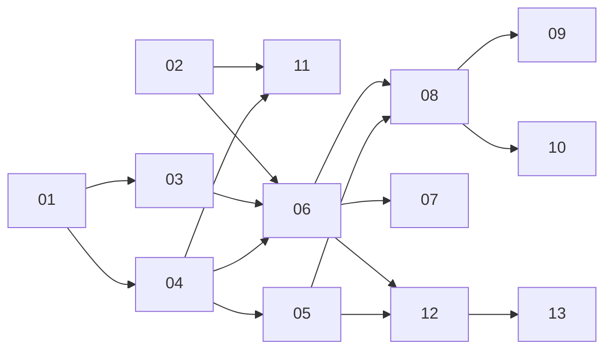

# AI 执行计划工单导航

此文件仅作导航，不是工单；各票的完整内容和验收标准见对应文件。状态为 ready-for-agent 表示批准实施，不表示依赖已经解除。初始可领取 01 和 02，建议先做 01 的薄入口重构。

| 编号 | 工单 | 阻塞于 |
| --- | --- | --- |
| 01 | [共享 UI 与 MCP 运行入口](01-shared-run-entry.md) | 无 |
| 02 | [MCP 完整事件树与修订并发](02-mcp-events-revision.md) | 无 |
| 03 | [绑定环境的运行快照](03-run-snapshot.md) | 01 |
| 04 | [异步启动与查询 Run](04-async-run.md) | 01 |
| 05 | [进度与本地中断记录](05-progress-recovery.md) | 04 |
| 06 | [完整步骤暂停并手动继续](06-step-pause.md) | 02、03、04 |
| 07 | [嵌套循环中暂停和恢复](07-loop-resume.md) | 06 |
| 08 | [暂停后保存并刷新剩余引用](08-saved-refresh.md) | 05、06 |
| 09 | [步骤覆盖冲突选择](09-override-conflicts.md) | 08 |
| 10 | [执行范围变更审阅](10-scope-review.md) | 08 |
| 11 | [显式依赖与失败传播](11-dependency-failure.md) | 02、04 |
| 12 | [有界取消与远端结果未知](12-cancel-unknown.md) | 05、06 |
| 13 | [运行期间 MCP 权限撤销](13-mcp-revocation.md) | 12 |

