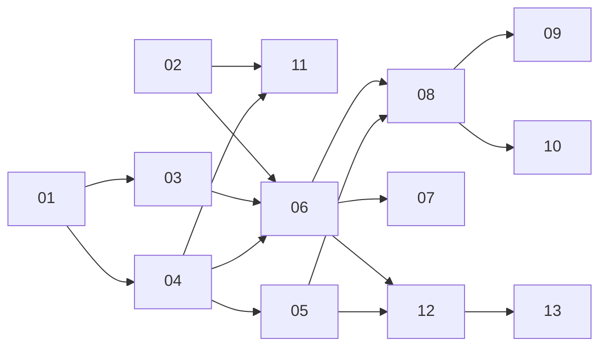

# AI 执行计划工单导航

13 张工单均为 resolved，完整实现及各票验收记录见下表。规格与最终审查于 2026-11-03 完成。依赖列保留实施顺序的追溯信息。

| 编号 | 工单 | 阻塞于 |
| --- | --- | --- |
| 01 | [共享 UI 与 MCP 运行入口](01-shared-run-entry.md) | 无 |
| 02 | [MCP 完整事件树与修订并发](02-mcp-events-revision.md) | 无 |
| 03 | [绑定环境的运行快照](03-run-snapshot.md) | 01 |
| 04 | [异步启动与查询 Run](04-async-run.md) | 01 |
| 05 | [进度与本地中断记录](05-progress-recovery.md) | 04 |
| 06 | [完整步骤暂停并手动继续](06-step-pause.md) | 02、03、04 |
| 07 | [嵌套循环中暂停和恢复](07-loop-resume.md) | 06 |
| 08 | [暂停后保存并刷新剩余引用](08-saved-refresh.md) | 05、06 |
| 09 | [步骤覆盖冲突选择](09-override-conflicts.md) | 08 |
| 10 | [执行范围变更审阅](10-scope-review.md) | 08 |
| 11 | [显式依赖与失败传播](11-dependency-failure.md) | 02、04 |
| 12 | [有界取消与远端结果未知](12-cancel-unknown.md) | 05、06 |
| 13 | [运行期间 MCP 权限撤销](13-mcp-revocation.md) | 12 |

## 最终审查与验收

- 已修复 4 项规格问题：数字及布尔敏感值在 MCP、UI、Run 与发送记录中统一脱敏；外部文件变化保留活动 Run 并暂停审查，显式采用后从原位置继续；继续原快照校验下一请求前置条件，允许待执行请求或脚本先产生变量并在实际发送前再次校验；未勾选环境变量与空 current value 保持普通发送语义。
- 文件审查保留流程锁、执行游标与已完成结果；逻辑步骤前脚本和接口前脚本各执行一次，取消可退出审查且不发送后续请求。新增真实 Electron 文件审查操作覆盖预览、范围确认、采用及手动继续。
- 标准审查未发现硬性规则违例；活动 Run 状态收敛为 `src/shared/flow.ts` 的穷尽类型表，由恢复、删除保护、界面轮询及退出活动查询共用。ADR-0008 已更新实现状态。
- 1180px Electron 实际界面确认结果标题单行、控制按钮在面板内换行；保存、冲突选择、范围确认、采用与继续保持独立操作。
- 最终验证通过：`npm run typecheck`（node/web）、`npm run build`、全部 20 个 `test:flow-*` 脚本（14 个真实存储/loopback/IPC/MCP 回归，6 个实际 Electron UI 操作）、`git diff --check`。文件 UI 测试首次因“已暂停”同时出现在历史与结果栏而命中严格选择器，限定结果栏后重跑通过。
- 新增前置条件回归：`scripts/flow-prerequisites-smoke.ts`；文件 UI 回归：`scripts/flow-file-review-ui.cjs`。既有 snapshot/progress 测试补充文件审查、无重放、环境兼容与数字凭据持久化验证。
- 完整 `npm run smoke` 已重跑：更新公开 Run 明文 token 的过期断言，改为验证 loopback `/orders` 恰好收到一次正确 Bearer token，同时公开证据脱敏；TCP 与 stdio 工具目录包含新增 4 个 Run 工具且保持一致。登录/token、MCP 与 MQTT 验证通过后，仅停在实施前已有的文档断言 `doc html excludes orphan field docs`；未修改文档服务以掩盖该基线问题。

## 第二轮审查修复与验收（2026-11-03）

- 修复两项 P1：逻辑组只继承当前相邻成员、完整 `iteration_path` 中已经成功的准入；前一轮、非相邻同组或纯跳过成员不能绕过中间失败。显式独立组仍可完整执行，既往失败仍保守传播。
- 认证脱敏使用捕获的有效认证及发送前已解析认证值，覆盖继承、自定义 API Key header/query、运行变量、接口前脚本和 Basic；Run 内累积原值及 URL 编码形式，刷新认证后保留旧凭据的脱敏上下文。预览、进度、控制响应、console、最终及落盘 Run、发送历史共享投影，运行和实际网络请求仍使用原值。
- 修复协议元数据脱敏：显式 Run、Event、发送记录、审阅与版本切换结构保护真实状态、类型及标识；任意响应 JSON、变量、Header、console 参数保持数据语义，同名 `status`、`type`、`run_id` 仍隐藏已知凭据。包含 token 字样的事件名称不会改变结构或产生虚假的 value 字段。
- 修复嵌套容器的暂停边界：容器位于外层相邻逻辑组时，子边界等待外层后置脚本和断言完成；普通嵌套循环仍在子逻辑步骤边界暂停。文件审查、权限撤销和取消入口保持独立有效。
- 完成两项 P3 维护建议：共享 Environment 选择策略；共享循环上限和 continuation frame 后缀/剩余轮数解释，剩余引用计数与下一事件查找保留各自聚合。
- 新增 `test:flow-review-regressions`，沿已确认的公开服务/真实存储/loopback 边界逐项先失败再修复。额外覆盖非相邻分组、禁用成员、敏感值与协议枚举/标识碰撞、正常业务值保留、前脚本动态凭据及后脚本覆盖变量、Basic、认证刷新前后所有证据和外层完整逻辑组暂停。
- 验证通过：node/web `typecheck`、`build`、原 20 项 flow 脚本与新增回归、`git diff --check`。最终依赖调整后重跑新回归、dependency 和 nested-loop 测试通过。文件 UI 的精确可访问名称因 Ant Design 的 loading 图标前缀超时；读取真实按钮与 Run 后，将该单一 locator 改为同组测试已有的正则方式，真实审阅、采用、手动继续和上传内容断言通过。
- 未修改已知无关的完整 smoke 文档断言问题，未执行 push。
