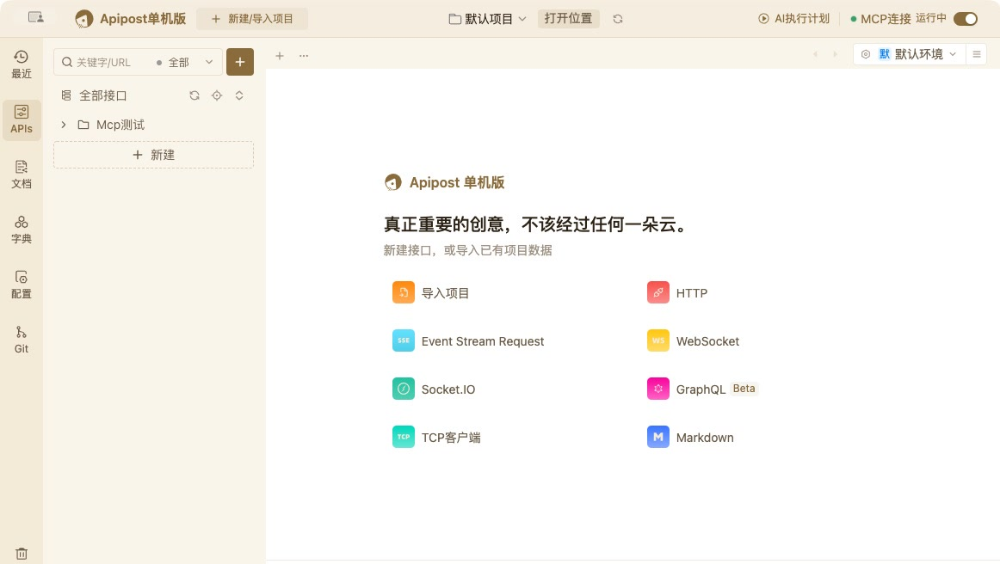
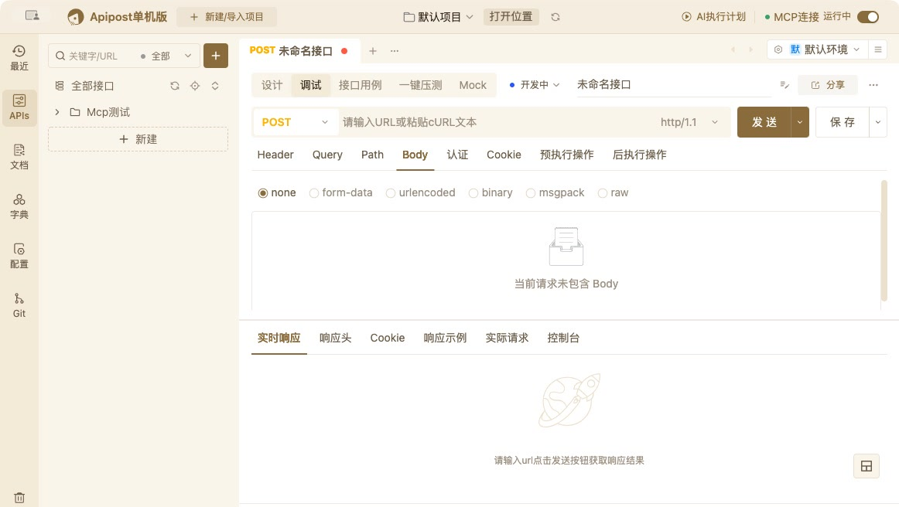
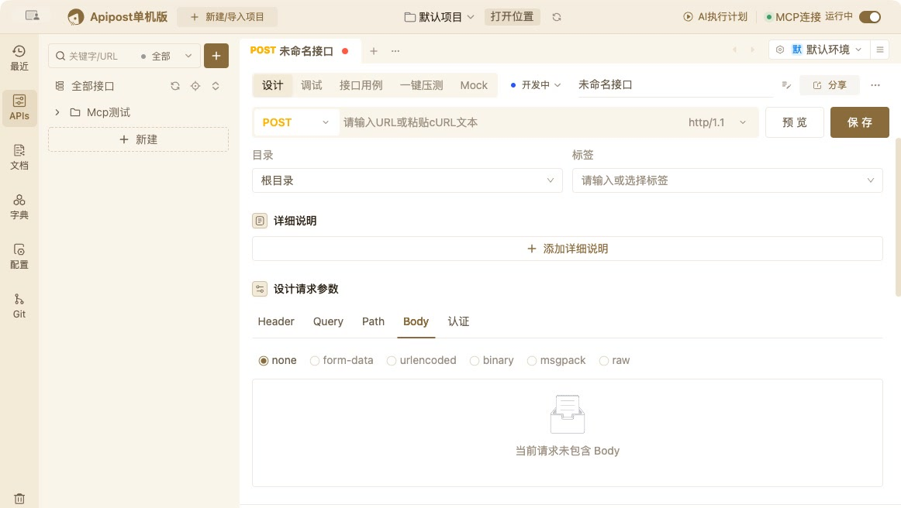
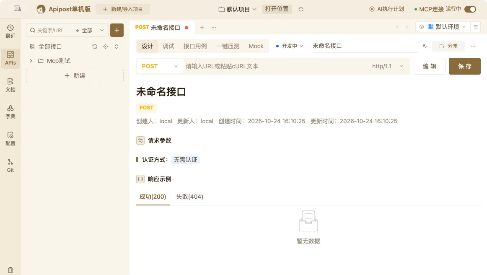
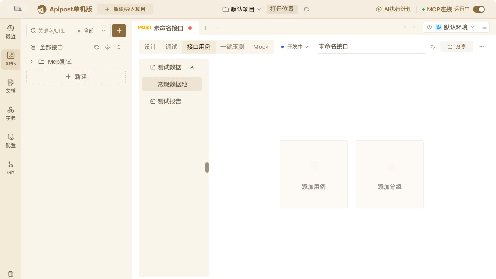
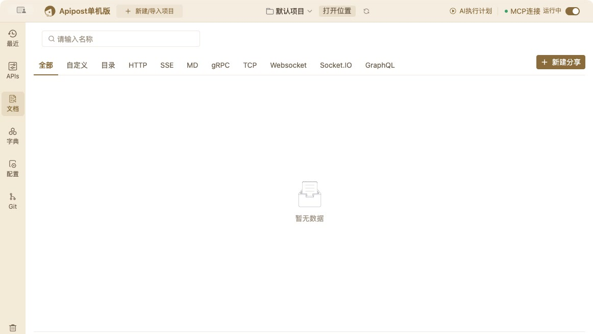
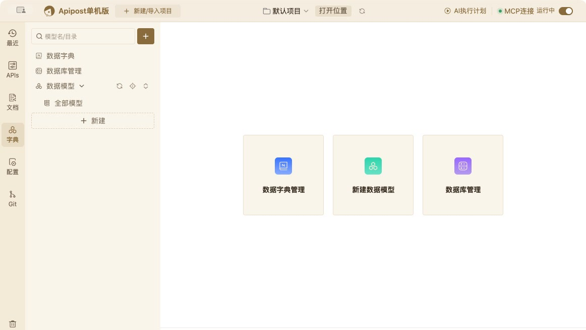
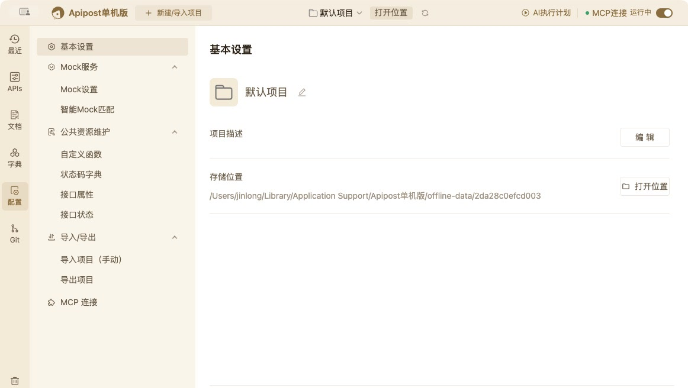
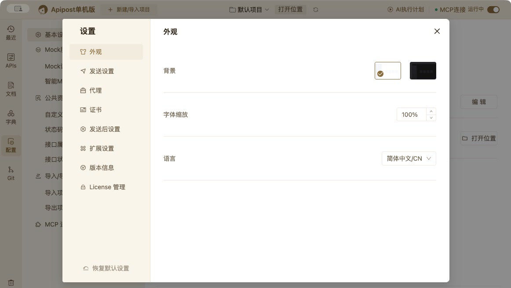
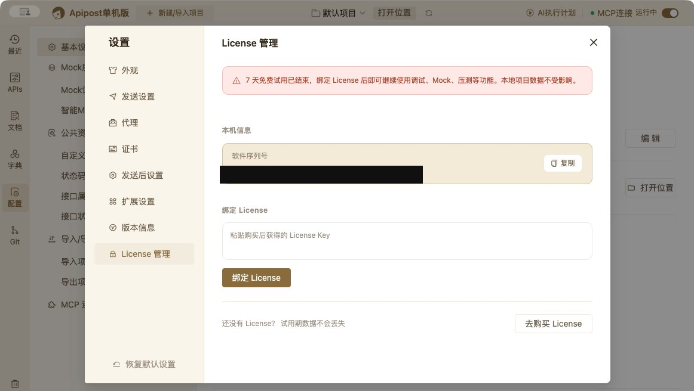

# 09 · UI 设计与界面分析

> 分析对象：`/Applications/Apipost单机版.app`（v2.0.0 / commit `c70703637`）
> 渲染层：`build/work.asar`（React 18 + Ant Design 5 + styled-components + Zustand + Monaco）
> 本文目标：还原它的**视觉语言、布局骨架、页面结构与交互模式**，作为自研 UI 的参考规范。

---

## 1. 结论速览

1. **它不是“紫厂风”**：实机默认是**暖米白 + 金棕色**（`theme_color=golden`、`bg_color=white`），紫色 `#835CFF` 只用于 AI 相关入口与 AI 生成内容。
2. **外壳极简、内容密度高**：自定义标题栏 + **约 48–50px 左侧图标导航** + 可拖拽侧栏（默认 15%）+ 暖白内容区 + 28px 底部状态栏。源码顶栏高度是 **44px**（`1550` chunk 的 `height: 44px`），实机截图视觉约 48px，差异应来自渲染缩放；复刻以 44px 为基准。
3. **三栏式 API 工作区**：左树 → 标签页 → 上下/左右可切换的「请求 / 响应」分屏。
4. **自研组件 + antd 深度换肤**：antd 前缀被改为 `apipost-`，大量组件通过 `theme.components` 覆盖为 4px 圆角、12/14/16 字号、无阴影、低对比边框；二级导航使用分段式胶囊（Segmented）。
5. **中文优先**：内置 `zh-cn / zh-tw / en / ja / id`，文案资源完整，可直接作为复刻时的 UI 词典。
6. **实机已走查**：最近、APIs、设计/调试/用例/压测/Mock、预览、文档、字典、项目配置、全局设置、License 等页面均已通过 computer-use 实际打开确认（见第 10 节）。

---

## 2. 设计语言（Design Tokens）

### 2.1 主题色盘

主题色由用户配置 `theme_color` 选择，源码中定义 10 种，默认 `golden`。**注意：当前实机版本的外观设置只暴露“背景（白/暗）、字体缩放、语言”，没有把主题色选择器放出来**；下表是源码中可用的色板，复刻时可自行决定是否开放。

| key | 色板值 | 说明 |
|---|---|---|
| `golden` | `#B49461` | **默认**，金棕/纸感 |
| `orange` | `#fa8c16` | 橙 |
| `blue` | `#5f80e9` | 蓝 |
| `green` | `#61cba0` | 绿 |
| `pink` | `#e2578d` | 粉 |
| `purple` | `#6366C5` | 紫 |
| `lakeblue` | `#5BBFD4` | 湖蓝 |
| `pinkpurple` | `#FF6F61` | 珊瑚 |
| `deongaree` | `#4971a6` | 深蓝 |
| `windred` | `#9b6065` | 酒红 |

> 色板值用于设置页的色块与部分基础令牌；实际亮色主题会派生出更深的 `colorPrimary` 以保证对比度（golden → `#8A6B3B`）。

### 2.2 亮色令牌（默认：white + golden）

| 令牌 | 值 | 用途 |
|---|---|---|
| `colorPrimary` | `#8A6B3B` | 主色 / 选中态 / 链接 |
| `colorPrimaryOpacity` | `rgba(156,124,74,.08)` | 主色浅底 |
| `colorPrimaryActive` | `#715830` | 按下态 |
| `colorBgPage` | `#FAF5EA` | 页面底色 |
| `colorBgRight` | `#FFFFFF` | 卡片/弹窗；实机编辑区更接近 `colorBgPage` 的暖白，纯白只出现在弹窗与卡片 |
| `colorBgFolder` | `#F3EAD8` | 左侧导航 / 标题栏邻近色 |
| `headerBgColor` | `#F4EDDF` | 顶栏 |
| `searchBgColor` | `#FAF5EA` | 搜索框 |
| `tableHeaderBgColor` | `#F3EAD8` | 表头 |
| `popoverSelectBgColor` | `#FFFFFF` | 弹层 |
| `popoverSelectBgHoverColor` | `#F3EAD8` | 弹层 hover |
| `colorBgFolderHover` | `rgba(156,124,74,.14)` | 导航/树选中 |
| `colorBorder` | `rgba(147,117,63,.16)` | 常规边框 |
| `colorBorderLight` | `rgba(147,117,63,.32)` | 强边框/勾选框 |
| `dividerColor` | `rgba(147,117,63,.16)` | 分隔线 |
| `iconColor` | `#9C9080` | 图标 |
| `fontTitleColor` | `#2C2214` | 标题 |
| `fontContentColor` | `#6B5D48` | 正文 |
| `fontLightColor` | `#9C9080` | 次要文字 |
| `fontPaleColor` | `rgba(107,93,72,.7)` | 更弱文字 |
| `modalContentBg` | `#FFFFFF` | 弹窗 |
| `modalMaskBg` | `rgba(58,46,28,.5)` | 遮罩 |
| `boxShadowModalColor` | `rgba(44,34,20,.08)` | 弹窗阴影 |
| `scrollbarThumbBgColor` | `#EAE0CB` | 滚动条 |
| `colorPurple` | `#835CFF` | AI 强调色（非主色） |

### 2.3 暗色令牌

由 `bg_color=dark` 触发，主色也随之提亮（golden → `#E4C990`）：

| 令牌 | 值 |
|---|---|
| `colorPrimary` | `#E4C990` |
| `colorBgPage` | `#17140F` |
| `colorBgRight` | `#1D1913` |
| `colorBgFolder` | `#241F17` |
| `headerBgColor` | `#14110D` |
| `tableHeaderBgColor` | `#241F17` |
| `colorBorder` | `rgba(196,164,115,.14)` |
| `colorBorderLight` | `rgba(196,164,115,.28)` |
| `iconColor` | `#7D7568` |
| `fontTitleColor` | `#F1E9D8` |
| `fontContentColor` | `#B9AE9A` |
| `fontLightColor` | `#7D7568` |
| `modalContentBg` | `#1D1913` |
| `modalMaskBg` | `rgba(10,8,6,.7)` |
| `scrollbarThumbBgColor` | `#2A241A` |
| `colorPrimaryOpacity` | `rgba(196,164,115,.1)` |
| `colorPurple` | `#7958F0` |

> 【事实】暗色并不止上表：`searchBgColor`、`popoverSelectBgColor`、
> `popoverSelectBgHoverColor`、`colorBgFolderHover` 也需要单独覆盖，
> 否则换肤后会出现亮色残留。具体值未逐一提取，复刻时按亮色同名令牌映射。

### 2.4 语义色

| 语义 | 值 | 用途 |
|---|---|---|
| Error | `#ff583e` | 删除、失败、必填 |
| Error BG | `rgba(249,40,20,.1)` | 错误浅底 |
| Success | `#26CEA4` | 成功、通过 |
| Success BG | `rgba(12,187,82,.1)` | 成功浅底 |
| Warning | `#ffb400` | 警告 |
| Warning BG | `rgba(255,180,0,.1)` | 警告浅底 |
| Info | `#097bed` | 信息 |
| AI Purple | `#835CFF` | AI 按钮/标签/图标 |
| AI 修改标记 | `#cf7b2e` | 执行计划中的 AI 写入内容 |
| 冲突提示 | `#ffc01e` | 标签页冲突图标 |

### 2.5 字体、字号与间距

- 根字体：`-apple-system, BlinkMacSystemFont, 'PingFang SC', 'Microsoft YaHei', sans-serif`
- 等宽：`ui-monospace, SFMono-Regular, Menlo, Consolas, 'Liberation Mono', monospace`
- 字号阶梯：`12 / 14 / 16`（由 `font_scale` 百分比缩放，默认 100%）
- 行高：`1.4`
- 字重：正文 400，区块标题 500–600，页面标题 600
- 间距令牌：`8 / 10 / 12 / 14 / 16 / 18 / 20`
- 圆角：默认 `4px`；导航块 `6px`；卡片/弹窗 `8px`；胶囊 `9/36/40px`
- 滚动条：宽高 `8px`，圆角继承 `border-radius`

### 2.6 图标

- 来源：本地 `iconfont.js`（运行时注册），共 **399 个** `<symbol>`（旧版写的 223 是统计口径错误）。
- 常用：`icon-delete`、`icon-drop-down`、`icon-edit`、`icon-copy`、`icon-add-line`、`icon-design-description`、`icon-tips`、`icon-search-line`、`icon-wenhao`、`icon-navi-more`、`icon-refresh`、`icon-import`、`icon-export`、`icon-folder`、`icon-data-model`、`icon-run`、`icon-assert`、`icon-console`。
- 图标尺寸：导航 16px，行内操作 14px，空状态可到 80px。
- 复刻建议：不必追求图标一一对应，用 antd icons / lucide 建立同名映射即可，但**尺寸与颜色规则要一致**。

### 2.7 组件库实现方式

- antd 5，类名前缀改为 `apipost-`（如 `apipost-btn`、`apipost-tabs`、`apipost-table`），并非直接使用 `ant-`。
- 样式层：styled-components + CSS 变量；少量 CSS Modules（`ByteMd`、`ApisPreview`）。
- 主题注入：`ConfigProvider` + `theme.components` 覆盖（Tabs、Input、Select、Button、Table、Tree、Menu、Segmented、Divider、Empty、Badge…）。
- 表格默认：`cellPadding=8.5`、表头背景 `colorBgRight`、选中列宽 `40`、`Input` 圆角 0（表内编辑）。

关键覆盖示例（设计语义）：

```text
Tabs:       选中色 = colorPrimary，inkBar 透明，卡片式标签
Input:      hover/active 边框 = colorPrimary，activeShadow = none
Select:     fontSize 12，选中底色 = colorPrimaryOpacity
Button:     primary = colorPrimary；light 模式用于次级操作
Table:      headerBg = colorBgRight；rowHover = formHoverColor
Tree:       选中底色 = colorBgFolderHover，容器透明
Menu:       选中底色 = colorPrimaryOpacity；icon 间距 8
Segmented:  选中底 = highlightChangeColor；字号 14
```

---

## 3. 应用外壳（App Shell）

### 3.1 窗口

| 项 | 值 |
|---|---|
| 默认尺寸 | `1080 × 720`（仅 fallback；代码优先用 `workAreaSize` 并按屏幕缩放） |
| 实机当前尺寸 | `1163 × 686`（用户窗口记忆值） |
| 最小尺寸 | `960 × 640` |
| 边框 | `frame: false` |
| macOS 标题栏 | `titleBarStyle: hiddenInset`（红绿灯内嵌） |
| 记忆尺寸 | `window-size.json` |
| 顶栏可拖拽 | `.header-mac-wrap` / `.header-box` 为拖拽区，双击可最大化 |

### 3.2 顶栏

【事实】源码 CSS 的顶栏高度是 **`44px`**（旧版写的 64px 与源码不符；
`--app-header-height` 等布局变量是自拟的，源码中 0 次出现）。实机截图
视觉约 48px，差异可能来自渲染缩放，复刻以 **44px** 为基准更稳妥。

```
┌───────────────────────────────────────────────────────────────────────────────┐
│ [● Logo] Apipost单机版  [＋ 新建/导入项目] [默认项目▾][打开位置][↻]   [AI执行计划][● MCP连接 运行中][开关] │
└───────────────────────────────────────────────────────────────────────────────┘
```

- 三段式 `header-left / header-center / header-right`。
- 左：品牌圆标（棕色）+ 15px/600 产品名 + 「新建/导入项目」按钮 + 项目切换器（项目图标、项目名；hover 出现「打开目录 / 删除项目」）。
- 中：没有主导航；主要放项目级动作与页面切换入口。实机顶部中间是「默认项目 / 打开位置 / 刷新」。
- 右：`AI执行计划` 胶囊 + `MCP连接 运行中` 状态（6px 圆点 + 开关）+ 环境选择器（**顶栏右侧**，见截图 01/02）。
- 执行计划胶囊：高 28px、圆角 5px、主色文字、hover 浅灰底；AI 工作时显示 78×18 的条纹状态胶囊。
- MCP 状态：运行中为绿色点，关闭时灰色；旁边是开关。
- 顶栏背景为暖米色（接近 `--header-bg-color`），与页面底色有极轻的层次差异。

### 3.3 左侧主导航

```
┌────┐
│ 最近 │  icon-history
│ APIs │  icon-APIs
│ 文档 │  icon-share-docs
│ 字典 │  icon-data-model
│ 配置 │  icon-project-setting
│────│
│ Git │  icon-branch（在终端打开项目目录）
│    │
│    │  （弹性空白）
│ 回收站│ icon-trash
└────┘
```

- 实机宽度约 48–50px，背景 `--color-bg-folder`；整列在“精简视图”下 `display:none`。
- 导航项内容宽 `45px`，上下 `6px / 4px`，圆角 `6px`；图标 16px、文字 12px，居中。
- 选中：底色为比导航底色略深的暖米色（`--color-bg-folder-hover`），图标/文字变金棕色、500 字重。
- hover：仅图标/文字变主色，不改变底色。
- **执行计划不在左栏**，而是顶栏右侧的「AI执行计划」胶囊；路由为 `/execution`。
- 左栏底部固定「回收站」；Git 在回收站上方。没有“更多”菜单。

### 3.4 内容区与可拖拽侧栏

- 内容区背景 `--color-bg-page`，高度 `100%`。
- 主工作区统一使用 `ResizablePanel`：
  - 左侧树面板：默认 **15%**，最小 10%，最大 30%，`autoSaveId` 记忆宽度；
  - 左面板内边距 `12px 0 12px 12px`；
  - 右主面板为暖白色（实机更接近 `--color-bg-page`；纯白 `--color-bg-right` 主要用于弹窗/卡片），内部 `main-children-wrap` 独立滚动。
- 分隔条宽 `8px`，中间有 `8×24` 的圆角拖动柄；点击可折叠。
- 全局滚动条 8px，轨道透明，滑块使用 `--scrollbar-thumb-bg-color`。

### 3.5 全局浮层

- **AI 助手**：右下角悬浮胶囊 `50×40`，圆角左侧 40px，渐变 `#869aff → #4d6bfe`，默认 50% 透明；展开为 36px 宽的竖排图标条。
- **环境/全局变量弹层**：顶栏右侧，含环境切换、管理入口、变量预览。
- **全局设置弹窗**：实机约 `880 × 620`，左侧菜单 + 右侧内容，内容区可滚动；详见 5.7。
- 消息/更新提示：顶部 Notification / 弹窗，不遮挡主编辑区。

### 3.6 底部状态栏（约 28px）

```
精简模式  |  软件序列号：80A8463B-…-6D8ACE5C ⧉ （安装后设备唯一标识）      ⚠ 试用已结束  |  ⚙ 设置
```

- 【事实】底部栏是**白底 `--color-bg-right`**，不是顶栏的暖米色；
  文字 **14px**，顶部 1px 分隔线。
- 左侧：`精简模式`（点击收起左栏与部分面板）。
- 中间：软件序列号 + 复制按钮 + 说明；试用状态为红色（`试用已结束`）。
- 右侧：`设置` 打开全局设置弹窗。
- 复刻时建议保留这条状态栏：它承担 License 状态、复制机器码、精简视图三个高频动作。

---

## 4. 信息架构与路由

| 路由 | 左侧导航 | 页面 | 懒加载 chunk |
|---|---|---|---|
| `/:projectId?` | — | 应用外壳（顶栏/导航/内容） | `6395 + 1996 + 1550` |
| `/:projectId?/apis` | APIs | 接口工作区（默认） | `3156 + 8683` |
| `/:projectId?/history` | 最近 | 最近保存 / 发送历史 | `9345` |
| `/:projectId?/docs` | 文档 | 分享文档管理 | `9226` |
| `/:projectId?/schemas` | 字典 | 数据模型/字典库 | `6307` |
| `/:projectId?/settings` | 配置 | 项目设置 | `7312` |
| `/:projectId?/execution` | （顶栏入口） | AI 执行计划 | `9108 + 1996 + 1277` |
| `/login` | — | 直接重定向到 `/apis` | — |

- 根路径 `index` 重定向到 `/apis`；未匹配路由显示 `NoMatch`。
- 页面标题/菜单文案全部走 i18n key（`menu.*`、`api.*`、`test.*`…）。
- 离线版保留了大量在线版功能文案（自动化测试、团队、协作、迁移、客服），但当前版本主导航只暴露上述 5 项 + 执行计划。

---

## 5. 页面设计

### 5.1 最近（`/history`）

- 顶部：搜索（按名称）、刷新、批量删除、取消操作。
- 分组：`今天 / 昨天 / 更早之前`。
- 列表项：接口方法色标 + 名称 + URL + 「最后发送/保存于」时间；hover 出现「打开调试 / 分享 / 删除」。
- 交互：点击直接在当前工作区打开对应接口的调试页。

### 5.2 APIs 总览

布局：左侧树 + 右侧标签页/内容。

#### 左侧 API 树

- 支持目录、HTTP、SSE、WebSocket、gRPC、GraphQL、TCP、Socket.IO、Markdown 文档等类型图标。
- 顶部：搜索框（32px 高，背景 `search-bg-color`）+ 筛选/标记 + 新建（32×32）。
- 树节点 hover 显示：新建子项、更多操作（复制/移动/删除/分享/生成代码/克隆）。
- 节点状态：`deprecated` 使用删除线 + 弱化文字；标记色点；锁定/示例图标。
- 右键/更多菜单：`复制、粘贴、移动、分享、导出、删除、生成代码、克隆`。

#### 顶部标签页

- 卡片式（card tabs），标签高度约 36–40px，圆角 4px，底部与内容区衔接。
- 标签状态：
  - **未保存**：显示 `modifying-dot`（6px 红点）；
  - **冲突**：显示 `conflict-icon`（黄色 `#ffc01e`）；
  - **复用标签**：文字斜体（`tabs-reuse-name`）；
  - **接口已删除**：文字删除线（`tabs-api-is-del`）；
  - hover 才显示关闭图标（14×14）。
- 标签栏右侧可放页面级操作（`tab-bar-extra-content-wrap`），支持横向滚动。
- 标签过多时出现下拉菜单，菜单项同样支持关闭。

#### 欢迎/空态（实机）

无打开标签时，右侧显示欢迎页：

- 内容宽约 `580px`，垂直居中，左对齐。
- 品牌行：棕色圆形 logo + `Apipost 单机版`（16/600）。
- 主标题：`真正重要的创意，不该经过任何一朵云。`（约 20–22px / 500）。
- 说明：`新建接口，或导入已有项目数据`（14px / 弱化）。
- **4×2 卡片网格**（这是全站少见的彩色区域）：每项为 40×40 圆角渐变图标 + 14px 标签：
  - 导入项目（橙）、HTTP（红）、Event Stream Request（蓝）、WebSocket（黄）
  - Socket.IO（青）、GraphQL Beta（品红）、TCP客户端（青绿）、Markdown（蓝）
- 图标为白线 glyph 叠在彩色渐变方块上；除这组入口外，全站保持金棕单色。
- 树顶部为 `全部接口` + 刷新/排序/折叠图标；目录行 hover 出现 `＋` 与 `…`；底部是虚线 `＋ 新建`。



### 5.3 API 详情

打开接口后，从上到下有三层头部：

```
[POST 未命名接口 ●] [＋] [⋯]                                  ← 卡片标签页
[设计] [调试] [接口用例] [一键压测] [Mock]                     ← 分段胶囊（实机为 5 个）
[● 开发中 ▾] [未命名接口........]                    [分享] [⋯]  ← 状态 + 名称 + 动作
[POST ▾][ https://...                         ][http/1.1 ▾] [发送▾][保存▾]  ← URL 行（调试）
```

> 实机没有独立的「预览」一级标签；预览是设计页里的一个按钮/只读模式（`api_tab.preview` 也存在，但入口在 URL 行右侧）。



#### 预览（Preview 模式）

- URL 行右侧显示 `编 辑` / `保 存`。
- 大标题：接口名（约 24–28px / 600），下方是 `POST` 彩色徽标。
- 元信息一行：`创建人 local  更新人 local  创建时间 …  更新时间 …`（12px 弱化）。
- 分区：`请求参数`、`认证方式：无需认证`（浅蓝 tag）、`响应示例`。
- 响应示例用 `成功(200) / 失败(404)` 下划线标签；空态为纸张线稿 + `暂无数据`。
- 适合作为对外文档/联调视图，信息密度低于调试页。



#### 设计（Design）

- URL 行吸顶：method + URL + 协议，右侧 `预 览` / `保 存`。
- 基本信息：`目录`（默认根目录）、`标签`、`详细说明`（点击展开 Markdown 编辑器）。
- **设计请求参数**：`Header / Query / Path / Body / 认证`（设计页没有 Cookie，Cookie 只在调试页）。
- Body 类型：`none / form-data / urlencoded / binary / msgpack / raw`；默认 `none`，显示 `当前请求未包含 Body`。
- **设计响应参数**：`成功（200） / 失败（404）` + `新建期望`；子视图 `Body / Header / 期望设置`；右侧 `数据结构 / 示例` 切换。
- 数据结构为树表格：根节点、`plus-circle` 添加、类型（object）、`N`、`Mock`、描述；行可拖拽排序。
- 设计页是“接口契约”的唯一来源，调试页的字段会与之同步/比对。



#### 调试（Debug）——最核心

```
┌────────────────────────────────────────────────────────────────────┐
│ [POST ▾][ https://...                                  ][http/1.1] [发送▾][保存▾] │
├────────────────────────────────────────────────────────────────────┤
│ Header | Query | Path | Body | 认证 | Cookie | 预执行操作 | 后执行操作 │
│ Body: ○ none ○ form-data ○ urlencoded ○ binary ○ msgpack ○ raw       │
│ （none 空态：纸张线稿 + 当前请求未包含 Body）                        │
├────────────────────────────────────────────────────────────────────┤ ← 50% 分隔
│ 实时响应 | 响应头 | Cookie | 响应示例 | 实际请求 | 控制台            │
│ 美化 | 原生 | 预览 | 可视化 | 表格 | 消息聚合 | 事件流               │
│ （空态：火箭线稿 + 请输入url点击发送按钮获取响应结果）               │
│                                                   [▦ 分屏切换]      │
└────────────────────────────────────────────────────────────────────┘
```

尺寸与交互：

- URL 行是一个**暖米色胶囊容器**：method 下拉 + URL 输入 + 协议下拉在同一个圆角底色里；`发送/保存` 是右侧独立按钮。
- 发送按钮为实心金棕，保存为白底描边；两者都带下拉箭头（可选择“发送并保存”等）。
- 请求标签为纯文字 + 2px 深棕下划线；共 8 个：Header、Query、Path、Body、认证、Cookie、预执行操作、后执行操作。
- 请求/响应默认 **上下 50% 分屏**；右下角浮动按钮可切换上下/左右分屏，分隔条可拖拽并记忆。
- 响应一级标签：`实时响应 / 响应头 / Cookie / 响应示例 / 实际请求 / 控制台`。
- `实时响应` 内再分：`美化 / 原生 / 预览 / 可视化 / 表格 / 消息聚合 / 事件流`。
- 「实际请求」展示最终发出的 URL/Header/Query/Path/Body，用于排查变量替换后的真实请求。
- 响应内容支持搜索、复制、格式化、折叠、下载；大文件提示改用客户端查看。
- 发送中按钮变「发送中… / 取消发送」；失败信息就地展示。
- 认证：继承 / 无认证 / Bearer / Basic / API Key / OAuth 等；有认证时标签显示圆点。
- 预执行/后执行：Monaco 脚本编辑器（高 280px）+ 右侧变量/片段列表；支持 `apt.*`、`pm.*` 提示。

#### 接口用例（实机）

- 左侧子栏约 `170px`：`测试数据`（展开后为 `常规数据池`）、`测试报告`；右边缘有 6px 拖拽柄。
- 主区空态是两张大的虚线/浅底卡片：`添加用例`、`添加分组`。
- 用例编辑态包含步骤/断言/变量提取/脚本；运行结果在抽屉中展示。



#### 一键压测（实机）

- URL 行：method + URL + 协议 + `压 测`（金棕）/ `更新数据`（白底）。
- 标签：`压测设置 / Header / Query / Path / Body / 认证 / Cookie`。
- 表单：`公共压测数据` 开关、`并发数` 步进器、`模式（按轮次 / 按压测时长）`、`压测轮次`、`开启日志`。
- 结果区空态：火箭线稿 + `点击压测按钮获取结果`；运行后展示请求数、失败率、TPS、响应时间、趋势图。

#### Mock（实机）

- URL 行：本地 Mock 地址 `http://127.0.0.1:30999/mock/<project_id>/`（只读）+ `保 存`。
- 标签：`数据结构 / 设置`；右侧提示 `优先返回：数据结构`。
- 期望区：`默认` 下拉 + `返回期望 成功（200）`；子标签 `Body / Header / 期望设置`。
- 主体是两列：`数据结构` 树 + `Mock返回预览`；底部虚线 `＋ 添加触发条件`。
- 这些高级能力可能受 License 限制（当前机器试用已结束），但页面结构完整。

### 5.4 执行计划（`/execution`）

- 页面内边距 `24px 32px`，白底。
- 头部：标题 + 说明（可由用户或 AI 编排、自动执行并生成报告、经 MCP 同步给 AI）。
- 主区：
  - 左：计划列表（启用/草稿/待确认状态、待确认草稿计数）；
  - 右：执行计划编辑器（名称、说明、步骤列表、每步接口与脚本、环境选择、执行按钮）。
- 步骤行：拖拽手柄、步骤序号、方法 + URL、状态跑马灯、查看/删除。
- 辅助区：断言结果、脚本日志、提取变量；变量抽屉展示环境/全局变量实时值。
- 执行记录：最近 50 条，含范围（单接口/业务流程）、通过/失败、耗时、详情；支持单条删除/清空。
- MCP 来源的计划显示「待人工确认」提示，确认前不可执行。
- AI 修改过的内容用暖琥珀色 `#cf7b2e` 标识。

### 5.5 文档（`/docs`）

- 顶部左侧是搜索框（`请输入名称`，约 330px），不是分组切换。
- 筛选标签：`全部 / 自定义 / 目录 / HTTP / SSE / MD / gRPC / TCP / Websocket / Socket.IO / GraphQL`。
- 右上角 `＋ 新建分享`（金棕实心）。
- 空态：纸张线稿 + `暂无数据`。
- 列表列（有数据时）：名称、范围/类型、更新时间、状态、操作（打开链接、复制链接、编辑、删除、更新归档）。
- 分享弹窗：宽 `60%`，分为默认分享 / 自定义分享；可配置访问密码、有效期、字段展示、分享范围、OpenAPI 访问。
- 分享页需要密码时展示输入框；支持下载 HTML。



### 5.6 字典（`/schemas`）

- 左侧树：搜索 `模型名/目录` + `＋`；分区 `数据字典`、`数据库管理`、`数据模型`（带刷新/排序/折叠）、`全部模型`；底部虚线 `＋ 新建`。
- 主区空态是三张卡片（彩色图标 + 标题）：
  - `数据字典管理`（蓝色书本图标）
  - `新建数据模型`（绿色节点图标）
  - `数据库管理`（紫色数据库图标）
- 模型编辑器：字段表（字段名、类型、必填、默认值、枚举、描述、引用模型），支持导入/导出、生成代码、模型互相引用（循环引用提示）。
- 选中节点底色 `--color-bg-folder-hover`；行内操作 hover 出现。



### 5.7 配置（`/settings`）

**项目配置是整页，不是弹窗**：

```
┌───────────────────┬──────────────────────────────────────────────┐
│ 基本设置           │ 基本设置                                      │
│ Mock服务 ▾         │ [文件夹图标] 默认项目 ✎                       │
│    Mock设置        │ 项目描述                          [编辑]      │
│    智能Mock匹配    │ 存储位置                                      │
│ 公共资源维护 ▾     │ /Users/.../offline-data/<project_id> [打开位置]│
│    自定义函数      │                                              │
│    状态码字典      │                                              │
│    接口属性        │                                              │
│    接口状态        │                                              │
│ 导入/导出 ▾        │                                              │
│    导入项目（手动）│                                              │
│    导出项目        │                                              │
│ MCP 连接           │                                              │
└───────────────────┴──────────────────────────────────────────────┘
```

- 左侧菜单宽约 `250px`，选中项为浅米底 + 金棕文字。
- 基本设置右侧：项目图标（40×40 米色圆角）、项目名 + 编辑铅笔、项目描述 + 编辑按钮、存储位置路径 + 打开位置。
- 其他分组沿用同一套表单风格，不使用卡片堆叠。



**全局设置是居中弹窗**（约 `880 × 620`）：

- 左侧菜单（8 项）：`外观、发送设置、代理、证书、发送后设置、扩展设置、版本信息、License 管理`。
- 左下角：`恢复默认设置`。
- 外观页只有三项：
  - `背景`：白/暗两张缩略图，选中项带勾选角标；
  - `字体缩放`：步进器，默认 `100%`；
  - `语言`：下拉，实机为 `简体中文/CN`。
- **主题色选择器在当前版本未暴露**；源码虽有 10 色板，但 UI 不提供切换。
- 发送设置、代理、证书、发送后设置、扩展设置的内容与表 2.x 的令牌一致，使用纵向表单 + 分隔线。


- 版本信息：当前版本、更新历史、Tag 版本、对比、还原。
- License 管理：见 5.8。

### 5.8 登录与 License

- 登录弹窗（源码）：邮箱/微信登录；标题“欢迎使用 Apipost”，slogan“开发快人一步”；表单含邮箱、密码、验证码、忘记密码、注册入口。
- License 管理（实机）：
  - 顶部浅粉警示条：`7 天免费试用已结束，绑定 License 后即可继续使用调试、Mock、压测等功能。本地项目数据不受影响。`
  - `本机信息`：米色圆角框内展示软件序列号 + `复制` 按钮。
  - `绑定 License`：输入框（占位 `粘贴购买后获得的 License Key`）+ 金棕 `绑定 License` 按钮。
  - 底部：`还没有 License？试用期数据不会丢失` + 白底 `去购买 License`。
  - 状态：激活成功/无效/过期/设备不匹配（源码文案）。
- 到期只锁定调试/Mock/压测等能力，不影响本地项目数据浏览。



---

## 6. 交互模式与组件规范

| 模式 | 规范 |
|---|---|
| Hover 操作 | 行内编辑/删除/更多默认隐藏，hover 行或节点后出现；避免常驻按钮造成噪声 |
| 卡片标签 | hover 才显示关闭；未保存红点、冲突黄图标、复用斜体、已删除删除线 |
| 可调整面板 | 8px 分隔条 + 8×24 拖动柄；尺寸写入 `autoSaveId`；点击可折叠 |
| 表格 | 行高约 36px；表头弱化；支持列宽拖拽、列显示配置、批量选择 |
| 树 | 选中浅底 + 主色文字；hover 才出现新增/更多；支持多选/拖拽排序 |
| 弹窗 | 主弹窗 880px / 分享 60% / 详情 60vw；遮罩深色；圆角 8px；无重阴影 |
| 抽屉 | 用于用例执行、变量查看、报告详情；关闭前确认进行中的任务 |
| Popover | 环境、变量、参数说明、网络详情；最大宽 300–400px |
| 空状态 | 80px 线性图标 + 标题 + 说明 + 主操作；文案弱化 |
| 反馈 | 顶部 Message（成功/失败）、就地错误、进度条/跑马灯；不使用大面积 Toast |
| 键盘 | 保存、发送（URL 内）、关闭标签、滚动标签、克隆、代码生成等均有快捷键 |

---

## 7. 复刻建议

### 7.1 技术选型（与现版对齐）

| 层 | 建议 |
|---|---|
| 框架 | React 18 + TypeScript |
| 组件 | Ant Design 5（**不必**改 `apipost-` 前缀），用 `ConfigProvider` + CSS 变量换肤 |
| 样式 | CSS Variables + CSS Modules / Tailwind；避免 styled-components 的运行时成本 |
| 状态 | Zustand |
| 路由 | React Router（布局路由 + 懒加载） |
| 分屏 | `react-resizable-panels`（`autoSaveId` 持久化） |
| 编辑器 | Monaco Editor（请求 Body / 脚本 / 响应） |
| 图标 | antd icons + 自建 SVG 映射（保留 16/14px 与颜色规则） |
| 国际化 | i18next（先做 zh-CN，保留 key 结构） |

### 7.2 实施顺序

1. **外壳与令牌**：窗口、顶栏（源码 44px，实机视觉约 48px）、左栏、底部状态栏、CSS 变量、亮/暗主题、可拖拽侧栏。
2. **APIs 工作区**：树 + 卡片标签 + 欢迎页 + 接口详情骨架。
3. **调试页**：URL 行、请求参数表、响应分屏、响应模式、实际请求、控制台。
4. **设计/预览**：参数表、Body 类型、响应示例、数据结构。
5. **最近/文档/字典/配置**：复用表格、树、弹窗、抽屉。
6. **执行计划与 AI 标记**：计划编辑器、记录、变量抽屉、MCP 草稿确认。
7. **打磨**：空态、hover 操作、拖拽、快捷键、暗色、字号缩放、i18n。

### 7.3 建议保留 / 可简化 / 不建议照搬

**保留**
- 50px 左栏 + 卡片标签 + 可拖拽三栏，这是效率核心。
- 暖金主题与低对比边框，长时间使用不刺眼。
- 请求/响应上下与左右分屏切换。
- hover 出现操作、未保存红点、冲突提示。
- 空状态与首次使用引导。

**可简化**
- 先做默认金色亮色 + 暗色即可；主题色切换在当前版本未暴露，可后置。
- 399 个图标可先覆盖 60 个高频图标。
- 可视化、消息聚合、事件流可后置。
- 插件、证书、代理可先保留入口与只读态。

**不建议照搬**
- `apipost-` 前缀的 antd 魔改（维护成本高）。
- 大量内联 styled-components 与固定像素。
- 旧版 electron 18 / 旧 antd 组件细节。
- 为了像素一致而复制所有 hover 动画与渐变。

---

## 8. 附录：可直接落地的 CSS 变量

```css
:root {
  /* 主色（以 golden 亮色为例，运行时替换） */
  --color-primary: #8A6B3B;
  --color-primary-opacity: rgba(156, 124, 74, .08);
  --color-primary-active: #715830;
  --color-purple: #835CFF;

  /* 背景 */
  --color-bg-page: #FAF5EA;
  --color-bg-right: #FFFFFF;
  --color-bg-folder: #F3EAD8;
  --color-bg-folder-hover: rgba(156, 124, 74, .14);
  --color-bg-gray: #F3EAD8;
  --color-deep-gray: #EAE0CB;
  --header-bg-color: #F4EDDF;
  --search-bg-color: #FAF5EA;
  --table-header-bg-color: #F3EAD8;
  --popover-select-bg-color: #FFFFFF;
  --popover-select-bg-hover-color: #F3EAD8;

  /* 文本与图标 */
  --font-title-color: #2C2214;
  --font-content-color: #6B5D48;
  --font-light-color: #9C9080;
  --font-pale-color: rgba(107, 93, 72, .7);
  --icon-color: #9C9080;

  /* 边框与阴影 */
  --color-border: rgba(147, 117, 63, .16);
  --color-border-light: rgba(147, 117, 63, .32);
  --divider-color: rgba(147, 117, 63, .16);
  --box-shadow-modal-color: rgba(44, 34, 20, .08);
  --modal-content-bg: #FFFFFF;
  --modal-mask-bg: rgba(58, 46, 28, .5);

  /* 语义 */
  --color-error: #ff583e;
  --color-error-bg: rgba(249, 40, 20, .1);
  --color-success: #26CEA4;
  --color-success-bg: rgba(12, 187, 82, .1);
  --color-warning-bg: rgba(255, 180, 0, .1);
  --color-info-bg: rgba(9, 123, 237, .1);

  /* 尺寸 */
  --font-size-12: 12px;
  --font-size-14: 14px;
  --font-size-16: 16px;
  --border-radius: 4px;
  --scrollbar-thumb-bg-color: #EAE0CB;
  --scrollbar-thumb-hover-bg-color: #DCCBA8;

  /* 布局（以下为自拟变量，源码中不存在；仅 header 实际 44px） */
  --app-header-height: 44px;
  --app-nav-width: 50px;
  --app-nav-item-width: 45px;
  --app-sider-default: 15%;
  --app-sider-min: 10%;
  --app-sider-max: 30%;
  --app-control-height: 40px;
  --app-toolbar-height: 37px;
}
```

> 【事实】上面的**布局变量是自拟的**，源码里没有 `--app-header-height`
> 等名称（顶栏高度直接写在 CSS 里）。颜色令牌来自源码，但暗色主题
> **不能只覆盖同一组**：还缺 `colorPrimaryOpacity`、`colorPurple`
> （`#7958F0`）、search/popover、`folder-hover` 等，见 2.3 的补全说明。

---

## 9. 证据与局限

**证据来源**
- `work.asar` 主包 `index-0d1d8198fa5a.js`：路由、导航、主题令牌、组件覆盖、快捷方式、全部中文 i18n。
- `1550.0381c5a8bb4d.js`：应用外壳、顶栏、左栏、项目切换、执行胶囊、MCP 状态。
- `8683.b8ec24a5ae5e.js`：APIs 树、卡片标签、欢迎页。
- `1277.59ec09176043.js`：执行计划编辑器与 AI 标记。
- `657.b6a76120fe76.js`：调试/用例相关面板。
- `Resources/app/main.js`：窗口尺寸、最小尺寸、`frame:false`、`hiddenInset`。
- `offline-data-local/settings/user_configure.json`：当前主题 `golden/white`、字号 100%、语言 zh-cn。
- **computer-use 实机截图**：2026-10-24 在 `1163×686` 窗口下逐页打开并截图，见第 10 节。

**局限**
- 截图使用 `computer-use` 的窗口级捕获，非 Retina 原始分辨率；颜色和尺寸以截图 + CSS 双重参照，仍可能存在 1–2px 偏差。
- 为避免泄露，截图已裁掉底部状态栏（其中含软件序列号）；License 页正文中的序列号已用黑条遮挡。项目配置截图仍保留了本机存储路径。
- antd 深度换肤的最终计算值（如部分半透明叠加）以运行时为准。
- 压测、Mock、事件流的结果态未实际运行（试用已结束），只确认了空态与表单结构。
- 在线版的团队协作、自动化测试等入口在单机版中可能被裁剪或隐藏，复刻时以本机出现的主导航为准。

---

## 10. 实机走查记录（computer-use）

实机窗口 `1163×686`，当前配置：`bg_color=white`、`theme_color=golden`、`font_scale=100`、`language=zh-cn`、License 试用已结束。

| 截图 | 页面 | 关键确认点 |
|---|---|---|
| `images/01-welcome.jpg` | APIs / 欢迎页 | 暖米白外壳、50px 级左栏、彩色 4×2 入口、树与虚线新建 |
| `images/02-debug.jpg` | 调试 | URL 米色胶囊、5 个一级胶囊、8 个请求标签、上下 50% 分屏、响应 6 标签 |
| `images/03-design.jpg` | 设计 | 吸顶 URL 行、目录/标签/说明、设计请求参数、成功/失败响应设计 |
| `images/04-preview.jpg` | 预览模式 | 大标题、POST 徽标、元信息、无需认证 tag、只读响应示例 |
| `images/05-cases.jpg` | 接口用例 | 测试数据子栏、常规数据池、测试报告、添加用例/分组空态 |
| `images/06-docs.jpg` | 文档 | 搜索、类型筛选、新建分享、空态 |
| `images/07-schemas.jpg` | 字典 | 数据字典/数据库/数据模型三分区、三张入口卡片 |
| `images/08-settings.jpg` | 项目配置 | 整页布局、左侧 5 组菜单、项目信息与存储路径 |
| `images/09-appearance.jpg` | 全局设置-外观 | 880×620 弹窗、背景缩略图、字体缩放、语言；无主题色选择 |
| `images/10-license.jpg` | License 管理 | 试用结束警示、本机信息、绑定输入、购买入口 |

**走查结论**：静态分析的方向正确，但有三处需要特别修正——

1. 顶栏没有放主导航；主导航固定在左侧 48–50px 栏。
2. 一级标签是 `设计/调试/接口用例/一键压测/Mock` 五个；`预览` 是设计页里的只读模式。
3. 外观设置没有主题色选择器，只有背景、字体缩放、语言。
