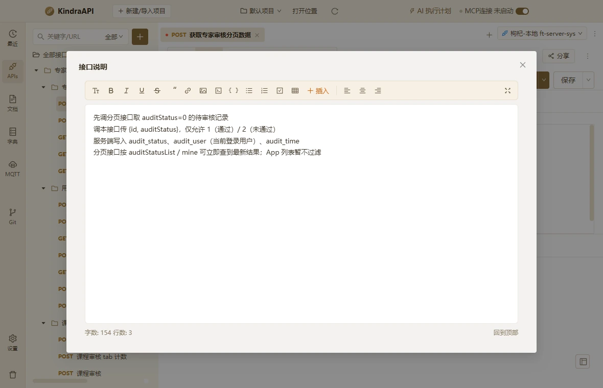

# 交互流：apis-dialog-description

- 路由：`/apis`
- 类型：dialog
- 视口：1180×760
- 说明：—
- 所属页面：[pages/apis.md](../pages/apis.md)

## 可见控件

| 区块 | 文案 / aria / icon | 类型 | 状态 | 选择器 |
| --- | --- | --- | --- | --- |
| modal:接口说明 | Close | `button` | — | `div.ant-modal-root.css-dzyqf7 > div.ant-modal-wrap:nth-of-type(2) > div.ant-modal.css-dzyqf7 > div:nth-of-type(1) > div.ant-modal-content > button.ant-modal-close` |
| modal:接口说明 | 关闭 | `span` | — | `div.ant-modal-wrap:nth-of-type(2) > div.ant-modal.css-dzyqf7 > div:nth-of-type(1) > div.ant-modal-content > button.ant-modal-close > span.ant-modal-close-x` |
| modal:接口说明 | 接口说明 | `div` | — | `div#:rj3:` |
| modal:接口说明 | anticon-font-size | `button` | — | `div:nth-of-type(1) > div.ant-modal-content > div.ant-modal-body:nth-of-type(2) > div.api-desc-shell > div.api-desc-toolbar:nth-of-type(1) > button.api-desc-tool:nth-of-type(1)` |
| modal:接口说明 | anticon-bold | `button` | — | `div:nth-of-type(1) > div.ant-modal-content > div.ant-modal-body:nth-of-type(2) > div.api-desc-shell > div.api-desc-toolbar:nth-of-type(1) > button.api-desc-tool:nth-of-type(2)` |
| modal:接口说明 | anticon-italic | `button` | — | `div:nth-of-type(1) > div.ant-modal-content > div.ant-modal-body:nth-of-type(2) > div.api-desc-shell > div.api-desc-toolbar:nth-of-type(1) > button.api-desc-tool:nth-of-type(3)` |
| modal:接口说明 | anticon-underline | `button` | — | `div:nth-of-type(1) > div.ant-modal-content > div.ant-modal-body:nth-of-type(2) > div.api-desc-shell > div.api-desc-toolbar:nth-of-type(1) > button.api-desc-tool:nth-of-type(4)` |
| modal:接口说明 | anticon-strikethrough | `button` | — | `div:nth-of-type(1) > div.ant-modal-content > div.ant-modal-body:nth-of-type(2) > div.api-desc-shell > div.api-desc-toolbar:nth-of-type(1) > button.api-desc-tool:nth-of-type(5)` |
| modal:接口说明 | “ | `button` | — | `div:nth-of-type(1) > div.ant-modal-content > div.ant-modal-body:nth-of-type(2) > div.api-desc-shell > div.api-desc-toolbar:nth-of-type(1) > button.api-desc-tool:nth-of-type(6)` |
| modal:接口说明 | anticon-link | `button` | — | `div:nth-of-type(1) > div.ant-modal-content > div.ant-modal-body:nth-of-type(2) > div.api-desc-shell > div.api-desc-toolbar:nth-of-type(1) > button.api-desc-tool:nth-of-type(7)` |
| modal:接口说明 | anticon-picture | `button` | — | `div:nth-of-type(1) > div.ant-modal-content > div.ant-modal-body:nth-of-type(2) > div.api-desc-shell > div.api-desc-toolbar:nth-of-type(1) > button.api-desc-tool:nth-of-type(8)` |
| modal:接口说明 | anticon-code | `button` | — | `div:nth-of-type(1) > div.ant-modal-content > div.ant-modal-body:nth-of-type(2) > div.api-desc-shell > div.api-desc-toolbar:nth-of-type(1) > button.api-desc-tool:nth-of-type(9)` |
| modal:接口说明 | { } | `button` | — | `div:nth-of-type(1) > div.ant-modal-content > div.ant-modal-body:nth-of-type(2) > div.api-desc-shell > div.api-desc-toolbar:nth-of-type(1) > button.api-desc-tool:nth-of-type(10)` |
| modal:接口说明 | anticon-unordered-list | `button` | — | `div:nth-of-type(1) > div.ant-modal-content > div.ant-modal-body:nth-of-type(2) > div.api-desc-shell > div.api-desc-toolbar:nth-of-type(1) > button.api-desc-tool:nth-of-type(11)` |
| modal:接口说明 | anticon-ordered-list | `button` | — | `div:nth-of-type(1) > div.ant-modal-content > div.ant-modal-body:nth-of-type(2) > div.api-desc-shell > div.api-desc-toolbar:nth-of-type(1) > button.api-desc-tool:nth-of-type(12)` |
| modal:接口说明 | anticon-check-square | `button` | — | `div:nth-of-type(1) > div.ant-modal-content > div.ant-modal-body:nth-of-type(2) > div.api-desc-shell > div.api-desc-toolbar:nth-of-type(1) > button.api-desc-tool:nth-of-type(13)` |
| modal:接口说明 | anticon-table | `button` | — | `div:nth-of-type(1) > div.ant-modal-content > div.ant-modal-body:nth-of-type(2) > div.api-desc-shell > div.api-desc-toolbar:nth-of-type(1) > button.api-desc-tool:nth-of-type(14)` |
| modal:接口说明 | 插入 | `button` | — | `div:nth-of-type(1) > div.ant-modal-content > div.ant-modal-body:nth-of-type(2) > div.api-desc-shell > div.api-desc-toolbar:nth-of-type(1) > button.ant-dropdown-trigger.api-desc-tool:nth-of-type(15)` |
| modal:接口说明 | anticon-align-left | `button` | — | `div:nth-of-type(1) > div.ant-modal-content > div.ant-modal-body:nth-of-type(2) > div.api-desc-shell > div.api-desc-toolbar:nth-of-type(1) > button.api-desc-tool:nth-of-type(16)` |
| modal:接口说明 | anticon-align-center | `button` | — | `div:nth-of-type(1) > div.ant-modal-content > div.ant-modal-body:nth-of-type(2) > div.api-desc-shell > div.api-desc-toolbar:nth-of-type(1) > button.api-desc-tool:nth-of-type(17)` |
| modal:接口说明 | anticon-align-right | `button` | — | `div:nth-of-type(1) > div.ant-modal-content > div.ant-modal-body:nth-of-type(2) > div.api-desc-shell > div.api-desc-toolbar:nth-of-type(1) > button.api-desc-tool:nth-of-type(18)` |
| modal:接口说明 | anticon-fullscreen | `button` | — | `div:nth-of-type(1) > div.ant-modal-content > div.ant-modal-body:nth-of-type(2) > div.api-desc-shell > div.api-desc-toolbar:nth-of-type(1) > button.api-desc-tool:nth-of-type(19)` |
| modal:接口说明 | 回到顶部 | `button` | — | `div:nth-of-type(1) > div.ant-modal-content > div.ant-modal-body:nth-of-type(2) > div.api-desc-shell > div.api-desc-footer:nth-of-type(3) > button.api-desc-link` |

## 提示文案

未捕获到提示文案。

## 相关源码

- `src/renderer/src/components/ApiDescriptionDialog.tsx`：4 个菜单项
- `src/renderer/src/components/ApiDescriptionDialog.tsx`：1 个 Tooltip
- `src/renderer/src/components/ApiTree.tsx`：11 条提示
- `src/renderer/src/components/ApiTree.tsx`：29 个菜单项
- `src/renderer/src/components/ApiTree.tsx`：3 个 Tooltip
- `src/renderer/src/components/CasesEditor.tsx`：5 条提示
- `src/renderer/src/components/CasesEditor.tsx`：16 个菜单项
- `src/renderer/src/components/CasesEditor.tsx`：2 个 IPC 调用
- `src/renderer/src/components/CodeGenDialog.tsx`：3 条提示
- `src/renderer/src/components/CodeGenDialog.tsx`：17 个菜单项
- `src/renderer/src/components/CodeGenDialog.tsx`：4 个 IPC 调用
- `src/renderer/src/components/EnvironmentModal.tsx`：18 条提示
- `src/renderer/src/components/EnvironmentModal.tsx`：10 个菜单项
- `src/renderer/src/components/EnvironmentModal.tsx`：11 个 IPC 调用
- `src/renderer/src/components/FieldRulesEditor.tsx`：7 个菜单项
- `src/renderer/src/components/JsonFieldTable.tsx`：5 条提示
- `src/renderer/src/components/JsonFieldTable.tsx`：15 个菜单项
- `src/renderer/src/components/JsonFieldTable.tsx`：2 个 Tooltip
- `src/renderer/src/components/ParamTable.tsx`：1 条提示
- `src/renderer/src/components/ParamTable.tsx`：2 个菜单项
- `src/renderer/src/components/ParamTable.tsx`：2 个 Tooltip
- `src/renderer/src/components/ParamTable.tsx`：2 个 IPC 调用
- `src/renderer/src/components/RequestEditor.tsx`：14 条提示
- `src/renderer/src/components/RequestEditor.tsx`：23 个菜单项
- `src/renderer/src/components/RequestEditor.tsx`：1 个 Tooltip
- `src/renderer/src/components/RequestEditor.tsx`：6 个 IPC 调用
- `src/renderer/src/components/ResponsePanel.tsx`：9 条提示
- `src/renderer/src/components/ResponsePanel.tsx`：1 个菜单项
- `src/renderer/src/components/ResponsePanel.tsx`：1 个 Tooltip
- `src/renderer/src/components/ResponsePanel.tsx`：5 个 IPC 调用
- `src/renderer/src/components/TargetSyncGuard.tsx`：1 条提示
- `src/renderer/src/components/TargetVersionDrawer.tsx`：6 条提示
- `src/renderer/src/components/TargetVersionDrawer.tsx`：3 个 IPC 调用
- `src/renderer/src/pages/ApisPage.tsx`：25 条提示
- `src/renderer/src/pages/ApisPage.tsx`：19 个菜单项
- `src/renderer/src/pages/ApisPage.tsx`：4 个 Tooltip
- `src/renderer/src/pages/ApisPage.tsx`：2 个 IPC 调用

> 返回 [交互流索引](README.md)
