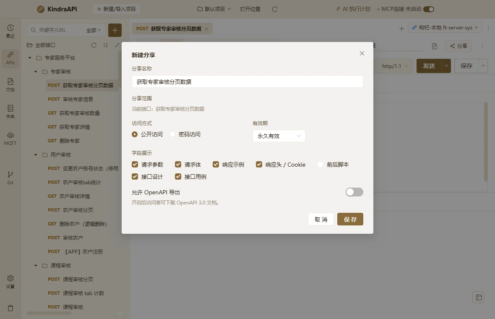

# 交互流：apis-dialog-share

- 路由：`/apis`
- 类型：dialog
- 视口：1180×760
- 说明：—
- 所属页面：[pages/apis.md](../pages/apis.md)

## 可见控件

| 区块 | 文案 / aria / icon | 类型 | 状态 | 选择器 |
| --- | --- | --- | --- | --- |
| modal:新建分享 | Close | `button` | — | `div.ant-modal-root.css-dzyqf7 > div.ant-modal-wrap:nth-of-type(2) > div.ant-modal.css-dzyqf7 > div:nth-of-type(1) > div.ant-modal-content > button.ant-modal-close` |
| modal:新建分享 | 关闭 | `span` | — | `div.ant-modal-wrap:nth-of-type(2) > div.ant-modal.css-dzyqf7 > div:nth-of-type(1) > div.ant-modal-content > button.ant-modal-close > span.ant-modal-close-x` |
| modal:新建分享 | 新建分享 | `div` | — | `div#:rk9:` |
| modal:新建分享 | 请输入分享名称 | `input` | — | `div:nth-of-type(1) > div.ant-modal-content > div.ant-modal-body:nth-of-type(2) > div.docs-form > div.docs-field:nth-of-type(1) > input.ant-input.css-dzyqf7` |
| — | 公开访问 | `label` | — | `div.ant-modal-body:nth-of-type(2) > div.docs-form > div.docs-field-row:nth-of-type(3) > div.docs-field:nth-of-type(1) > div.ant-radio-group.ant-radio-group-outline > label.ant-radio-wrapper.ant-radio-wrapper-checked:nth-of-type(1)` |
| — | 密码访问 | `label` | — | `div.ant-modal-body:nth-of-type(2) > div.docs-form > div.docs-field-row:nth-of-type(3) > div.docs-field:nth-of-type(1) > div.ant-radio-group.ant-radio-group-outline > label.ant-radio-wrapper.css-dzyqf7:nth-of-type(2)` |
| — | 永久有效 | `div` | — | `div.ant-modal-body:nth-of-type(2) > div.docs-form > div.docs-field-row:nth-of-type(3) > div.docs-field:nth-of-type(2) > div.docs-inline > div.ant-select.ant-select-outlined` |
| — | 永久有效 | `span` | — | `div.docs-field:nth-of-type(2) > div.docs-inline > div.ant-select.ant-select-outlined > div.ant-select-selector > span.ant-select-selection-wrap > span.ant-select-selection-item:nth-of-type(2)` |
| modal:新建分享 | 请求参数 | `label` | — | `div.ant-modal-content > div.ant-modal-body:nth-of-type(2) > div.docs-form > div.docs-field:nth-of-type(4) > div.docs-checks > label.ant-checkbox-wrapper.ant-checkbox-wrapper-checked:nth-of-type(1)` |
| modal:新建分享 | 请求体 | `label` | — | `div.ant-modal-content > div.ant-modal-body:nth-of-type(2) > div.docs-form > div.docs-field:nth-of-type(4) > div.docs-checks > label.ant-checkbox-wrapper.ant-checkbox-wrapper-checked:nth-of-type(2)` |
| modal:新建分享 | 响应示例 | `label` | — | `div.ant-modal-content > div.ant-modal-body:nth-of-type(2) > div.docs-form > div.docs-field:nth-of-type(4) > div.docs-checks > label.ant-checkbox-wrapper.ant-checkbox-wrapper-checked:nth-of-type(3)` |
| modal:新建分享 | 响应头 / Cookie | `label` | — | `div.ant-modal-content > div.ant-modal-body:nth-of-type(2) > div.docs-form > div.docs-field:nth-of-type(4) > div.docs-checks > label.ant-checkbox-wrapper.ant-checkbox-wrapper-checked:nth-of-type(4)` |
| modal:新建分享 | 前后脚本 | `label` | — | `div.ant-modal-content > div.ant-modal-body:nth-of-type(2) > div.docs-form > div.docs-field:nth-of-type(4) > div.docs-checks > label.ant-checkbox-wrapper.css-dzyqf7:nth-of-type(5)` |
| modal:新建分享 | 接口设计 | `label` | — | `div.ant-modal-content > div.ant-modal-body:nth-of-type(2) > div.docs-form > div.docs-field:nth-of-type(4) > div.docs-checks > label.ant-checkbox-wrapper.ant-checkbox-wrapper-checked:nth-of-type(6)` |
| modal:新建分享 | 接口用例 | `label` | — | `div.ant-modal-content > div.ant-modal-body:nth-of-type(2) > div.docs-form > div.docs-field:nth-of-type(4) > div.docs-checks > label.ant-checkbox-wrapper.ant-checkbox-wrapper-checked:nth-of-type(7)` |
| modal:新建分享 | 取 消 | `button` | — | `div.ant-modal-wrap:nth-of-type(2) > div.ant-modal.css-dzyqf7 > div:nth-of-type(1) > div.ant-modal-content > div.ant-modal-footer:nth-of-type(3) > button.ant-btn.css-dzyqf7:nth-of-type(1)` |
| modal:新建分享 | 保 存 | `button` | — | `div.ant-modal-wrap:nth-of-type(2) > div.ant-modal.css-dzyqf7 > div:nth-of-type(1) > div.ant-modal-content > div.ant-modal-footer:nth-of-type(3) > button.ant-btn.css-dzyqf7:nth-of-type(2)` |

## 提示文案

**title 属性**

- 永久有效

## 相关源码

- `src/renderer/src/components/ApiDescriptionDialog.tsx`：4 个菜单项
- `src/renderer/src/components/ApiDescriptionDialog.tsx`：1 个 Tooltip
- `src/renderer/src/components/ApiTree.tsx`：11 条提示
- `src/renderer/src/components/ApiTree.tsx`：29 个菜单项
- `src/renderer/src/components/ApiTree.tsx`：3 个 Tooltip
- `src/renderer/src/components/CasesEditor.tsx`：5 条提示
- `src/renderer/src/components/CasesEditor.tsx`：16 个菜单项
- `src/renderer/src/components/CasesEditor.tsx`：2 个 IPC 调用
- `src/renderer/src/components/CodeGenDialog.tsx`：3 条提示
- `src/renderer/src/components/CodeGenDialog.tsx`：17 个菜单项
- `src/renderer/src/components/CodeGenDialog.tsx`：4 个 IPC 调用
- `src/renderer/src/components/EnvironmentModal.tsx`：18 条提示
- `src/renderer/src/components/EnvironmentModal.tsx`：10 个菜单项
- `src/renderer/src/components/EnvironmentModal.tsx`：11 个 IPC 调用
- `src/renderer/src/components/FieldRulesEditor.tsx`：7 个菜单项
- `src/renderer/src/components/JsonFieldTable.tsx`：5 条提示
- `src/renderer/src/components/JsonFieldTable.tsx`：15 个菜单项
- `src/renderer/src/components/JsonFieldTable.tsx`：2 个 Tooltip
- `src/renderer/src/components/ParamTable.tsx`：1 条提示
- `src/renderer/src/components/ParamTable.tsx`：2 个菜单项
- `src/renderer/src/components/ParamTable.tsx`：2 个 Tooltip
- `src/renderer/src/components/ParamTable.tsx`：2 个 IPC 调用
- `src/renderer/src/components/RequestEditor.tsx`：14 条提示
- `src/renderer/src/components/RequestEditor.tsx`：23 个菜单项
- `src/renderer/src/components/RequestEditor.tsx`：1 个 Tooltip
- `src/renderer/src/components/RequestEditor.tsx`：6 个 IPC 调用
- `src/renderer/src/components/ResponsePanel.tsx`：9 条提示
- `src/renderer/src/components/ResponsePanel.tsx`：1 个菜单项
- `src/renderer/src/components/ResponsePanel.tsx`：1 个 Tooltip
- `src/renderer/src/components/ResponsePanel.tsx`：5 个 IPC 调用
- `src/renderer/src/components/TargetSyncGuard.tsx`：1 条提示
- `src/renderer/src/components/TargetVersionDrawer.tsx`：6 条提示
- `src/renderer/src/components/TargetVersionDrawer.tsx`：3 个 IPC 调用
- `src/renderer/src/pages/ApisPage.tsx`：25 条提示
- `src/renderer/src/pages/ApisPage.tsx`：19 个菜单项
- `src/renderer/src/pages/ApisPage.tsx`：4 个 Tooltip
- `src/renderer/src/pages/ApisPage.tsx`：2 个 IPC 调用

> 返回 [交互流索引](README.md)
