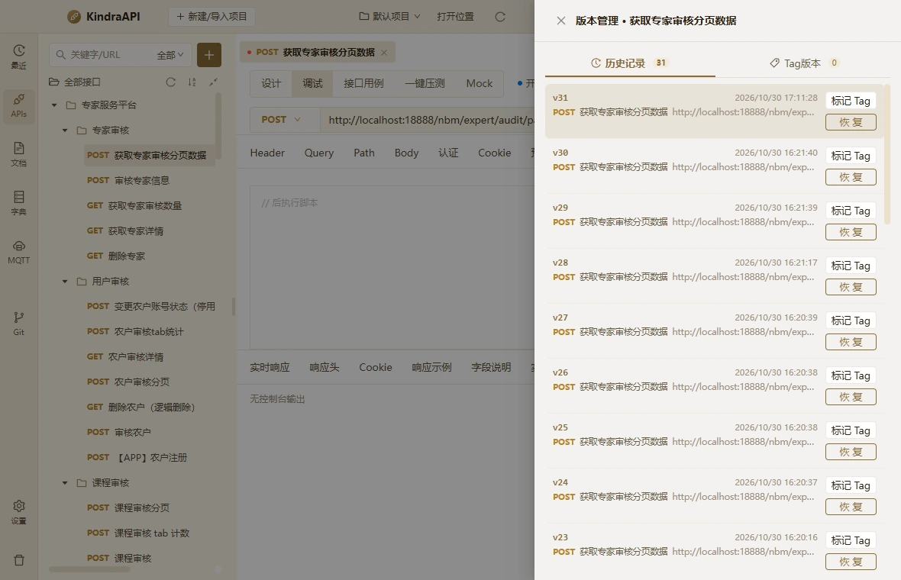

# 交互流：apis-drawer-versions

- 路由：`/apis`
- 类型：drawer
- 视口：1180×760
- 说明：—
- 所属页面：[pages/apis.md](../pages/apis.md)

## 可见控件

| 区块 | 文案 / aria / icon | 类型 | 状态 | 选择器 |
| --- | --- | --- | --- | --- |
| drawer:版本管理 · 获取专家审核分页数据 | 关闭 | `button` | — | `div.ant-drawer.ant-drawer-right > div.ant-drawer-content-wrapper:nth-of-type(3) > div.ant-drawer-content.version-drawer > div.ant-drawer-header:nth-of-type(1) > div.ant-drawer-header-title > button.ant-drawer-close` |
| drawer:版本管理 · 获取专家审核分页数据 | 版本管理 · 获取专家审核分页数据 | `div` | — | `div#:rg2:` |
| drawer:版本管理 · 获取专家审核分页数据 | 历史记录 31 | `button` | active | `div.ant-drawer.ant-drawer-right > div.ant-drawer-content-wrapper:nth-of-type(3) > div.ant-drawer-content.version-drawer > div.ant-drawer-body:nth-of-type(2) > div.version-tabs:nth-of-type(1) > button.active:nth-of-type(1)` |
| drawer:版本管理 · 获取专家审核分页数据 | Tag版本 0 | `button` | — | `div.ant-drawer.ant-drawer-right > div.ant-drawer-content-wrapper:nth-of-type(3) > div.ant-drawer-content.version-drawer > div.ant-drawer-body:nth-of-type(2) > div.version-tabs:nth-of-type(1) > button:nth-of-type(2)` |
| drawer:版本管理 · 获取专家审核分页数据 | 标记 Tag | `button` | — | `div.ant-drawer-content.version-drawer > div.ant-drawer-body:nth-of-type(2) > div.version-list:nth-of-type(2) > div.version-row:nth-of-type(1) > div.version-actions:nth-of-type(2) > button.ant-btn.css-dzyqf7:nth-of-type(1)` |
| drawer:版本管理 · 获取专家审核分页数据 | 恢 复 | `button` | — | `div.ant-drawer-content.version-drawer > div.ant-drawer-body:nth-of-type(2) > div.version-list:nth-of-type(2) > div.version-row:nth-of-type(1) > div.version-actions:nth-of-type(2) > button.ant-btn.css-dzyqf7:nth-of-type(2)` |
| drawer:版本管理 · 获取专家审核分页数据 | 标记 Tag | `button` | — | `div.ant-drawer-content.version-drawer > div.ant-drawer-body:nth-of-type(2) > div.version-list:nth-of-type(2) > div.version-row:nth-of-type(2) > div.version-actions:nth-of-type(2) > button.ant-btn.css-dzyqf7:nth-of-type(1)` |
| drawer:版本管理 · 获取专家审核分页数据 | 恢 复 | `button` | — | `div.ant-drawer-content.version-drawer > div.ant-drawer-body:nth-of-type(2) > div.version-list:nth-of-type(2) > div.version-row:nth-of-type(2) > div.version-actions:nth-of-type(2) > button.ant-btn.css-dzyqf7:nth-of-type(2)` |
| drawer:版本管理 · 获取专家审核分页数据 | 标记 Tag | `button` | — | `div.ant-drawer-content.version-drawer > div.ant-drawer-body:nth-of-type(2) > div.version-list:nth-of-type(2) > div.version-row:nth-of-type(3) > div.version-actions:nth-of-type(2) > button.ant-btn.css-dzyqf7:nth-of-type(1)` |
| drawer:版本管理 · 获取专家审核分页数据 | 恢 复 | `button` | — | `div.ant-drawer-content.version-drawer > div.ant-drawer-body:nth-of-type(2) > div.version-list:nth-of-type(2) > div.version-row:nth-of-type(3) > div.version-actions:nth-of-type(2) > button.ant-btn.css-dzyqf7:nth-of-type(2)` |
| drawer:版本管理 · 获取专家审核分页数据 | 标记 Tag | `button` | — | `div.ant-drawer-content.version-drawer > div.ant-drawer-body:nth-of-type(2) > div.version-list:nth-of-type(2) > div.version-row:nth-of-type(4) > div.version-actions:nth-of-type(2) > button.ant-btn.css-dzyqf7:nth-of-type(1)` |
| drawer:版本管理 · 获取专家审核分页数据 | 恢 复 | `button` | — | `div.ant-drawer-content.version-drawer > div.ant-drawer-body:nth-of-type(2) > div.version-list:nth-of-type(2) > div.version-row:nth-of-type(4) > div.version-actions:nth-of-type(2) > button.ant-btn.css-dzyqf7:nth-of-type(2)` |
| drawer:版本管理 · 获取专家审核分页数据 | 标记 Tag | `button` | — | `div.ant-drawer-content.version-drawer > div.ant-drawer-body:nth-of-type(2) > div.version-list:nth-of-type(2) > div.version-row:nth-of-type(5) > div.version-actions:nth-of-type(2) > button.ant-btn.css-dzyqf7:nth-of-type(1)` |
| drawer:版本管理 · 获取专家审核分页数据 | 恢 复 | `button` | — | `div.ant-drawer-content.version-drawer > div.ant-drawer-body:nth-of-type(2) > div.version-list:nth-of-type(2) > div.version-row:nth-of-type(5) > div.version-actions:nth-of-type(2) > button.ant-btn.css-dzyqf7:nth-of-type(2)` |
| drawer:版本管理 · 获取专家审核分页数据 | 标记 Tag | `button` | — | `div.ant-drawer-content.version-drawer > div.ant-drawer-body:nth-of-type(2) > div.version-list:nth-of-type(2) > div.version-row:nth-of-type(6) > div.version-actions:nth-of-type(2) > button.ant-btn.css-dzyqf7:nth-of-type(1)` |
| drawer:版本管理 · 获取专家审核分页数据 | 恢 复 | `button` | — | `div.ant-drawer-content.version-drawer > div.ant-drawer-body:nth-of-type(2) > div.version-list:nth-of-type(2) > div.version-row:nth-of-type(6) > div.version-actions:nth-of-type(2) > button.ant-btn.css-dzyqf7:nth-of-type(2)` |
| drawer:版本管理 · 获取专家审核分页数据 | 标记 Tag | `button` | — | `div.ant-drawer-content.version-drawer > div.ant-drawer-body:nth-of-type(2) > div.version-list:nth-of-type(2) > div.version-row:nth-of-type(7) > div.version-actions:nth-of-type(2) > button.ant-btn.css-dzyqf7:nth-of-type(1)` |
| drawer:版本管理 · 获取专家审核分页数据 | 恢 复 | `button` | — | `div.ant-drawer-content.version-drawer > div.ant-drawer-body:nth-of-type(2) > div.version-list:nth-of-type(2) > div.version-row:nth-of-type(7) > div.version-actions:nth-of-type(2) > button.ant-btn.css-dzyqf7:nth-of-type(2)` |
| drawer:版本管理 · 获取专家审核分页数据 | 标记 Tag | `button` | — | `div.ant-drawer-content.version-drawer > div.ant-drawer-body:nth-of-type(2) > div.version-list:nth-of-type(2) > div.version-row:nth-of-type(8) > div.version-actions:nth-of-type(2) > button.ant-btn.css-dzyqf7:nth-of-type(1)` |
| drawer:版本管理 · 获取专家审核分页数据 | 恢 复 | `button` | — | `div.ant-drawer-content.version-drawer > div.ant-drawer-body:nth-of-type(2) > div.version-list:nth-of-type(2) > div.version-row:nth-of-type(8) > div.version-actions:nth-of-type(2) > button.ant-btn.css-dzyqf7:nth-of-type(2)` |
| drawer:版本管理 · 获取专家审核分页数据 | 标记 Tag | `button` | — | `div.ant-drawer-content.version-drawer > div.ant-drawer-body:nth-of-type(2) > div.version-list:nth-of-type(2) > div.version-row:nth-of-type(9) > div.version-actions:nth-of-type(2) > button.ant-btn.css-dzyqf7:nth-of-type(1)` |
| drawer:版本管理 · 获取专家审核分页数据 | 恢 复 | `button` | — | `div.ant-drawer-content.version-drawer > div.ant-drawer-body:nth-of-type(2) > div.version-list:nth-of-type(2) > div.version-row:nth-of-type(9) > div.version-actions:nth-of-type(2) > button.ant-btn.css-dzyqf7:nth-of-type(2)` |
| drawer:版本管理 · 获取专家审核分页数据 | 标记 Tag | `button` | — | `div.ant-drawer-content.version-drawer > div.ant-drawer-body:nth-of-type(2) > div.version-list:nth-of-type(2) > div.version-row:nth-of-type(10) > div.version-actions:nth-of-type(2) > button.ant-btn.css-dzyqf7:nth-of-type(1)` |
| drawer:版本管理 · 获取专家审核分页数据 | 恢 复 | `button` | — | `div.ant-drawer-content.version-drawer > div.ant-drawer-body:nth-of-type(2) > div.version-list:nth-of-type(2) > div.version-row:nth-of-type(10) > div.version-actions:nth-of-type(2) > button.ant-btn.css-dzyqf7:nth-of-type(2)` |
| drawer:版本管理 · 获取专家审核分页数据 | 标记 Tag | `button` | — | `div.ant-drawer-content.version-drawer > div.ant-drawer-body:nth-of-type(2) > div.version-list:nth-of-type(2) > div.version-row:nth-of-type(11) > div.version-actions:nth-of-type(2) > button.ant-btn.css-dzyqf7:nth-of-type(1)` |
| drawer:版本管理 · 获取专家审核分页数据 | 恢 复 | `button` | — | `div.ant-drawer-content.version-drawer > div.ant-drawer-body:nth-of-type(2) > div.version-list:nth-of-type(2) > div.version-row:nth-of-type(11) > div.version-actions:nth-of-type(2) > button.ant-btn.css-dzyqf7:nth-of-type(2)` |
| drawer:版本管理 · 获取专家审核分页数据 | 标记 Tag | `button` | — | `div.ant-drawer-content.version-drawer > div.ant-drawer-body:nth-of-type(2) > div.version-list:nth-of-type(2) > div.version-row:nth-of-type(12) > div.version-actions:nth-of-type(2) > button.ant-btn.css-dzyqf7:nth-of-type(1)` |
| drawer:版本管理 · 获取专家审核分页数据 | 恢 复 | `button` | — | `div.ant-drawer-content.version-drawer > div.ant-drawer-body:nth-of-type(2) > div.version-list:nth-of-type(2) > div.version-row:nth-of-type(12) > div.version-actions:nth-of-type(2) > button.ant-btn.css-dzyqf7:nth-of-type(2)` |
| drawer:版本管理 · 获取专家审核分页数据 | 标记 Tag | `button` | — | `div.ant-drawer-content.version-drawer > div.ant-drawer-body:nth-of-type(2) > div.version-list:nth-of-type(2) > div.version-row:nth-of-type(13) > div.version-actions:nth-of-type(2) > button.ant-btn.css-dzyqf7:nth-of-type(1)` |
| drawer:版本管理 · 获取专家审核分页数据 | 恢 复 | `button` | — | `div.ant-drawer-content.version-drawer > div.ant-drawer-body:nth-of-type(2) > div.version-list:nth-of-type(2) > div.version-row:nth-of-type(13) > div.version-actions:nth-of-type(2) > button.ant-btn.css-dzyqf7:nth-of-type(2)` |
| drawer:版本管理 · 获取专家审核分页数据 | 标记 Tag | `button` | — | `div.ant-drawer-content.version-drawer > div.ant-drawer-body:nth-of-type(2) > div.version-list:nth-of-type(2) > div.version-row:nth-of-type(14) > div.version-actions:nth-of-type(2) > button.ant-btn.css-dzyqf7:nth-of-type(1)` |
| drawer:版本管理 · 获取专家审核分页数据 | 恢 复 | `button` | — | `div.ant-drawer-content.version-drawer > div.ant-drawer-body:nth-of-type(2) > div.version-list:nth-of-type(2) > div.version-row:nth-of-type(14) > div.version-actions:nth-of-type(2) > button.ant-btn.css-dzyqf7:nth-of-type(2)` |
| drawer:版本管理 · 获取专家审核分页数据 | 标记 Tag | `button` | — | `div.ant-drawer-content.version-drawer > div.ant-drawer-body:nth-of-type(2) > div.version-list:nth-of-type(2) > div.version-row:nth-of-type(15) > div.version-actions:nth-of-type(2) > button.ant-btn.css-dzyqf7:nth-of-type(1)` |
| drawer:版本管理 · 获取专家审核分页数据 | 恢 复 | `button` | — | `div.ant-drawer-content.version-drawer > div.ant-drawer-body:nth-of-type(2) > div.version-list:nth-of-type(2) > div.version-row:nth-of-type(15) > div.version-actions:nth-of-type(2) > button.ant-btn.css-dzyqf7:nth-of-type(2)` |
| drawer:版本管理 · 获取专家审核分页数据 | 标记 Tag | `button` | — | `div.ant-drawer-content.version-drawer > div.ant-drawer-body:nth-of-type(2) > div.version-list:nth-of-type(2) > div.version-row:nth-of-type(16) > div.version-actions:nth-of-type(2) > button.ant-btn.css-dzyqf7:nth-of-type(1)` |
| drawer:版本管理 · 获取专家审核分页数据 | 恢 复 | `button` | — | `div.ant-drawer-content.version-drawer > div.ant-drawer-body:nth-of-type(2) > div.version-list:nth-of-type(2) > div.version-row:nth-of-type(16) > div.version-actions:nth-of-type(2) > button.ant-btn.css-dzyqf7:nth-of-type(2)` |
| drawer:版本管理 · 获取专家审核分页数据 | 标记 Tag | `button` | — | `div.ant-drawer-content.version-drawer > div.ant-drawer-body:nth-of-type(2) > div.version-list:nth-of-type(2) > div.version-row:nth-of-type(17) > div.version-actions:nth-of-type(2) > button.ant-btn.css-dzyqf7:nth-of-type(1)` |
| drawer:版本管理 · 获取专家审核分页数据 | 恢 复 | `button` | — | `div.ant-drawer-content.version-drawer > div.ant-drawer-body:nth-of-type(2) > div.version-list:nth-of-type(2) > div.version-row:nth-of-type(17) > div.version-actions:nth-of-type(2) > button.ant-btn.css-dzyqf7:nth-of-type(2)` |
| drawer:版本管理 · 获取专家审核分页数据 | 标记 Tag | `button` | — | `div.ant-drawer-content.version-drawer > div.ant-drawer-body:nth-of-type(2) > div.version-list:nth-of-type(2) > div.version-row:nth-of-type(18) > div.version-actions:nth-of-type(2) > button.ant-btn.css-dzyqf7:nth-of-type(1)` |
| drawer:版本管理 · 获取专家审核分页数据 | 恢 复 | `button` | — | `div.ant-drawer-content.version-drawer > div.ant-drawer-body:nth-of-type(2) > div.version-list:nth-of-type(2) > div.version-row:nth-of-type(18) > div.version-actions:nth-of-type(2) > button.ant-btn.css-dzyqf7:nth-of-type(2)` |
| drawer:版本管理 · 获取专家审核分页数据 | 标记 Tag | `button` | — | `div.ant-drawer-content.version-drawer > div.ant-drawer-body:nth-of-type(2) > div.version-list:nth-of-type(2) > div.version-row:nth-of-type(19) > div.version-actions:nth-of-type(2) > button.ant-btn.css-dzyqf7:nth-of-type(1)` |
| drawer:版本管理 · 获取专家审核分页数据 | 恢 复 | `button` | — | `div.ant-drawer-content.version-drawer > div.ant-drawer-body:nth-of-type(2) > div.version-list:nth-of-type(2) > div.version-row:nth-of-type(19) > div.version-actions:nth-of-type(2) > button.ant-btn.css-dzyqf7:nth-of-type(2)` |
| drawer:版本管理 · 获取专家审核分页数据 | 标记 Tag | `button` | — | `div.ant-drawer-content.version-drawer > div.ant-drawer-body:nth-of-type(2) > div.version-list:nth-of-type(2) > div.version-row:nth-of-type(20) > div.version-actions:nth-of-type(2) > button.ant-btn.css-dzyqf7:nth-of-type(1)` |
| drawer:版本管理 · 获取专家审核分页数据 | 恢 复 | `button` | — | `div.ant-drawer-content.version-drawer > div.ant-drawer-body:nth-of-type(2) > div.version-list:nth-of-type(2) > div.version-row:nth-of-type(20) > div.version-actions:nth-of-type(2) > button.ant-btn.css-dzyqf7:nth-of-type(2)` |
| drawer:版本管理 · 获取专家审核分页数据 | 标记 Tag | `button` | — | `div.ant-drawer-content.version-drawer > div.ant-drawer-body:nth-of-type(2) > div.version-list:nth-of-type(2) > div.version-row:nth-of-type(21) > div.version-actions:nth-of-type(2) > button.ant-btn.css-dzyqf7:nth-of-type(1)` |
| drawer:版本管理 · 获取专家审核分页数据 | 恢 复 | `button` | — | `div.ant-drawer-content.version-drawer > div.ant-drawer-body:nth-of-type(2) > div.version-list:nth-of-type(2) > div.version-row:nth-of-type(21) > div.version-actions:nth-of-type(2) > button.ant-btn.css-dzyqf7:nth-of-type(2)` |
| drawer:版本管理 · 获取专家审核分页数据 | 标记 Tag | `button` | — | `div.ant-drawer-content.version-drawer > div.ant-drawer-body:nth-of-type(2) > div.version-list:nth-of-type(2) > div.version-row:nth-of-type(22) > div.version-actions:nth-of-type(2) > button.ant-btn.css-dzyqf7:nth-of-type(1)` |
| drawer:版本管理 · 获取专家审核分页数据 | 恢 复 | `button` | — | `div.ant-drawer-content.version-drawer > div.ant-drawer-body:nth-of-type(2) > div.version-list:nth-of-type(2) > div.version-row:nth-of-type(22) > div.version-actions:nth-of-type(2) > button.ant-btn.css-dzyqf7:nth-of-type(2)` |
| drawer:版本管理 · 获取专家审核分页数据 | 标记 Tag | `button` | — | `div.ant-drawer-content.version-drawer > div.ant-drawer-body:nth-of-type(2) > div.version-list:nth-of-type(2) > div.version-row:nth-of-type(23) > div.version-actions:nth-of-type(2) > button.ant-btn.css-dzyqf7:nth-of-type(1)` |
| drawer:版本管理 · 获取专家审核分页数据 | 恢 复 | `button` | — | `div.ant-drawer-content.version-drawer > div.ant-drawer-body:nth-of-type(2) > div.version-list:nth-of-type(2) > div.version-row:nth-of-type(23) > div.version-actions:nth-of-type(2) > button.ant-btn.css-dzyqf7:nth-of-type(2)` |
| drawer:版本管理 · 获取专家审核分页数据 | 标记 Tag | `button` | — | `div.ant-drawer-content.version-drawer > div.ant-drawer-body:nth-of-type(2) > div.version-list:nth-of-type(2) > div.version-row:nth-of-type(24) > div.version-actions:nth-of-type(2) > button.ant-btn.css-dzyqf7:nth-of-type(1)` |
| drawer:版本管理 · 获取专家审核分页数据 | 恢 复 | `button` | — | `div.ant-drawer-content.version-drawer > div.ant-drawer-body:nth-of-type(2) > div.version-list:nth-of-type(2) > div.version-row:nth-of-type(24) > div.version-actions:nth-of-type(2) > button.ant-btn.css-dzyqf7:nth-of-type(2)` |
| drawer:版本管理 · 获取专家审核分页数据 | 标记 Tag | `button` | — | `div.ant-drawer-content.version-drawer > div.ant-drawer-body:nth-of-type(2) > div.version-list:nth-of-type(2) > div.version-row:nth-of-type(25) > div.version-actions:nth-of-type(2) > button.ant-btn.css-dzyqf7:nth-of-type(1)` |
| drawer:版本管理 · 获取专家审核分页数据 | 恢 复 | `button` | — | `div.ant-drawer-content.version-drawer > div.ant-drawer-body:nth-of-type(2) > div.version-list:nth-of-type(2) > div.version-row:nth-of-type(25) > div.version-actions:nth-of-type(2) > button.ant-btn.css-dzyqf7:nth-of-type(2)` |
| drawer:版本管理 · 获取专家审核分页数据 | 标记 Tag | `button` | — | `div.ant-drawer-content.version-drawer > div.ant-drawer-body:nth-of-type(2) > div.version-list:nth-of-type(2) > div.version-row:nth-of-type(26) > div.version-actions:nth-of-type(2) > button.ant-btn.css-dzyqf7:nth-of-type(1)` |
| drawer:版本管理 · 获取专家审核分页数据 | 恢 复 | `button` | — | `div.ant-drawer-content.version-drawer > div.ant-drawer-body:nth-of-type(2) > div.version-list:nth-of-type(2) > div.version-row:nth-of-type(26) > div.version-actions:nth-of-type(2) > button.ant-btn.css-dzyqf7:nth-of-type(2)` |
| drawer:版本管理 · 获取专家审核分页数据 | 标记 Tag | `button` | — | `div.ant-drawer-content.version-drawer > div.ant-drawer-body:nth-of-type(2) > div.version-list:nth-of-type(2) > div.version-row:nth-of-type(27) > div.version-actions:nth-of-type(2) > button.ant-btn.css-dzyqf7:nth-of-type(1)` |
| drawer:版本管理 · 获取专家审核分页数据 | 恢 复 | `button` | — | `div.ant-drawer-content.version-drawer > div.ant-drawer-body:nth-of-type(2) > div.version-list:nth-of-type(2) > div.version-row:nth-of-type(27) > div.version-actions:nth-of-type(2) > button.ant-btn.css-dzyqf7:nth-of-type(2)` |
| drawer:版本管理 · 获取专家审核分页数据 | 标记 Tag | `button` | — | `div.ant-drawer-content.version-drawer > div.ant-drawer-body:nth-of-type(2) > div.version-list:nth-of-type(2) > div.version-row:nth-of-type(28) > div.version-actions:nth-of-type(2) > button.ant-btn.css-dzyqf7:nth-of-type(1)` |
| drawer:版本管理 · 获取专家审核分页数据 | 恢 复 | `button` | — | `div.ant-drawer-content.version-drawer > div.ant-drawer-body:nth-of-type(2) > div.version-list:nth-of-type(2) > div.version-row:nth-of-type(28) > div.version-actions:nth-of-type(2) > button.ant-btn.css-dzyqf7:nth-of-type(2)` |
| drawer:版本管理 · 获取专家审核分页数据 | 标记 Tag | `button` | — | `div.ant-drawer-content.version-drawer > div.ant-drawer-body:nth-of-type(2) > div.version-list:nth-of-type(2) > div.version-row:nth-of-type(29) > div.version-actions:nth-of-type(2) > button.ant-btn.css-dzyqf7:nth-of-type(1)` |
| drawer:版本管理 · 获取专家审核分页数据 | 恢 复 | `button` | — | `div.ant-drawer-content.version-drawer > div.ant-drawer-body:nth-of-type(2) > div.version-list:nth-of-type(2) > div.version-row:nth-of-type(29) > div.version-actions:nth-of-type(2) > button.ant-btn.css-dzyqf7:nth-of-type(2)` |
| drawer:版本管理 · 获取专家审核分页数据 | 标记 Tag | `button` | — | `div.ant-drawer-content.version-drawer > div.ant-drawer-body:nth-of-type(2) > div.version-list:nth-of-type(2) > div.version-row:nth-of-type(30) > div.version-actions:nth-of-type(2) > button.ant-btn.css-dzyqf7:nth-of-type(1)` |
| drawer:版本管理 · 获取专家审核分页数据 | 恢 复 | `button` | — | `div.ant-drawer-content.version-drawer > div.ant-drawer-body:nth-of-type(2) > div.version-list:nth-of-type(2) > div.version-row:nth-of-type(30) > div.version-actions:nth-of-type(2) > button.ant-btn.css-dzyqf7:nth-of-type(2)` |
| drawer:版本管理 · 获取专家审核分页数据 | 标记 Tag | `button` | — | `div.ant-drawer-content.version-drawer > div.ant-drawer-body:nth-of-type(2) > div.version-list:nth-of-type(2) > div.version-row:nth-of-type(31) > div.version-actions:nth-of-type(2) > button.ant-btn.css-dzyqf7:nth-of-type(1)` |
| drawer:版本管理 · 获取专家审核分页数据 | 恢 复 | `button` | — | `div.ant-drawer-content.version-drawer > div.ant-drawer-body:nth-of-type(2) > div.version-list:nth-of-type(2) > div.version-row:nth-of-type(31) > div.version-actions:nth-of-type(2) > button.ant-btn.css-dzyqf7:nth-of-type(2)` |

## 提示文案

未捕获到提示文案。

## 相关源码

- `src/renderer/src/components/ApiDescriptionDialog.tsx`：4 个菜单项
- `src/renderer/src/components/ApiDescriptionDialog.tsx`：1 个 Tooltip
- `src/renderer/src/components/ApiTree.tsx`：11 条提示
- `src/renderer/src/components/ApiTree.tsx`：29 个菜单项
- `src/renderer/src/components/ApiTree.tsx`：3 个 Tooltip
- `src/renderer/src/components/CasesEditor.tsx`：5 条提示
- `src/renderer/src/components/CasesEditor.tsx`：16 个菜单项
- `src/renderer/src/components/CasesEditor.tsx`：2 个 IPC 调用
- `src/renderer/src/components/CodeGenDialog.tsx`：3 条提示
- `src/renderer/src/components/CodeGenDialog.tsx`：17 个菜单项
- `src/renderer/src/components/CodeGenDialog.tsx`：4 个 IPC 调用
- `src/renderer/src/components/EnvironmentModal.tsx`：18 条提示
- `src/renderer/src/components/EnvironmentModal.tsx`：10 个菜单项
- `src/renderer/src/components/EnvironmentModal.tsx`：11 个 IPC 调用
- `src/renderer/src/components/FieldRulesEditor.tsx`：7 个菜单项
- `src/renderer/src/components/JsonFieldTable.tsx`：5 条提示
- `src/renderer/src/components/JsonFieldTable.tsx`：15 个菜单项
- `src/renderer/src/components/JsonFieldTable.tsx`：2 个 Tooltip
- `src/renderer/src/components/ParamTable.tsx`：1 条提示
- `src/renderer/src/components/ParamTable.tsx`：2 个菜单项
- `src/renderer/src/components/ParamTable.tsx`：2 个 Tooltip
- `src/renderer/src/components/ParamTable.tsx`：2 个 IPC 调用
- `src/renderer/src/components/RequestEditor.tsx`：14 条提示
- `src/renderer/src/components/RequestEditor.tsx`：23 个菜单项
- `src/renderer/src/components/RequestEditor.tsx`：1 个 Tooltip
- `src/renderer/src/components/RequestEditor.tsx`：6 个 IPC 调用
- `src/renderer/src/components/ResponsePanel.tsx`：9 条提示
- `src/renderer/src/components/ResponsePanel.tsx`：1 个菜单项
- `src/renderer/src/components/ResponsePanel.tsx`：1 个 Tooltip
- `src/renderer/src/components/ResponsePanel.tsx`：5 个 IPC 调用
- `src/renderer/src/components/TargetSyncGuard.tsx`：1 条提示
- `src/renderer/src/components/TargetVersionDrawer.tsx`：6 条提示
- `src/renderer/src/components/TargetVersionDrawer.tsx`：3 个 IPC 调用
- `src/renderer/src/pages/ApisPage.tsx`：25 条提示
- `src/renderer/src/pages/ApisPage.tsx`：19 个菜单项
- `src/renderer/src/pages/ApisPage.tsx`：4 个 Tooltip
- `src/renderer/src/pages/ApisPage.tsx`：2 个 IPC 调用

> 返回 [交互流索引](README.md)
