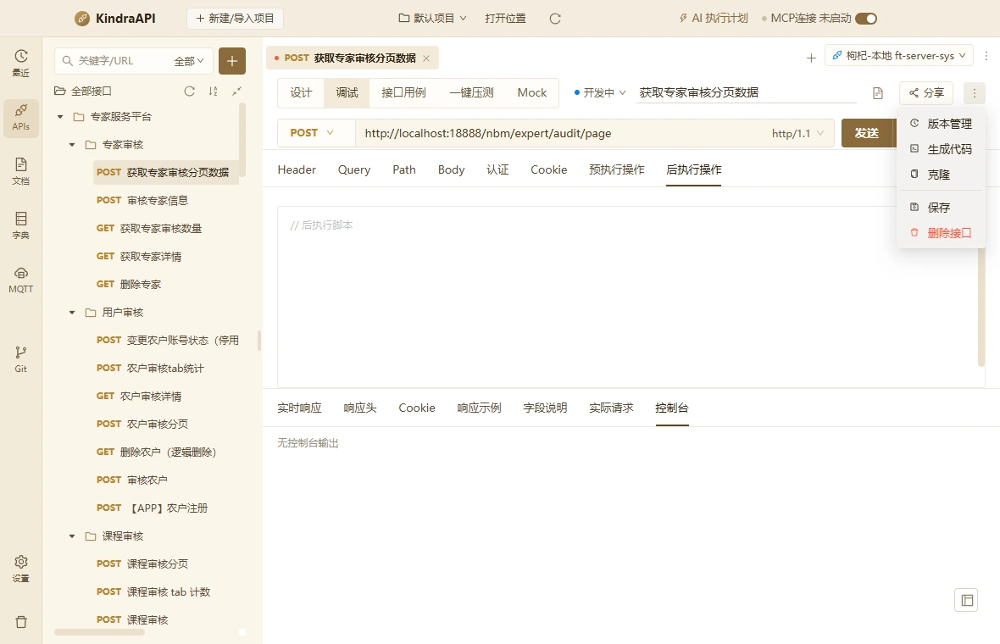

# 交互流：apis-more-menu

- 路由：`/apis`
- 类型：menu
- 视口：1180×760
- 说明：—
- 所属页面：[pages/apis.md](../pages/apis.md)

## 可见控件

| 区块 | 文案 / aria / icon | 类型 | 状态 | 选择器 |
| --- | --- | --- | --- | --- |
| — | 版本管理 | `li/menuitem` | — | `div:nth-of-type(5) > div.ant-dropdown.css-dzyqf7 > ul.ant-dropdown-menu.ant-dropdown-menu-root > li.ant-dropdown-menu-item:nth-of-type(1)` |
| — | 生成代码 | `li/menuitem` | — | `div:nth-of-type(5) > div.ant-dropdown.css-dzyqf7 > ul.ant-dropdown-menu.ant-dropdown-menu-root > li.ant-dropdown-menu-item:nth-of-type(2)` |
| — | 克隆 | `li/menuitem` | — | `div:nth-of-type(5) > div.ant-dropdown.css-dzyqf7 > ul.ant-dropdown-menu.ant-dropdown-menu-root > li.ant-dropdown-menu-item:nth-of-type(3)` |
| — | 保存 | `li/menuitem` | — | `div:nth-of-type(5) > div.ant-dropdown.css-dzyqf7 > ul.ant-dropdown-menu.ant-dropdown-menu-root > li.ant-dropdown-menu-item:nth-of-type(5)` |
| — | 删除接口 | `li/menuitem` | — | `div:nth-of-type(5) > div.ant-dropdown.css-dzyqf7 > ul.ant-dropdown-menu.ant-dropdown-menu-root > li.ant-dropdown-menu-item.ant-dropdown-menu-item-danger:nth-of-type(6)` |

## 提示文案

未捕获到提示文案。

## 相关源码

- `src/renderer/src/components/ApiDescriptionDialog.tsx`：4 个菜单项
- `src/renderer/src/components/ApiDescriptionDialog.tsx`：1 个 Tooltip
- `src/renderer/src/components/ApiTree.tsx`：11 条提示
- `src/renderer/src/components/ApiTree.tsx`：29 个菜单项
- `src/renderer/src/components/ApiTree.tsx`：3 个 Tooltip
- `src/renderer/src/components/CasesEditor.tsx`：5 条提示
- `src/renderer/src/components/CasesEditor.tsx`：16 个菜单项
- `src/renderer/src/components/CasesEditor.tsx`：2 个 IPC 调用
- `src/renderer/src/components/CodeGenDialog.tsx`：3 条提示
- `src/renderer/src/components/CodeGenDialog.tsx`：17 个菜单项
- `src/renderer/src/components/CodeGenDialog.tsx`：4 个 IPC 调用
- `src/renderer/src/components/EnvironmentModal.tsx`：18 条提示
- `src/renderer/src/components/EnvironmentModal.tsx`：10 个菜单项
- `src/renderer/src/components/EnvironmentModal.tsx`：11 个 IPC 调用
- `src/renderer/src/components/FieldRulesEditor.tsx`：7 个菜单项
- `src/renderer/src/components/JsonFieldTable.tsx`：5 条提示
- `src/renderer/src/components/JsonFieldTable.tsx`：15 个菜单项
- `src/renderer/src/components/JsonFieldTable.tsx`：2 个 Tooltip
- `src/renderer/src/components/ParamTable.tsx`：1 条提示
- `src/renderer/src/components/ParamTable.tsx`：2 个菜单项
- `src/renderer/src/components/ParamTable.tsx`：2 个 Tooltip
- `src/renderer/src/components/ParamTable.tsx`：2 个 IPC 调用
- `src/renderer/src/components/RequestEditor.tsx`：14 条提示
- `src/renderer/src/components/RequestEditor.tsx`：23 个菜单项
- `src/renderer/src/components/RequestEditor.tsx`：1 个 Tooltip
- `src/renderer/src/components/RequestEditor.tsx`：6 个 IPC 调用
- `src/renderer/src/components/ResponsePanel.tsx`：9 条提示
- `src/renderer/src/components/ResponsePanel.tsx`：1 个菜单项
- `src/renderer/src/components/ResponsePanel.tsx`：1 个 Tooltip
- `src/renderer/src/components/ResponsePanel.tsx`：5 个 IPC 调用
- `src/renderer/src/components/TargetSyncGuard.tsx`：1 条提示
- `src/renderer/src/components/TargetVersionDrawer.tsx`：6 条提示
- `src/renderer/src/components/TargetVersionDrawer.tsx`：3 个 IPC 调用
- `src/renderer/src/pages/ApisPage.tsx`：25 条提示
- `src/renderer/src/pages/ApisPage.tsx`：19 个菜单项
- `src/renderer/src/pages/ApisPage.tsx`：4 个 Tooltip
- `src/renderer/src/pages/ApisPage.tsx`：2 个 IPC 调用

> 返回 [交互流索引](README.md)
