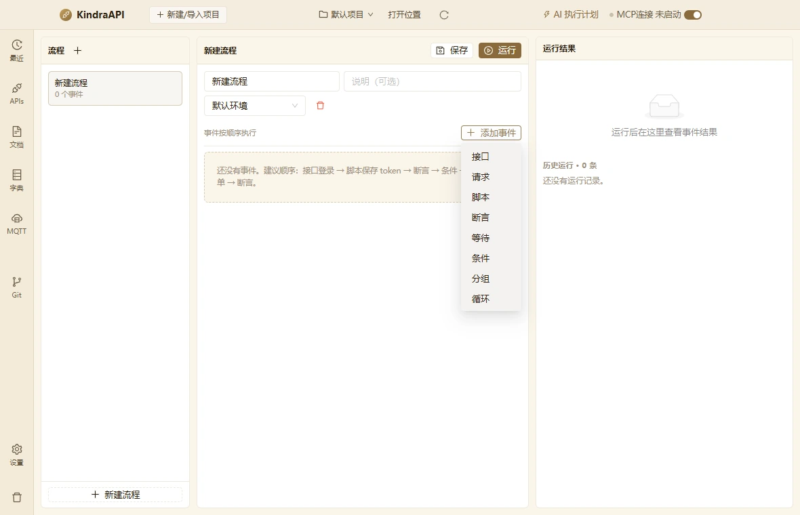

# 交互流：automation-event-menu

- 路由：`/automation`
- 类型：menu
- 视口：1180×760
- 说明：—
- 所属页面：[pages/automation.md](../pages/automation.md)

## 可见控件

| 区块 | 文案 / aria / icon | 类型 | 状态 | 选择器 |
| --- | --- | --- | --- | --- |
| — | 接口 | `li/menuitem` | — | `div:nth-of-type(5) > div.ant-dropdown.css-dzyqf7 > ul.ant-dropdown-menu.ant-dropdown-menu-root > li.ant-dropdown-menu-item.ant-dropdown-menu-item-only-child:nth-of-type(1)` |
| — | 请求 | `li/menuitem` | — | `div:nth-of-type(5) > div.ant-dropdown.css-dzyqf7 > ul.ant-dropdown-menu.ant-dropdown-menu-root > li.ant-dropdown-menu-item.ant-dropdown-menu-item-only-child:nth-of-type(2)` |
| — | 脚本 | `li/menuitem` | — | `div:nth-of-type(5) > div.ant-dropdown.css-dzyqf7 > ul.ant-dropdown-menu.ant-dropdown-menu-root > li.ant-dropdown-menu-item.ant-dropdown-menu-item-only-child:nth-of-type(3)` |
| — | 断言 | `li/menuitem` | — | `div:nth-of-type(5) > div.ant-dropdown.css-dzyqf7 > ul.ant-dropdown-menu.ant-dropdown-menu-root > li.ant-dropdown-menu-item.ant-dropdown-menu-item-only-child:nth-of-type(4)` |
| — | 等待 | `li/menuitem` | — | `div:nth-of-type(5) > div.ant-dropdown.css-dzyqf7 > ul.ant-dropdown-menu.ant-dropdown-menu-root > li.ant-dropdown-menu-item.ant-dropdown-menu-item-only-child:nth-of-type(5)` |
| — | 条件 | `li/menuitem` | — | `div:nth-of-type(5) > div.ant-dropdown.css-dzyqf7 > ul.ant-dropdown-menu.ant-dropdown-menu-root > li.ant-dropdown-menu-item.ant-dropdown-menu-item-only-child:nth-of-type(6)` |
| — | 分组 | `li/menuitem` | — | `div:nth-of-type(5) > div.ant-dropdown.css-dzyqf7 > ul.ant-dropdown-menu.ant-dropdown-menu-root > li.ant-dropdown-menu-item.ant-dropdown-menu-item-only-child:nth-of-type(7)` |
| — | 循环 | `li/menuitem` | — | `div:nth-of-type(5) > div.ant-dropdown.css-dzyqf7 > ul.ant-dropdown-menu.ant-dropdown-menu-root > li.ant-dropdown-menu-item.ant-dropdown-menu-item-only-child:nth-of-type(8)` |

## 提示文案

未捕获到提示文案。

## 相关源码

- `src/renderer/src/pages/AutomationPage.tsx`：13 条提示
- `src/renderer/src/pages/AutomationPage.tsx`：13 个菜单项
- `src/renderer/src/pages/AutomationPage.tsx`：3 个 Tooltip
- `src/renderer/src/pages/AutomationPage.tsx`：8 个 IPC 调用

> 返回 [交互流索引](README.md)
