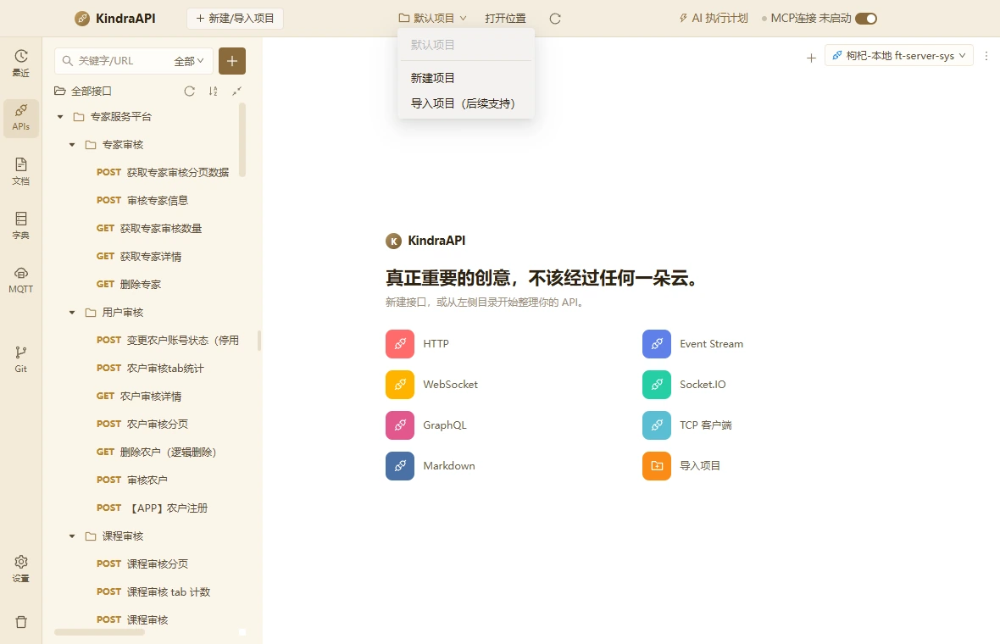

# 交互流：chrome-project-menu

- 路由：`/global`
- 类型：menu
- 视口：1180×760
- 说明：—
- 所属页面：[pages/global.md](../pages/global.md)

## 可见控件

| 区块 | 文案 / aria / icon | 类型 | 状态 | 选择器 |
| --- | --- | --- | --- | --- |
| — | 默认项目 | `li/menuitem` | disabled | `div:nth-of-type(2) > div.ant-dropdown.css-dzyqf7 > ul.ant-dropdown-menu.ant-dropdown-menu-root > li.ant-dropdown-menu-item.ant-dropdown-menu-item-disabled:nth-of-type(1)` |
| — | 新建项目 | `li/menuitem` | — | `div:nth-of-type(2) > div.ant-dropdown.css-dzyqf7 > ul.ant-dropdown-menu.ant-dropdown-menu-root > li.ant-dropdown-menu-item.ant-dropdown-menu-item-only-child:nth-of-type(3)` |
| — | 导入项目（后续支持） | `li/menuitem` | — | `div:nth-of-type(2) > div.ant-dropdown.css-dzyqf7 > ul.ant-dropdown-menu.ant-dropdown-menu-root > li.ant-dropdown-menu-item.ant-dropdown-menu-item-only-child:nth-of-type(4)` |

## 提示文案

未捕获到提示文案。

> 返回 [交互流索引](README.md)
