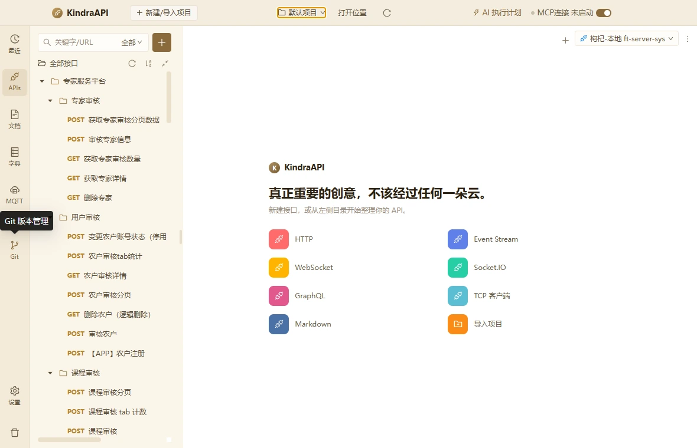

# 交互流：chrome-tooltip-git

- 路由：`/global`
- 类型：tooltip
- 视口：1180×760
- 说明：—
- 所属页面：[pages/global.md](../pages/global.md)

## 可见控件

| 区块 | 文案 / aria / icon | 类型 | 状态 | 选择器 |
| --- | --- | --- | --- | --- |
| — | Git 版本管理 | `div/tooltip` | — | `div#:r6:` |

## 提示文案

**Tooltip**

- Git 版本管理

> 返回 [交互流索引](README.md)
