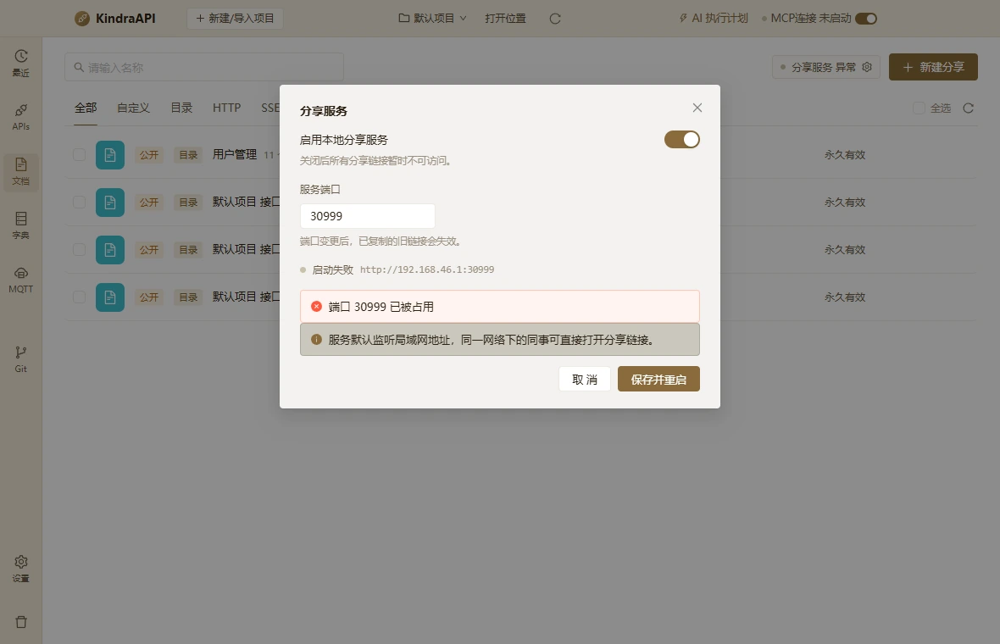

# 交互流：docs-dialog-share-service

- 路由：`/docs`
- 类型：dialog
- 视口：1180×760
- 说明：—
- 所属页面：[pages/docs.md](../pages/docs.md)

## 可见控件

| 区块 | 文案 / aria / icon | 类型 | 状态 | 选择器 |
| --- | --- | --- | --- | --- |
| modal:分享服务 | Close | `button` | — | `div.ant-modal-root.css-dzyqf7 > div.ant-modal-wrap:nth-of-type(2) > div.ant-modal.css-dzyqf7 > div:nth-of-type(1) > div.ant-modal-content > button.ant-modal-close` |
| modal:分享服务 | 关闭 | `span` | — | `div.ant-modal-wrap:nth-of-type(2) > div.ant-modal.css-dzyqf7 > div:nth-of-type(1) > div.ant-modal-content > button.ant-modal-close > span.ant-modal-close-x` |
| modal:分享服务 | 分享服务 | `div` | — | `div#:rqa:` |
| modal:分享服务 | anticon-up | `div` | — | `div:nth-of-type(1) > div.ant-modal-content > div.ant-modal-body:nth-of-type(2) > div.docs-form > div.docs-field:nth-of-type(2) > div.ant-input-number.css-dzyqf7:nth-of-type(1)` |
| — | Increase Value | `span/button` | — | `div.ant-modal-body:nth-of-type(2) > div.docs-form > div.docs-field:nth-of-type(2) > div.ant-input-number.css-dzyqf7:nth-of-type(1) > div.ant-input-number-handler-wrap:nth-of-type(1) > span.ant-input-number-handler.ant-input-number-handler-up:nth-of-type(1)` |
| — | Decrease Value | `span/button` | — | `div.ant-modal-body:nth-of-type(2) > div.docs-form > div.docs-field:nth-of-type(2) > div.ant-input-number.css-dzyqf7:nth-of-type(1) > div.ant-input-number-handler-wrap:nth-of-type(1) > span.ant-input-number-handler.ant-input-number-handler-down:nth-of-type(2)` |
| — | (未命名单选/控件) | `input/spinbutton` | — | `div.ant-modal-body:nth-of-type(2) > div.docs-form > div.docs-field:nth-of-type(2) > div.ant-input-number.css-dzyqf7:nth-of-type(1) > div.ant-input-number-input-wrap:nth-of-type(2) > input.ant-input-number-input` |
| modal:分享服务 | 端口 30999 已被占用 | `div/alert` | — | `div.ant-modal.css-dzyqf7 > div:nth-of-type(1) > div.ant-modal-content > div.ant-modal-body:nth-of-type(2) > div.docs-form > div.ant-alert.ant-alert-error:nth-of-type(4)` |
| modal:分享服务 | 服务默认监听局域网地址，同一网络下的同事可直接打开分享链接。 | `div/alert` | — | `div.ant-modal.css-dzyqf7 > div:nth-of-type(1) > div.ant-modal-content > div.ant-modal-body:nth-of-type(2) > div.docs-form > div.ant-alert.ant-alert-info:nth-of-type(5)` |
| modal:分享服务 | 取 消 | `button` | — | `div.ant-modal-wrap:nth-of-type(2) > div.ant-modal.css-dzyqf7 > div:nth-of-type(1) > div.ant-modal-content > div.ant-modal-footer:nth-of-type(3) > button.ant-btn.css-dzyqf7:nth-of-type(1)` |
| modal:分享服务 | 保存并重启 | `button` | — | `div.ant-modal-wrap:nth-of-type(2) > div.ant-modal.css-dzyqf7 > div:nth-of-type(1) > div.ant-modal-content > div.ant-modal-footer:nth-of-type(3) > button.ant-btn.css-dzyqf7:nth-of-type(2)` |

## 提示文案

**警告**

- 端口 30999 已被占用
- 服务默认监听局域网地址，同一网络下的同事可直接打开分享链接。

## 相关源码

- `src/renderer/src/components/DocShareDialog.tsx`：5 条提示
- `src/renderer/src/components/DocShareDialog.tsx`：6 个菜单项
- `src/renderer/src/components/DocShareDialog.tsx`：2 个 IPC 调用
- `src/renderer/src/components/DocShareLinkDialog.tsx`：4 条提示
- `src/renderer/src/components/DocShareLinkDialog.tsx`：4 个 IPC 调用
- `src/renderer/src/pages/DocsPage.tsx`：15 条提示
- `src/renderer/src/pages/DocsPage.tsx`：6 个 Tooltip
- `src/renderer/src/pages/DocsPage.tsx`：7 个 IPC 调用

> 返回 [交互流索引](README.md)
