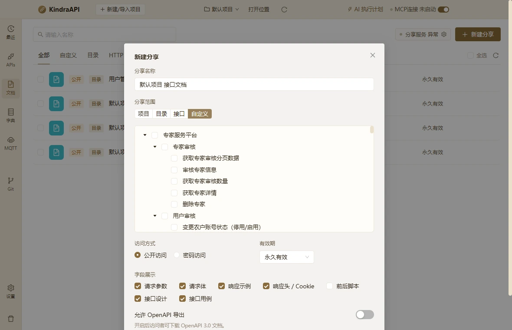

# 交互流：docs-new-share-tab-custom

- 路由：`/docs`
- 类型：dialog-tab
- 视口：1180×760
- 说明：—
- 所属页面：[pages/docs.md](../pages/docs.md)

## 可见控件

| 区块 | 文案 / aria / icon | 类型 | 状态 | 选择器 |
| --- | --- | --- | --- | --- |
| modal:新建分享 | Close | `button` | — | `div.ant-modal-root.css-dzyqf7 > div.ant-modal-wrap:nth-of-type(2) > div.ant-modal.css-dzyqf7 > div:nth-of-type(1) > div.ant-modal-content > button.ant-modal-close` |
| modal:新建分享 | 关闭 | `span` | — | `div.ant-modal-wrap:nth-of-type(2) > div.ant-modal.css-dzyqf7 > div:nth-of-type(1) > div.ant-modal-content > button.ant-modal-close > span.ant-modal-close-x` |
| modal:新建分享 | 新建分享 | `div` | — | `div#:rq5:` |
| modal:新建分享 | 请输入分享名称 | `input` | — | `div:nth-of-type(1) > div.ant-modal-content > div.ant-modal-body:nth-of-type(2) > div.docs-form > div.docs-field:nth-of-type(1) > input.ant-input.css-dzyqf7` |
| modal:新建分享 | 项目 | `label` | — | `div.ant-modal-content > div.ant-modal-body:nth-of-type(2) > div.docs-form > div.docs-field:nth-of-type(2) > div.ant-radio-group.ant-radio-group-solid > label.ant-radio-button-wrapper.css-dzyqf7:nth-of-type(1)` |
| modal:新建分享 | 目录 | `label` | — | `div.ant-modal-content > div.ant-modal-body:nth-of-type(2) > div.docs-form > div.docs-field:nth-of-type(2) > div.ant-radio-group.ant-radio-group-solid > label.ant-radio-button-wrapper.css-dzyqf7:nth-of-type(2)` |
| modal:新建分享 | 接口 | `label` | — | `div.ant-modal-content > div.ant-modal-body:nth-of-type(2) > div.docs-form > div.docs-field:nth-of-type(2) > div.ant-radio-group.ant-radio-group-solid > label.ant-radio-button-wrapper.css-dzyqf7:nth-of-type(3)` |
| modal:新建分享 | 自定义 | `label` | active | `div.ant-modal-content > div.ant-modal-body:nth-of-type(2) > div.docs-form > div.docs-field:nth-of-type(2) > div.ant-radio-group.ant-radio-group-solid > label.ant-radio-button-wrapper.ant-radio-button-wrapper-checked:nth-of-type(4)` |
| — | 公开访问 | `label` | — | `div.ant-modal-body:nth-of-type(2) > div.docs-form > div.docs-field-row:nth-of-type(4) > div.docs-field:nth-of-type(1) > div.ant-radio-group.ant-radio-group-outline > label.ant-radio-wrapper.ant-radio-wrapper-checked:nth-of-type(1)` |
| — | 密码访问 | `label` | — | `div.ant-modal-body:nth-of-type(2) > div.docs-form > div.docs-field-row:nth-of-type(4) > div.docs-field:nth-of-type(1) > div.ant-radio-group.ant-radio-group-outline > label.ant-radio-wrapper.css-dzyqf7:nth-of-type(2)` |
| — | 永久有效 | `div` | — | `div.ant-modal-body:nth-of-type(2) > div.docs-form > div.docs-field-row:nth-of-type(4) > div.docs-field:nth-of-type(2) > div.docs-inline > div.ant-select.ant-select-outlined` |
| — | 永久有效 | `span` | — | `div.docs-field:nth-of-type(2) > div.docs-inline > div.ant-select.ant-select-outlined > div.ant-select-selector > span.ant-select-selection-wrap > span.ant-select-selection-item:nth-of-type(2)` |
| modal:新建分享 | 请求参数 | `label` | — | `div.ant-modal-content > div.ant-modal-body:nth-of-type(2) > div.docs-form > div.docs-field:nth-of-type(5) > div.docs-checks > label.ant-checkbox-wrapper.ant-checkbox-wrapper-checked:nth-of-type(1)` |
| modal:新建分享 | 请求体 | `label` | — | `div.ant-modal-content > div.ant-modal-body:nth-of-type(2) > div.docs-form > div.docs-field:nth-of-type(5) > div.docs-checks > label.ant-checkbox-wrapper.ant-checkbox-wrapper-checked:nth-of-type(2)` |
| modal:新建分享 | 响应示例 | `label` | — | `div.ant-modal-content > div.ant-modal-body:nth-of-type(2) > div.docs-form > div.docs-field:nth-of-type(5) > div.docs-checks > label.ant-checkbox-wrapper.ant-checkbox-wrapper-checked:nth-of-type(3)` |
| modal:新建分享 | 响应头 / Cookie | `label` | — | `div.ant-modal-content > div.ant-modal-body:nth-of-type(2) > div.docs-form > div.docs-field:nth-of-type(5) > div.docs-checks > label.ant-checkbox-wrapper.ant-checkbox-wrapper-checked:nth-of-type(4)` |
| modal:新建分享 | 前后脚本 | `label` | — | `div.ant-modal-content > div.ant-modal-body:nth-of-type(2) > div.docs-form > div.docs-field:nth-of-type(5) > div.docs-checks > label.ant-checkbox-wrapper.css-dzyqf7:nth-of-type(5)` |
| modal:新建分享 | 接口设计 | `label` | — | `div.ant-modal-content > div.ant-modal-body:nth-of-type(2) > div.docs-form > div.docs-field:nth-of-type(5) > div.docs-checks > label.ant-checkbox-wrapper.ant-checkbox-wrapper-checked:nth-of-type(6)` |
| modal:新建分享 | 接口用例 | `label` | — | `div.ant-modal-content > div.ant-modal-body:nth-of-type(2) > div.docs-form > div.docs-field:nth-of-type(5) > div.docs-checks > label.ant-checkbox-wrapper.ant-checkbox-wrapper-checked:nth-of-type(7)` |
| modal:新建分享 | 取 消 | `button` | — | `div.ant-modal-wrap:nth-of-type(2) > div.ant-modal.css-dzyqf7 > div:nth-of-type(1) > div.ant-modal-content > div.ant-modal-footer:nth-of-type(3) > button.ant-btn.css-dzyqf7:nth-of-type(1)` |
| modal:新建分享 | 保 存 | `button` | — | `div.ant-modal-wrap:nth-of-type(2) > div.ant-modal.css-dzyqf7 > div:nth-of-type(1) > div.ant-modal-content > div.ant-modal-footer:nth-of-type(3) > button.ant-btn.css-dzyqf7:nth-of-type(2)` |

## 提示文案

**title 属性**

- 专家服务平台
- 专家审核
- 获取专家审核分页数据
- 审核专家信息
- 获取专家审核数量
- 获取专家详情
- 删除专家
- 用户审核
- 变更农户账号状态（停用/启用）
- 农户审核tab统计
- 农户审核详情
- 农户审核分页
- 删除农户（逻辑删除）
- 审核农户
- 【APP】农户注册
- 课程审核
- 课程审核分页
- 课程审核 tab 计数
- 课程详情
- 课程编辑
- 课程删除
- 课程发布/撤回
- 登录
- 获取图形验证码
- 账号密码登录（图形验证码）
- 账号密码登录（免图形验证码）
- 养殖技术库
- 分页列表
- 详情（含审核详情）
- 新增
- 编辑
- 删除
- 审核
- 撤回
- 重新提交
- 置顶/取消置顶
- Excel 批量导入
- 导入模板下载
- 创建部门下拉
- 用户管理
- 台账分页（含分类计数）
- 编辑用户
- 登录日志分页
- 权限卡片
- 恢复默认（清空角色权限）
- 批量重置账号权限
- 操作日志分页
- 台账导出
- 登录日志导出
- 操作日志导出
- 农户注册（新增合作社必填）
- 科研成果库
- 详情
- 新增（保存并提交审核）
- 推送
- 发布部门下拉
- 内容类型下拉
- 级别下拉
- APP 成果详情
- APP-我的消息（type=2/3/4 改读推送）
- APP-我的消息未读计数（四类）
- 生产培训课程
- 课程分页列表
- 上传课程（新增）
- 编辑课程
- 审核课程
- 撤回课程
- 置顶 / 取消置顶
- 删除课程
- Excel 批量上传
- 课程分类列表（含课程数）
- 新增课程分类
- 重命名课程分类
- 删除课程分类
- 单文件上传
- 信息推送
- 合作社
- 合作社分页
- 启用合作社列表（免登录）
- 新建合作社
- 编辑合作社
- 启用/停用合作社
- 删除合作社
- 推送列表分页
- 推送详情
- 新建推送
- 编辑推送
- 撤回推送
- 再次/重新推送
- 删除推送
- 推送统计
- APP 推送详情
- 供需交易订单
- 可响应供需信息分页
- 发布人交易完成
- 发布人确认订单
- 响应供需信息下单
- 历史订单分页
- 订单详情
- 采购订单/供货订单分页
- 菜单待确认数量
- 供需信息详情（扩展）
- 跨服务调用-我的种植
- 数字大棚列表
- 地图数字大棚列表
- 大棚最新数据及详情
- 大棚监控数据-线形图
- 枸杞
- web-查询企业信息联系人（地块负责人下拉）
- app-搜索作物列表
- 登录流程
- 信息化平台
- 1-登录行为验证码V2
- 2-登录行为验证码校验V2（已注释，恒通过）
- 3-获取手机验证码V2（已注释，不发真实短信）
- 4-账号密码+验证码登录V2（验证码不校验，返回 token）
- app-买手企业信息回显
- app-提交买手企业信息
- 永久有效

## 相关源码

- `src/renderer/src/components/DocShareDialog.tsx`：5 条提示
- `src/renderer/src/components/DocShareDialog.tsx`：6 个菜单项
- `src/renderer/src/components/DocShareDialog.tsx`：2 个 IPC 调用
- `src/renderer/src/components/DocShareLinkDialog.tsx`：4 条提示
- `src/renderer/src/components/DocShareLinkDialog.tsx`：4 个 IPC 调用
- `src/renderer/src/pages/DocsPage.tsx`：15 条提示
- `src/renderer/src/pages/DocsPage.tsx`：6 个 Tooltip
- `src/renderer/src/pages/DocsPage.tsx`：7 个 IPC 调用

> 返回 [交互流索引](README.md)
