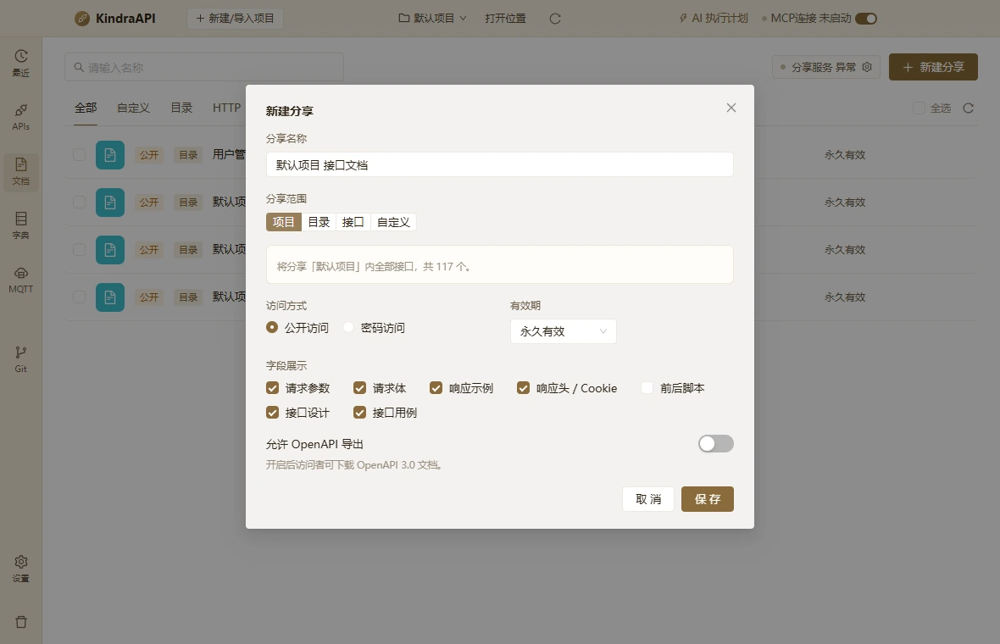

# 交互流：docs-new-share-tab-project

- 路由：`/docs`
- 类型：dialog-tab
- 视口：1180×760
- 说明：—
- 所属页面：[pages/docs.md](../pages/docs.md)

## 可见控件

| 区块 | 文案 / aria / icon | 类型 | 状态 | 选择器 |
| --- | --- | --- | --- | --- |
| modal:新建分享 | Close | `button` | — | `div.ant-modal-root.css-dzyqf7 > div.ant-modal-wrap:nth-of-type(2) > div.ant-modal.css-dzyqf7 > div:nth-of-type(1) > div.ant-modal-content > button.ant-modal-close` |
| modal:新建分享 | 关闭 | `span` | — | `div.ant-modal-wrap:nth-of-type(2) > div.ant-modal.css-dzyqf7 > div:nth-of-type(1) > div.ant-modal-content > button.ant-modal-close > span.ant-modal-close-x` |
| modal:新建分享 | 新建分享 | `div` | — | `div#:rq5:` |
| modal:新建分享 | 请输入分享名称 | `input` | — | `div:nth-of-type(1) > div.ant-modal-content > div.ant-modal-body:nth-of-type(2) > div.docs-form > div.docs-field:nth-of-type(1) > input.ant-input.css-dzyqf7` |
| modal:新建分享 | 项目 | `label` | active | `div.ant-modal-content > div.ant-modal-body:nth-of-type(2) > div.docs-form > div.docs-field:nth-of-type(2) > div.ant-radio-group.ant-radio-group-solid > label.ant-radio-button-wrapper.ant-radio-button-wrapper-checked:nth-of-type(1)` |
| modal:新建分享 | 目录 | `label` | — | `div.ant-modal-content > div.ant-modal-body:nth-of-type(2) > div.docs-form > div.docs-field:nth-of-type(2) > div.ant-radio-group.ant-radio-group-solid > label.ant-radio-button-wrapper.css-dzyqf7:nth-of-type(2)` |
| modal:新建分享 | 接口 | `label` | — | `div.ant-modal-content > div.ant-modal-body:nth-of-type(2) > div.docs-form > div.docs-field:nth-of-type(2) > div.ant-radio-group.ant-radio-group-solid > label.ant-radio-button-wrapper.css-dzyqf7:nth-of-type(3)` |
| modal:新建分享 | 自定义 | `label` | — | `div.ant-modal-content > div.ant-modal-body:nth-of-type(2) > div.docs-form > div.docs-field:nth-of-type(2) > div.ant-radio-group.ant-radio-group-solid > label.ant-radio-button-wrapper.css-dzyqf7:nth-of-type(4)` |
| — | 公开访问 | `label` | — | `div.ant-modal-body:nth-of-type(2) > div.docs-form > div.docs-field-row:nth-of-type(4) > div.docs-field:nth-of-type(1) > div.ant-radio-group.ant-radio-group-outline > label.ant-radio-wrapper.ant-radio-wrapper-checked:nth-of-type(1)` |
| — | 密码访问 | `label` | — | `div.ant-modal-body:nth-of-type(2) > div.docs-form > div.docs-field-row:nth-of-type(4) > div.docs-field:nth-of-type(1) > div.ant-radio-group.ant-radio-group-outline > label.ant-radio-wrapper.css-dzyqf7:nth-of-type(2)` |
| — | 永久有效 | `div` | — | `div.ant-modal-body:nth-of-type(2) > div.docs-form > div.docs-field-row:nth-of-type(4) > div.docs-field:nth-of-type(2) > div.docs-inline > div.ant-select.ant-select-outlined` |
| — | 永久有效 | `span` | — | `div.docs-field:nth-of-type(2) > div.docs-inline > div.ant-select.ant-select-outlined > div.ant-select-selector > span.ant-select-selection-wrap > span.ant-select-selection-item:nth-of-type(2)` |
| modal:新建分享 | 请求参数 | `label` | — | `div.ant-modal-content > div.ant-modal-body:nth-of-type(2) > div.docs-form > div.docs-field:nth-of-type(5) > div.docs-checks > label.ant-checkbox-wrapper.ant-checkbox-wrapper-checked:nth-of-type(1)` |
| modal:新建分享 | 请求体 | `label` | — | `div.ant-modal-content > div.ant-modal-body:nth-of-type(2) > div.docs-form > div.docs-field:nth-of-type(5) > div.docs-checks > label.ant-checkbox-wrapper.ant-checkbox-wrapper-checked:nth-of-type(2)` |
| modal:新建分享 | 响应示例 | `label` | — | `div.ant-modal-content > div.ant-modal-body:nth-of-type(2) > div.docs-form > div.docs-field:nth-of-type(5) > div.docs-checks > label.ant-checkbox-wrapper.ant-checkbox-wrapper-checked:nth-of-type(3)` |
| modal:新建分享 | 响应头 / Cookie | `label` | — | `div.ant-modal-content > div.ant-modal-body:nth-of-type(2) > div.docs-form > div.docs-field:nth-of-type(5) > div.docs-checks > label.ant-checkbox-wrapper.ant-checkbox-wrapper-checked:nth-of-type(4)` |
| modal:新建分享 | 前后脚本 | `label` | — | `div.ant-modal-content > div.ant-modal-body:nth-of-type(2) > div.docs-form > div.docs-field:nth-of-type(5) > div.docs-checks > label.ant-checkbox-wrapper.css-dzyqf7:nth-of-type(5)` |
| modal:新建分享 | 接口设计 | `label` | — | `div.ant-modal-content > div.ant-modal-body:nth-of-type(2) > div.docs-form > div.docs-field:nth-of-type(5) > div.docs-checks > label.ant-checkbox-wrapper.ant-checkbox-wrapper-checked:nth-of-type(6)` |
| modal:新建分享 | 接口用例 | `label` | — | `div.ant-modal-content > div.ant-modal-body:nth-of-type(2) > div.docs-form > div.docs-field:nth-of-type(5) > div.docs-checks > label.ant-checkbox-wrapper.ant-checkbox-wrapper-checked:nth-of-type(7)` |
| modal:新建分享 | 取 消 | `button` | — | `div.ant-modal-wrap:nth-of-type(2) > div.ant-modal.css-dzyqf7 > div:nth-of-type(1) > div.ant-modal-content > div.ant-modal-footer:nth-of-type(3) > button.ant-btn.css-dzyqf7:nth-of-type(1)` |
| modal:新建分享 | 保 存 | `button` | — | `div.ant-modal-wrap:nth-of-type(2) > div.ant-modal.css-dzyqf7 > div:nth-of-type(1) > div.ant-modal-content > div.ant-modal-footer:nth-of-type(3) > button.ant-btn.css-dzyqf7:nth-of-type(2)` |

## 提示文案

**title 属性**

- 永久有效

## 相关源码

- `src/renderer/src/components/DocShareDialog.tsx`：5 条提示
- `src/renderer/src/components/DocShareDialog.tsx`：6 个菜单项
- `src/renderer/src/components/DocShareDialog.tsx`：2 个 IPC 调用
- `src/renderer/src/components/DocShareLinkDialog.tsx`：4 条提示
- `src/renderer/src/components/DocShareLinkDialog.tsx`：4 个 IPC 调用
- `src/renderer/src/pages/DocsPage.tsx`：15 条提示
- `src/renderer/src/pages/DocsPage.tsx`：6 个 Tooltip
- `src/renderer/src/pages/DocsPage.tsx`：7 个 IPC 调用

> 返回 [交互流索引](README.md)
