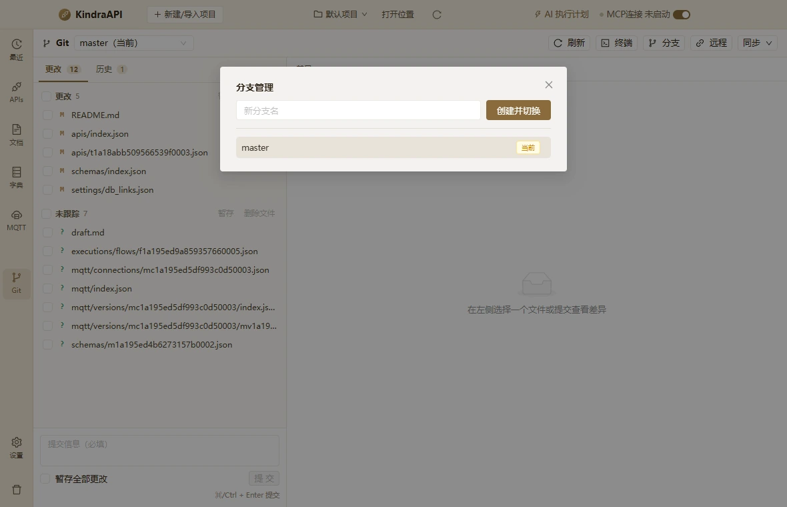

# 交互流：git-dialog-branches

- 路由：`/git`
- 类型：dialog
- 视口：1180×760
- 说明：—
- 所属页面：[pages/git.md](../pages/git.md)

## 可见控件

| 区块 | 文案 / aria / icon | 类型 | 状态 | 选择器 |
| --- | --- | --- | --- | --- |
| modal:分支管理 | Close | `button` | — | `div.ant-modal-root.css-dzyqf7 > div.ant-modal-wrap:nth-of-type(2) > div.ant-modal.css-dzyqf7 > div:nth-of-type(1) > div.ant-modal-content > button.ant-modal-close` |
| modal:分支管理 | 关闭 | `span` | — | `div.ant-modal-wrap:nth-of-type(2) > div.ant-modal.css-dzyqf7 > div:nth-of-type(1) > div.ant-modal-content > button.ant-modal-close > span.ant-modal-close-x` |
| modal:分支管理 | 分支管理 | `div` | — | `div#:run:` |
| modal:分支管理 | 新分支名 | `input` | — | `div.ant-modal.css-dzyqf7 > div:nth-of-type(1) > div.ant-modal-content > div.ant-modal-body:nth-of-type(2) > div.git-branch-add:nth-of-type(1) > input.ant-input.css-dzyqf7` |
| modal:分支管理 | 创建并切换 | `button` | — | `div.ant-modal.css-dzyqf7 > div:nth-of-type(1) > div.ant-modal-content > div.ant-modal-body:nth-of-type(2) > div.git-branch-add:nth-of-type(1) > button.ant-btn.css-dzyqf7` |

## 提示文案

未捕获到提示文案。

## 相关源码

- `src/renderer/src/pages/GitPage.tsx`：24 条提示
- `src/renderer/src/pages/GitPage.tsx`：6 个菜单项
- `src/renderer/src/pages/GitPage.tsx`：22 个 IPC 调用

> 返回 [交互流索引](README.md)
