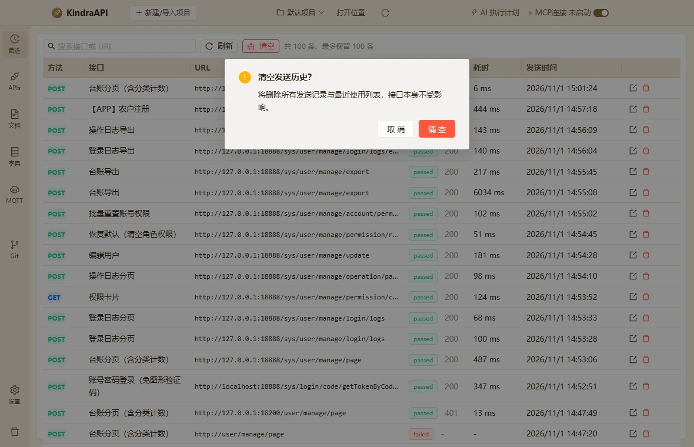

# 交互流：history-confirm-clear

- 路由：`/history`
- 类型：confirm
- 视口：1180×760
- 说明：—
- 所属页面：[pages/history.md](../pages/history.md)

## 可见控件

| 区块 | 文案 / aria / icon | 类型 | 状态 | 选择器 |
| --- | --- | --- | --- | --- |
| modal:清空发送历史？ | 取 消 | `button` | — | `div:nth-of-type(1) > div.ant-modal-content > div.ant-modal-body:nth-of-type(2) > div.ant-modal-confirm-body-wrapper > div.ant-modal-confirm-btns:nth-of-type(2) > button.ant-btn.css-dzyqf7:nth-of-type(1)` |
| modal:清空发送历史？ | 清 空 | `button` | — | `div:nth-of-type(1) > div.ant-modal-content > div.ant-modal-body:nth-of-type(2) > div.ant-modal-confirm-body-wrapper > div.ant-modal-confirm-btns:nth-of-type(2) > button.ant-btn.css-dzyqf7:nth-of-type(2)` |

## 提示文案

未捕获到提示文案。

## 相关源码

- `src/renderer/src/components/ResponsePanel.tsx`：9 条提示
- `src/renderer/src/components/ResponsePanel.tsx`：1 个菜单项
- `src/renderer/src/components/ResponsePanel.tsx`：1 个 Tooltip
- `src/renderer/src/components/ResponsePanel.tsx`：5 个 IPC 调用
- `src/renderer/src/pages/HistoryPage.tsx`：7 条提示
- `src/renderer/src/pages/HistoryPage.tsx`：2 个 Tooltip
- `src/renderer/src/pages/HistoryPage.tsx`：4 个 IPC 调用

> 返回 [交互流索引](README.md)
