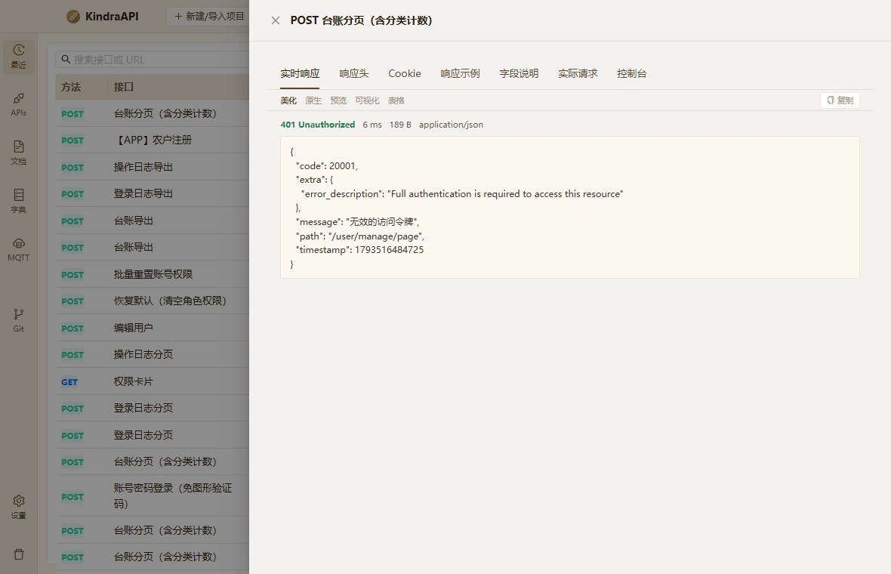

# 交互流：history-detail-drawer

- 路由：`/history`
- 类型：drawer
- 视口：1180×760
- 说明：—
- 所属页面：[pages/history.md](../pages/history.md)

## 可见控件

| 区块 | 文案 / aria / icon | 类型 | 状态 | 选择器 |
| --- | --- | --- | --- | --- |
| drawer:POST 台账分页（含分类计数） | 关闭 | `button` | — | `div.ant-drawer.ant-drawer-right > div.ant-drawer-content-wrapper:nth-of-type(3) > div.ant-drawer-content > div.ant-drawer-header:nth-of-type(1) > div.ant-drawer-header-title > button.ant-drawer-close` |
| drawer:POST 台账分页（含分类计数） | POST 台账分页（含分类计数） | `div` | — | `div#:r5n:` |
| drawer:POST 台账分页（含分类计数） | 实时响应 | `button` | active | `div.ant-drawer-content-wrapper:nth-of-type(3) > div.ant-drawer-content > div.ant-drawer-body:nth-of-type(2) > section.resp > div.resp-tabs:nth-of-type(1) > button.active:nth-of-type(1)` |
| drawer:POST 台账分页（含分类计数） | 响应头 | `button` | — | `div.ant-drawer-content-wrapper:nth-of-type(3) > div.ant-drawer-content > div.ant-drawer-body:nth-of-type(2) > section.resp > div.resp-tabs:nth-of-type(1) > button:nth-of-type(2)` |
| drawer:POST 台账分页（含分类计数） | Cookie | `button` | — | `div.ant-drawer-content-wrapper:nth-of-type(3) > div.ant-drawer-content > div.ant-drawer-body:nth-of-type(2) > section.resp > div.resp-tabs:nth-of-type(1) > button:nth-of-type(3)` |
| drawer:POST 台账分页（含分类计数） | 响应示例 | `button` | — | `div.ant-drawer-content-wrapper:nth-of-type(3) > div.ant-drawer-content > div.ant-drawer-body:nth-of-type(2) > section.resp > div.resp-tabs:nth-of-type(1) > button:nth-of-type(4)` |
| drawer:POST 台账分页（含分类计数） | 字段说明 | `button` | — | `div.ant-drawer-content-wrapper:nth-of-type(3) > div.ant-drawer-content > div.ant-drawer-body:nth-of-type(2) > section.resp > div.resp-tabs:nth-of-type(1) > button:nth-of-type(5)` |
| drawer:POST 台账分页（含分类计数） | 实际请求 | `button` | — | `div.ant-drawer-content-wrapper:nth-of-type(3) > div.ant-drawer-content > div.ant-drawer-body:nth-of-type(2) > section.resp > div.resp-tabs:nth-of-type(1) > button:nth-of-type(6)` |
| drawer:POST 台账分页（含分类计数） | 控制台 | `button` | — | `div.ant-drawer-content-wrapper:nth-of-type(3) > div.ant-drawer-content > div.ant-drawer-body:nth-of-type(2) > section.resp > div.resp-tabs:nth-of-type(1) > button:nth-of-type(7)` |
| drawer:POST 台账分页（含分类计数） | 美化 | `button` | — | `div.ant-drawer-content-wrapper:nth-of-type(3) > div.ant-drawer-content > div.ant-drawer-body:nth-of-type(2) > section.resp > div.resp-toolbar:nth-of-type(2) > button.on:nth-of-type(1)` |
| drawer:POST 台账分页（含分类计数） | 原生 | `button` | — | `div.ant-drawer-content-wrapper:nth-of-type(3) > div.ant-drawer-content > div.ant-drawer-body:nth-of-type(2) > section.resp > div.resp-toolbar:nth-of-type(2) > button:nth-of-type(2)` |
| drawer:POST 台账分页（含分类计数） | 预览 | `button` | — | `div.ant-drawer-content-wrapper:nth-of-type(3) > div.ant-drawer-content > div.ant-drawer-body:nth-of-type(2) > section.resp > div.resp-toolbar:nth-of-type(2) > button:nth-of-type(3)` |
| drawer:POST 台账分页（含分类计数） | 可视化 | `button` | — | `div.ant-drawer-content-wrapper:nth-of-type(3) > div.ant-drawer-content > div.ant-drawer-body:nth-of-type(2) > section.resp > div.resp-toolbar:nth-of-type(2) > button:nth-of-type(4)` |
| drawer:POST 台账分页（含分类计数） | 表格 | `button` | — | `div.ant-drawer-content-wrapper:nth-of-type(3) > div.ant-drawer-content > div.ant-drawer-body:nth-of-type(2) > section.resp > div.resp-toolbar:nth-of-type(2) > button:nth-of-type(5)` |
| drawer:POST 台账分页（含分类计数） | 复制 | `button` | — | `div.ant-drawer-content-wrapper:nth-of-type(3) > div.ant-drawer-content > div.ant-drawer-body:nth-of-type(2) > section.resp > div.resp-toolbar:nth-of-type(2) > button.resp-copy:nth-of-type(6)` |

## 提示文案

**title 属性**

- 复制响应体

## 相关源码

- `src/renderer/src/components/ResponsePanel.tsx`：9 条提示
- `src/renderer/src/components/ResponsePanel.tsx`：1 个菜单项
- `src/renderer/src/components/ResponsePanel.tsx`：1 个 Tooltip
- `src/renderer/src/components/ResponsePanel.tsx`：5 个 IPC 调用
- `src/renderer/src/pages/HistoryPage.tsx`：7 条提示
- `src/renderer/src/pages/HistoryPage.tsx`：2 个 Tooltip
- `src/renderer/src/pages/HistoryPage.tsx`：4 个 IPC 调用

> 返回 [交互流索引](README.md)
