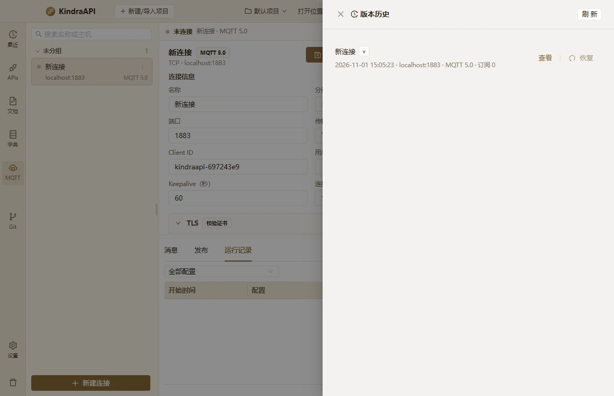

# 交互流：mqtt-drawer-versions

- 路由：`/mqtt`
- 类型：drawer
- 视口：1180×760
- 说明：—
- 所属页面：[pages/mqtt.md](../pages/mqtt.md)

## 可见控件

| 区块 | 文案 / aria / icon | 类型 | 状态 | 选择器 |
| --- | --- | --- | --- | --- |
| drawer:版本历史 | 关闭 | `button` | — | `div.ant-drawer.ant-drawer-right > div.ant-drawer-content-wrapper:nth-of-type(3) > div.ant-drawer-content > div.ant-drawer-header:nth-of-type(1) > div.ant-drawer-header-title:nth-of-type(1) > button.ant-drawer-close` |
| drawer:版本历史 | 版本历史 | `div` | — | `div#:rt4:` |
| drawer:版本历史 | 刷 新 | `button` | — | `div.ant-drawer.ant-drawer-right > div.ant-drawer-content-wrapper:nth-of-type(3) > div.ant-drawer-content > div.ant-drawer-header:nth-of-type(1) > div.ant-drawer-extra:nth-of-type(2) > button.ant-btn.css-dzyqf7` |
| — | 查看 | `button` | — | `div.ant-spin-container > ul.ant-list-items > li.ant-list-item.mqtt-version-item > ul.ant-list-item-action > li:nth-of-type(1) > button.ant-btn.css-dzyqf7` |
| — | 恢复 | `button` | — | `div.ant-spin-container > ul.ant-list-items > li.ant-list-item.mqtt-version-item > ul.ant-list-item-action > li:nth-of-type(2) > button.ant-btn.css-dzyqf7` |

## 提示文案

未捕获到提示文案。

## 相关源码

- `src/renderer/src/components/mqtt/AttemptsPanel.tsx`：7 条提示
- `src/renderer/src/components/mqtt/AttemptsPanel.tsx`：3 个菜单项
- `src/renderer/src/components/mqtt/AttemptsPanel.tsx`：2 个 Tooltip
- `src/renderer/src/components/mqtt/AttemptsPanel.tsx`：3 个 IPC 调用
- `src/renderer/src/components/mqtt/MessagesPanel.tsx`：17 条提示
- `src/renderer/src/components/mqtt/MessagesPanel.tsx`：2 个菜单项
- `src/renderer/src/components/mqtt/MessagesPanel.tsx`：1 个 Tooltip
- `src/renderer/src/components/mqtt/MessagesPanel.tsx`：7 个 IPC 调用
- `src/renderer/src/components/mqtt/ProfileEditor.tsx`：5 条提示
- `src/renderer/src/components/mqtt/ProfileEditor.tsx`：16 个菜单项
- `src/renderer/src/components/mqtt/ProfileEditor.tsx`：1 个 Tooltip
- `src/renderer/src/components/mqtt/ProfileEditor.tsx`：2 个 IPC 调用
- `src/renderer/src/components/mqtt/ProfileList.tsx`：3 条提示
- `src/renderer/src/components/mqtt/ProfileList.tsx`：4 个菜单项
- `src/renderer/src/components/mqtt/ProfileList.tsx`：1 个 Tooltip
- `src/renderer/src/components/mqtt/PublishPanel.tsx`：15 条提示
- `src/renderer/src/components/mqtt/PublishPanel.tsx`：3 个菜单项
- `src/renderer/src/components/mqtt/PublishPanel.tsx`：18 个 IPC 调用
- `src/renderer/src/components/mqtt/UserPropertiesEditor.tsx`：1 个菜单项
- `src/renderer/src/components/mqtt/UserPropertiesEditor.tsx`：1 个 Tooltip
- `src/renderer/src/components/mqtt/VersionDrawer.tsx`：6 条提示
- `src/renderer/src/components/mqtt/VersionDrawer.tsx`：3 个 IPC 调用
- `src/renderer/src/pages/MqttPage.tsx`：12 条提示
- `src/renderer/src/pages/MqttPage.tsx`：3 个菜单项
- `src/renderer/src/pages/MqttPage.tsx`：2 个 Tooltip
- `src/renderer/src/pages/MqttPage.tsx`：21 个 IPC 调用

> 返回 [交互流索引](README.md)
