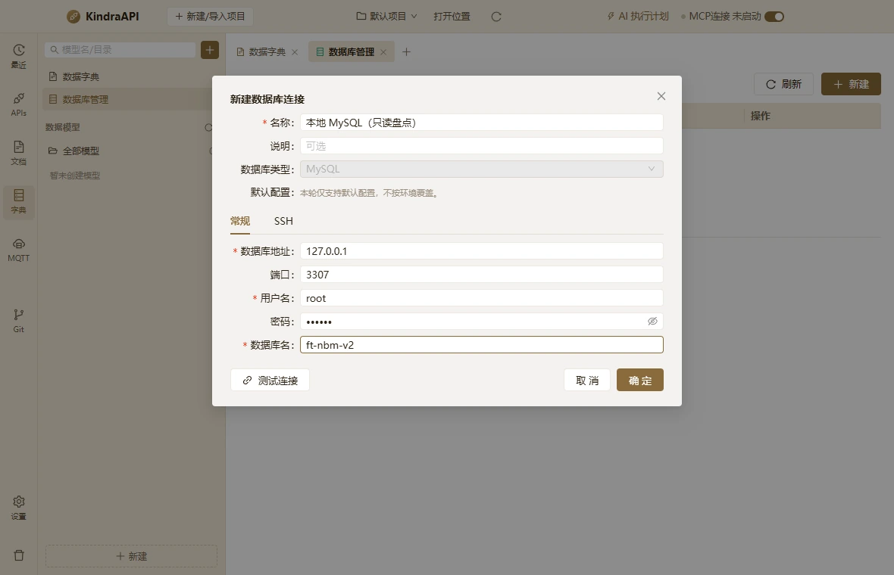

# 交互流：schemas-dialog-db-connection-filled

- 路由：`/schemas`
- 类型：dialog
- 视口：1180×760
- 说明：—
- 所属页面：[pages/schemas.md](../pages/schemas.md)

## 可见控件

| 区块 | 文案 / aria / icon | 类型 | 状态 | 选择器 |
| --- | --- | --- | --- | --- |
| modal:新建数据库连接 | Close | `button` | — | `div.ant-modal-root.css-dzyqf7 > div.ant-modal-wrap:nth-of-type(2) > div.ant-modal.css-dzyqf7 > div:nth-of-type(1) > div.ant-modal-content > button.ant-modal-close` |
| modal:新建数据库连接 | 关闭 | `span` | — | `div.ant-modal-wrap:nth-of-type(2) > div.ant-modal.css-dzyqf7 > div:nth-of-type(1) > div.ant-modal-content > button.ant-modal-close > span.ant-modal-close-x` |
| modal:新建数据库连接 | 新建数据库连接 | `div` | — | `div#:rrh:` |
| form | 名称 | `div` | — | `div.ant-modal-content > div.ant-modal-body:nth-of-type(2) > form.ant-form.ant-form-horizontal > div.ant-form-item.css-dzyqf7:nth-of-type(1) > div.ant-row.ant-form-item-row > div.ant-col.ant-form-item-label:nth-of-type(1)` |
| form | 名称 | `label` | — | `div.ant-modal-body:nth-of-type(2) > form.ant-form.ant-form-horizontal > div.ant-form-item.css-dzyqf7:nth-of-type(1) > div.ant-row.ant-form-item-row > div.ant-col.ant-form-item-label:nth-of-type(1) > label.ant-form-item-required` |
| form | 连接名称 | `input` | — | `div.ant-form-item.css-dzyqf7:nth-of-type(1) > div.ant-row.ant-form-item-row > div.ant-col.ant-form-item-control:nth-of-type(2) > div.ant-form-item-control-input > div.ant-form-item-control-input-content > input.ant-input.ant-input-sm` |
| form | 说明 | `div` | — | `div.ant-modal-content > div.ant-modal-body:nth-of-type(2) > form.ant-form.ant-form-horizontal > div.ant-form-item.css-dzyqf7:nth-of-type(2) > div.ant-row.ant-form-item-row > div.ant-col.ant-form-item-label:nth-of-type(1)` |
| form | 说明 | `label` | — | `div.ant-modal-body:nth-of-type(2) > form.ant-form.ant-form-horizontal > div.ant-form-item.css-dzyqf7:nth-of-type(2) > div.ant-row.ant-form-item-row > div.ant-col.ant-form-item-label:nth-of-type(1) > label` |
| form | 可选 | `input` | — | `div.ant-form-item.css-dzyqf7:nth-of-type(2) > div.ant-row.ant-form-item-row > div.ant-col.ant-form-item-control:nth-of-type(2) > div.ant-form-item-control-input > div.ant-form-item-control-input-content > input.ant-input.ant-input-sm` |
| form | 数据库类型 | `div` | — | `div.ant-modal-content > div.ant-modal-body:nth-of-type(2) > form.ant-form.ant-form-horizontal > div.ant-form-item.css-dzyqf7:nth-of-type(3) > div.ant-row.ant-form-item-row > div.ant-col.ant-form-item-label:nth-of-type(1)` |
| form | 数据库类型 | `label` | — | `div.ant-modal-body:nth-of-type(2) > form.ant-form.ant-form-horizontal > div.ant-form-item.css-dzyqf7:nth-of-type(3) > div.ant-row.ant-form-item-row > div.ant-col.ant-form-item-label:nth-of-type(1) > label` |
| form | MySQL | `div` | — | `div.ant-form-item.css-dzyqf7:nth-of-type(3) > div.ant-row.ant-form-item-row > div.ant-col.ant-form-item-control:nth-of-type(2) > div.ant-form-item-control-input > div.ant-form-item-control-input-content > div.ant-select.ant-select-sm` |
| — | MySQL | `span` | — | `div.ant-form-item-control-input > div.ant-form-item-control-input-content > div.ant-select.ant-select-sm > div.ant-select-selector > span.ant-select-selection-wrap > span.ant-select-selection-item:nth-of-type(2)` |
| form | 默认配置 | `div` | — | `div.ant-modal-content > div.ant-modal-body:nth-of-type(2) > form.ant-form.ant-form-horizontal > div.ant-form-item.css-dzyqf7:nth-of-type(4) > div.ant-row.ant-form-item-row > div.ant-col.ant-form-item-label:nth-of-type(1)` |
| form | 默认配置 | `label` | — | `div.ant-modal-body:nth-of-type(2) > form.ant-form.ant-form-horizontal > div.ant-form-item.css-dzyqf7:nth-of-type(4) > div.ant-row.ant-form-item-row > div.ant-col.ant-form-item-label:nth-of-type(1) > label` |
| form | 常规 | `div` | active | `form.ant-form.ant-form-horizontal > div.ant-tabs.ant-tabs-top:nth-of-type(5) > div.ant-tabs-nav:nth-of-type(1) > div.ant-tabs-nav-wrap:nth-of-type(1) > div.ant-tabs-nav-list > div.ant-tabs-tab.ant-tabs-tab-active:nth-of-type(1)` |
| form | 常规 | `div/tab` | — | `div#rc-tabs-0-tab-regular` |
| form | SSH | `div` | — | `form.ant-form.ant-form-horizontal > div.ant-tabs.ant-tabs-top:nth-of-type(5) > div.ant-tabs-nav:nth-of-type(1) > div.ant-tabs-nav-wrap:nth-of-type(1) > div.ant-tabs-nav-list > div.ant-tabs-tab:nth-of-type(2)` |
| form | SSH | `div/tab` | — | `div#rc-tabs-0-tab-ssh` |
| — | 数据库地址 | `div` | — | `div#rc-tabs-0-panel-regular > div > div.ant-form-item.css-dzyqf7:nth-of-type(1) > div.ant-row.ant-form-item-row > div.ant-col.ant-form-item-label:nth-of-type(1)` |
| — | 数据库地址 | `label` | — | `div#rc-tabs-0-panel-regular > div > div.ant-form-item.css-dzyqf7:nth-of-type(1) > div.ant-row.ant-form-item-row > div.ant-col.ant-form-item-label:nth-of-type(1) > label.ant-form-item-required` |
| — | 端口 | `div` | — | `div#rc-tabs-0-panel-regular > div > div.ant-form-item.css-dzyqf7:nth-of-type(2) > div.ant-row.ant-form-item-row > div.ant-col.ant-form-item-label:nth-of-type(1)` |
| — | 端口 | `label` | — | `div#rc-tabs-0-panel-regular > div > div.ant-form-item.css-dzyqf7:nth-of-type(2) > div.ant-row.ant-form-item-row > div.ant-col.ant-form-item-label:nth-of-type(1) > label` |
| — | anticon-up | `div` | — | `div.ant-form-item.css-dzyqf7:nth-of-type(2) > div.ant-row.ant-form-item-row > div.ant-col.ant-form-item-control:nth-of-type(2) > div.ant-form-item-control-input > div.ant-form-item-control-input-content > div.ant-input-number.ant-input-number-sm` |
| — | Increase Value | `span/button` | — | `div.ant-col.ant-form-item-control:nth-of-type(2) > div.ant-form-item-control-input > div.ant-form-item-control-input-content > div.ant-input-number.ant-input-number-sm > div.ant-input-number-handler-wrap:nth-of-type(1) > span.ant-input-number-handler.ant-input-number-handler-up:nth-of-type(1)` |
| — | Decrease Value | `span/button` | — | `div.ant-col.ant-form-item-control:nth-of-type(2) > div.ant-form-item-control-input > div.ant-form-item-control-input-content > div.ant-input-number.ant-input-number-sm > div.ant-input-number-handler-wrap:nth-of-type(1) > span.ant-input-number-handler.ant-input-number-handler-down:nth-of-type(2)` |
| — | 3306 | `input/spinbutton` | — | `div.ant-col.ant-form-item-control:nth-of-type(2) > div.ant-form-item-control-input > div.ant-form-item-control-input-content > div.ant-input-number.ant-input-number-sm > div.ant-input-number-input-wrap:nth-of-type(2) > input.ant-input-number-input` |
| — | 用户名 | `div` | — | `div#rc-tabs-0-panel-regular > div > div.ant-form-item.css-dzyqf7:nth-of-type(3) > div.ant-row.ant-form-item-row > div.ant-col.ant-form-item-label:nth-of-type(1)` |
| — | 用户名 | `label` | — | `div#rc-tabs-0-panel-regular > div > div.ant-form-item.css-dzyqf7:nth-of-type(3) > div.ant-row.ant-form-item-row > div.ant-col.ant-form-item-label:nth-of-type(1) > label.ant-form-item-required` |
| — | root | `input` | — | `div.ant-form-item.css-dzyqf7:nth-of-type(3) > div.ant-row.ant-form-item-row > div.ant-col.ant-form-item-control:nth-of-type(2) > div.ant-form-item-control-input > div.ant-form-item-control-input-content > input.ant-input.ant-input-sm` |
| — | 密码 | `div` | — | `div#rc-tabs-0-panel-regular > div > div.ant-form-item.css-dzyqf7:nth-of-type(4) > div.ant-row.ant-form-item-row > div.ant-col.ant-form-item-label:nth-of-type(1)` |
| — | 密码 | `label` | — | `div#rc-tabs-0-panel-regular > div > div.ant-form-item.css-dzyqf7:nth-of-type(4) > div.ant-row.ant-form-item-row > div.ant-col.ant-form-item-label:nth-of-type(1) > label` |
| — | 密码 | `input` | — | `div.ant-row.ant-form-item-row > div.ant-col.ant-form-item-control:nth-of-type(2) > div.ant-form-item-control-input > div.ant-form-item-control-input-content > span.ant-input-affix-wrapper.ant-input-affix-wrapper-sm > input.ant-input.ant-input-sm` |
| — | 数据库名 | `div` | — | `div#rc-tabs-0-panel-regular > div > div.ant-form-item.css-dzyqf7:nth-of-type(5) > div.ant-row.ant-form-item-row > div.ant-col.ant-form-item-label:nth-of-type(1)` |
| — | 数据库名 | `label` | — | `div#rc-tabs-0-panel-regular > div > div.ant-form-item.css-dzyqf7:nth-of-type(5) > div.ant-row.ant-form-item-row > div.ant-col.ant-form-item-label:nth-of-type(1) > label.ant-form-item-required` |
| — | database | `input` | — | `div.ant-form-item.css-dzyqf7:nth-of-type(5) > div.ant-row.ant-form-item-row > div.ant-col.ant-form-item-control:nth-of-type(2) > div.ant-form-item-control-input > div.ant-form-item-control-input-content > input.ant-input.ant-input-sm` |
| modal:新建数据库连接 | 测试连接 | `button` | — | `div.ant-modal.css-dzyqf7 > div:nth-of-type(1) > div.ant-modal-content > div.ant-modal-footer:nth-of-type(3) > div > button.ant-btn.css-dzyqf7:nth-of-type(1)` |
| modal:新建数据库连接 | 取 消 | `button` | — | `div.ant-modal.css-dzyqf7 > div:nth-of-type(1) > div.ant-modal-content > div.ant-modal-footer:nth-of-type(3) > div > button.ant-btn.css-dzyqf7:nth-of-type(2)` |
| modal:新建数据库连接 | 确 定 | `button` | — | `div.ant-modal.css-dzyqf7 > div:nth-of-type(1) > div.ant-modal-content > div.ant-modal-footer:nth-of-type(3) > div > button.ant-btn.css-dzyqf7:nth-of-type(3)` |

## 提示文案

**title 属性**

- 名称
- 说明
- 数据库类型
- MySQL
- 默认配置
- 数据库地址
- 端口
- 用户名
- 密码
- 数据库名

## 相关源码

- `src/renderer/src/components/schemas/DatabasePanel.tsx`：11 条提示
- `src/renderer/src/components/schemas/DatabasePanel.tsx`：15 个菜单项
- `src/renderer/src/components/schemas/DatabasePanel.tsx`：3 个 Tooltip
- `src/renderer/src/components/schemas/DatabasePanel.tsx`：7 个 IPC 调用
- `src/renderer/src/components/schemas/DictionaryPanel.tsx`：9 条提示
- `src/renderer/src/components/schemas/DictionaryPanel.tsx`：6 个菜单项
- `src/renderer/src/components/schemas/DictionaryPanel.tsx`：2 个 Tooltip
- `src/renderer/src/components/schemas/DictionaryPanel.tsx`：5 个 IPC 调用
- `src/renderer/src/components/schemas/DictionarySuggest.tsx`：1 个菜单项
- `src/renderer/src/components/schemas/DictionarySuggest.tsx`：2 个 IPC 调用
- `src/renderer/src/components/schemas/ModelEditor.tsx`：12 条提示
- `src/renderer/src/components/schemas/ModelEditor.tsx`：2 个 Tooltip
- `src/renderer/src/components/schemas/ModelEditor.tsx`：5 个 IPC 调用
- `src/renderer/src/components/schemas/ModelPickerModal.tsx`：1 条提示
- `src/renderer/src/components/schemas/ModelPickerModal.tsx`：4 个 IPC 调用
- `src/renderer/src/components/schemas/ModelsListPanel.tsx`：17 个菜单项
- `src/renderer/src/components/schemas/ModelsListPanel.tsx`：1 个 Tooltip
- `src/renderer/src/components/schemas/SchemaFieldEditor.tsx`：11 个菜单项
- `src/renderer/src/components/schemas/SchemaFieldEditor.tsx`：1 个 Tooltip
- `src/renderer/src/components/schemas/modelDocumentation.ts`：2 个 IPC 调用
- `src/renderer/src/pages/SchemasPage.tsx`：15 条提示
- `src/renderer/src/pages/SchemasPage.tsx`：11 个菜单项
- `src/renderer/src/pages/SchemasPage.tsx`：1 个 Tooltip
- `src/renderer/src/pages/SchemasPage.tsx`：8 个 IPC 调用

> 返回 [交互流索引](README.md)
