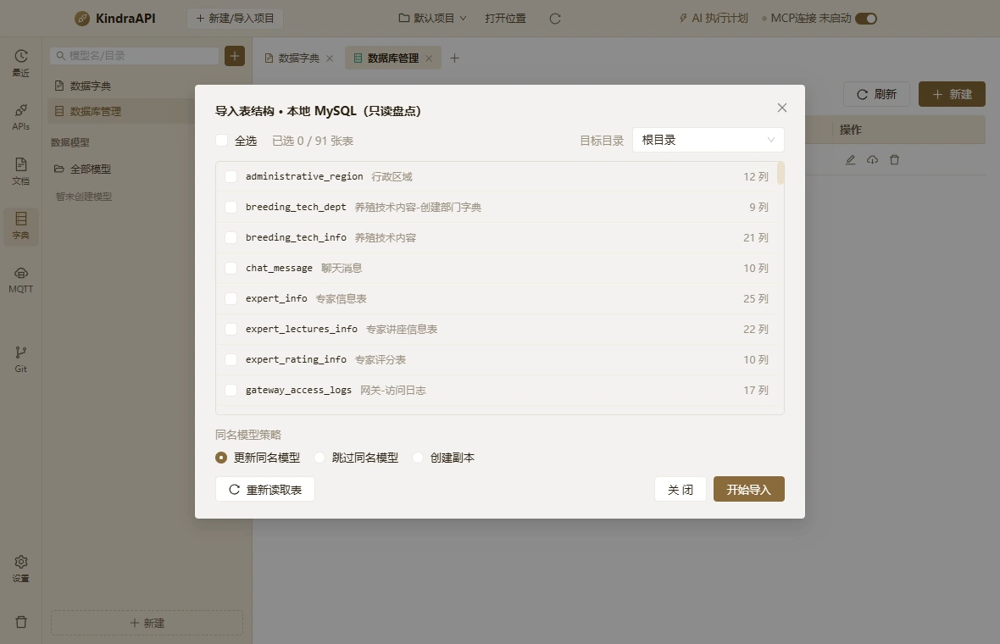

# 交互流：schemas-dialog-import-tables

- 路由：`/schemas`
- 类型：dialog
- 视口：1180×760
- 说明：导入表结构：表列表（ft-nbm-v2，只读）
- 所属页面：[pages/schemas.md](../pages/schemas.md)

## 可见控件

| 区块 | 文案 / aria / icon | 类型 | 状态 | 选择器 |
| --- | --- | --- | --- | --- |
| modal:导入表结构 · 本地 MySQL（只读盘点） | Close | `button` | — | `div.ant-modal-root.css-dzyqf7 > div.ant-modal-wrap:nth-of-type(2) > div.ant-modal.css-dzyqf7 > div:nth-of-type(1) > div.ant-modal-content > button.ant-modal-close` |
| modal:导入表结构 · 本地 MySQL（只读盘点） | 关闭 | `span` | — | `div.ant-modal-wrap:nth-of-type(2) > div.ant-modal.css-dzyqf7 > div:nth-of-type(1) > div.ant-modal-content > button.ant-modal-close > span.ant-modal-close-x` |
| modal:导入表结构 · 本地 MySQL（只读盘点） | 导入表结构 · 本地 MySQL（只读盘点） | `div` | — | `div#:rrq:` |
| modal:导入表结构 · 本地 MySQL（只读盘点） | 全选 | `label` | — | `div.ant-modal.css-dzyqf7 > div:nth-of-type(1) > div.ant-modal-content > div.ant-modal-body:nth-of-type(2) > div.dict-head:nth-of-type(1) > label.ant-checkbox-wrapper.css-dzyqf7` |
| modal:导入表结构 · 本地 MySQL（只读盘点） | 根目录 | `div` | — | `div.ant-modal.css-dzyqf7 > div:nth-of-type(1) > div.ant-modal-content > div.ant-modal-body:nth-of-type(2) > div.dict-head:nth-of-type(1) > div.ant-select.ant-select-outlined` |
| — | 根目录 | `span` | — | `div.ant-modal-body:nth-of-type(2) > div.dict-head:nth-of-type(1) > div.ant-select.ant-select-outlined > div.ant-select-selector > span.ant-select-selection-wrap > span.ant-select-selection-item:nth-of-type(2)` |
| modal:导入表结构 · 本地 MySQL（只读盘点） | 更新同名模型 | `label` | — | `div:nth-of-type(1) > div.ant-modal-content > div.ant-modal-body:nth-of-type(2) > div:nth-of-type(3) > div.ant-radio-group.ant-radio-group-outline:nth-of-type(2) > label.ant-radio-wrapper.ant-radio-wrapper-checked:nth-of-type(1)` |
| modal:导入表结构 · 本地 MySQL（只读盘点） | 跳过同名模型 | `label` | — | `div:nth-of-type(1) > div.ant-modal-content > div.ant-modal-body:nth-of-type(2) > div:nth-of-type(3) > div.ant-radio-group.ant-radio-group-outline:nth-of-type(2) > label.ant-radio-wrapper.css-dzyqf7:nth-of-type(2)` |
| modal:导入表结构 · 本地 MySQL（只读盘点） | 创建副本 | `label` | — | `div:nth-of-type(1) > div.ant-modal-content > div.ant-modal-body:nth-of-type(2) > div:nth-of-type(3) > div.ant-radio-group.ant-radio-group-outline:nth-of-type(2) > label.ant-radio-wrapper.css-dzyqf7:nth-of-type(3)` |
| modal:导入表结构 · 本地 MySQL（只读盘点） | 重新读取表 | `button` | — | `div.ant-modal.css-dzyqf7 > div:nth-of-type(1) > div.ant-modal-content > div.ant-modal-footer:nth-of-type(3) > div > button.ant-btn.css-dzyqf7:nth-of-type(1)` |
| modal:导入表结构 · 本地 MySQL（只读盘点） | 关 闭 | `button` | — | `div.ant-modal.css-dzyqf7 > div:nth-of-type(1) > div.ant-modal-content > div.ant-modal-footer:nth-of-type(3) > div > button.ant-btn.css-dzyqf7:nth-of-type(2)` |
| modal:导入表结构 · 本地 MySQL（只读盘点） | 开始导入 | `button` | — | `div.ant-modal.css-dzyqf7 > div:nth-of-type(1) > div.ant-modal-content > div.ant-modal-footer:nth-of-type(3) > div > button.ant-btn.css-dzyqf7:nth-of-type(3)` |

## 提示文案

**title 属性**

- 根目录

## 相关源码

- `src/renderer/src/components/schemas/DatabasePanel.tsx`：11 条提示
- `src/renderer/src/components/schemas/DatabasePanel.tsx`：15 个菜单项
- `src/renderer/src/components/schemas/DatabasePanel.tsx`：3 个 Tooltip
- `src/renderer/src/components/schemas/DatabasePanel.tsx`：7 个 IPC 调用
- `src/renderer/src/components/schemas/DictionaryPanel.tsx`：9 条提示
- `src/renderer/src/components/schemas/DictionaryPanel.tsx`：6 个菜单项
- `src/renderer/src/components/schemas/DictionaryPanel.tsx`：2 个 Tooltip
- `src/renderer/src/components/schemas/DictionaryPanel.tsx`：5 个 IPC 调用
- `src/renderer/src/components/schemas/DictionarySuggest.tsx`：1 个菜单项
- `src/renderer/src/components/schemas/DictionarySuggest.tsx`：2 个 IPC 调用
- `src/renderer/src/components/schemas/ModelEditor.tsx`：12 条提示
- `src/renderer/src/components/schemas/ModelEditor.tsx`：2 个 Tooltip
- `src/renderer/src/components/schemas/ModelEditor.tsx`：5 个 IPC 调用
- `src/renderer/src/components/schemas/ModelPickerModal.tsx`：1 条提示
- `src/renderer/src/components/schemas/ModelPickerModal.tsx`：4 个 IPC 调用
- `src/renderer/src/components/schemas/ModelsListPanel.tsx`：17 个菜单项
- `src/renderer/src/components/schemas/ModelsListPanel.tsx`：1 个 Tooltip
- `src/renderer/src/components/schemas/SchemaFieldEditor.tsx`：11 个菜单项
- `src/renderer/src/components/schemas/SchemaFieldEditor.tsx`：1 个 Tooltip
- `src/renderer/src/components/schemas/modelDocumentation.ts`：2 个 IPC 调用
- `src/renderer/src/pages/SchemasPage.tsx`：15 条提示
- `src/renderer/src/pages/SchemasPage.tsx`：11 个菜单项
- `src/renderer/src/pages/SchemasPage.tsx`：1 个 Tooltip
- `src/renderer/src/pages/SchemasPage.tsx`：8 个 IPC 调用

> 返回 [交互流索引](README.md)
