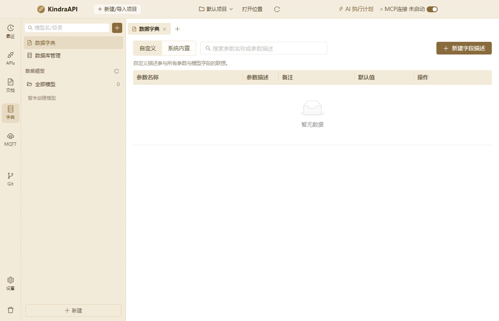

# 交互流：schemas-dictionary-new-field

- 路由：`/schemas`
- 类型：dialog
- 视口：1180×760
- 说明：—
- 所属页面：[pages/schemas.md](../pages/schemas.md)

## 可见控件

| 区块 | 文案 / aria / icon | 类型 | 状态 | 选择器 |
| --- | --- | --- | --- | --- |
| — | 模型名/目录 | `input` | — | `div.main > div.page.schemas-page > aside.schemas-side > div.schemas-search:nth-of-type(1) > span.ant-input-affix-wrapper.ant-input-affix-wrapper-sm > input.ant-input.ant-input-sm` |
| — | anticon-plus | `button` | — | `div.shell > div.main > div.page.schemas-page > aside.schemas-side > div.schemas-search:nth-of-type(1) > button.ant-dropdown-trigger.tree-plus` |
| — | anticon-reload | `button` | — | `div.main > div.page.schemas-page > aside.schemas-side > div.schemas-side-scroll:nth-of-type(2) > div.schema-section-head:nth-of-type(3) > button.icon-btn` |
| — | 新建 | `button` | — | `div.app-shell > div.shell > div.main > div.page.schemas-page > aside.schemas-side > button.ant-dropdown-trigger.schemas-new` |
| — | 数据字典 | `div/button` | active | `div.shell > div.main > div.page.schemas-page > section.schemas-main > div.tabbar:nth-of-type(1) > div.filetab.active` |
| — | anticon-close | `span/button` | — | `div.main > div.page.schemas-page > section.schemas-main > div.tabbar:nth-of-type(1) > div.filetab.active > span.tab-x:nth-of-type(3)` |
| — | anticon-plus | `button` | — | `div.shell > div.main > div.page.schemas-page > section.schemas-main > div.tabbar:nth-of-type(1) > button.ant-dropdown-trigger.tab-add` |
| — | 自定义 | `button` | active | `section.schemas-main > div.schemas-content:nth-of-type(2) > div.dict-panel > div.dict-head:nth-of-type(1) > div.segmented > button.active:nth-of-type(1)` |
| — | 系统内置 | `button` | — | `section.schemas-main > div.schemas-content:nth-of-type(2) > div.dict-panel > div.dict-head:nth-of-type(1) > div.segmented > button:nth-of-type(2)` |
| — | 搜索参数名称或参数描述 | `input` | — | `section.schemas-main > div.schemas-content:nth-of-type(2) > div.dict-panel > div.dict-head:nth-of-type(1) > span.ant-input-affix-wrapper.css-dzyqf7:nth-of-type(1) > input.ant-input.css-dzyqf7` |
| — | 新建字段描述 | `button` | — | `div.page.schemas-page > section.schemas-main > div.schemas-content:nth-of-type(2) > div.dict-panel > div.dict-head:nth-of-type(1) > button.ant-btn.css-dzyqf7` |
| — | 参数名称 | `th` | — | `div.ant-table-container > div.ant-table-header:nth-of-type(1) > table > thead.ant-table-thead > tr > th.ant-table-cell:nth-of-type(1)` |
| — | 参数描述 | `th` | — | `div.ant-table-container > div.ant-table-header:nth-of-type(1) > table > thead.ant-table-thead > tr > th.ant-table-cell.ant-table-cell-ellipsis:nth-of-type(2)` |
| — | 备注 | `th` | — | `div.ant-table-container > div.ant-table-header:nth-of-type(1) > table > thead.ant-table-thead > tr > th.ant-table-cell.ant-table-cell-ellipsis:nth-of-type(3)` |
| — | 默认值 | `th` | — | `div.ant-table-container > div.ant-table-header:nth-of-type(1) > table > thead.ant-table-thead > tr > th.ant-table-cell.ant-table-cell-ellipsis:nth-of-type(4)` |
| — | 操作 | `th` | — | `div.ant-table-container > div.ant-table-header:nth-of-type(1) > table > thead.ant-table-thead > tr > th.ant-table-cell:nth-of-type(5)` |
| — | 暂无数据 | `div` | — | `table > tbody.ant-table-tbody > tr.ant-table-placeholder:nth-of-type(2) > td.ant-table-cell > div.css-dzyqf7.ant-empty > div.ant-empty-description:nth-of-type(2)` |

## 提示文案

**空态**

- 暂无数据

**title 属性**

- 参数描述
- 备注
- 默认值

## 相关源码

- `src/renderer/src/components/schemas/DatabasePanel.tsx`：11 条提示
- `src/renderer/src/components/schemas/DatabasePanel.tsx`：15 个菜单项
- `src/renderer/src/components/schemas/DatabasePanel.tsx`：3 个 Tooltip
- `src/renderer/src/components/schemas/DatabasePanel.tsx`：7 个 IPC 调用
- `src/renderer/src/components/schemas/DictionaryPanel.tsx`：9 条提示
- `src/renderer/src/components/schemas/DictionaryPanel.tsx`：6 个菜单项
- `src/renderer/src/components/schemas/DictionaryPanel.tsx`：2 个 Tooltip
- `src/renderer/src/components/schemas/DictionaryPanel.tsx`：5 个 IPC 调用
- `src/renderer/src/components/schemas/DictionarySuggest.tsx`：1 个菜单项
- `src/renderer/src/components/schemas/DictionarySuggest.tsx`：2 个 IPC 调用
- `src/renderer/src/components/schemas/ModelEditor.tsx`：12 条提示
- `src/renderer/src/components/schemas/ModelEditor.tsx`：2 个 Tooltip
- `src/renderer/src/components/schemas/ModelEditor.tsx`：5 个 IPC 调用
- `src/renderer/src/components/schemas/ModelPickerModal.tsx`：1 条提示
- `src/renderer/src/components/schemas/ModelPickerModal.tsx`：4 个 IPC 调用
- `src/renderer/src/components/schemas/ModelsListPanel.tsx`：17 个菜单项
- `src/renderer/src/components/schemas/ModelsListPanel.tsx`：1 个 Tooltip
- `src/renderer/src/components/schemas/SchemaFieldEditor.tsx`：11 个菜单项
- `src/renderer/src/components/schemas/SchemaFieldEditor.tsx`：1 个 Tooltip
- `src/renderer/src/components/schemas/modelDocumentation.ts`：2 个 IPC 调用
- `src/renderer/src/pages/SchemasPage.tsx`：15 条提示
- `src/renderer/src/pages/SchemasPage.tsx`：11 个菜单项
- `src/renderer/src/pages/SchemasPage.tsx`：1 个 Tooltip
- `src/renderer/src/pages/SchemasPage.tsx`：8 个 IPC 调用

> 返回 [交互流索引](README.md)
