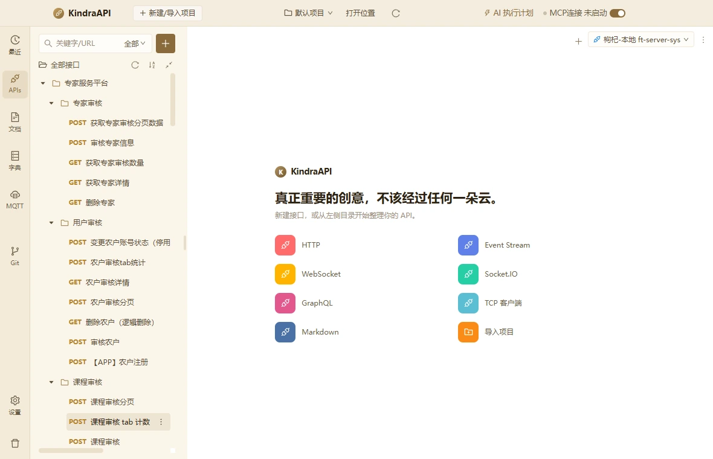
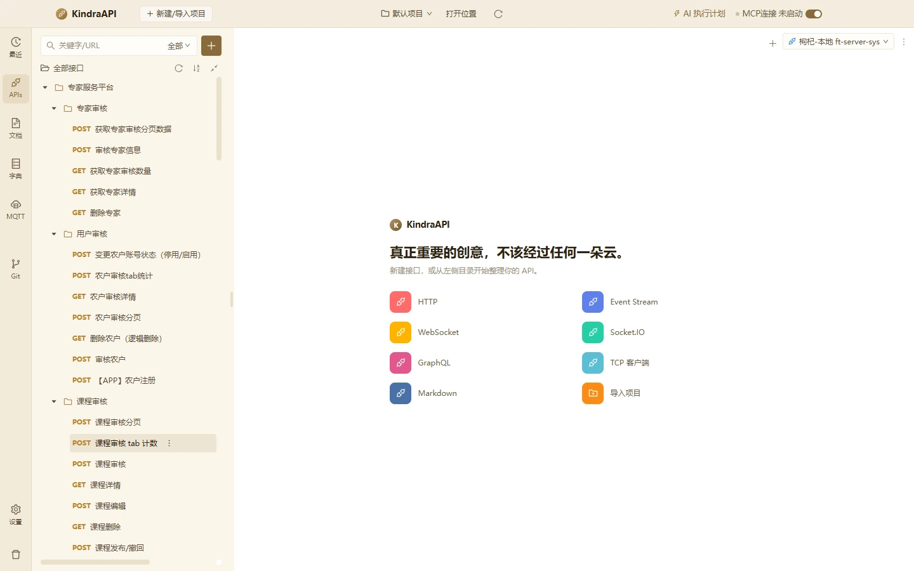

# APIs 接口工作台

- 路由：`/apis`
- 用途：接口树、请求编辑器、响应面板、环境选择、接口用例与版本管理。
- 采集状态：29 个；DOM/AX 元素合计：12197
- 主要源码：`src/renderer/src/pages/ApisPage.tsx`、`src/renderer/src/components/ApiTree.tsx`、`src/renderer/src/components/RequestEditor.tsx`、`src/renderer/src/components/ResponsePanel.tsx`、`src/renderer/src/components/ParamTable.tsx`、`src/renderer/src/components/JsonFieldTable.tsx`、`src/renderer/src/components/CasesEditor.tsx`、`src/renderer/src/components/DesignEditor.tsx`、`src/renderer/src/components/CodeGenDialog.tsx`、`src/renderer/src/components/ApiDescriptionDialog.tsx`、`src/renderer/src/components/TargetVersionDrawer.tsx`、`src/renderer/src/components/EnvironmentModal.tsx`、`src/renderer/src/components/FieldRulesEditor.tsx`、`src/renderer/src/components/TargetSyncGuard.tsx`、`src/renderer/src/components/TargetEditScope.tsx`

## 状态截图

| 状态 | 类型 | 视口 | 元素数 | 截图 |
| --- | --- | --- | --- | --- |
| `apis-welcome-1180x760` | page | 1180×760 | 477 | [WebP](../screenshots/webp/apis-welcome-1180x760.webp) |
| `apis-welcome-1440x900` | page | 1440×900 | 477 | [WebP](../screenshots/webp/apis-welcome-1440x900.webp) |
| `apis-tree-expanded` | page | 1180×760 | 477 | [WebP](../screenshots/webp/apis-tree-expanded.webp) |
| `apis-editor-debug-1180x760` | page | 1180×760 | 527 | [WebP](../screenshots/webp/apis-editor-debug-1180x760.webp) |
| `apis-editor-debug-1440x900` | page | 1440×900 | 527 | [WebP](../screenshots/webp/apis-editor-debug-1440x900.webp) |
| `apis-mode-design` | page | 1180×760 | 527 | [WebP](../screenshots/webp/apis-mode-design.webp) |
| `apis-mode-cases` | page | 1180×760 | 491 | [WebP](../screenshots/webp/apis-mode-cases.webp) |
| `apis-mode-stress` | page | 1180×760 | 485 | [WebP](../screenshots/webp/apis-mode-stress.webp) |
| `apis-mode-mock` | page | 1180×760 | 485 | [WebP](../screenshots/webp/apis-mode-mock.webp) |
| `apis-request-tab-header` | page | 1180×760 | 534 | [WebP](../screenshots/webp/apis-request-tab-header.webp) |
| `apis-request-tab-query` | page | 1180×760 | 520 | [WebP](../screenshots/webp/apis-request-tab-query.webp) |
| `apis-request-tab-path` | page | 1180×760 | 520 | [WebP](../screenshots/webp/apis-request-tab-path.webp) |
| `apis-request-tab-body` | page | 1180×760 | 527 | [WebP](../screenshots/webp/apis-request-tab-body.webp) |
| `apis-request-tab-auth` | page | 1180×760 | 517 | [WebP](../screenshots/webp/apis-request-tab-auth.webp) |
| `apis-request-tab-cookie` | page | 1180×760 | 520 | [WebP](../screenshots/webp/apis-request-tab-cookie.webp) |
| `apis-request-tab-pre-request` | page | 1180×760 | 515 | [WebP](../screenshots/webp/apis-request-tab-pre-request.webp) |
| `apis-request-tab-post-request` | page | 1180×760 | 515 | [WebP](../screenshots/webp/apis-request-tab-post-request.webp) |
| `apis-response-tab-response` | page | 1180×760 | 515 | [WebP](../screenshots/webp/apis-response-tab-response.webp) |
| `apis-response-tab-headers` | page | 1180×760 | 515 | [WebP](../screenshots/webp/apis-response-tab-headers.webp) |
| `apis-response-tab-example` | page | 1180×760 | 526 | [WebP](../screenshots/webp/apis-response-tab-example.webp) |
| `apis-response-tab-field-docs` | page | 1180×760 | 725 | [WebP](../screenshots/webp/apis-response-tab-field-docs.webp) |
| `apis-response-tab-actual-request` | page | 1180×760 | 515 | [WebP](../screenshots/webp/apis-response-tab-actual-request.webp) |
| `apis-response-tab-console` | page | 1180×760 | 515 | [WebP](../screenshots/webp/apis-response-tab-console.webp) |
| `apis-more-menu` | menu | 1180×760 | 10 | [WebP](../screenshots/webp/apis-more-menu.webp) |
| `apis-dialog-codegen` | dialog | 1180×760 | 40 | [WebP](../screenshots/webp/apis-dialog-codegen.webp) |
| `apis-drawer-versions` | drawer | 1180×760 | 69 | [WebP](../screenshots/webp/apis-drawer-versions.webp) |
| `apis-dialog-description` | dialog | 1180×760 | 41 | [WebP](../screenshots/webp/apis-dialog-description.webp) |
| `apis-dialog-share` | dialog | 1180×760 | 20 | [WebP](../screenshots/webp/apis-dialog-share.webp) |
| `apis-empty-search` | page | 1180×760 | 65 | [WebP](../screenshots/webp/apis-empty-search.webp) |

### apis-welcome-1180x760

### apis-welcome-1440x900

## 布局区域（1180×760 基准）

| 区域 | x | y | width | height |
| --- | --- | --- | --- | --- |
| `topbar` | 0 | 0 | 1180 | 44 |
| `rail` | 0 | 44 | 50 | 716 |
| `main` | 50 | 44 | 1130 | 716 |

## 控件全量清单

| 区块 | 控件文案 / aria / icon | 类型 | 状态 | 位置 | 来源状态 |
| --- | --- | --- | --- | --- | --- |
| 页面 | 关键字/URL | `input` | — | 93,62 · 104×19 | `apis-welcome-1180x760` |
| 页面 | 新建 `anticon-plus` | `button` | — | 258,56 · 32×32 | `apis-welcome-1180x760` |
| 页面 | anticon-reload `anticon-reload` | `button` | — | 212,96 · 22×22 | `apis-welcome-1180x760` |
| 页面 | anticon-sort-ascending `anticon-sort-ascending` | `button` | — | 240,96 · 22×22 | `apis-welcome-1180x760` |
| 页面 | anticon-shrink `anticon-shrink` | `button` | — | 268,96 · 22×22 | `apis-welcome-1180x760` |
| 页面 | anticon-plus `anticon-plus` | `button` | — | 186,126 · 23×23 | `apis-welcome-1180x760` |
| 页面 | anticon-more `anticon-more` | `button` | — | 208,126 · 23×23 | `apis-welcome-1180x760` |
| 页面 | 枸杞-本地 ft-server-sys `anticon-api` | `button` | — | 973,52 · 176×26 | `apis-welcome-1180x760` |
| 页面 | POST 获取专家审核分页数据 `anticon-close` | `div/button` | active | 314,54 · 192×28 | `apis-editor-debug-1180x760` |
| 页面 | anticon-close `anticon-close` | `span/button` | — | 487,60 · 10×17 | `apis-editor-debug-1180x760` |
| 页面 | 设计 | `button` | — | 328,93 · 54×34 | `apis-editor-debug-1180x760` |
| 页面 | 调试 | `button` | active | 382,93 · 54×34 | `apis-editor-debug-1180x760` |
| 页面 | 接口用例 | `button` | — | 436,93 · 80×34 | `apis-editor-debug-1180x760` |
| 页面 | 一键压测 | `button` | — | 516,93 · 80×34 | `apis-editor-debug-1180x760` |
| 页面 | Mock | `button` | — | 596,93 · 63×34 | `apis-editor-debug-1180x760` |
| 页面 | (未命名单选/控件) | `input` | — | 751,98 · 260×24 | `apis-editor-debug-1180x760` |
| 页面 | anticon-file-text `anticon-file-text` | `button` | — | 1023,97 · 26×26 | `apis-editor-debug-1180x760` |
| 页面 | 分享 `anticon-share-alt` | `button` | — | 1061,96 · 64×28 | `apis-editor-debug-1180x760` |
| request-editor | POST `anticon-down` | `button` | — | 328,141 · 91×32 | `apis-editor-debug-1180x760` |
| request-editor | 请输入URL或粘贴cURL文本 | `input` | — | 420,141 · 464×32 | `apis-editor-debug-1180x760` |
| request-editor | http/1.1 `anticon-down` | `div` | — | 884,142 · 100×30 | `apis-editor-debug-1180x760` |
| request-editor | http/1.1 | `span` | — | 894,141 · 80×32 | `apis-editor-debug-1180x760` |
| request-editor | 发送 | `button` | — | 993,140 · 60×34 | `apis-editor-debug-1180x760` |
| request-editor | anticon-down `anticon-down` | `button` | — | 1053,140 · 22×34 | `apis-editor-debug-1180x760` |
| request-editor | 保存 | `button` | — | 1084,141 · 56×32 | `apis-editor-debug-1180x760` |
| request-editor | Header | `button` | — | 327,177 · 45×43 | `apis-editor-debug-1180x760` |
| request-editor | Query | `button` | — | 399,177 · 38×43 | `apis-editor-debug-1180x760` |
| request-editor | Path | `button` | — | 463,177 · 28×43 | `apis-editor-debug-1180x760` |
| request-editor | Body | `button` | active | 517,177 · 32×43 | `apis-editor-debug-1180x760` |
| request-editor | 认证 | `button` | — | 574,177 · 26×43 | `apis-editor-debug-1180x760` |
| request-editor | Cookie | `button` | — | 626,177 · 43×43 | `apis-editor-debug-1180x760` |
| request-editor | 预执行操作 | `button` | — | 695,177 · 65×43 | `apis-editor-debug-1180x760` |
| request-editor | 后执行操作 | `button` | — | 786,177 · 65×43 | `apis-editor-debug-1180x760` |
| request-editor | none | `label` | — | 327,237 · 77×25 | `apis-editor-debug-1180x760` |
| request-editor | form-data | `label` | — | 405,237 · 106×25 | `apis-editor-debug-1180x760` |
| request-editor | urlencoded | `label` | — | 511,237 · 113×25 | `apis-editor-debug-1180x760` |
| request-editor | binary | `label` | — | 624,237 · 84×25 | `apis-editor-debug-1180x760` |
| request-editor | msgpack | `label` | — | 708,237 · 99×25 | `apis-editor-debug-1180x760` |
| request-editor | raw | `label` | — | 808,237 · 70×25 | `apis-editor-debug-1180x760` |
| request-editor | 引用模型 | `button` | — | 336,280 · 64×22 | `apis-editor-debug-1180x760` |
| request-editor | 原始 字段 | `div/radiogroup` | — | 1070,280 · 84×23 | `apis-editor-debug-1180x760` |
| request-editor | 原始 | `label` | active | 1072,282 · 40×19 | `apis-editor-debug-1180x760` |
| request-editor | 原始 | `div` | — | 1072,282 · 40×19 | `apis-editor-debug-1180x760` |
| request-editor | 字段 | `label` | — | 1112,282 · 40×19 | `apis-editor-debug-1180x760` |
| request-editor | 字段 | `div` | — | 1112,282 · 40×19 | `apis-editor-debug-1180x760` |
| request-editor | { "page": 1, "limit": 10 } | `textarea` | — | 328,319 · 834×138 | `apis-editor-debug-1180x760` |
| response-panel | 实时响应 | `button` | active | 327,464 · 52×39 | `apis-editor-debug-1180x760` |
| response-panel | 响应头 | `button` | — | 405,464 · 39×39 | `apis-editor-debug-1180x760` |
| response-panel | Cookie | `button` | — | 470,464 · 43×39 | `apis-editor-debug-1180x760` |
| response-panel | 响应示例 | `button` | — | 540,464 · 52×39 | `apis-editor-debug-1180x760` |
| response-panel | 字段说明 | `button` | — | 618,464 · 52×39 | `apis-editor-debug-1180x760` |
| response-panel | 实际请求 | `button` | — | 696,464 · 52×39 | `apis-editor-debug-1180x760` |
| response-panel | 控制台 | `button` | — | 774,464 · 39×39 | `apis-editor-debug-1180x760` |
| response-panel | anticon-layout `anticon-layout` | `button` | — | 1126,694 · 28×28 | `apis-editor-debug-1180x760` |
| 页面 | 实时响应 | `button` | active | 344,800 · 52×39 | `apis-mode-design` |
| 页面 | 响应头 | `button` | — | 422,800 · 39×39 | `apis-mode-design` |
| 页面 | Cookie | `button` | — | 487,800 · 43×39 | `apis-mode-design` |
| 页面 | 响应示例 | `button` | — | 557,800 · 52×39 | `apis-mode-design` |
| 页面 | 字段说明 | `button` | — | 635,800 · 52×39 | `apis-mode-design` |
| 页面 | 实际请求 | `button` | — | 713,800 · 52×39 | `apis-mode-design` |
| 页面 | 控制台 | `button` | — | 791,800 · 39×39 | `apis-mode-design` |
| 页面 | 添加错误码 `anticon-plus` | `button` | — | 326,1256 · 102×23 | `apis-mode-design` |
| 页面 | 新建 `anticon-plus` | `button` | — | 320,147 · 63×23 | `apis-mode-cases` |
| 页面 | 全部运行 `anticon-play-circle` | `button` | — | 389,147 · 89×23 | `apis-mode-cases` |
| 页面 | 暂无用例 | `div` | — | 326,257 · 207×21 | `apis-mode-cases` |
| 页面 | 选择或新建一个用例 | `div` | — | 574,255 · 582×21 | `apis-mode-cases` |
| request-editor | 收起 `anticon-down` | `button` | — | 327,240 · 16×20 | `apis-request-tab-header` |
| request-editor | 规则 | `button` | — | 381,323 · 42×23 | `apis-request-tab-header` |
| request-editor | Header 名 | `input` | — | 427,319 · 205×32 | `apis-request-tab-header` |
| request-editor | 参数值 | `input` | — | 654,319 · 264×32 | `apis-request-tab-header` |
| request-editor | 描述 | `div` | — | 939,320 · 195×30 | `apis-request-tab-header` |
| 页面 | 描述 | `input/combobox` | — | 939,320 · 195×32 | `apis-request-tab-header` |
| request-editor | anticon-delete `anticon-delete` | `button` | — | 1137,325 · 20×20 | `apis-request-tab-header` |
| request-editor | 添加参数 `anticon-plus` | `button` | — | 328,314 · 834×34 | `apis-request-tab-query` |
| request-editor | 继承父级 `anticon-down` | `div` | — | 327,256 · 240×30 | `apis-request-tab-auth` |
| 页面 | 继承父级 | `span` | — | 339,257 · 216×28 | `apis-request-tab-auth` |
| request-editor | // 预执行脚本 | `textarea` | — | 342,256 · 798×228 | `apis-request-tab-pre-request` |
| request-editor | // 后执行脚本 | `textarea` | — | 342,256 · 798×228 | `apis-request-tab-post-request` |
| response-panel | 美化 | `button` | — | 327,510 · 21×15 | `apis-response-tab-example` |
| response-panel | 原生 | `button` | — | 360,510 · 21×15 | `apis-response-tab-example` |
| response-panel | 预览 | `button` | — | 393,510 · 21×15 | `apis-response-tab-example` |
| response-panel | 可视化 | `button` | — | 426,510 · 32×15 | `apis-response-tab-example` |
| response-panel | 表格 | `button` | — | 470,510 · 21×15 | `apis-response-tab-example` |
| response-panel | 复制 `anticon-copy` | `button` | — | 1110,506 · 54×22 | `apis-response-tab-example` |
| response-panel | 实时响应 · 200 `anticon-down` | `div` | — | 310,532 · 870×30 | `apis-response-tab-example` |
| response-panel | 实时响应 · 200 | `span` | — | 322,533 · 846×28 | `apis-response-tab-example` |
| response-panel | 引用模型 | `button` | — | 336,587 · 64×22 | `apis-response-tab-example` |
| response-panel | 仅文档字段 `anticon-plus` | `button` | — | 1043,550 · 102×23 | `apis-response-tab-field-docs` |
| 页面 | code | `span` | — | 357,616 · 26×17 | `apis-response-tab-field-docs` |
| response-panel | 自动（integer） `anticon-down` | `div` | — | 708,613 · 138×23 | `apis-response-tab-field-docs` |
| 页面 | 自动（integer） | `span` | — | 716,614 · 122×21 | `apis-response-tab-field-docs` |
| response-panel | 字段含义 | `textarea` | — | 910,612 · 155×26 | `apis-response-tab-field-docs` |
| response-panel | 规则 | `button` | — | 1080,613 · 42×23 | `apis-response-tab-field-docs` |
| response-panel | 更多操作 `anticon-more` | `button` | — | 1122,615 · 20×20 | `apis-response-tab-field-docs` |
| 页面 | message | `span` | — | 357,652 · 46×17 | `apis-response-tab-field-docs` |
| response-panel | 自动（string） `anticon-down` | `div` | — | 708,649 · 138×23 | `apis-response-tab-field-docs` |
| 页面 | 自动（string） | `span` | — | 716,650 · 122×21 | `apis-response-tab-field-docs` |
| 页面 | anticon-down `anticon-down` | `button` | — | 337,757 · 16×9 | `apis-response-tab-field-docs` |
| 页面 | data | `span` | — | 357,753 · 26×17 | `apis-response-tab-field-docs` |
| 页面 | { "records": [ { "id": "2016343414999785474", "name": "分割", "phoneNumber": "18780006905",  | `textarea` | — | 507,682 · 177×159 | `apis-response-tab-field-docs` |
| response-panel | 自动（object） `anticon-down` | `div` | — | 708,750 · 138×23 | `apis-response-tab-field-docs` |
| 页面 | 自动（object） | `span` | — | 716,751 · 122×21 | `apis-response-tab-field-docs` |
| 页面 | records | `span` | — | 373,921 · 46×17 | `apis-response-tab-field-docs` |
| 页面 | [ { "id": "2016343414999785474", "name": "分割", "phoneNumber": "18780006905", "workUnit": " | `textarea` | — | 507,850 · 177×159 | `apis-response-tab-field-docs` |
| response-panel | 自动（array） `anticon-down` | `div` | — | 708,918 · 138×23 | `apis-response-tab-field-docs` |
| 页面 | 自动（array） | `span` | — | 716,919 · 122×21 | `apis-response-tab-field-docs` |
| 页面 | [] | `span` | — | 389,1023 · 13×17 | `apis-response-tab-field-docs` |
| 页面 | id | `span` | — | 405,1058 · 13×17 | `apis-response-tab-field-docs` |
| 页面 | name | `span` | — | 405,1093 · 26×17 | `apis-response-tab-field-docs` |
| 页面 | phoneNumber | `span` | — | 405,1128 · 73×17 | `apis-response-tab-field-docs` |
| 页面 | workUnit | `span` | — | 405,1163 · 53×17 | `apis-response-tab-field-docs` |
| 页面 | education | `span` | — | 405,1198 · 59×17 | `apis-response-tab-field-docs` |
| 页面 | avgScore | `span` | — | 405,1233 · 53×17 | `apis-response-tab-field-docs` |
| 页面 | goodAtField | `span` | — | 405,1268 · 73×17 | `apis-response-tab-field-docs` |
| 页面 | expertType | `span` | — | 405,1303 · 66×17 | `apis-response-tab-field-docs` |
| 页面 | auditStatus | `span` | — | 405,1338 · 73×17 | `apis-response-tab-field-docs` |
| 页面 | auditUser | `span` | — | 405,1373 · 59×17 | `apis-response-tab-field-docs` |
| response-panel | 自动（null） `anticon-down` | `div` | — | 708,1370 · 138×23 | `apis-response-tab-field-docs` |
| 页面 | 自动（null） | `span` | — | 716,1371 · 122×21 | `apis-response-tab-field-docs` |
| 页面 | auditTime | `span` | — | 405,1408 · 59×17 | `apis-response-tab-field-docs` |
| 页面 | createTime | `span` | — | 405,1443 · 66×17 | `apis-response-tab-field-docs` |
| 页面 | total | `span` | — | 373,1478 · 33×17 | `apis-response-tab-field-docs` |
| 页面 | size | `span` | — | 373,1513 · 26×17 | `apis-response-tab-field-docs` |
| 页面 | current | `span` | — | 373,1549 · 46×17 | `apis-response-tab-field-docs` |
| 页面 | pages | `span` | — | 373,1584 · 33×17 | `apis-response-tab-field-docs` |
| 页面 | path | `span` | — | 357,1619 · 26×17 | `apis-response-tab-field-docs` |
| 页面 | extra | `span` | — | 357,1654 · 33×17 | `apis-response-tab-field-docs` |
| 页面 | timestamp | `span` | — | 357,1689 · 59×17 | `apis-response-tab-field-docs` |
| 页面 | 版本管理 `anticon-history` | `li/menuitem` | — | 1062,130 · 97×30 | `apis-more-menu` |
| 页面 | 生成代码 `anticon-code` | `li/menuitem` | — | 1062,160 · 97×30 | `apis-more-menu` |
| 页面 | 克隆 `anticon-copy` | `li/menuitem` | — | 1062,190 · 97×30 | `apis-more-menu` |
| 页面 | 保存 `anticon-save` | `li/menuitem` | — | 1062,229 · 97×30 | `apis-more-menu` |
| 页面 | 删除接口 `anticon-delete` | `li/menuitem` | — | 1062,259 · 97×30 | `apis-more-menu` |
| modal:生成代码 | Close `anticon-close` | `button` | — | 1008,112 · 30×30 | `apis-dialog-codegen` |
| modal:生成代码 | 关闭 `anticon-close` | `span` | — | 1008,120 · 30×14 | `apis-dialog-codegen` |
| modal:生成代码 | 生成代码 | `div` | — | 154,120 · 872×22 | `apis-dialog-codegen` |
| modal:生成代码 | shell(curl) `anticon-code` | `button` | active | 173,165 · 189×30 | `apis-dialog-codegen` |
| modal:生成代码 | shell(httpie) 后续 `anticon-code` | `button` | disabled | 173,195 · 189×30 | `apis-dialog-codegen` |
| modal:生成代码 | shell(wget) 后续 `anticon-code` | `button` | disabled | 173,225 · 189×30 | `apis-dialog-codegen` |
| modal:生成代码 | c(libcurl) 后续 `anticon-code` | `button` | disabled | 173,255 · 189×30 | `apis-dialog-codegen` |
| modal:生成代码 | clojure(clj_http) 后续 `anticon-code` | `button` | disabled | 173,285 · 189×30 | `apis-dialog-codegen` |
| modal:生成代码 | csharp(httpclient) 后续 `anticon-code` | `button` | disabled | 173,315 · 189×30 | `apis-dialog-codegen` |
| modal:生成代码 | csharp(restsharp) 后续 `anticon-code` | `button` | disabled | 173,345 · 189×30 | `apis-dialog-codegen` |
| modal:生成代码 | go(native) 后续 `anticon-code` | `button` | disabled | 173,375 · 189×30 | `apis-dialog-codegen` |
| modal:生成代码 | HTTP(http/1.1) 后续 `anticon-code` | `button` | disabled | 173,405 · 189×30 | `apis-dialog-codegen` |
| modal:生成代码 | java(asynchttp) 后续 `anticon-code` | `button` | disabled | 173,435 · 189×30 | `apis-dialog-codegen` |
| modal:生成代码 | java(nethttp) 后续 `anticon-code` | `button` | disabled | 173,465 · 189×30 | `apis-dialog-codegen` |
| modal:生成代码 | java(okhttp) 后续 `anticon-code` | `button` | disabled | 173,495 · 189×30 | `apis-dialog-codegen` |
| modal:生成代码 | java(unirest) 后续 `anticon-code` | `button` | disabled | 173,525 · 189×30 | `apis-dialog-codegen` |
| modal:生成代码 | javascript(axios) 后续 `anticon-code` | `button` | disabled | 173,555 · 189×30 | `apis-dialog-codegen` |
| modal:生成代码 | javascript(fetch) 后续 `anticon-code` | `button` | disabled | 173,585 · 189×30 | `apis-dialog-codegen` |
| modal:生成代码 | javascript(jquery) 后续 `anticon-code` | `button` | disabled | 173,615 · 189×30 | `apis-dialog-codegen` |
| modal:生成代码 | javascript(xhr) 后续 `anticon-code` | `button` | disabled | 173,645 · 189×30 | `apis-dialog-codegen` |
| modal:生成代码 | 复制代码 `anticon-copy` | `button` | — | 914,166 · 89×23 | `apis-dialog-codegen` |
| drawer:版本管理 · 获取专家审核分页数据 | 关闭 `anticon-close` | `button` | — | 724,16 · 22×22 | `apis-drawer-versions` |
| drawer:版本管理 · 获取专家审核分页数据 | 版本管理 · 获取专家审核分页数据 | `div` | — | 754,16 · 402×22 | `apis-drawer-versions` |
| drawer:版本管理 · 获取专家审核分页数据 | 历史记录 31 `anticon-history` | `button` | active | 714,65 · 223×36 | `apis-drawer-versions` |
| drawer:版本管理 · 获取专家审核分页数据 | Tag版本 0 `anticon-tag` | `button` | — | 943,65 · 223×36 | `apis-drawer-versions` |
| drawer:版本管理 · 获取专家审核分页数据 | 标记 Tag | `button` | — | 1081,120 · 67×23 | `apis-drawer-versions` |
| drawer:版本管理 · 获取专家审核分页数据 | 恢 复 | `button` | — | 1081,149 · 67×23 | `apis-drawer-versions` |
| modal:接口说明 | Close `anticon-close` | `button` | — | 1008,112 · 30×30 | `apis-dialog-description` |
| modal:接口说明 | 关闭 `anticon-close` | `span` | — | 1008,120 · 30×14 | `apis-dialog-description` |
| modal:接口说明 | 接口说明 | `div` | — | 154,120 · 872×22 | `apis-dialog-description` |
| modal:接口说明 | anticon-font-size `anticon-font-size` | `button` | — | 173,163 · 28×28 | `apis-dialog-description` |
| modal:接口说明 | anticon-bold `anticon-bold` | `button` | — | 203,163 · 28×28 | `apis-dialog-description` |
| modal:接口说明 | anticon-italic `anticon-italic` | `button` | — | 233,163 · 28×28 | `apis-dialog-description` |
| modal:接口说明 | anticon-underline `anticon-underline` | `button` | — | 263,163 · 28×28 | `apis-dialog-description` |
| modal:接口说明 | anticon-strikethrough `anticon-strikethrough` | `button` | — | 293,163 · 28×28 | `apis-dialog-description` |
| modal:接口说明 | “ | `button` | — | 323,163 · 28×28 | `apis-dialog-description` |
| modal:接口说明 | anticon-link `anticon-link` | `button` | — | 353,163 · 28×28 | `apis-dialog-description` |
| modal:接口说明 | anticon-picture `anticon-picture` | `button` | — | 383,163 · 28×28 | `apis-dialog-description` |
| modal:接口说明 | anticon-code `anticon-code` | `button` | — | 413,163 · 28×28 | `apis-dialog-description` |
| modal:接口说明 | { } | `button` | — | 443,163 · 28×28 | `apis-dialog-description` |
| modal:接口说明 | anticon-unordered-list `anticon-unordered-list` | `button` | — | 473,163 · 28×28 | `apis-dialog-description` |
| modal:接口说明 | anticon-ordered-list `anticon-ordered-list` | `button` | — | 503,163 · 28×28 | `apis-dialog-description` |
| modal:接口说明 | anticon-check-square `anticon-check-square` | `button` | — | 533,163 · 28×28 | `apis-dialog-description` |
| modal:接口说明 | anticon-table `anticon-table` | `button` | — | 563,163 · 28×28 | `apis-dialog-description` |
| modal:接口说明 | 插入 `anticon-plus` | `button` | — | 593,163 · 59×28 | `apis-dialog-description` |
| modal:接口说明 | anticon-align-left `anticon-align-left` | `button` | — | 665,163 · 28×28 | `apis-dialog-description` |
| modal:接口说明 | anticon-align-center `anticon-align-center` | `button` | — | 695,163 · 28×28 | `apis-dialog-description` |
| modal:接口说明 | anticon-align-right `anticon-align-right` | `button` | — | 725,163 · 28×28 | `apis-dialog-description` |
| modal:接口说明 | anticon-fullscreen `anticon-fullscreen` | `button` | — | 979,163 · 28×28 | `apis-dialog-description` |
| modal:接口说明 | 回到顶部 | `button` | — | 966,642 · 48×19 | `apis-dialog-description` |
| modal:新建分享 | Close `anticon-close` | `button` | — | 848,112 · 30×30 | `apis-dialog-share` |
| modal:新建分享 | 关闭 `anticon-close` | `span` | — | 848,120 · 30×14 | `apis-dialog-share` |
| modal:新建分享 | 新建分享 | `div` | — | 314,120 · 552×22 | `apis-dialog-share` |
| modal:新建分享 | 请输入分享名称 | `input` | — | 314,179 · 552×30 | `apis-dialog-share` |
| 页面 | 公开访问 | `label` | — | 314,309 · 82×21 | `apis-dialog-share` |
| 页面 | 密码访问 | `label` | — | 404,309 · 82×21 | `apis-dialog-share` |
| 页面 | 永久有效 `anticon-down` | `div` | — | 602,309 · 126×30 | `apis-dialog-share` |
| 页面 | 永久有效 | `span` | — | 614,310 · 102×28 | `apis-dialog-share` |
| modal:新建分享 | 请求参数 | `label` | — | 314,381 · 83×21 | `apis-dialog-share` |
| modal:新建分享 | 请求体 | `label` | — | 417,381 · 70×21 | `apis-dialog-share` |
| modal:新建分享 | 响应示例 | `label` | — | 507,381 · 83×21 | `apis-dialog-share` |
| modal:新建分享 | 响应头 / Cookie | `label` | — | 610,381 · 126×21 | `apis-dialog-share` |
| modal:新建分享 | 前后脚本 | `label` | — | 756,381 · 83×21 | `apis-dialog-share` |
| modal:新建分享 | 接口设计 | `label` | — | 314,410 · 83×21 | `apis-dialog-share` |
| modal:新建分享 | 接口用例 | `label` | — | 417,410 · 83×21 | `apis-dialog-share` |
| modal:新建分享 | 取 消 | `button` | — | 734,507 · 62×30 | `apis-dialog-share` |
| modal:新建分享 | 保 存 | `button` | — | 804,507 · 62×30 | `apis-dialog-share` |

## 树节点（数据，不是控件）

展开 120 个树节点

| 节点 | 状态 | 来源状态 | 选择器 |
| --- | --- | --- | --- |
| 专家服务平台 | — | `apis-welcome-1180x760` | `div.ant-tree.ant-tree-icon-hide > div.ant-tree-list:nth-of-type(3) > div.ant-tree-list-holder > div > div.ant-tree-list-holder-inner > div.ant-tree-treenode.ant-tree-treenode-switcher-open:nth-of-type(1)` |
| 专家审核 | — | `apis-welcome-1180x760` | `div.ant-tree.ant-tree-icon-hide > div.ant-tree-list:nth-of-type(3) > div.ant-tree-list-holder > div > div.ant-tree-list-holder-inner > div.ant-tree-treenode.ant-tree-treenode-switcher-open:nth-of-type(2)` |
| POST 获取专家审核分页数据 | — | `apis-welcome-1180x760` | `div.ant-tree.ant-tree-icon-hide > div.ant-tree-list:nth-of-type(3) > div.ant-tree-list-holder > div > div.ant-tree-list-holder-inner > div.ant-tree-treenode.ant-tree-treenode-switcher-close:nth-of-type(3)` |
| POST 审核专家信息 | — | `apis-welcome-1180x760` | `div.ant-tree.ant-tree-icon-hide > div.ant-tree-list:nth-of-type(3) > div.ant-tree-list-holder > div > div.ant-tree-list-holder-inner > div.ant-tree-treenode.ant-tree-treenode-switcher-close:nth-of-type(4)` |
| GET 获取专家审核数量 | — | `apis-welcome-1180x760` | `div.ant-tree.ant-tree-icon-hide > div.ant-tree-list:nth-of-type(3) > div.ant-tree-list-holder > div > div.ant-tree-list-holder-inner > div.ant-tree-treenode.ant-tree-treenode-switcher-close:nth-of-type(5)` |
| GET 获取专家详情 | — | `apis-welcome-1180x760` | `div.ant-tree.ant-tree-icon-hide > div.ant-tree-list:nth-of-type(3) > div.ant-tree-list-holder > div > div.ant-tree-list-holder-inner > div.ant-tree-treenode.ant-tree-treenode-switcher-close:nth-of-type(6)` |
| GET 删除专家 | — | `apis-welcome-1180x760` | `div.ant-tree.ant-tree-icon-hide > div.ant-tree-list:nth-of-type(3) > div.ant-tree-list-holder > div > div.ant-tree-list-holder-inner > div.ant-tree-treenode.ant-tree-treenode-switcher-close:nth-of-type(7)` |
| 用户审核 | — | `apis-welcome-1180x760` | `div.ant-tree.ant-tree-icon-hide > div.ant-tree-list:nth-of-type(3) > div.ant-tree-list-holder > div > div.ant-tree-list-holder-inner > div.ant-tree-treenode.ant-tree-treenode-switcher-open:nth-of-type(8)` |
| POST 变更农户账号状态（停用/启用） | — | `apis-welcome-1180x760` | `div.ant-tree.ant-tree-icon-hide > div.ant-tree-list:nth-of-type(3) > div.ant-tree-list-holder > div > div.ant-tree-list-holder-inner > div.ant-tree-treenode.ant-tree-treenode-switcher-close:nth-of-type(9)` |
| POST 农户审核tab统计 | — | `apis-welcome-1180x760` | `div.ant-tree.ant-tree-icon-hide > div.ant-tree-list:nth-of-type(3) > div.ant-tree-list-holder > div > div.ant-tree-list-holder-inner > div.ant-tree-treenode.ant-tree-treenode-switcher-close:nth-of-type(10)` |
| GET 农户审核详情 | — | `apis-welcome-1180x760` | `div.ant-tree.ant-tree-icon-hide > div.ant-tree-list:nth-of-type(3) > div.ant-tree-list-holder > div > div.ant-tree-list-holder-inner > div.ant-tree-treenode.ant-tree-treenode-switcher-close:nth-of-type(11)` |
| POST 农户审核分页 | — | `apis-welcome-1180x760` | `div.ant-tree.ant-tree-icon-hide > div.ant-tree-list:nth-of-type(3) > div.ant-tree-list-holder > div > div.ant-tree-list-holder-inner > div.ant-tree-treenode.ant-tree-treenode-switcher-close:nth-of-type(12)` |
| GET 删除农户（逻辑删除） | — | `apis-welcome-1180x760` | `div.ant-tree.ant-tree-icon-hide > div.ant-tree-list:nth-of-type(3) > div.ant-tree-list-holder > div > div.ant-tree-list-holder-inner > div.ant-tree-treenode.ant-tree-treenode-switcher-close:nth-of-type(13)` |
| POST 审核农户 | — | `apis-welcome-1180x760` | `div.ant-tree.ant-tree-icon-hide > div.ant-tree-list:nth-of-type(3) > div.ant-tree-list-holder > div > div.ant-tree-list-holder-inner > div.ant-tree-treenode.ant-tree-treenode-switcher-close:nth-of-type(14)` |
| POST 【APP】农户注册 | — | `apis-welcome-1180x760` | `div.ant-tree.ant-tree-icon-hide > div.ant-tree-list:nth-of-type(3) > div.ant-tree-list-holder > div > div.ant-tree-list-holder-inner > div.ant-tree-treenode.ant-tree-treenode-switcher-close:nth-of-type(15)` |
| 课程审核 | — | `apis-welcome-1180x760` | `div.ant-tree.ant-tree-icon-hide > div.ant-tree-list:nth-of-type(3) > div.ant-tree-list-holder > div > div.ant-tree-list-holder-inner > div.ant-tree-treenode.ant-tree-treenode-switcher-open:nth-of-type(16)` |
| POST 课程审核分页 | — | `apis-welcome-1180x760` | `div.ant-tree.ant-tree-icon-hide > div.ant-tree-list:nth-of-type(3) > div.ant-tree-list-holder > div > div.ant-tree-list-holder-inner > div.ant-tree-treenode.ant-tree-treenode-switcher-close:nth-of-type(17)` |
| POST 课程审核 tab 计数 | — | `apis-welcome-1180x760` | `div.ant-tree.ant-tree-icon-hide > div.ant-tree-list:nth-of-type(3) > div.ant-tree-list-holder > div > div.ant-tree-list-holder-inner > div.ant-tree-treenode.ant-tree-treenode-switcher-close:nth-of-type(18)` |
| POST 课程审核 | — | `apis-welcome-1180x760` | `div.ant-tree.ant-tree-icon-hide > div.ant-tree-list:nth-of-type(3) > div.ant-tree-list-holder > div > div.ant-tree-list-holder-inner > div.ant-tree-treenode.ant-tree-treenode-switcher-close:nth-of-type(19)` |
| GET 课程详情 | — | `apis-welcome-1180x760` | `div.ant-tree.ant-tree-icon-hide > div.ant-tree-list:nth-of-type(3) > div.ant-tree-list-holder > div > div.ant-tree-list-holder-inner > div.ant-tree-treenode.ant-tree-treenode-switcher-close:nth-of-type(20)` |
| POST 课程编辑 | — | `apis-welcome-1180x760` | `div.ant-tree.ant-tree-icon-hide > div.ant-tree-list:nth-of-type(3) > div.ant-tree-list-holder > div > div.ant-tree-list-holder-inner > div.ant-tree-treenode.ant-tree-treenode-switcher-close:nth-of-type(21)` |
| GET 课程删除 | — | `apis-welcome-1180x760` | `div.ant-tree.ant-tree-icon-hide > div.ant-tree-list:nth-of-type(3) > div.ant-tree-list-holder > div > div.ant-tree-list-holder-inner > div.ant-tree-treenode.ant-tree-treenode-switcher-close:nth-of-type(22)` |
| POST 课程发布/撤回 | — | `apis-welcome-1180x760` | `div.ant-tree.ant-tree-icon-hide > div.ant-tree-list:nth-of-type(3) > div.ant-tree-list-holder > div > div.ant-tree-list-holder-inner > div.ant-tree-treenode.ant-tree-treenode-switcher-close:nth-of-type(23)` |
| 登录 | — | `apis-welcome-1180x760` | `div.ant-tree.ant-tree-icon-hide > div.ant-tree-list:nth-of-type(3) > div.ant-tree-list-holder > div > div.ant-tree-list-holder-inner > div.ant-tree-treenode.ant-tree-treenode-switcher-open:nth-of-type(24)` |
| GET 获取图形验证码 | — | `apis-welcome-1180x760` | `div.ant-tree.ant-tree-icon-hide > div.ant-tree-list:nth-of-type(3) > div.ant-tree-list-holder > div > div.ant-tree-list-holder-inner > div.ant-tree-treenode.ant-tree-treenode-switcher-close:nth-of-type(25)` |
| POST 账号密码登录（图形验证码） | — | `apis-welcome-1180x760` | `div.ant-tree.ant-tree-icon-hide > div.ant-tree-list:nth-of-type(3) > div.ant-tree-list-holder > div > div.ant-tree-list-holder-inner > div.ant-tree-treenode.ant-tree-treenode-switcher-close:nth-of-type(26)` |
| POST 账号密码登录（免图形验证码） | — | `apis-welcome-1180x760` | `div.ant-tree.ant-tree-icon-hide > div.ant-tree-list:nth-of-type(3) > div.ant-tree-list-holder > div > div.ant-tree-list-holder-inner > div.ant-tree-treenode.ant-tree-treenode-switcher-close:nth-of-type(27)` |
| 养殖技术库 | — | `apis-welcome-1180x760` | `div.ant-tree.ant-tree-icon-hide > div.ant-tree-list:nth-of-type(3) > div.ant-tree-list-holder > div > div.ant-tree-list-holder-inner > div.ant-tree-treenode.ant-tree-treenode-switcher-open:nth-of-type(28)` |
| POST 分页列表 | — | `apis-welcome-1180x760` | `div.ant-tree.ant-tree-icon-hide > div.ant-tree-list:nth-of-type(3) > div.ant-tree-list-holder > div > div.ant-tree-list-holder-inner > div.ant-tree-treenode.ant-tree-treenode-switcher-close:nth-of-type(29)` |
| GET 详情（含审核详情） | — | `apis-welcome-1180x760` | `div.ant-tree.ant-tree-icon-hide > div.ant-tree-list:nth-of-type(3) > div.ant-tree-list-holder > div > div.ant-tree-list-holder-inner > div.ant-tree-treenode.ant-tree-treenode-switcher-close:nth-of-type(30)` |
| POST 新增 | — | `apis-welcome-1180x760` | `div.ant-tree.ant-tree-icon-hide > div.ant-tree-list:nth-of-type(3) > div.ant-tree-list-holder > div > div.ant-tree-list-holder-inner > div.ant-tree-treenode.ant-tree-treenode-switcher-close:nth-of-type(31)` |
| POST 编辑 | — | `apis-welcome-1180x760` | `div.ant-tree.ant-tree-icon-hide > div.ant-tree-list:nth-of-type(3) > div.ant-tree-list-holder > div > div.ant-tree-list-holder-inner > div.ant-tree-treenode.ant-tree-treenode-switcher-close:nth-of-type(32)` |
| GET 删除 | — | `apis-welcome-1180x760` | `div.ant-tree.ant-tree-icon-hide > div.ant-tree-list:nth-of-type(3) > div.ant-tree-list-holder > div > div.ant-tree-list-holder-inner > div.ant-tree-treenode.ant-tree-treenode-switcher-close:nth-of-type(33)` |
| POST 审核 | — | `apis-welcome-1180x760` | `div.ant-tree.ant-tree-icon-hide > div.ant-tree-list:nth-of-type(3) > div.ant-tree-list-holder > div > div.ant-tree-list-holder-inner > div.ant-tree-treenode.ant-tree-treenode-switcher-close:nth-of-type(34)` |
| POST 撤回 | — | `apis-welcome-1180x760` | `div.ant-tree.ant-tree-icon-hide > div.ant-tree-list:nth-of-type(3) > div.ant-tree-list-holder > div > div.ant-tree-list-holder-inner > div.ant-tree-treenode.ant-tree-treenode-switcher-close:nth-of-type(35)` |
| POST 重新提交 | — | `apis-welcome-1180x760` | `div.ant-tree.ant-tree-icon-hide > div.ant-tree-list:nth-of-type(3) > div.ant-tree-list-holder > div > div.ant-tree-list-holder-inner > div.ant-tree-treenode.ant-tree-treenode-switcher-close:nth-of-type(36)` |
| POST 置顶/取消置顶 | — | `apis-welcome-1180x760` | `div.ant-tree.ant-tree-icon-hide > div.ant-tree-list:nth-of-type(3) > div.ant-tree-list-holder > div > div.ant-tree-list-holder-inner > div.ant-tree-treenode.ant-tree-treenode-switcher-close:nth-of-type(37)` |
| POST Excel 批量导入 | — | `apis-welcome-1180x760` | `div.ant-tree.ant-tree-icon-hide > div.ant-tree-list:nth-of-type(3) > div.ant-tree-list-holder > div > div.ant-tree-list-holder-inner > div.ant-tree-treenode.ant-tree-treenode-switcher-close:nth-of-type(38)` |
| GET 导入模板下载 | — | `apis-welcome-1180x760` | `div.ant-tree.ant-tree-icon-hide > div.ant-tree-list:nth-of-type(3) > div.ant-tree-list-holder > div > div.ant-tree-list-holder-inner > div.ant-tree-treenode.ant-tree-treenode-switcher-close:nth-of-type(39)` |
| GET 创建部门下拉 | — | `apis-welcome-1180x760` | `div.ant-tree.ant-tree-icon-hide > div.ant-tree-list:nth-of-type(3) > div.ant-tree-list-holder > div > div.ant-tree-list-holder-inner > div.ant-tree-treenode.ant-tree-treenode-switcher-close:nth-of-type(40)` |
| 用户管理 | — | `apis-welcome-1180x760` | `div.ant-tree.ant-tree-icon-hide > div.ant-tree-list:nth-of-type(3) > div.ant-tree-list-holder > div > div.ant-tree-list-holder-inner > div.ant-tree-treenode.ant-tree-treenode-switcher-open:nth-of-type(41)` |
| POST 台账分页（含分类计数） | — | `apis-welcome-1180x760` | `div.ant-tree.ant-tree-icon-hide > div.ant-tree-list:nth-of-type(3) > div.ant-tree-list-holder > div > div.ant-tree-list-holder-inner > div.ant-tree-treenode.ant-tree-treenode-switcher-close:nth-of-type(42)` |
| POST 编辑用户 | — | `apis-welcome-1180x760` | `div.ant-tree.ant-tree-icon-hide > div.ant-tree-list:nth-of-type(3) > div.ant-tree-list-holder > div > div.ant-tree-list-holder-inner > div.ant-tree-treenode.ant-tree-treenode-switcher-close:nth-of-type(43)` |
| POST 登录日志分页 | — | `apis-welcome-1180x760` | `div.ant-tree.ant-tree-icon-hide > div.ant-tree-list:nth-of-type(3) > div.ant-tree-list-holder > div > div.ant-tree-list-holder-inner > div.ant-tree-treenode.ant-tree-treenode-switcher-close:nth-of-type(44)` |
| GET 权限卡片 | — | `apis-welcome-1180x760` | `div.ant-tree.ant-tree-icon-hide > div.ant-tree-list:nth-of-type(3) > div.ant-tree-list-holder > div > div.ant-tree-list-holder-inner > div.ant-tree-treenode.ant-tree-treenode-switcher-close:nth-of-type(45)` |
| POST 恢复默认（清空角色权限） | — | `apis-welcome-1180x760` | `div.ant-tree.ant-tree-icon-hide > div.ant-tree-list:nth-of-type(3) > div.ant-tree-list-holder > div > div.ant-tree-list-holder-inner > div.ant-tree-treenode.ant-tree-treenode-switcher-close:nth-of-type(46)` |
| POST 批量重置账号权限 | — | `apis-welcome-1180x760` | `div.ant-tree.ant-tree-icon-hide > div.ant-tree-list:nth-of-type(3) > div.ant-tree-list-holder > div > div.ant-tree-list-holder-inner > div.ant-tree-treenode.ant-tree-treenode-switcher-close:nth-of-type(47)` |
| POST 操作日志分页 | — | `apis-welcome-1180x760` | `div.ant-tree.ant-tree-icon-hide > div.ant-tree-list:nth-of-type(3) > div.ant-tree-list-holder > div > div.ant-tree-list-holder-inner > div.ant-tree-treenode.ant-tree-treenode-switcher-close:nth-of-type(48)` |
| POST 台账导出 | — | `apis-welcome-1180x760` | `div.ant-tree.ant-tree-icon-hide > div.ant-tree-list:nth-of-type(3) > div.ant-tree-list-holder > div > div.ant-tree-list-holder-inner > div.ant-tree-treenode.ant-tree-treenode-switcher-close:nth-of-type(49)` |
| POST 登录日志导出 | — | `apis-welcome-1180x760` | `div.ant-tree.ant-tree-icon-hide > div.ant-tree-list:nth-of-type(3) > div.ant-tree-list-holder > div > div.ant-tree-list-holder-inner > div.ant-tree-treenode.ant-tree-treenode-switcher-close:nth-of-type(50)` |
| POST 操作日志导出 | — | `apis-welcome-1180x760` | `div.ant-tree.ant-tree-icon-hide > div.ant-tree-list:nth-of-type(3) > div.ant-tree-list-holder > div > div.ant-tree-list-holder-inner > div.ant-tree-treenode.ant-tree-treenode-switcher-close:nth-of-type(51)` |
| POST 农户注册（新增合作社必填） | — | `apis-welcome-1180x760` | `div.ant-tree.ant-tree-icon-hide > div.ant-tree-list:nth-of-type(3) > div.ant-tree-list-holder > div > div.ant-tree-list-holder-inner > div.ant-tree-treenode.ant-tree-treenode-switcher-close:nth-of-type(52)` |
| 科研成果库 | — | `apis-welcome-1180x760` | `div.ant-tree.ant-tree-icon-hide > div.ant-tree-list:nth-of-type(3) > div.ant-tree-list-holder > div > div.ant-tree-list-holder-inner > div.ant-tree-treenode.ant-tree-treenode-switcher-open:nth-of-type(53)` |
| GET 详情 | — | `apis-welcome-1180x760` | `div.ant-tree.ant-tree-icon-hide > div.ant-tree-list:nth-of-type(3) > div.ant-tree-list-holder > div > div.ant-tree-list-holder-inner > div.ant-tree-treenode.ant-tree-treenode-switcher-close:nth-of-type(55)` |
| POST 新增（保存并提交审核） | — | `apis-welcome-1180x760` | `div.ant-tree.ant-tree-icon-hide > div.ant-tree-list:nth-of-type(3) > div.ant-tree-list-holder > div > div.ant-tree-list-holder-inner > div.ant-tree-treenode.ant-tree-treenode-switcher-close:nth-of-type(56)` |
| POST 推送 | — | `apis-welcome-1180x760` | `div.ant-tree.ant-tree-icon-hide > div.ant-tree-list:nth-of-type(3) > div.ant-tree-list-holder > div > div.ant-tree-list-holder-inner > div.ant-tree-treenode.ant-tree-treenode-switcher-close:nth-of-type(59)` |
| POST 删除 | — | `apis-welcome-1180x760` | `div.ant-tree.ant-tree-icon-hide > div.ant-tree-list:nth-of-type(3) > div.ant-tree-list-holder > div > div.ant-tree-list-holder-inner > div.ant-tree-treenode.ant-tree-treenode-switcher-close:nth-of-type(62)` |
| GET 发布部门下拉 | — | `apis-welcome-1180x760` | `div.ant-tree.ant-tree-icon-hide > div.ant-tree-list:nth-of-type(3) > div.ant-tree-list-holder > div > div.ant-tree-list-holder-inner > div.ant-tree-treenode.ant-tree-treenode-switcher-close:nth-of-type(63)` |
| GET 内容类型下拉 | — | `apis-welcome-1180x760` | `div.ant-tree.ant-tree-icon-hide > div.ant-tree-list:nth-of-type(3) > div.ant-tree-list-holder > div > div.ant-tree-list-holder-inner > div.ant-tree-treenode.ant-tree-treenode-switcher-close:nth-of-type(64)` |
| GET 级别下拉 | — | `apis-welcome-1180x760` | `div.ant-tree.ant-tree-icon-hide > div.ant-tree-list:nth-of-type(3) > div.ant-tree-list-holder > div > div.ant-tree-list-holder-inner > div.ant-tree-treenode.ant-tree-treenode-switcher-close:nth-of-type(65)` |
| GET APP 成果详情 | — | `apis-welcome-1180x760` | `div.ant-tree.ant-tree-icon-hide > div.ant-tree-list:nth-of-type(3) > div.ant-tree-list-holder > div > div.ant-tree-list-holder-inner > div.ant-tree-treenode.ant-tree-treenode-switcher-close:nth-of-type(66)` |
| GET APP-我的消息（type=2/3/4 改读推送） | — | `apis-welcome-1180x760` | `div.ant-tree.ant-tree-icon-hide > div.ant-tree-list:nth-of-type(3) > div.ant-tree-list-holder > div > div.ant-tree-list-holder-inner > div.ant-tree-treenode.ant-tree-treenode-switcher-close:nth-of-type(69)` |
| GET APP-我的消息未读计数（四类） | — | `apis-welcome-1180x760` | `div.ant-tree.ant-tree-icon-hide > div.ant-tree-list:nth-of-type(3) > div.ant-tree-list-holder > div > div.ant-tree-list-holder-inner > div.ant-tree-treenode.ant-tree-treenode-switcher-close:nth-of-type(70)` |
| 生产培训课程 | — | `apis-welcome-1180x760` | `div.ant-tree.ant-tree-icon-hide > div.ant-tree-list:nth-of-type(3) > div.ant-tree-list-holder > div > div.ant-tree-list-holder-inner > div.ant-tree-treenode.ant-tree-treenode-switcher-open:nth-of-type(71)` |
| POST 课程分页列表 | — | `apis-welcome-1180x760` | `div.ant-tree.ant-tree-icon-hide > div.ant-tree-list:nth-of-type(3) > div.ant-tree-list-holder > div > div.ant-tree-list-holder-inner > div.ant-tree-treenode.ant-tree-treenode-switcher-close:nth-of-type(72)` |
| POST 上传课程（新增） | — | `apis-welcome-1180x760` | `div.ant-tree.ant-tree-icon-hide > div.ant-tree-list:nth-of-type(3) > div.ant-tree-list-holder > div > div.ant-tree-list-holder-inner > div.ant-tree-treenode.ant-tree-treenode-switcher-close:nth-of-type(74)` |
| POST 编辑课程 | — | `apis-welcome-1180x760` | `div.ant-tree.ant-tree-icon-hide > div.ant-tree-list:nth-of-type(3) > div.ant-tree-list-holder > div > div.ant-tree-list-holder-inner > div.ant-tree-treenode.ant-tree-treenode-switcher-close:nth-of-type(75)` |
| POST 审核课程 | — | `apis-welcome-1180x760` | `div.ant-tree.ant-tree-icon-hide > div.ant-tree-list:nth-of-type(3) > div.ant-tree-list-holder > div > div.ant-tree-list-holder-inner > div.ant-tree-treenode.ant-tree-treenode-switcher-close:nth-of-type(76)` |
| POST 撤回课程 | — | `apis-welcome-1180x760` | `div.ant-tree.ant-tree-icon-hide > div.ant-tree-list:nth-of-type(3) > div.ant-tree-list-holder > div > div.ant-tree-list-holder-inner > div.ant-tree-treenode.ant-tree-treenode-switcher-close:nth-of-type(77)` |
| POST 置顶 / 取消置顶 | — | `apis-welcome-1180x760` | `div.ant-tree.ant-tree-icon-hide > div.ant-tree-list:nth-of-type(3) > div.ant-tree-list-holder > div > div.ant-tree-list-holder-inner > div.ant-tree-treenode.ant-tree-treenode-switcher-close:nth-of-type(79)` |
| POST 删除课程 | — | `apis-welcome-1180x760` | `div.ant-tree.ant-tree-icon-hide > div.ant-tree-list:nth-of-type(3) > div.ant-tree-list-holder > div > div.ant-tree-list-holder-inner > div.ant-tree-treenode.ant-tree-treenode-switcher-close:nth-of-type(80)` |
| POST Excel 批量上传 | — | `apis-welcome-1180x760` | `div.ant-tree.ant-tree-icon-hide > div.ant-tree-list:nth-of-type(3) > div.ant-tree-list-holder > div > div.ant-tree-list-holder-inner > div.ant-tree-treenode.ant-tree-treenode-switcher-close:nth-of-type(84)` |
| GET 课程分类列表（含课程数） | — | `apis-welcome-1180x760` | `div.ant-tree.ant-tree-icon-hide > div.ant-tree-list:nth-of-type(3) > div.ant-tree-list-holder > div > div.ant-tree-list-holder-inner > div.ant-tree-treenode.ant-tree-treenode-switcher-close:nth-of-type(86)` |
| POST 新增课程分类 | — | `apis-welcome-1180x760` | `div.ant-tree.ant-tree-icon-hide > div.ant-tree-list:nth-of-type(3) > div.ant-tree-list-holder > div > div.ant-tree-list-holder-inner > div.ant-tree-treenode.ant-tree-treenode-switcher-close:nth-of-type(87)` |
| POST 重命名课程分类 | — | `apis-welcome-1180x760` | `div.ant-tree.ant-tree-icon-hide > div.ant-tree-list:nth-of-type(3) > div.ant-tree-list-holder > div > div.ant-tree-list-holder-inner > div.ant-tree-treenode.ant-tree-treenode-switcher-close:nth-of-type(88)` |
| GET 删除课程分类 | — | `apis-welcome-1180x760` | `div.ant-tree.ant-tree-icon-hide > div.ant-tree-list:nth-of-type(3) > div.ant-tree-list-holder > div > div.ant-tree-list-holder-inner > div.ant-tree-treenode.ant-tree-treenode-switcher-close:nth-of-type(89)` |
| POST 单文件上传 | — | `apis-welcome-1180x760` | `div.ant-tree.ant-tree-icon-hide > div.ant-tree-list:nth-of-type(3) > div.ant-tree-list-holder > div > div.ant-tree-list-holder-inner > div.ant-tree-treenode.ant-tree-treenode-switcher-close:nth-of-type(90)` |
| 信息推送 | — | `apis-welcome-1180x760` | `div.ant-tree.ant-tree-icon-hide > div.ant-tree-list:nth-of-type(3) > div.ant-tree-list-holder > div > div.ant-tree-list-holder-inner > div.ant-tree-treenode.ant-tree-treenode-switcher-open:nth-of-type(91)` |
| 合作社 | — | `apis-welcome-1180x760` | `div.ant-tree.ant-tree-icon-hide > div.ant-tree-list:nth-of-type(3) > div.ant-tree-list-holder > div > div.ant-tree-list-holder-inner > div.ant-tree-treenode.ant-tree-treenode-switcher-open:nth-of-type(92)` |
| POST 合作社分页 | — | `apis-welcome-1180x760` | `div.ant-tree.ant-tree-icon-hide > div.ant-tree-list:nth-of-type(3) > div.ant-tree-list-holder > div > div.ant-tree-list-holder-inner > div.ant-tree-treenode.ant-tree-treenode-switcher-close:nth-of-type(93)` |
| GET 启用合作社列表（免登录） | — | `apis-welcome-1180x760` | `div.ant-tree.ant-tree-icon-hide > div.ant-tree-list:nth-of-type(3) > div.ant-tree-list-holder > div > div.ant-tree-list-holder-inner > div.ant-tree-treenode.ant-tree-treenode-switcher-close:nth-of-type(94)` |
| POST 新建合作社 | — | `apis-welcome-1180x760` | `div.ant-tree.ant-tree-icon-hide > div.ant-tree-list:nth-of-type(3) > div.ant-tree-list-holder > div > div.ant-tree-list-holder-inner > div.ant-tree-treenode.ant-tree-treenode-switcher-close:nth-of-type(95)` |
| POST 编辑合作社 | — | `apis-welcome-1180x760` | `div.ant-tree.ant-tree-icon-hide > div.ant-tree-list:nth-of-type(3) > div.ant-tree-list-holder > div > div.ant-tree-list-holder-inner > div.ant-tree-treenode.ant-tree-treenode-switcher-close:nth-of-type(96)` |
| POST 启用/停用合作社 | — | `apis-welcome-1180x760` | `div.ant-tree.ant-tree-icon-hide > div.ant-tree-list:nth-of-type(3) > div.ant-tree-list-holder > div > div.ant-tree-list-holder-inner > div.ant-tree-treenode.ant-tree-treenode-switcher-close:nth-of-type(97)` |
| GET 删除合作社 | — | `apis-welcome-1180x760` | `div.ant-tree.ant-tree-icon-hide > div.ant-tree-list:nth-of-type(3) > div.ant-tree-list-holder > div > div.ant-tree-list-holder-inner > div.ant-tree-treenode.ant-tree-treenode-switcher-close:nth-of-type(98)` |
| POST 推送列表分页 | — | `apis-welcome-1180x760` | `div.ant-tree.ant-tree-icon-hide > div.ant-tree-list:nth-of-type(3) > div.ant-tree-list-holder > div > div.ant-tree-list-holder-inner > div.ant-tree-treenode.ant-tree-treenode-switcher-close:nth-of-type(99)` |
| GET 推送详情 | — | `apis-welcome-1180x760` | `div.ant-tree.ant-tree-icon-hide > div.ant-tree-list:nth-of-type(3) > div.ant-tree-list-holder > div > div.ant-tree-list-holder-inner > div.ant-tree-treenode.ant-tree-treenode-switcher-close:nth-of-type(100)` |
| POST 新建推送 | — | `apis-welcome-1180x760` | `div.ant-tree.ant-tree-icon-hide > div.ant-tree-list:nth-of-type(3) > div.ant-tree-list-holder > div > div.ant-tree-list-holder-inner > div.ant-tree-treenode.ant-tree-treenode-switcher-close:nth-of-type(101)` |
| POST 编辑推送 | — | `apis-welcome-1180x760` | `div.ant-tree.ant-tree-icon-hide > div.ant-tree-list:nth-of-type(3) > div.ant-tree-list-holder > div > div.ant-tree-list-holder-inner > div.ant-tree-treenode.ant-tree-treenode-switcher-close:nth-of-type(102)` |
| POST 撤回推送 | — | `apis-welcome-1180x760` | `div.ant-tree.ant-tree-icon-hide > div.ant-tree-list:nth-of-type(3) > div.ant-tree-list-holder > div > div.ant-tree-list-holder-inner > div.ant-tree-treenode.ant-tree-treenode-switcher-close:nth-of-type(103)` |
| POST 再次/重新推送 | — | `apis-welcome-1180x760` | `div.ant-tree.ant-tree-icon-hide > div.ant-tree-list:nth-of-type(3) > div.ant-tree-list-holder > div > div.ant-tree-list-holder-inner > div.ant-tree-treenode.ant-tree-treenode-switcher-close:nth-of-type(104)` |
| GET 删除推送 | — | `apis-welcome-1180x760` | `div.ant-tree.ant-tree-icon-hide > div.ant-tree-list:nth-of-type(3) > div.ant-tree-list-holder > div > div.ant-tree-list-holder-inner > div.ant-tree-treenode.ant-tree-treenode-switcher-close:nth-of-type(105)` |
| GET 推送统计 | — | `apis-welcome-1180x760` | `div.ant-tree.ant-tree-icon-hide > div.ant-tree-list:nth-of-type(3) > div.ant-tree-list-holder > div > div.ant-tree-list-holder-inner > div.ant-tree-treenode.ant-tree-treenode-switcher-close:nth-of-type(106)` |
| GET APP 推送详情 | — | `apis-welcome-1180x760` | `div.ant-tree.ant-tree-icon-hide > div.ant-tree-list:nth-of-type(3) > div.ant-tree-list-holder > div > div.ant-tree-list-holder-inner > div.ant-tree-treenode.ant-tree-treenode-switcher-close:nth-of-type(107)` |
| 供需交易订单 | — | `apis-welcome-1180x760` | `div.ant-tree.ant-tree-icon-hide > div.ant-tree-list:nth-of-type(3) > div.ant-tree-list-holder > div > div.ant-tree-list-holder-inner > div.ant-tree-treenode.ant-tree-treenode-switcher-open:nth-of-type(108)` |
| POST 可响应供需信息分页 | — | `apis-welcome-1180x760` | `div.ant-tree.ant-tree-icon-hide > div.ant-tree-list:nth-of-type(3) > div.ant-tree-list-holder > div > div.ant-tree-list-holder-inner > div.ant-tree-treenode.ant-tree-treenode-switcher-close:nth-of-type(109)` |
| POST 发布人交易完成 | — | `apis-welcome-1180x760` | `div.ant-tree.ant-tree-icon-hide > div.ant-tree-list:nth-of-type(3) > div.ant-tree-list-holder > div > div.ant-tree-list-holder-inner > div.ant-tree-treenode.ant-tree-treenode-switcher-close:nth-of-type(110)` |
| POST 发布人确认订单 | — | `apis-welcome-1180x760` | `div.ant-tree.ant-tree-icon-hide > div.ant-tree-list:nth-of-type(3) > div.ant-tree-list-holder > div > div.ant-tree-list-holder-inner > div.ant-tree-treenode.ant-tree-treenode-switcher-close:nth-of-type(111)` |
| POST 响应供需信息下单 | — | `apis-welcome-1180x760` | `div.ant-tree.ant-tree-icon-hide > div.ant-tree-list:nth-of-type(3) > div.ant-tree-list-holder > div > div.ant-tree-list-holder-inner > div.ant-tree-treenode.ant-tree-treenode-switcher-close:nth-of-type(112)` |
| POST 历史订单分页 | — | `apis-welcome-1180x760` | `div.ant-tree.ant-tree-icon-hide > div.ant-tree-list:nth-of-type(3) > div.ant-tree-list-holder > div > div.ant-tree-list-holder-inner > div.ant-tree-treenode.ant-tree-treenode-switcher-close:nth-of-type(113)` |
| GET 订单详情 | — | `apis-welcome-1180x760` | `div.ant-tree.ant-tree-icon-hide > div.ant-tree-list:nth-of-type(3) > div.ant-tree-list-holder > div > div.ant-tree-list-holder-inner > div.ant-tree-treenode.ant-tree-treenode-switcher-close:nth-of-type(114)` |
| POST 采购订单/供货订单分页 | — | `apis-welcome-1180x760` | `div.ant-tree.ant-tree-icon-hide > div.ant-tree-list:nth-of-type(3) > div.ant-tree-list-holder > div > div.ant-tree-list-holder-inner > div.ant-tree-treenode.ant-tree-treenode-switcher-close:nth-of-type(115)` |
| GET 菜单待确认数量 | — | `apis-welcome-1180x760` | `div.ant-tree.ant-tree-icon-hide > div.ant-tree-list:nth-of-type(3) > div.ant-tree-list-holder > div > div.ant-tree-list-holder-inner > div.ant-tree-treenode.ant-tree-treenode-switcher-close:nth-of-type(116)` |
| GET 供需信息详情（扩展） | — | `apis-welcome-1180x760` | `div.ant-tree.ant-tree-icon-hide > div.ant-tree-list:nth-of-type(3) > div.ant-tree-list-holder > div > div.ant-tree-list-holder-inner > div.ant-tree-treenode.ant-tree-treenode-switcher-close:nth-of-type(117)` |
| 跨服务调用-我的种植 | — | `apis-welcome-1180x760` | `div.ant-tree.ant-tree-icon-hide > div.ant-tree-list:nth-of-type(3) > div.ant-tree-list-holder > div > div.ant-tree-list-holder-inner > div.ant-tree-treenode.ant-tree-treenode-switcher-open:nth-of-type(118)` |
| GET 数字大棚列表 | — | `apis-welcome-1180x760` | `div.ant-tree.ant-tree-icon-hide > div.ant-tree-list:nth-of-type(3) > div.ant-tree-list-holder > div > div.ant-tree-list-holder-inner > div.ant-tree-treenode.ant-tree-treenode-switcher-close:nth-of-type(119)` |
| GET 地图数字大棚列表 | — | `apis-welcome-1180x760` | `div.ant-tree.ant-tree-icon-hide > div.ant-tree-list:nth-of-type(3) > div.ant-tree-list-holder > div > div.ant-tree-list-holder-inner > div.ant-tree-treenode.ant-tree-treenode-switcher-close:nth-of-type(120)` |
| GET 大棚最新数据及详情 | — | `apis-welcome-1180x760` | `div.ant-tree.ant-tree-icon-hide > div.ant-tree-list:nth-of-type(3) > div.ant-tree-list-holder > div > div.ant-tree-list-holder-inner > div.ant-tree-treenode.ant-tree-treenode-switcher-close:nth-of-type(121)` |
| GET 大棚监控数据-线形图 | — | `apis-welcome-1180x760` | `div.ant-tree.ant-tree-icon-hide > div.ant-tree-list:nth-of-type(3) > div.ant-tree-list-holder > div > div.ant-tree-list-holder-inner > div.ant-tree-treenode.ant-tree-treenode-switcher-close:nth-of-type(122)` |
| 枸杞 | — | `apis-welcome-1180x760` | `div.ant-tree.ant-tree-icon-hide > div.ant-tree-list:nth-of-type(3) > div.ant-tree-list-holder > div > div.ant-tree-list-holder-inner > div.ant-tree-treenode.ant-tree-treenode-switcher-open:nth-of-type(123)` |
| GET web-查询企业信息联系人（地块负责人下拉） | — | `apis-welcome-1180x760` | `div.ant-tree.ant-tree-icon-hide > div.ant-tree-list:nth-of-type(3) > div.ant-tree-list-holder > div > div.ant-tree-list-holder-inner > div.ant-tree-treenode.ant-tree-treenode-switcher-close:nth-of-type(124)` |
| GET app-搜索作物列表 | — | `apis-welcome-1180x760` | `div.ant-tree.ant-tree-icon-hide > div.ant-tree-list:nth-of-type(3) > div.ant-tree-list-holder > div > div.ant-tree-list-holder-inner > div.ant-tree-treenode.ant-tree-treenode-switcher-close:nth-of-type(125)` |
| 登录流程 | — | `apis-welcome-1180x760` | `div.ant-tree.ant-tree-icon-hide > div.ant-tree-list:nth-of-type(3) > div.ant-tree-list-holder > div > div.ant-tree-list-holder-inner > div.ant-tree-treenode.ant-tree-treenode-switcher-open:nth-of-type(126)` |
| 信息化平台 | — | `apis-welcome-1180x760` | `div.ant-tree.ant-tree-icon-hide > div.ant-tree-list:nth-of-type(3) > div.ant-tree-list-holder > div > div.ant-tree-list-holder-inner > div.ant-tree-treenode.ant-tree-treenode-switcher-open:nth-of-type(127)` |
| GET 1-登录行为验证码V2 | — | `apis-welcome-1180x760` | `div.ant-tree.ant-tree-icon-hide > div.ant-tree-list:nth-of-type(3) > div.ant-tree-list-holder > div > div.ant-tree-list-holder-inner > div.ant-tree-treenode.ant-tree-treenode-switcher-close:nth-of-type(128)` |
| POST 2-登录行为验证码校验V2（已注释，恒通过） | — | `apis-welcome-1180x760` | `div.ant-tree.ant-tree-icon-hide > div.ant-tree-list:nth-of-type(3) > div.ant-tree-list-holder > div > div.ant-tree-list-holder-inner > div.ant-tree-treenode.ant-tree-treenode-switcher-close:nth-of-type(129)` |
| GET 3-获取手机验证码V2（已注释，不发真实短信） | — | `apis-welcome-1180x760` | `div.ant-tree.ant-tree-icon-hide > div.ant-tree-list:nth-of-type(3) > div.ant-tree-list-holder > div > div.ant-tree-list-holder-inner > div.ant-tree-treenode.ant-tree-treenode-switcher-close:nth-of-type(130)` |
| POST 4-账号密码+验证码登录V2（验证码不校验，返回 token） | — | `apis-welcome-1180x760` | `div.ant-tree.ant-tree-icon-hide > div.ant-tree-list:nth-of-type(3) > div.ant-tree-list-holder > div > div.ant-tree-list-holder-inner > div.ant-tree-treenode.ant-tree-treenode-switcher-close:nth-of-type(131)` |
| GET app-买手企业信息回显 | — | `apis-welcome-1180x760` | `div.ant-tree.ant-tree-icon-hide > div.ant-tree-list:nth-of-type(3) > div.ant-tree-list-holder > div > div.ant-tree-list-holder-inner > div.ant-tree-treenode.ant-tree-treenode-switcher-close:nth-of-type(132)` |
| POST app-提交买手企业信息 | — | `apis-welcome-1180x760` | `div.ant-tree.ant-tree-icon-hide > div.ant-tree-list:nth-of-type(3) > div.ant-tree-list-holder > div > div.ant-tree-list-holder-inner > div.ant-tree-treenode.ant-tree-treenode-switcher-close:nth-of-type(133)` |

## 菜单 / 下拉项（运行态）

| 所在区域 | 菜单文案 | 类型 | 状态 | 选择器 |
| --- | --- | --- | --- | --- |
| 菜单 | 版本管理 | `li` | — | `div:nth-of-type(5) > div.ant-dropdown.css-dzyqf7 > ul.ant-dropdown-menu.ant-dropdown-menu-root > li.ant-dropdown-menu-item:nth-of-type(1)` |
| 菜单 | history | `span` | — | `div:nth-of-type(5) > div.ant-dropdown.css-dzyqf7 > ul.ant-dropdown-menu.ant-dropdown-menu-root > li.ant-dropdown-menu-item:nth-of-type(1) > span.anticon.anticon-history:nth-of-type(1)` |
| 菜单 | 生成代码 | `li` | — | `div:nth-of-type(5) > div.ant-dropdown.css-dzyqf7 > ul.ant-dropdown-menu.ant-dropdown-menu-root > li.ant-dropdown-menu-item:nth-of-type(2)` |
| 菜单 | code | `span` | — | `div:nth-of-type(5) > div.ant-dropdown.css-dzyqf7 > ul.ant-dropdown-menu.ant-dropdown-menu-root > li.ant-dropdown-menu-item:nth-of-type(2) > span.anticon.anticon-code:nth-of-type(1)` |
| 菜单 | 克隆 | `li` | — | `div:nth-of-type(5) > div.ant-dropdown.css-dzyqf7 > ul.ant-dropdown-menu.ant-dropdown-menu-root > li.ant-dropdown-menu-item:nth-of-type(3)` |
| 菜单 | copy | `span` | — | `div:nth-of-type(5) > div.ant-dropdown.css-dzyqf7 > ul.ant-dropdown-menu.ant-dropdown-menu-root > li.ant-dropdown-menu-item:nth-of-type(3) > span.anticon.anticon-copy:nth-of-type(1)` |
| 菜单 | 保存 | `li` | — | `div:nth-of-type(5) > div.ant-dropdown.css-dzyqf7 > ul.ant-dropdown-menu.ant-dropdown-menu-root > li.ant-dropdown-menu-item:nth-of-type(5)` |
| 菜单 | save | `span` | — | `div:nth-of-type(5) > div.ant-dropdown.css-dzyqf7 > ul.ant-dropdown-menu.ant-dropdown-menu-root > li.ant-dropdown-menu-item:nth-of-type(5) > span.anticon.anticon-save:nth-of-type(1)` |
| 菜单 | 删除接口 | `li` | — | `div:nth-of-type(5) > div.ant-dropdown.css-dzyqf7 > ul.ant-dropdown-menu.ant-dropdown-menu-root > li.ant-dropdown-menu-item.ant-dropdown-menu-item-danger:nth-of-type(6)` |
| 菜单 | delete | `span` | — | `div:nth-of-type(5) > div.ant-dropdown.css-dzyqf7 > ul.ant-dropdown-menu.ant-dropdown-menu-root > li.ant-dropdown-menu-item.ant-dropdown-menu-item-danger:nth-of-type(6) > span.anticon.anticon-delete:nth-of-type(1)` |

## 提示、空态与错误

**空态**

- 暂无用例
- 选择或新建一个用例

**title 属性（悬停提示）**

- 新建
- http/1.1
- 原始
- 字段
- 收起
- 继承父级
- 复制响应体
- 实时响应 · 200
- code
- 自动（integer）
- 更多操作
- message
- 自动（string）
- data
- 自动（object）
- data.records
- 自动（array）
- data.records[]
- data.records[].id
- data.records[].name
- data.records[].phoneNumber
- data.records[].workUnit
- data.records[].education
- data.records[].avgScore
- data.records[].goodAtField
- data.records[].expertType
- data.records[].auditStatus
- data.records[].auditUser
- 自动（null）
- data.records[].auditTime
- data.records[].createTime
- data.total
- data.size
- data.current
- data.pages
- path
- extra
- timestamp
- shell(curl)
- shell(httpie) 后续支持
- shell(wget) 后续支持
- c(libcurl) 后续支持
- clojure(clj_http) 后续支持
- csharp(httpclient) 后续支持
- csharp(restsharp) 后续支持
- go(native) 后续支持
- HTTP(http/1.1) 后续支持
- java(asynchttp) 后续支持
- java(nethttp) 后续支持
- java(okhttp) 后续支持
- java(unirest) 后续支持
- javascript(axios) 后续支持
- javascript(fetch) 后续支持
- javascript(jquery) 后续支持
- javascript(xhr) 后续支持
- 永久有效

## 源码静态清单（含 file:line）

### 源码中的按钮

| 组件 | 文案 | 关键属性 | 位置 |
| --- | --- | --- | --- |
| Button | 新建 | size=small | `src/renderer/src/components/CasesEditor.tsx`:188 |
| Button | 全部运行 | size=small loading=running === 'all' | `src/renderer/src/components/CasesEditor.tsx`:191 |
| Button | 复制 | size=small | `src/renderer/src/components/CasesEditor.tsx`:249 |
| Button | 删除 | size=small danger=true | `src/renderer/src/components/CasesEditor.tsx`:256 |
| Button | 运行 | type=primary size=small loading=running === 'one' | `src/renderer/src/components/CasesEditor.tsx`:265 |
| Button | 添加断言 | size=small | `src/renderer/src/components/CasesEditor.tsx`:473 |
| Button | 复制代码 | size=small | `src/renderer/src/components/CodeGenDialog.tsx`:98 |
| Button | 添加错误码 | size=small | `src/renderer/src/components/DesignEditor.tsx`:81 |
| Button | 删除环境 | danger=true | `src/renderer/src/components/EnvironmentModal.tsx`:379 |
| Button | 添加服务 | size=small type=link | `src/renderer/src/components/EnvironmentModal.tsx`:386 |
| Button | 添加变量 | type=dashed | `src/renderer/src/components/EnvironmentModal.tsx`:521 |
| Button | 添加变量 | type=dashed | `src/renderer/src/components/EnvironmentModal.tsx`:608 |
| Button | 添加域名 | type=primary | `src/renderer/src/components/EnvironmentModal.tsx`:856 |
| Button | 新建环境 |  | `src/renderer/src/components/EnvironmentModal.tsx`:970 |
| Button | 保存并关闭 |  | `src/renderer/src/components/EnvironmentModal.tsx`:978 |
| Button | 保存 | type=primary | `src/renderer/src/components/EnvironmentModal.tsx`:979 |
| Button | 规则 | size=small type=text disabled=disabled | `src/renderer/src/components/FieldRulesEditor.tsx`:47 |
| Button | 仅文档字段 | size=small | `src/renderer/src/components/JsonFieldTable.tsx`:403 |
| Button | 选择 | size=small type=link | `src/renderer/src/components/ParamTable.tsx`:218 |
| Button | 清除 | size=small type=text | `src/renderer/src/components/ParamTable.tsx`:222 |
| Button | 选择文件 |  | `src/renderer/src/components/RequestEditor.tsx`:446 |
| Button | 保留草稿 | disabled=busy | `src/renderer/src/components/TargetSyncGuard.tsx`:18 |
| Button | 另存为新接口 | type=primary loading=busy | `src/renderer/src/components/TargetSyncGuard.tsx`:19 |
| Button | 放弃本地修改，加载最新版 | disabled=busy | `src/renderer/src/components/TargetSyncGuard.tsx`:23 |
| Button | 确认用本地内容覆盖最新版 | danger=true loading=busy | `src/renderer/src/components/TargetSyncGuard.tsx`:24 |
| Button | item.label ? '改 Tag' : '标记 Tag' | size=small | `src/renderer/src/components/TargetVersionDrawer.tsx`:160 |
| Button | 恢复 | size=small type=primary | `src/renderer/src/components/TargetVersionDrawer.tsx`:163 |
| Button | 知道了 | size=small type=text | `src/renderer/src/pages/ApisPage.tsx`:540 |
| Button | 重试同步 | size=small | `src/renderer/src/pages/ApisPage.tsx`:544 |
| Button | 复制内容 | size=small | `src/renderer/src/pages/ApisPage.tsx`:546 |
| Button | 另存为新接口 | size=small | `src/renderer/src/pages/ApisPage.tsx`:547 |
| Button | 加载最新版 | size=small | `src/renderer/src/pages/ApisPage.tsx`:549 |
| Button | 保存后关闭 | loading=closing | `src/renderer/src/pages/ApisPage.tsx`:721 |
| Button | 取消 |  | `src/renderer/src/pages/ApisPage.tsx`:728 |
| Button | 放弃并关闭 | danger=true | `src/renderer/src/pages/ApisPage.tsx`:729 |

### 源码中的提示 / 通知 / 确认框

| 类型 | 文案 | 位置 |
| --- | --- | --- |
| `message.info` | `\`${entry.label} 将在后续里程碑支持\`` | `src/renderer/src/components/ApiTree.tsx`:173 |
| `modal.confirm` | `title=删除确认; content=\`确定删除「${item.name}」${ item.target_type === 'folder' ? '及其下所有内容' : '' }？此操作不可撤销。\`; okText=删除; cancelText=取消` | `src/renderer/src/components/ApiTree.tsx`:194 |
| `message.warning` | `名称不能为空` | `src/renderer/src/components/ApiTree.tsx`:215 |
| `message.error` | `(error as Error).message` | `src/renderer/src/components/ApiTree.tsx`:222 |
| `message.error` | `(error as Error).message` | `src/renderer/src/components/ApiTree.tsx`:277 |
| `message.info` | `粘贴接口/文本将在后续里程碑支持` | `src/renderer/src/components/ApiTree.tsx`:294 |
| `message.info` | `可直接拖动节点调整位置` | `src/renderer/src/components/ApiTree.tsx`:308 |
| `message.info` | `复制将在后续里程碑支持` | `src/renderer/src/components/ApiTree.tsx`:310 |
| `message.info` | `可直接拖动节点调整位置` | `src/renderer/src/components/ApiTree.tsx`:334 |
| `message.info` | `复制将在后续里程碑支持` | `src/renderer/src/components/ApiTree.tsx`:336 |
| `message.error` | `error.message` | `src/renderer/src/components/ApiTree.tsx`:528 |
| `message.error` | `result.error` | `src/renderer/src/components/CasesEditor.tsx`:140 |
| `message.error` | `(error as Error).message` | `src/renderer/src/components/CasesEditor.tsx`:145 |
| `message.error` | `result.error` | `src/renderer/src/components/CasesEditor.tsx`:162 |
| `message.success` | `\`运行完成：通过 ${result.data.passed} / 失败 ${result.data.failed} / 异常 ${result.data.error}\`` | `src/renderer/src/components/CasesEditor.tsx`:166 |
| `message.error` | `(error as Error).message` | `src/renderer/src/components/CasesEditor.tsx`:170 |
| `message.error` | `response.error` | `src/renderer/src/components/CodeGenDialog.tsx`:55 |
| `message.success` | `已复制` | `src/renderer/src/components/CodeGenDialog.tsx`:63 |
| `message.error` | `response.error` | `src/renderer/src/components/CodeGenDialog.tsx`:64 |
| `message.error` | `result.error` | `src/renderer/src/components/EnvironmentModal.tsx`:151 |
| `message.error` | `result.error` | `src/renderer/src/components/EnvironmentModal.tsx`:166 |
| `message.error` | `result.error` | `src/renderer/src/components/EnvironmentModal.tsx`:171 |
| `message.success` | `环境已创建` | `src/renderer/src/components/EnvironmentModal.tsx`:188 |
| `message.error` | `(error as Error).message` | `src/renderer/src/components/EnvironmentModal.tsx`:190 |
| `message.warning` | `至少保留一个环境` | `src/renderer/src/components/EnvironmentModal.tsx`:197 |
| `modal.confirm` | `title=\`删除环境「${activeEnv.name}」？\`; okText=删除; cancelText=取消` | `src/renderer/src/components/EnvironmentModal.tsx`:200 |
| `message.error` | `result.error` | `src/renderer/src/components/EnvironmentModal.tsx`:208 |
| `message.success` | `环境已删除` | `src/renderer/src/components/EnvironmentModal.tsx`:212 |
| `message.error` | `result.error` | `src/renderer/src/components/EnvironmentModal.tsx`:249 |
| `message.success` | `环境已保存` | `src/renderer/src/components/EnvironmentModal.tsx`:253 |
| `message.error` | `result.error` | `src/renderer/src/components/EnvironmentModal.tsx`:275 |
| `message.success` | `全局变量已保存` | `src/renderer/src/components/EnvironmentModal.tsx`:278 |
| `message.error` | `result.error` | `src/renderer/src/components/EnvironmentModal.tsx`:286 |
| `message.success` | `全局参数已保存` | `src/renderer/src/components/EnvironmentModal.tsx`:289 |
| `message.error` | `result.error` | `src/renderer/src/components/EnvironmentModal.tsx`:298 |
| `message.warning` | `域名已存在` | `src/renderer/src/components/EnvironmentModal.tsx`:305 |
| `message.success` | `Cookie 已保存` | `src/renderer/src/components/EnvironmentModal.tsx`:326 |
| `message.error` | `当前 JSON 无效，无法写回字段值` | `src/renderer/src/components/JsonFieldTable.tsx`:245 |
| `message.error` | `无法在该路径写入值` | `src/renderer/src/components/JsonFieldTable.tsx`:249 |
| `modal.confirm` | `title=从请求体中删除字段？; content=\`将删除 ${row.path}，并移除其下所有字段说明。\`; okText=删除; cancelText=取消` | `src/renderer/src/components/JsonFieldTable.tsx`:334 |
| `message.error` | `当前 JSON 无效，无法删除字段` | `src/renderer/src/components/JsonFieldTable.tsx`:345 |
| `message.error` | `无法删除该字段` | `src/renderer/src/components/JsonFieldTable.tsx`:349 |
| `message.error` | `result.error` | `src/renderer/src/components/ParamTable.tsx`:90 |
| `message.error` | `error.message` | `src/renderer/src/components/RequestEditor.tsx`:161 |
| `modal.confirm` | `title=编辑将解除模型引用; content=解除后保留当前生成的 JSON，可继续手动修改。; okText=解除并编辑; cancelText=取消` | `src/renderer/src/components/RequestEditor.tsx`:173 |
| `message.error` | `error.message` | `src/renderer/src/components/RequestEditor.tsx`:183 |
| `message.error` | `result.error` | `src/renderer/src/components/RequestEditor.tsx`:187 |
| `message.warning` | `result.data.warnings[0].message` | `src/renderer/src/components/RequestEditor.tsx`:191 |
| `message.error` | `\`JSON 结构错误：第 ${problem.line} 行第 ${problem.column} 列\`` | `src/renderer/src/components/RequestEditor.tsx`:222 |
| `message.success` | `\`请求完成 ${record.response?.code ?? ''}\`` | `src/renderer/src/components/RequestEditor.tsx`:226 |
| `message.error` | `record.error?.message ?? '请求失败'` | `src/renderer/src/components/RequestEditor.tsx`:227 |
| `message.error` | `(error as Error).message` | `src/renderer/src/components/RequestEditor.tsx`:230 |
| `message.error` | `\`JSON 结构错误：第 ${problem.line} 行第 ${problem.column} 列\`` | `src/renderer/src/components/RequestEditor.tsx`:241 |
| `message.success` | `已保存` | `src/renderer/src/components/RequestEditor.tsx`:246 |
| `message.error` | `(error as Error).message` | `src/renderer/src/components/RequestEditor.tsx`:248 |
| `message.error` | `result.error` | `src/renderer/src/components/RequestEditor.tsx`:450 |
| `message.info` | `msgpack 将在后续里程碑支持` | `src/renderer/src/components/RequestEditor.tsx`:488 |
| `message.success` | `响应体已复制` | `src/renderer/src/components/ResponsePanel.tsx`:115 |
| `message.success` | `响应体已复制` | `src/renderer/src/components/ResponsePanel.tsx`:119 |
| `message.error` | `复制失败` | `src/renderer/src/components/ResponsePanel.tsx`:121 |
| `message.error` | `error.message` | `src/renderer/src/components/ResponsePanel.tsx`:177 |
| `message.error` | `result.error` | `src/renderer/src/components/ResponsePanel.tsx`:181 |
| `message.warning` | `result.data.warnings[0].message` | `src/renderer/src/components/ResponsePanel.tsx`:184 |
| `modal.confirm` | `title=编辑将解除模型引用; content=解除后保留当前生成的示例 JSON，可继续手动维护。; okText=解除并编辑; cancelText=取消` | `src/renderer/src/components/ResponsePanel.tsx`:230 |
| `message.warning` | `当前仅维护成功响应` | `src/renderer/src/components/ResponsePanel.tsx`:250 |
| `message.warning` | `请先解除模型引用，再更新示例` | `src/renderer/src/components/ResponsePanel.tsx`:251 |
| `message.error` | `(error as Error).message` | `src/renderer/src/components/TargetSyncGuard.tsx`:12 |
| `message.error` | `result.error` | `src/renderer/src/components/TargetVersionDrawer.tsx`:42 |
| `modal.confirm` | `title=\`恢复到 v${version.version}？\`; content=当前未保存的内容会被该版本覆盖，并生成一条新的恢复记录。; okText=恢复; cancelText=取消` | `src/renderer/src/components/TargetVersionDrawer.tsx`:56 |
| `message.error` | `result.error` | `src/renderer/src/components/TargetVersionDrawer.tsx`:68 |
| `message.success` | `\`已恢复到 v${version.version}\`` | `src/renderer/src/components/TargetVersionDrawer.tsx`:72 |
| `message.error` | `result.error` | `src/renderer/src/components/TargetVersionDrawer.tsx`:92 |
| `message.success` | `tagLabel.trim() ? 'Tag 已保存' : 'Tag 已移除'` | `src/renderer/src/components/TargetVersionDrawer.tsx`:96 |
| `message.error` | `(error as Error).message` | `src/renderer/src/pages/ApisPage.tsx`:147 |
| `message.error` | `(error as Error).message` | `src/renderer/src/pages/ApisPage.tsx`:156 |
| `message.success` | `已删除` | `src/renderer/src/pages/ApisPage.tsx`:165 |
| `message.error` | `(error as Error).message` | `src/renderer/src/pages/ApisPage.tsx`:167 |
| `message.success` | `已保存并关闭` | `src/renderer/src/pages/ApisPage.tsx`:195 |
| `message.error` | `(error as Error).message` | `src/renderer/src/pages/ApisPage.tsx`:197 |
| `message.success` | `已保存` | `src/renderer/src/pages/ApisPage.tsx`:267 |
| `message.error` | `(error as Error).message` | `src/renderer/src/pages/ApisPage.tsx`:269 |
| `message.error` | `(error as Error).message` | `src/renderer/src/pages/ApisPage.tsx`:285 |
| `message.error` | `(error as Error).message` | `src/renderer/src/pages/ApisPage.tsx`:299 |
| `modal.confirm` | `title=\`删除接口「${active.name}」？\`; content=删除后不可撤销。; okText=删除; cancelText=取消` | `src/renderer/src/pages/ApisPage.tsx`:305 |
| `message.error` | `(error as Error).message` | `src/renderer/src/pages/ApisPage.tsx`:330 |
| `message.success` | `已克隆接口` | `src/renderer/src/pages/ApisPage.tsx`:338 |
| `message.error` | `(error as Error).message` | `src/renderer/src/pages/ApisPage.tsx`:340 |
| `message.error` | `(error as Error).message` | `src/renderer/src/pages/ApisPage.tsx`:358 |
| `message.success` | `接口说明已保存` | `src/renderer/src/pages/ApisPage.tsx`:366 |
| `message.error` | `(error as Error).message` | `src/renderer/src/pages/ApisPage.tsx`:367 |
| `message.success` | `已复制接口内容` | `src/renderer/src/pages/ApisPage.tsx`:546 |
| `modal.confirm` | `title=放弃本地编辑并加载最新版？; content=本地尚未保存的内容将被替换。; okText=加载最新版; cancelText=取消` | `src/renderer/src/pages/ApisPage.tsx`:549 |
| `message.success` | `已恢复版本` | `src/renderer/src/pages/ApisPage.tsx`:784 |
| `message.info` | `\`${entry.label} 将在后续里程碑支持\`` | `src/renderer/src/pages/ApisPage.tsx`:856 |
| `modal.confirm` | `title=\`删除选中的 ${checkedIds.length} 个接口？\`; content=只删除列表内选中的接口，目录本身不会删除。此操作不可撤销。; okText=删除; cancelText=取消` | `src/renderer/src/pages/ApisPage.tsx`:903 |
| `message.success` | `已删除` | `src/renderer/src/pages/ApisPage.tsx`:913 |
| `message.error` | `(error as Error).message` | `src/renderer/src/pages/ApisPage.tsx`:915 |
| `message.error` | `(error as Error).message` | `src/renderer/src/pages/ApisPage.tsx`:937 |

### 源码中的菜单项

| label | key | disabled | 位置 |
| --- | --- | --- | --- |
| `日期` | `date` | — | `src/renderer/src/components/ApiDescriptionDialog.tsx`:163 |
| `分割线` | `divider` | — | `src/renderer/src/components/ApiDescriptionDialog.tsx`:164 |
| `表格` | `table` | — | `src/renderer/src/components/ApiDescriptionDialog.tsx`:165 |
| `图片` | `image` | — | `src/renderer/src/components/ApiDescriptionDialog.tsx`:166 |
| `HTTP` | `http` | — | `src/renderer/src/components/ApiTree.tsx`:61 |
| `Event Stream Request` | `event-stream` | — | `src/renderer/src/components/ApiTree.tsx`:62 |
| `WebSocket` | `websocket` | — | `src/renderer/src/components/ApiTree.tsx`:63 |
| `Socket.IO` | `socketio` | — | `src/renderer/src/components/ApiTree.tsx`:64 |
| `gRPC` | `grpc` | — | `src/renderer/src/components/ApiTree.tsx`:65 |
| `GraphQL` | `graphql` | — | `src/renderer/src/components/ApiTree.tsx`:66 |
| `TCP 客户端` | `tcp` | — | `src/renderer/src/components/ApiTree.tsx`:67 |
| `Markdown` | `markdown` | — | `src/renderer/src/components/ApiTree.tsx`:68 |
| `目录` | `folder` | — | `src/renderer/src/components/ApiTree.tsx`:69 |
| `cURL 导入` | `curl` | — | `src/renderer/src/components/ApiTree.tsx`:78 |
| `粘贴接口/文本` | `paste` | — | `src/renderer/src/components/ApiTree.tsx`:79 |
| `其他文件导入` | `file` | — | `src/renderer/src/components/ApiTree.tsx`:80 |
| `entry.label` | `entry.key` | — | `src/renderer/src/components/ApiTree.tsx`:182 |
| `新建` | `new` | — | `src/renderer/src/components/ApiTree.tsx`:284 |
| `粘贴接口/文本` | `paste` | — | `src/renderer/src/components/ApiTree.tsx`:290 |
| `分享` | `share` | — | `src/renderer/src/components/ApiTree.tsx`:297 |
| `移动至` | `move` | — | `src/renderer/src/components/ApiTree.tsx`:304 |
| `复制` | `copy` | — | `src/renderer/src/components/ApiTree.tsx`:310 |
| `编辑` | `edit` | — | `src/renderer/src/components/ApiTree.tsx`:311 |
| `编辑说明` | `describe` | — | `src/renderer/src/components/ApiTree.tsx`:312 |
| `删除` | `delete` | — | `src/renderer/src/components/ApiTree.tsx`:319 |
| `分享` | `share` | — | `src/renderer/src/components/ApiTree.tsx`:323 |
| `移动至` | `move` | — | `src/renderer/src/components/ApiTree.tsx`:330 |
| `复制` | `copy` | — | `src/renderer/src/components/ApiTree.tsx`:336 |
| `编辑` | `edit` | — | `src/renderer/src/components/ApiTree.tsx`:337 |
| `删除` | `delete` | — | `src/renderer/src/components/ApiTree.tsx`:339 |
| `全部` | `all` | — | `src/renderer/src/components/ApiTree.tsx`:431 |
| `仅接口` | `api` | — | `src/renderer/src/components/ApiTree.tsx`:432 |
| `仅目录` | `folder` | — | `src/renderer/src/components/ApiTree.tsx`:433 |
| `继承接口` | `` | — | `src/renderer/src/components/CasesEditor.tsx`:37 |
| `raw` | `` | — | `src/renderer/src/components/CasesEditor.tsx`:38 |
| `JSON` | `` | — | `src/renderer/src/components/CasesEditor.tsx`:39 |
| `x-www-form-urlencoded` | `` | — | `src/renderer/src/components/CasesEditor.tsx`:40 |
| `form-data` | `` | — | `src/renderer/src/components/CasesEditor.tsx`:41 |
| `状态码` | `` | — | `src/renderer/src/components/CasesEditor.tsx`:45 |
| `耗时(ms)` | `` | — | `src/renderer/src/components/CasesEditor.tsx`:46 |
| `JSON 路径` | `` | — | `src/renderer/src/components/CasesEditor.tsx`:47 |
| `等于` | `` | — | `src/renderer/src/components/CasesEditor.tsx`:51 |
| `不等于` | `` | — | `src/renderer/src/components/CasesEditor.tsx`:52 |
| `包含` | `` | — | `src/renderer/src/components/CasesEditor.tsx`:53 |
| `存在` | `` | — | `src/renderer/src/components/CasesEditor.tsx`:54 |
| `大于` | `` | — | `src/renderer/src/components/CasesEditor.tsx`:55 |
| `小于` | `` | — | `src/renderer/src/components/CasesEditor.tsx`:56 |
| `value` | `` | — | `src/renderer/src/components/CasesEditor.tsx`:294 |
| `item.label` | `` | — | `src/renderer/src/components/CasesEditor.tsx`:329 |
| `shell(curl)` | `` | — | `src/renderer/src/components/CodeGenDialog.tsx`:15 |
| `shell(httpie)` | `` | — | `src/renderer/src/components/CodeGenDialog.tsx`:16 |
| `shell(wget)` | `` | — | `src/renderer/src/components/CodeGenDialog.tsx`:17 |
| `c(libcurl)` | `` | — | `src/renderer/src/components/CodeGenDialog.tsx`:18 |
| `clojure(clj_http)` | `` | — | `src/renderer/src/components/CodeGenDialog.tsx`:19 |
| `csharp(httpclient)` | `` | — | `src/renderer/src/components/CodeGenDialog.tsx`:20 |
| `csharp(restsharp)` | `` | — | `src/renderer/src/components/CodeGenDialog.tsx`:21 |
| `go(native)` | `` | — | `src/renderer/src/components/CodeGenDialog.tsx`:22 |
| `HTTP(http/1.1)` | `` | — | `src/renderer/src/components/CodeGenDialog.tsx`:23 |
| `java(asynchttp)` | `` | — | `src/renderer/src/components/CodeGenDialog.tsx`:24 |
| `java(nethttp)` | `` | — | `src/renderer/src/components/CodeGenDialog.tsx`:25 |
| `java(okhttp)` | `` | — | `src/renderer/src/components/CodeGenDialog.tsx`:26 |
| `java(unirest)` | `` | — | `src/renderer/src/components/CodeGenDialog.tsx`:27 |
| `javascript(axios)` | `` | — | `src/renderer/src/components/CodeGenDialog.tsx`:28 |
| `javascript(fetch)` | `` | — | `src/renderer/src/components/CodeGenDialog.tsx`:29 |
| `javascript(jquery)` | `` | — | `src/renderer/src/components/CodeGenDialog.tsx`:30 |
| `javascript(xhr)` | `` | — | `src/renderer/src/components/CodeGenDialog.tsx`:31 |
| `none` | `` | — | `src/renderer/src/components/EnvironmentModal.tsx`:62 |
| `raw` | `` | — | `src/renderer/src/components/EnvironmentModal.tsx`:63 |
| `urlencoded` | `` | — | `src/renderer/src/components/EnvironmentModal.tsx`:64 |
| `form-data` | `` | — | `src/renderer/src/components/EnvironmentModal.tsx`:65 |
| `noauth` | `` | — | `src/renderer/src/components/EnvironmentModal.tsx`:712 |
| `Bearer Token` | `` | — | `src/renderer/src/components/EnvironmentModal.tsx`:713 |
| `Basic Auth` | `` | — | `src/renderer/src/components/EnvironmentModal.tsx`:714 |
| `Key/Value` | `` | — | `src/renderer/src/components/EnvironmentModal.tsx`:715 |
| `Header` | `` | — | `src/renderer/src/components/EnvironmentModal.tsx`:820 |
| `Query` | `` | — | `src/renderer/src/components/EnvironmentModal.tsx`:821 |
| `待补充` | `` | — | `src/renderer/src/components/FieldRulesEditor.tsx`:44 |
| `是` | `` | — | `src/renderer/src/components/FieldRulesEditor.tsx`:44 |
| `否` | `` | — | `src/renderer/src/components/FieldRulesEditor.tsx`:44 |
| `type` | `` | — | `src/renderer/src/components/FieldRulesEditor.tsx`:50 |
| `待补充` | `` | — | `src/renderer/src/components/FieldRulesEditor.tsx`:54 |
| `没有枚举限制` | `` | — | `src/renderer/src/components/FieldRulesEditor.tsx`:54 |
| `指定枚举值` | `` | — | `src/renderer/src/components/FieldRulesEditor.tsx`:54 |
| `自动推断` | `` | — | `src/renderer/src/components/JsonFieldTable.tsx`:36 |
| `string` | `` | — | `src/renderer/src/components/JsonFieldTable.tsx`:37 |
| `number` | `` | — | `src/renderer/src/components/JsonFieldTable.tsx`:38 |
| `integer` | `` | — | `src/renderer/src/components/JsonFieldTable.tsx`:39 |
| `boolean` | `` | — | `src/renderer/src/components/JsonFieldTable.tsx`:40 |
| `null` | `` | — | `src/renderer/src/components/JsonFieldTable.tsx`:41 |
| `object` | `` | — | `src/renderer/src/components/JsonFieldTable.tsx`:42 |
| `array` | `` | — | `src/renderer/src/components/JsonFieldTable.tsx`:43 |
| `unknown` | `` | — | `src/renderer/src/components/JsonFieldTable.tsx`:44 |
| `true` | `` | — | `src/renderer/src/components/JsonFieldTable.tsx`:119 |
| `false` | `` | — | `src/renderer/src/components/JsonFieldTable.tsx`:120 |
| `重新映射` | `remap` | — | `src/renderer/src/components/JsonFieldTable.tsx`:360 |
| `row.docOnly ? '删除文档行' : '清除说明'` | `remove-doc` | — | `src/renderer/src/components/JsonFieldTable.tsx`:362 |
| `从请求体删除` | `remove-raw` | — | `src/renderer/src/components/JsonFieldTable.tsx`:365 |
| `\`自动（${row.inferred}${row.mixed ? '/mixed' : ''}）\`` | `` | — | `src/renderer/src/components/JsonFieldTable.tsx`:472 |
| `文本` | `` | — | `src/renderer/src/components/ParamTable.tsx`:171 |
| `文件` | `` | — | `src/renderer/src/components/ParamTable.tsx`:172 |
| `none` | `` | — | `src/renderer/src/components/RequestEditor.tsx`:62 |
| `form-data` | `` | — | `src/renderer/src/components/RequestEditor.tsx`:63 |
| `urlencoded` | `` | — | `src/renderer/src/components/RequestEditor.tsx`:64 |
| `binary` | `` | — | `src/renderer/src/components/RequestEditor.tsx`:65 |
| `msgpack` | `` | `true` | `src/renderer/src/components/RequestEditor.tsx`:66 |
| `raw` | `` | — | `src/renderer/src/components/RequestEditor.tsx`:67 |
| `发送` | `send` | — | `src/renderer/src/components/RequestEditor.tsx`:280 |
| `发送并保存` | `sendSave` | — | `src/renderer/src/components/RequestEditor.tsx`:281 |
| `保存` | `save` | — | `src/renderer/src/components/RequestEditor.tsx`:296 |
| `保存并发送` | `saveSend` | — | `src/renderer/src/components/RequestEditor.tsx`:297 |
| `原始` | `` | — | `src/renderer/src/components/RequestEditor.tsx`:374 |
| `字段` | `` | — | `src/renderer/src/components/RequestEditor.tsx`:375 |
| `method` | `method` | — | `src/renderer/src/components/RequestEditor.tsx`:601 |
| `http/1.1` | `` | — | `src/renderer/src/components/RequestEditor.tsx`:627 |
| `auto` | `` | — | `src/renderer/src/components/RequestEditor.tsx`:628 |
| `http/2` | `` | — | `src/renderer/src/components/RequestEditor.tsx`:629 |
| `继承父级` | `` | — | `src/renderer/src/components/RequestEditor.tsx`:706 |
| `无需认证` | `` | — | `src/renderer/src/components/RequestEditor.tsx`:707 |
| `Bearer Token` | `` | — | `src/renderer/src/components/RequestEditor.tsx`:708 |
| `Basic Auth` | `` | — | `src/renderer/src/components/RequestEditor.tsx`:709 |
| `API Key` | `` | — | `src/renderer/src/components/RequestEditor.tsx`:710 |
| `Header` | `` | — | `src/renderer/src/components/RequestEditor.tsx`:770 |
| `Query` | `` | — | `src/renderer/src/components/RequestEditor.tsx`:771 |
| `(item.expect?.name ?? '成功') + ' · ' + (item.expect?.code ?? 200)` | `` | — | `src/renderer/src/components/ResponsePanel.tsx`:527 |
| `HTTP` | `` | — | `src/renderer/src/pages/ApisPage.tsx`:53 |
| `Event Stream` | `` | — | `src/renderer/src/pages/ApisPage.tsx`:54 |
| `WebSocket` | `` | — | `src/renderer/src/pages/ApisPage.tsx`:55 |
| `Socket.IO` | `` | — | `src/renderer/src/pages/ApisPage.tsx`:56 |
| `GraphQL` | `` | — | `src/renderer/src/pages/ApisPage.tsx`:57 |
| `TCP 客户端` | `` | — | `src/renderer/src/pages/ApisPage.tsx`:58 |
| `Markdown` | `` | — | `src/renderer/src/pages/ApisPage.tsx`:59 |
| `导入项目` | `` | — | `src/renderer/src/pages/ApisPage.tsx`:60 |
| `关闭 (Ctrl+F4)` | `close` | — | `src/renderer/src/pages/ApisPage.tsx`:229 |
| `关闭其他标签页` | `closeOthers` | `others.length === 0` | `src/renderer/src/pages/ApisPage.tsx`:230 |
| `关闭所有标签页` | `closeAll` | — | `src/renderer/src/pages/ApisPage.tsx`:236 |
| `关闭未修改标签页` | `closeUnmodified` | `unmodified.length === 0` | `src/renderer/src/pages/ApisPage.tsx`:241 |
| `关闭左侧标签页` | `closeLeft` | `index <= 0` | `src/renderer/src/pages/ApisPage.tsx`:248 |
| `关闭右侧标签页` | `closeRight` | `index >= tabs.length - 1` | `src/renderer/src/pages/ApisPage.tsx`:254 |
| `版本管理` | `versions` | — | `src/renderer/src/pages/ApisPage.tsx`:600 |
| `生成代码` | `code` | — | `src/renderer/src/pages/ApisPage.tsx`:605 |
| `克隆` | `clone` | — | `src/renderer/src/pages/ApisPage.tsx`:606 |
| `保存` | `save` | — | `src/renderer/src/pages/ApisPage.tsx`:608 |
| `删除接口` | `delete` | — | `src/renderer/src/pages/ApisPage.tsx`:609 |

### 源码中的提示文案

**Tooltip**

| 文案 | 位置 |
| --- | --- |
| `title` | `src/renderer/src/components/ApiDescriptionDialog.tsx`:113 |
| `刷新` | `src/renderer/src/components/ApiTree.tsx`:462 |
| `ascending ? '倒序排列' : '正序排列'` | `src/renderer/src/components/ApiTree.tsx`:467 |
| `allCollapsed ? '展开全部' : '折叠全部'` | `src/renderer/src/components/ApiTree.tsx`:476 |
| `新增 raw 中不存在的仅文档字段` | `src/renderer/src/components/JsonFieldTable.tsx`:402 |
| `声明的类型与当前值不一致` | `src/renderer/src/components/JsonFieldTable.tsx`:482 |
| `添加参数` | `src/renderer/src/components/ParamTable.tsx`:130 |
| `删除` | `src/renderer/src/components/ParamTable.tsx`:264 |
| `解除引用后保留当前 JSON 可编辑` | `src/renderer/src/components/RequestEditor.tsx`:337 |
| `解除引用后保留当前 JSON` | `src/renderer/src/components/ResponsePanel.tsx`:284 |
| `环境管理` | `src/renderer/src/pages/ApisPage.tsx`:529 |
| `接口说明` | `src/renderer/src/pages/ApisPage.tsx`:588 |
| `splitDir === 'vertical' ? '切换为左右分屏' : '切换为上下分屏'` | `src/renderer/src/pages/ApisPage.tsx`:667 |
| `checkedIds.length ? '删除选中的接口' : '请先勾选要删除的接口'` | `src/renderer/src/pages/ApisPage.tsx`:962 |

**Placeholder**

| 文案 | 位置 |
| --- | --- |
| `关键字/URL` | `src/renderer/src/components/ApiTree.tsx`:425 |
| `名称` | `src/renderer/src/components/ApiTree.tsx`:544 |
| `用例说明` | `src/renderer/src/components/CasesEditor.tsx`:278 |
| `方法` | `src/renderer/src/components/CasesEditor.tsx`:290 |
| `URL（留空继承）` | `src/renderer/src/components/CasesEditor.tsx`:301 |
| `继承接口` | `src/renderer/src/components/CasesEditor.tsx`:326 |
| `请求体` | `src/renderer/src/components/CasesEditor.tsx`:344 |
| `$.data.id` | `src/renderer/src/components/CasesEditor.tsx`:425 |
| `期望值` | `src/renderer/src/components/CasesEditor.tsx`:442 |
| `Code` | `src/renderer/src/components/DesignEditor.tsx`:57 |
| `含义` | `src/renderer/src/components/DesignEditor.tsx`:62 |
| `备注` | `src/renderer/src/components/DesignEditor.tsx`:67 |
| `请输入环境名称` | `src/renderer/src/components/EnvironmentModal.tsx`:376 |
| `服务名` | `src/renderer/src/components/EnvironmentModal.tsx`:414 |
| `https://api.example.com` | `src/renderer/src/components/EnvironmentModal.tsx`:425 |
| `搜索变量名、描述` | `src/renderer/src/components/EnvironmentModal.tsx`:451 |
| `变量名` | `src/renderer/src/components/EnvironmentModal.tsx`:482 |
| `变量值` | `src/renderer/src/components/EnvironmentModal.tsx`:493 |
| `描述` | `src/renderer/src/components/EnvironmentModal.tsx`:504 |
| `搜索变量名、描述` | `src/renderer/src/components/EnvironmentModal.tsx`:549 |
| `变量名` | `src/renderer/src/components/EnvironmentModal.tsx`:566 |
| `变量值` | `src/renderer/src/components/EnvironmentModal.tsx`:577 |
| `描述` | `src/renderer/src/components/EnvironmentModal.tsx`:588 |
| `请求体内容` | `src/renderer/src/components/EnvironmentModal.tsx`:664 |
| `Token` | `src/renderer/src/components/EnvironmentModal.tsx`:721 |
| `用户名` | `src/renderer/src/components/EnvironmentModal.tsx`:737 |
| `密码` | `src/renderer/src/components/EnvironmentModal.tsx`:753 |
| `Key` | `src/renderer/src/components/EnvironmentModal.tsx`:773 |
| `Value` | `src/renderer/src/components/EnvironmentModal.tsx`:789 |
| `example.com` | `src/renderer/src/components/EnvironmentModal.tsx`:851 |
| `a=1; b=2` | `src/renderer/src/components/EnvironmentModal.tsx`:892 |
| `'例如 0、false、"默认名称"'` | `src/renderer/src/components/FieldRulesEditor.tsx`:57 |
| `字段含义` | `src/renderer/src/components/JsonFieldTable.tsx`:501 |
| `user.name 或 items[].id` | `src/renderer/src/components/JsonFieldTable.tsx`:544 |
| `user.name 或 items[].id` | `src/renderer/src/components/JsonFieldTable.tsx`:579 |
| `keyPlaceholder` | `src/renderer/src/components/ParamTable.tsx`:185 |
| `valuePlaceholder` | `src/renderer/src/components/ParamTable.tsx`:235 |
| `描述` | `src/renderer/src/components/ParamTable.tsx`:249 |
| `描述` | `src/renderer/src/components/ParamTable.tsx`:257 |
| `body.mode === 'json' ? '{ "key": "value" }' : '请求体'` | `src/renderer/src/components/RequestEditor.tsx`:404 |
| `/path/to/file` | `src/renderer/src/components/RequestEditor.tsx`:444 |
| `// 预执行脚本` | `src/renderer/src/components/RequestEditor.tsx`:569 |
| `// 后执行脚本` | `src/renderer/src/components/RequestEditor.tsx`:585 |
| `请输入URL或粘贴cURL文本` | `src/renderer/src/components/RequestEditor.tsx`:616 |
| `Bearer token` | `src/renderer/src/components/RequestEditor.tsx`:723 |
| `用户名` | `src/renderer/src/components/RequestEditor.tsx`:735 |
| `密码` | `src/renderer/src/components/RequestEditor.tsx`:742 |
| `Key` | `src/renderer/src/components/RequestEditor.tsx`:754 |
| `Value` | `src/renderer/src/components/RequestEditor.tsx`:761 |
| `例如：v1.0 发布候选（留空则移除 Tag）` | `src/renderer/src/components/TargetVersionDrawer.tsx`:185 |
| `请输入环境名称` | `src/renderer/src/pages/ApisPage.tsx`:483 |

**Empty**

| 文案 | 位置 |
| --- | --- |
| `暂无用例` | `src/renderer/src/components/CasesEditor.tsx`:202 |
| `选择或新建一个用例` | `src/renderer/src/components/CasesEditor.tsx`:234 |
| `请选择或新建环境` | `src/renderer/src/components/EnvironmentModal.tsx`:369 |
| `暂无全局变量` | `src/renderer/src/components/EnvironmentModal.tsx`:606 |
| `暂无域名，添加后可在此维护 Cookie` | `src/renderer/src/components/EnvironmentModal.tsx`:861 |
| `tab === 'tags' ? '暂无 Tag 版本，可在历史记录中为版本打 Tag' : '暂无版本记录，保存接口后会自动生成'` | `src/renderer/src/components/TargetVersionDrawer.tsx`:136 |

### 快捷键 / 键盘处理

| 表达式 | 位置 |
| --- | --- |
| `event.key === 'Enter'` | `src/renderer/src/components/ResponsePanel.tsx`:829 |
| `event.key === 'F4' && event.ctrlKey && !event.metaKey` | `src/renderer/src/pages/ApisPage.tsx`:206 |
| `event.key === 'F4' && event.ctrlKey` | `src/renderer/src/pages/ApisPage.tsx`:206 |
| `event.key === 'F4'` | `src/renderer/src/pages/ApisPage.tsx`:206 |
| `event.key === 'Enter'` | `src/renderer/src/pages/ApisPage.tsx`:412 |

### 行为 / IPC 调用

| 调用 | 参数 | 位置 |
| --- | --- | --- |
| `window.api.targets.cases.run` | `projectId, latest, selected.case_id, environmentId` | `src/renderer/src/components/CasesEditor.tsx`:133 |
| `window.api.targets.cases.runAll` | `projectId, latest, environmentId` | `src/renderer/src/components/CasesEditor.tsx`:156 |
| `window.api.targets
      .codegenCurl(projectId, target, environmentId)
      .then((response) => {
        if (response.ok) setResult(response.data)
        else message.error(response.error)
      })
      .finally` | `() => setLoading(false)` | `src/renderer/src/components/CodeGenDialog.tsx`:51 |
| `window.api.targets
      .codegenCurl(projectId, target, environmentId)
      .then` | `(response) => { if (response.ok) setResult(response.data) else message.error(response.error) }` | `src/renderer/src/components/CodeGenDialog.tsx`:51 |
| `window.api.targets
      .codegenCurl` | `projectId, target, environmentId` | `src/renderer/src/components/CodeGenDialog.tsx`:51 |
| `window.api.app.copyText` | `result.script` | `src/renderer/src/components/CodeGenDialog.tsx`:62 |
| `window.api.globals.get(projectId).then` | `(result) => { if (!result.ok) { message.error(result.error) return } se` | `src/renderer/src/components/EnvironmentModal.tsx`:149 |
| `window.api.globals.get` | `projectId` | `src/renderer/src/components/EnvironmentModal.tsx`:149 |
| `window.api.globalParams.get(projectId).then` | `(result) => { if (result.ok) setParams(result.data ?? createRequest()) else message.error(result.err` | `src/renderer/src/components/EnvironmentModal.tsx`:164 |
| `window.api.globalParams.get` | `projectId` | `src/renderer/src/components/EnvironmentModal.tsx`:164 |
| `window.api.cookies.get(projectId).then` | `(result) => { if (!result.ok) { message.error(result.error) return } up` | `src/renderer/src/components/EnvironmentModal.tsx`:169 |
| `window.api.cookies.get` | `projectId` | `src/renderer/src/components/EnvironmentModal.tsx`:169 |
| `window.api.envs.remove` | `projectId, activeEnv.env_id` | `src/renderer/src/components/EnvironmentModal.tsx`:206 |
| `window.api.envs.save` | `projectId, next` | `src/renderer/src/components/EnvironmentModal.tsx`:247 |
| `window.api.globals.save` | `projectId, { project_id: projectId, vars, updated_at: new Date().toISOString() }` | `src/renderer/src/components/EnvironmentModal.tsx`:269 |
| `window.api.globalParams.save` | `projectId, params` | `src/renderer/src/components/EnvironmentModal.tsx`:284 |
| `window.api.cookies.save` | `projectId, payload` | `src/renderer/src/components/EnvironmentModal.tsx`:297 |
| `window.api.dialog.openFiles` | `` | `src/renderer/src/components/ParamTable.tsx`:88 |
| `window.api.files.getPathForFile` | `file` | `src/renderer/src/components/ParamTable.tsx`:99 |
| `window.api.models
      .list(projectId)
      .then((result) => {
        if (active && result.ok) setModels(result.data)
      })
      .catch` | `() => undefined` | `src/renderer/src/components/RequestEditor.tsx`:135 |
| `window.api.models
      .list(projectId)
      .then` | `(result) => { if (active && result.ok) setModels(result.data) }` | `src/renderer/src/components/RequestEditor.tsx`:135 |
| `window.api.models
      .list` | `projectId` | `src/renderer/src/components/RequestEditor.tsx`:135 |
| `window.api.models.generateExample` | `projectId, model.model_id` | `src/renderer/src/components/RequestEditor.tsx`:185 |
| `window.api.dialog.openFiles().then` | `(result) => { if (!result.ok) { message.error(result.error) re` | `src/renderer/src/components/RequestEditor.tsx`:448 |
| `window.api.dialog.openFiles` | `` | `src/renderer/src/components/RequestEditor.tsx`:448 |
| `window.api.app.copyText` | `text` | `src/renderer/src/components/ResponsePanel.tsx`:113 |
| `window.api.models
      .list(projectId)
      .then((result) => {
        if (active && result.ok) setModels(result.data)
      })
      .catch` | `() => undefined` | `src/renderer/src/components/ResponsePanel.tsx`:135 |
| `window.api.models
      .list(projectId)
      .then` | `(result) => { if (active && result.ok) setModels(result.data) }` | `src/renderer/src/components/ResponsePanel.tsx`:135 |
| `window.api.models
      .list` | `projectId` | `src/renderer/src/components/ResponsePanel.tsx`:135 |
| `window.api.models.generateExample` | `projectId, model.model_id` | `src/renderer/src/components/ResponsePanel.tsx`:179 |
| `window.api.targets.versions.list` | `projectId, targetId` | `src/renderer/src/components/TargetVersionDrawer.tsx`:40 |
| `window.api.targets.versions.restore` | `projectId, targetId, version.version_id` | `src/renderer/src/components/TargetVersionDrawer.tsx`:62 |
| `window.api.targets.versions.tag` | `projectId, targetId, tagging.version_id, tagLabel.trim()` | `src/renderer/src/components/TargetVersionDrawer.tsx`:85 |
| `window.api.app.onCloseTabShortcut` | `() => { const id = useApp.getState().activeId if (id) requestClose([id]) }` | `src/renderer/src/pages/ApisPage.tsx`:214 |
| `window.api.app.copyText` | `JSON.stringify(useApp.getState().drafts[activeId], null, 2)` | `src/renderer/src/pages/ApisPage.tsx`:546 |

> 返回 [总索引](../README.md)
