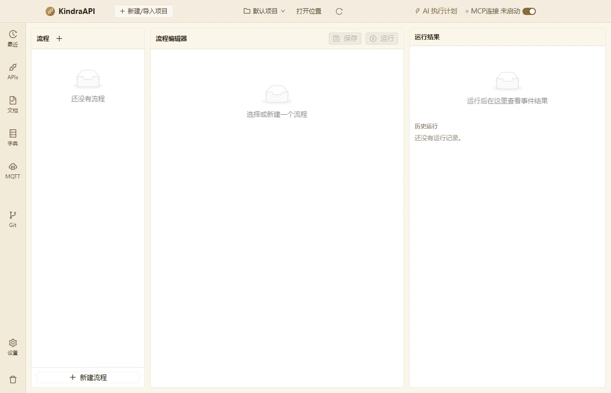
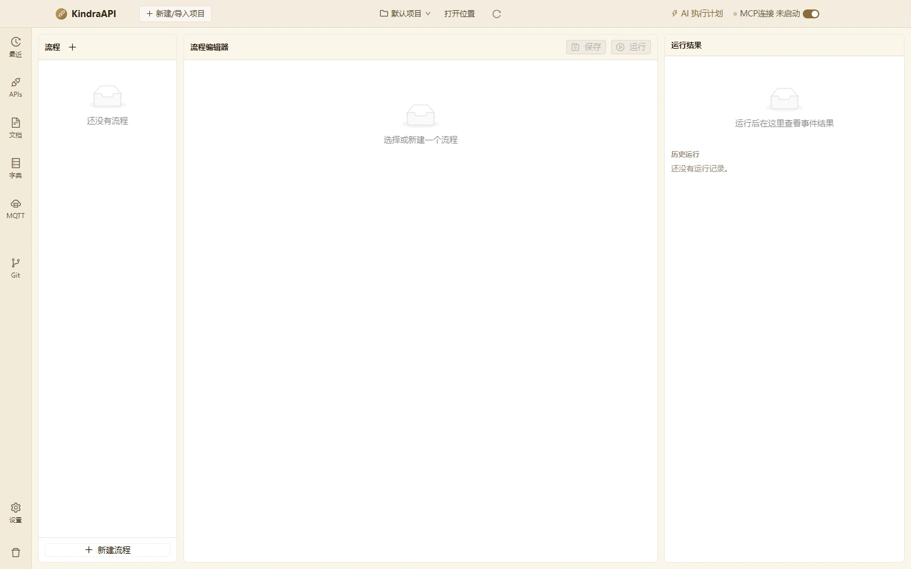

# 流程自动化

- 路由：`/automation`
- 用途：流程列表、事件编排、运行结果与历史运行。
- 采集状态：7 个；DOM/AX 元素合计：122
- 主要源码：`src/renderer/src/pages/AutomationPage.tsx`

## 状态截图

| 状态 | 类型 | 视口 | 元素数 | 截图 |
| --- | --- | --- | --- | --- |
| `automation-empty-1180x760` | page | 1180×760 | 11 | [WebP](../screenshots/webp/automation-empty-1180x760.webp) |
| `automation-empty-1440x900` | page | 1440×900 | 11 | [WebP](../screenshots/webp/automation-empty-1440x900.webp) |
| `automation-flow-editor-1180x760` | page | 1180×760 | 19 | [WebP](../screenshots/webp/automation-flow-editor-1180x760.webp) |
| `automation-flow-editor-1440x900` | page | 1440×900 | 19 | [WebP](../screenshots/webp/automation-flow-editor-1440x900.webp) |
| `automation-event-menu` | menu | 1180×760 | 8 | [WebP](../screenshots/webp/automation-event-menu.webp) |
| `automation-event-added` | page | 1180×760 | 27 | [WebP](../screenshots/webp/automation-event-added.webp) |
| `automation-run-result-empty` | page | 1180×760 | 27 | [WebP](../screenshots/webp/automation-run-result-empty.webp) |

### automation-empty-1180x760

### automation-empty-1440x900

## 布局区域（1180×760 基准）

| 区域 | x | y | width | height |
| --- | --- | --- | --- | --- |
| `topbar` | 0 | 0 | 1180 | 44 |
| `rail` | 0 | 44 | 50 | 716 |
| `main` | 50 | 44 | 1130 | 716 |

## 控件全量清单

| 区块 | 控件文案 / aria / icon | 类型 | 状态 | 位置 | 来源状态 |
| --- | --- | --- | --- | --- | --- |
| 页面 | anticon-plus `anticon-plus` | `button` | — | 103,63 · 23×23 | `automation-empty-1180x760` |
| 页面 | 还没有流程 | `div` | — | 79,180 · 182×21 | `automation-empty-1180x760` |
| 页面 | 新建流程 `anticon-plus` | `button` | — | 71,719 · 198×23 | `automation-empty-1180x760` |
| 页面 | 保存 `anticon-save` | `button` | disabled | 635,63 · 63×23 | `automation-empty-1180x760` |
| 页面 | 运行 `anticon-play-circle` | `button` | disabled | 706,63 · 63×23 | `automation-empty-1180x760` |
| 页面 | 选择或新建一个流程 | `div` | — | 309,210 · 452×21 | `automation-empty-1180x760` |
| 页面 | 运行后在这里查看事件结果 | `div` | — | 809,184 · 342×21 | `automation-empty-1180x760` |
| 页面 | 新建流程 0 个事件 | `button` | active | 71,105 · 198×51 | `automation-flow-editor-1180x760` |
| 页面 | 流程名称 | `input` | — | 301,105 · 200×30 | `automation-flow-editor-1180x760` |
| 页面 | 说明（可选） | `input` | — | 507,105 · 262×30 | `automation-flow-editor-1180x760` |
| 页面 | 默认环境 `anticon-down` | `div` | — | 301,141 · 150×30 | `automation-flow-editor-1180x760` |
| 页面 | 默认环境 | `span` | — | 313,142 · 126×28 | `automation-flow-editor-1180x760` |
| 页面 | anticon-delete `anticon-delete` | `button` | — | 457,141 · 30×30 | `automation-flow-editor-1180x760` |
| 页面 | 添加事件 `anticon-plus` | `button` | — | 680,185 · 89×23 | `automation-flow-editor-1180x760` |
| 页面 | 接口 | `li/menuitem` | — | 684,215 · 81×30 | `automation-event-menu` |
| 页面 | 请求 | `li/menuitem` | — | 684,245 · 81×30 | `automation-event-menu` |
| 页面 | 脚本 | `li/menuitem` | — | 684,275 · 81×30 | `automation-event-menu` |
| 页面 | 断言 | `li/menuitem` | — | 684,305 · 81×30 | `automation-event-menu` |
| 页面 | 等待 | `li/menuitem` | — | 684,335 · 81×30 | `automation-event-menu` |
| 页面 | 条件 | `li/menuitem` | — | 684,365 · 81×30 | `automation-event-menu` |
| 页面 | 分组 | `li/menuitem` | — | 684,395 · 81×30 | `automation-event-menu` |
| 页面 | 循环 | `li/menuitem` | — | 684,425 · 81×30 | `automation-event-menu` |
| 页面 | (未命名单选/控件) | `input` | — | 354,232 · 346×23 | `automation-event-added` |
| 页面 | GET web-查询企业信息联系人（地块负责人下拉） `anticon-down` | `div` | — | 310,261 · 450×23 | `automation-event-added` |
| 页面 | GET web-查询企业信息联系人（地块负责人下拉） | `span` | — | 318,262 · 434×21 | `automation-event-added` |

## 菜单 / 下拉项（运行态）

| 所在区域 | 菜单文案 | 类型 | 状态 | 选择器 |
| --- | --- | --- | --- | --- |
| 菜单 | 接口 | `li` | — | `div:nth-of-type(5) > div.ant-dropdown.css-dzyqf7 > ul.ant-dropdown-menu.ant-dropdown-menu-root > li.ant-dropdown-menu-item.ant-dropdown-menu-item-only-child:nth-of-type(1)` |
| 菜单 | 请求 | `li` | — | `div:nth-of-type(5) > div.ant-dropdown.css-dzyqf7 > ul.ant-dropdown-menu.ant-dropdown-menu-root > li.ant-dropdown-menu-item.ant-dropdown-menu-item-only-child:nth-of-type(2)` |
| 菜单 | 脚本 | `li` | — | `div:nth-of-type(5) > div.ant-dropdown.css-dzyqf7 > ul.ant-dropdown-menu.ant-dropdown-menu-root > li.ant-dropdown-menu-item.ant-dropdown-menu-item-only-child:nth-of-type(3)` |
| 菜单 | 断言 | `li` | — | `div:nth-of-type(5) > div.ant-dropdown.css-dzyqf7 > ul.ant-dropdown-menu.ant-dropdown-menu-root > li.ant-dropdown-menu-item.ant-dropdown-menu-item-only-child:nth-of-type(4)` |
| 菜单 | 等待 | `li` | — | `div:nth-of-type(5) > div.ant-dropdown.css-dzyqf7 > ul.ant-dropdown-menu.ant-dropdown-menu-root > li.ant-dropdown-menu-item.ant-dropdown-menu-item-only-child:nth-of-type(5)` |
| 菜单 | 条件 | `li` | — | `div:nth-of-type(5) > div.ant-dropdown.css-dzyqf7 > ul.ant-dropdown-menu.ant-dropdown-menu-root > li.ant-dropdown-menu-item.ant-dropdown-menu-item-only-child:nth-of-type(6)` |
| 菜单 | 分组 | `li` | — | `div:nth-of-type(5) > div.ant-dropdown.css-dzyqf7 > ul.ant-dropdown-menu.ant-dropdown-menu-root > li.ant-dropdown-menu-item.ant-dropdown-menu-item-only-child:nth-of-type(7)` |
| 菜单 | 循环 | `li` | — | `div:nth-of-type(5) > div.ant-dropdown.css-dzyqf7 > ul.ant-dropdown-menu.ant-dropdown-menu-root > li.ant-dropdown-menu-item.ant-dropdown-menu-item-only-child:nth-of-type(8)` |

## 提示、空态与错误

**空态**

- 还没有流程
- 选择或新建一个流程
- 运行后在这里查看事件结果

**title 属性（悬停提示）**

- 默认环境
- GET web-查询企业信息联系人（地块负责人下拉）

## 源码静态清单（含 file:line）

### 源码中的按钮

| 组件 | 文案 | 关键属性 | 位置 |
| --- | --- | --- | --- |
| Button | 新建流程 | size=small type=dashed | `src/renderer/src/pages/AutomationPage.tsx`:296 |
| Button | 保存 | size=small loading=saving disabled=!flow | `src/renderer/src/pages/AutomationPage.tsx`:307 |
| Button | 运行 | size=small type=primary loading=running disabled=!flow | `src/renderer/src/pages/AutomationPage.tsx`:316 |
| Button | 添加事件 | size=small | `src/renderer/src/pages/AutomationPage.tsx`:368 |
| Button | 添加断言 | size=small type=dashed | `src/renderer/src/pages/AutomationPage.tsx`:752 |

### 源码中的提示 / 通知 / 确认框

| 类型 | 文案 | 位置 |
| --- | --- | --- |
| `message.error` | `result.ok ? '流程不存在' : result.error` | `src/renderer/src/pages/AutomationPage.tsx`:131 |
| `message.error` | `result.error` | `src/renderer/src/pages/AutomationPage.tsx`:145 |
| `message.error` | `result.error` | `src/renderer/src/pages/AutomationPage.tsx`:176 |
| `message.success` | `流程已创建` | `src/renderer/src/pages/AutomationPage.tsx`:180 |
| `message.error` | `result.error` | `src/renderer/src/pages/AutomationPage.tsx`:189 |
| `message.success` | `流程已保存` | `src/renderer/src/pages/AutomationPage.tsx`:200 |
| `message.error` | `result.error` | `src/renderer/src/pages/AutomationPage.tsx`:215 |
| `message.success` | `流程运行通过` | `src/renderer/src/pages/AutomationPage.tsx`:220 |
| `message.error` | `流程存在失败事件` | `src/renderer/src/pages/AutomationPage.tsx`:221 |
| `modal.confirm` | `title=\`删除流程「${flow.name}」？\`; content=运行记录会保留，流程定义将被删除。; okText=删除; cancelText=取消` | `src/renderer/src/pages/AutomationPage.tsx`:229 |
| `message.error` | `result.error` | `src/renderer/src/pages/AutomationPage.tsx`:238 |
| `message.success` | `已删除` | `src/renderer/src/pages/AutomationPage.tsx`:242 |
| `message.error` | `result.error` | `src/renderer/src/pages/AutomationPage.tsx`:251 |

### 源码中的菜单项

| label | key | disabled | 位置 |
| --- | --- | --- | --- |
| `env.name` | `` | — | `src/renderer/src/pages/AutomationPage.tsx`:347 |
| `TYPE_LABEL[type]` | `type` | — | `src/renderer/src/pages/AutomationPage.tsx`:361 |
| `TYPE_LABEL[type]` | `type` | — | `src/renderer/src/pages/AutomationPage.tsx`:543 |
| `\`${target.method \|\| 'GET'} ${target.name}\`` | `` | — | `src/renderer/src/pages/AutomationPage.tsx`:562 |
| `method` | `` | — | `src/renderer/src/pages/AutomationPage.tsx`:580 |
| `状态码` | `` | — | `src/renderer/src/pages/AutomationPage.tsx`:712 |
| `JSON` | `` | — | `src/renderer/src/pages/AutomationPage.tsx`:713 |
| `耗时` | `` | — | `src/renderer/src/pages/AutomationPage.tsx`:714 |
| `Body 包含` | `` | — | `src/renderer/src/pages/AutomationPage.tsx`:715 |
| `=` | `` | — | `src/renderer/src/pages/AutomationPage.tsx`:731 |
| `存在` | `` | — | `src/renderer/src/pages/AutomationPage.tsx`:732 |
| `长度 >` | `` | — | `src/renderer/src/pages/AutomationPage.tsx`:733 |
| `包含` | `` | — | `src/renderer/src/pages/AutomationPage.tsx`:734 |

### 源码中的提示文案

**Tooltip**

| 文案 | 位置 |
| --- | --- |
| `删除流程` | `src/renderer/src/pages/AutomationPage.tsx`:351 |
| `启用 / 禁用` | `src/renderer/src/pages/AutomationPage.tsx`:537 |
| `添加子事件` | `src/renderer/src/pages/AutomationPage.tsx`:547 |

**Placeholder**

| 文案 | 位置 |
| --- | --- |
| `流程名称` | `src/renderer/src/pages/AutomationPage.tsx`:334 |
| `说明（可选）` | `src/renderer/src/pages/AutomationPage.tsx`:339 |
| `运行环境` | `src/renderer/src/pages/AutomationPage.tsx`:348 |
| `选择接口` | `src/renderer/src/pages/AutomationPage.tsx`:561 |
| `URL，如 {{baseUrl}}/login` | `src/renderer/src/pages/AutomationPage.tsx`:589 |
| `请求体` | `src/renderer/src/pages/AutomationPage.tsx`:597 |
| `'pm.environment.set("token", pm.response.json().token);\npm.test("状态码 200", () => pm.expect(pm.respo` | `src/renderer/src/pages/AutomationPage.tsx`:608 |
| `env.token !== undefined` | `src/renderer/src/pages/AutomationPage.tsx`:622 |
| `assertion.type === 'json' ? 'data.id' : '（路径）'` | `src/renderer/src/pages/AutomationPage.tsx`:722 |
| `期望值` | `src/renderer/src/pages/AutomationPage.tsx`:741 |

**Empty**

| 文案 | 位置 |
| --- | --- |
| `还没有流程` | `src/renderer/src/pages/AutomationPage.tsx`:277 |
| `选择或新建一个流程` | `src/renderer/src/pages/AutomationPage.tsx`:400 |
| `运行后在这里查看事件结果` | `src/renderer/src/pages/AutomationPage.tsx`:475 |

### 行为 / IPC 调用

| 调用 | 参数 | 位置 |
| --- | --- | --- |
| `window.api.flows.runs` | `project.project_id, 50` | `src/renderer/src/pages/AutomationPage.tsx`:123 |
| `window.api.flows.get` | `project.project_id, flowId` | `src/renderer/src/pages/AutomationPage.tsx`:129 |
| `window.api.flows.list` | `project.project_id` | `src/renderer/src/pages/AutomationPage.tsx`:143 |
| `window.api.flows.create` | `project.project_id, '新建流程'` | `src/renderer/src/pages/AutomationPage.tsx`:174 |
| `window.api.flows.save` | `project.project_id, { ...flow, env_id: envId }` | `src/renderer/src/pages/AutomationPage.tsx`:187 |
| `window.api.flows.run` | `project.project_id, flow.flow_id, envId` | `src/renderer/src/pages/AutomationPage.tsx`:213 |
| `window.api.flows.delete` | `project.project_id, flow.flow_id` | `src/renderer/src/pages/AutomationPage.tsx`:236 |
| `window.api.flows.getRun` | `project.project_id, runId` | `src/renderer/src/pages/AutomationPage.tsx`:249 |

> 返回 [总索引](../README.md)
