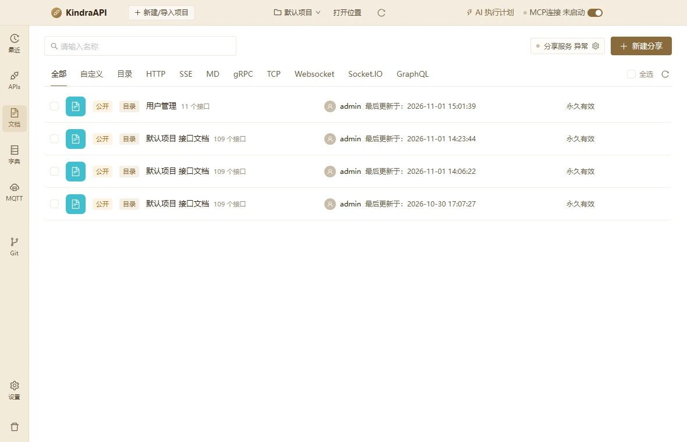
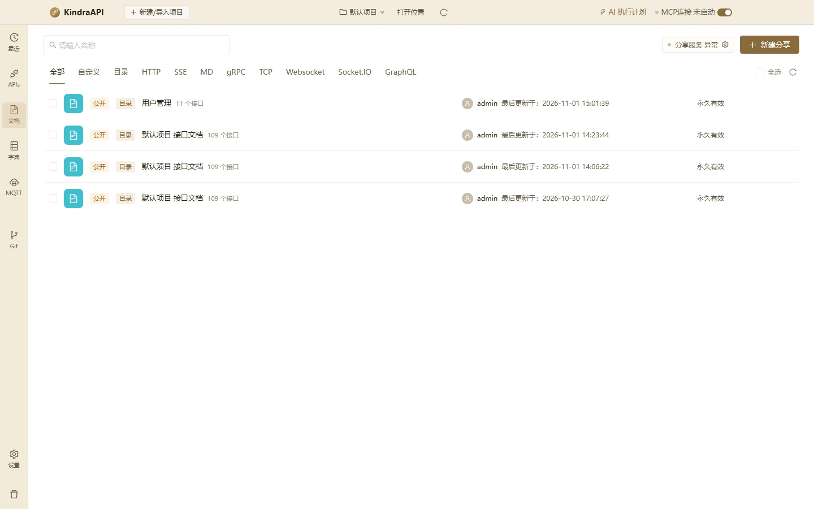

# 文档分享

- 路由：`/docs`
- 用途：分享列表、分享范围（项目/目录/接口/自定义）、分享服务配置。
- 采集状态：10 个；DOM/AX 元素合计：734
- 主要源码：`src/renderer/src/pages/DocsPage.tsx`、`src/renderer/src/components/DocShareDialog.tsx`、`src/renderer/src/components/DocShareLinkDialog.tsx`

## 状态截图

| 状态 | 类型 | 视口 | 元素数 | 截图 |
| --- | --- | --- | --- | --- |
| `docs-list-1180x760` | page | 1180×760 | 68 | [WebP](../screenshots/webp/docs-list-1180x760.webp) |
| `docs-list-1440x900` | page | 1440×900 | 68 | [WebP](../screenshots/webp/docs-list-1440x900.webp) |
| `docs-dialog-new-share` | dialog | 1180×760 | 24 | [WebP](../screenshots/webp/docs-dialog-new-share.webp) |
| `docs-new-share-tab-project` | dialog-tab | 1180×760 | 24 | [WebP](../screenshots/webp/docs-new-share-tab-project.webp) |
| `docs-new-share-tab-folder` | dialog-tab | 1180×760 | 27 | [WebP](../screenshots/webp/docs-new-share-tab-folder.webp) |
| `docs-new-share-tab-api` | dialog-tab | 1180×760 | 27 | [WebP](../screenshots/webp/docs-new-share-tab-api.webp) |
| `docs-new-share-tab-custom` | dialog-tab | 1180×760 | 439 | [WebP](../screenshots/webp/docs-new-share-tab-custom.webp) |
| `docs-dialog-share-service` | dialog | 1180×760 | 17 | [WebP](../screenshots/webp/docs-dialog-share-service.webp) |
| `docs-filter-http` | page | 1180×760 | 20 | [WebP](../screenshots/webp/docs-filter-http.webp) |
| `docs-filter-graphql` | page | 1180×760 | 20 | [WebP](../screenshots/webp/docs-filter-graphql.webp) |

### docs-list-1180x760

### docs-list-1440x900

## 布局区域（1180×760 基准）

| 区域 | x | y | width | height |
| --- | --- | --- | --- | --- |
| `topbar` | 0 | 0 | 1180 | 44 |
| `rail` | 0 | 44 | 50 | 716 |
| `main` | 50 | 44 | 1130 | 716 |

## 控件全量清单

| 区块 | 控件文案 / aria / icon | 类型 | 状态 | 位置 | 来源状态 |
| --- | --- | --- | --- | --- | --- |
| 页面 | 请输入名称 | `input` | — | 104,63 · 277×32 | `docs-list-1180x760` |
| 页面 | 分享服务 异常 `anticon-setting` | `button` | — | 911,65 · 128×28 | `docs-list-1180x760` |
| 页面 | 新建分享 `anticon-plus` | `button` | — | 1049,63 · 105×32 | `docs-list-1180x760` |
| 页面 | 全部 | `button` | active | 76,106 · 50×42 | `docs-list-1180x760` |
| 页面 | 自定义 | `button` | — | 126,106 · 63×42 | `docs-list-1180x760` |
| 页面 | 目录 | `button` | — | 189,106 · 50×42 | `docs-list-1180x760` |
| 页面 | HTTP | `button` | — | 239,106 · 57×42 | `docs-list-1180x760` |
| 页面 | SSE | `button` | — | 296,106 · 46×42 | `docs-list-1180x760` |
| 页面 | MD | `button` | — | 342,106 · 47×42 | `docs-list-1180x760` |
| 页面 | gRPC | `button` | — | 389,106 · 57×42 | `docs-list-1180x760` |
| 页面 | TCP | `button` | — | 446,106 · 47×42 | `docs-list-1180x760` |
| 页面 | Websocket | `button` | — | 494,106 · 92×42 | `docs-list-1180x760` |
| 页面 | Socket.IO | `button` | — | 586,106 · 83×42 | `docs-list-1180x760` |
| 页面 | GraphQL | `button` | — | 669,106 · 79×42 | `docs-list-1180x760` |
| 页面 | anticon-reload `anticon-reload` | `button` | — | 1130,115 · 24×24 | `docs-list-1180x760` |
| 页面 | 用户管理 11 个接口 | `span` | — | 251,173 · 294×18 | `docs-list-1180x760` |
| 页面 | anticon-link `anticon-link` | `button` | — | 1037,170 · 26×26 | `docs-list-1180x760` |
| 页面 | anticon-copy `anticon-copy` | `button` | — | 1064,170 · 26×26 | `docs-list-1180x760` |
| 页面 | anticon-edit `anticon-edit` | `button` | — | 1091,170 · 26×26 | `docs-list-1180x760` |
| 页面 | anticon-delete `anticon-delete` | `button` | — | 1118,170 · 26×26 | `docs-list-1180x760` |
| 页面 | 默认项目 接口文档 109 个接口 | `span` | — | 251,229 · 294×18 | `docs-list-1180x760` |
| modal:新建分享 | Close `anticon-close` | `button` | — | 848,112 · 30×30 | `docs-dialog-new-share` |
| modal:新建分享 | 关闭 `anticon-close` | `span` | — | 848,120 · 30×14 | `docs-dialog-new-share` |
| modal:新建分享 | 新建分享 | `div` | — | 314,120 · 552×22 | `docs-dialog-new-share` |
| modal:新建分享 | 请输入分享名称 | `input` | — | 314,179 · 552×30 | `docs-dialog-new-share` |
| modal:新建分享 | 项目 | `label` | active | 314,251 · 42×23 | `docs-dialog-new-share` |
| modal:新建分享 | 目录 | `label` | — | 355,251 · 42×23 | `docs-dialog-new-share` |
| modal:新建分享 | 接口 | `label` | — | 396,251 · 42×23 | `docs-dialog-new-share` |
| modal:新建分享 | 自定义 | `label` | — | 437,251 · 55×23 | `docs-dialog-new-share` |
| 页面 | 公开访问 | `label` | — | 314,376 · 82×21 | `docs-dialog-new-share` |
| 页面 | 密码访问 | `label` | — | 404,376 · 82×21 | `docs-dialog-new-share` |
| 页面 | 永久有效 `anticon-down` | `div` | — | 602,376 · 126×30 | `docs-dialog-new-share` |
| 页面 | 永久有效 | `span` | — | 614,377 · 102×28 | `docs-dialog-new-share` |
| modal:新建分享 | 请求参数 | `label` | — | 314,447 · 83×21 | `docs-dialog-new-share` |
| modal:新建分享 | 请求体 | `label` | — | 417,447 · 70×21 | `docs-dialog-new-share` |
| modal:新建分享 | 响应示例 | `label` | — | 507,447 · 83×21 | `docs-dialog-new-share` |
| modal:新建分享 | 响应头 / Cookie | `label` | — | 610,447 · 126×21 | `docs-dialog-new-share` |
| modal:新建分享 | 前后脚本 | `label` | — | 756,447 · 83×21 | `docs-dialog-new-share` |
| modal:新建分享 | 接口设计 | `label` | — | 314,476 · 83×21 | `docs-dialog-new-share` |
| modal:新建分享 | 接口用例 | `label` | — | 417,476 · 83×21 | `docs-dialog-new-share` |
| modal:新建分享 | 取 消 | `button` | — | 734,574 · 62×30 | `docs-dialog-new-share` |
| modal:新建分享 | 保 存 | `button` | — | 804,574 · 62×30 | `docs-dialog-new-share` |
| modal:新建分享 | 请选择目录 `anticon-down` | `div` | — | 327,300 · 526×30 | `docs-new-share-tab-folder` |
| 页面 | (未命名单选/控件) | `input/combobox` | — | 339,301 · 485×28 | `docs-new-share-tab-folder` |
| modal:新建分享 | 请选择接口 `anticon-down` | `div` | — | 327,300 · 526×30 | `docs-new-share-tab-api` |
| modal:分享服务 | Close `anticon-close` | `button` | — | 808,112 · 30×30 | `docs-dialog-share-service` |
| modal:分享服务 | 关闭 `anticon-close` | `span` | — | 808,120 · 30×14 | `docs-dialog-share-service` |
| modal:分享服务 | 分享服务 | `div` | — | 354,120 · 472×22 | `docs-dialog-share-service` |
| modal:分享服务 | anticon-up `anticon-up` | `div` | — | 354,240 · 160×30 | `docs-dialog-share-service` |
| 页面 | Increase Value `anticon-up` | `span/button` | — | 513,241 · 1×14 | `docs-dialog-share-service` |
| 页面 | Decrease Value `anticon-down` | `span/button` | — | 513,255 · 1×14 | `docs-dialog-share-service` |
| modal:分享服务 | 端口 30999 已被占用 `anticon-close-circle` | `div/alert` | — | 354,342 · 472×39 | `docs-dialog-share-service` |
| modal:分享服务 | 服务默认监听局域网地址，同一网络下的同事可直接打开分享链接。 `anticon-info-circle` | `div/alert` | — | 354,381 · 472×39 | `docs-dialog-share-service` |
| modal:分享服务 | 取 消 | `button` | — | 659,432 · 62×30 | `docs-dialog-share-service` |
| modal:分享服务 | 保存并重启 | `button` | — | 729,432 · 97×30 | `docs-dialog-share-service` |

## 树节点（数据，不是控件）

展开 118 个树节点

| 节点 | 状态 | 来源状态 | 选择器 |
| --- | --- | --- | --- |
| 专家服务平台 | — | `docs-new-share-tab-custom` | `div.ant-tree.ant-tree-icon-hide:nth-of-type(1) > div.ant-tree-list:nth-of-type(3) > div.ant-tree-list-holder > div > div.ant-tree-list-holder-inner > div.ant-tree-treenode.ant-tree-treenode-switcher-open:nth-of-type(1)` |
| 专家审核 | — | `docs-new-share-tab-custom` | `div.ant-tree.ant-tree-icon-hide:nth-of-type(1) > div.ant-tree-list:nth-of-type(3) > div.ant-tree-list-holder > div > div.ant-tree-list-holder-inner > div.ant-tree-treenode.ant-tree-treenode-switcher-open:nth-of-type(2)` |
| 获取专家审核分页数据 | — | `docs-new-share-tab-custom` | `div.ant-tree.ant-tree-icon-hide:nth-of-type(1) > div.ant-tree-list:nth-of-type(3) > div.ant-tree-list-holder > div > div.ant-tree-list-holder-inner > div.ant-tree-treenode.ant-tree-treenode-switcher-close:nth-of-type(3)` |
| 审核专家信息 | — | `docs-new-share-tab-custom` | `div.ant-tree.ant-tree-icon-hide:nth-of-type(1) > div.ant-tree-list:nth-of-type(3) > div.ant-tree-list-holder > div > div.ant-tree-list-holder-inner > div.ant-tree-treenode.ant-tree-treenode-switcher-close:nth-of-type(4)` |
| 获取专家审核数量 | — | `docs-new-share-tab-custom` | `div.ant-tree.ant-tree-icon-hide:nth-of-type(1) > div.ant-tree-list:nth-of-type(3) > div.ant-tree-list-holder > div > div.ant-tree-list-holder-inner > div.ant-tree-treenode.ant-tree-treenode-switcher-close:nth-of-type(5)` |
| 获取专家详情 | — | `docs-new-share-tab-custom` | `div.ant-tree.ant-tree-icon-hide:nth-of-type(1) > div.ant-tree-list:nth-of-type(3) > div.ant-tree-list-holder > div > div.ant-tree-list-holder-inner > div.ant-tree-treenode.ant-tree-treenode-switcher-close:nth-of-type(6)` |
| 删除专家 | — | `docs-new-share-tab-custom` | `div.ant-tree.ant-tree-icon-hide:nth-of-type(1) > div.ant-tree-list:nth-of-type(3) > div.ant-tree-list-holder > div > div.ant-tree-list-holder-inner > div.ant-tree-treenode.ant-tree-treenode-switcher-close:nth-of-type(7)` |
| 用户审核 | — | `docs-new-share-tab-custom` | `div.ant-tree.ant-tree-icon-hide:nth-of-type(1) > div.ant-tree-list:nth-of-type(3) > div.ant-tree-list-holder > div > div.ant-tree-list-holder-inner > div.ant-tree-treenode.ant-tree-treenode-switcher-open:nth-of-type(8)` |
| 变更农户账号状态（停用/启用） | — | `docs-new-share-tab-custom` | `div.ant-tree.ant-tree-icon-hide:nth-of-type(1) > div.ant-tree-list:nth-of-type(3) > div.ant-tree-list-holder > div > div.ant-tree-list-holder-inner > div.ant-tree-treenode.ant-tree-treenode-switcher-close:nth-of-type(9)` |
| 农户审核tab统计 | — | `docs-new-share-tab-custom` | `div.ant-tree.ant-tree-icon-hide:nth-of-type(1) > div.ant-tree-list:nth-of-type(3) > div.ant-tree-list-holder > div > div.ant-tree-list-holder-inner > div.ant-tree-treenode.ant-tree-treenode-switcher-close:nth-of-type(10)` |
| 农户审核详情 | — | `docs-new-share-tab-custom` | `div.ant-tree.ant-tree-icon-hide:nth-of-type(1) > div.ant-tree-list:nth-of-type(3) > div.ant-tree-list-holder > div > div.ant-tree-list-holder-inner > div.ant-tree-treenode.ant-tree-treenode-switcher-close:nth-of-type(11)` |
| 农户审核分页 | — | `docs-new-share-tab-custom` | `div.ant-tree.ant-tree-icon-hide:nth-of-type(1) > div.ant-tree-list:nth-of-type(3) > div.ant-tree-list-holder > div > div.ant-tree-list-holder-inner > div.ant-tree-treenode.ant-tree-treenode-switcher-close:nth-of-type(12)` |
| 删除农户（逻辑删除） | — | `docs-new-share-tab-custom` | `div.ant-tree.ant-tree-icon-hide:nth-of-type(1) > div.ant-tree-list:nth-of-type(3) > div.ant-tree-list-holder > div > div.ant-tree-list-holder-inner > div.ant-tree-treenode.ant-tree-treenode-switcher-close:nth-of-type(13)` |
| 审核农户 | — | `docs-new-share-tab-custom` | `div.ant-tree.ant-tree-icon-hide:nth-of-type(1) > div.ant-tree-list:nth-of-type(3) > div.ant-tree-list-holder > div > div.ant-tree-list-holder-inner > div.ant-tree-treenode.ant-tree-treenode-switcher-close:nth-of-type(14)` |
| 【APP】农户注册 | — | `docs-new-share-tab-custom` | `div.ant-tree.ant-tree-icon-hide:nth-of-type(1) > div.ant-tree-list:nth-of-type(3) > div.ant-tree-list-holder > div > div.ant-tree-list-holder-inner > div.ant-tree-treenode.ant-tree-treenode-switcher-close:nth-of-type(15)` |
| 课程审核 | — | `docs-new-share-tab-custom` | `div.ant-tree.ant-tree-icon-hide:nth-of-type(1) > div.ant-tree-list:nth-of-type(3) > div.ant-tree-list-holder > div > div.ant-tree-list-holder-inner > div.ant-tree-treenode.ant-tree-treenode-switcher-open:nth-of-type(16)` |
| 课程审核分页 | — | `docs-new-share-tab-custom` | `div.ant-tree.ant-tree-icon-hide:nth-of-type(1) > div.ant-tree-list:nth-of-type(3) > div.ant-tree-list-holder > div > div.ant-tree-list-holder-inner > div.ant-tree-treenode.ant-tree-treenode-switcher-close:nth-of-type(17)` |
| 课程审核 tab 计数 | — | `docs-new-share-tab-custom` | `div.ant-tree.ant-tree-icon-hide:nth-of-type(1) > div.ant-tree-list:nth-of-type(3) > div.ant-tree-list-holder > div > div.ant-tree-list-holder-inner > div.ant-tree-treenode.ant-tree-treenode-switcher-close:nth-of-type(18)` |
| 课程详情 | — | `docs-new-share-tab-custom` | `div.ant-tree.ant-tree-icon-hide:nth-of-type(1) > div.ant-tree-list:nth-of-type(3) > div.ant-tree-list-holder > div > div.ant-tree-list-holder-inner > div.ant-tree-treenode.ant-tree-treenode-switcher-close:nth-of-type(20)` |
| 课程编辑 | — | `docs-new-share-tab-custom` | `div.ant-tree.ant-tree-icon-hide:nth-of-type(1) > div.ant-tree-list:nth-of-type(3) > div.ant-tree-list-holder > div > div.ant-tree-list-holder-inner > div.ant-tree-treenode.ant-tree-treenode-switcher-close:nth-of-type(21)` |
| 课程删除 | — | `docs-new-share-tab-custom` | `div.ant-tree.ant-tree-icon-hide:nth-of-type(1) > div.ant-tree-list:nth-of-type(3) > div.ant-tree-list-holder > div > div.ant-tree-list-holder-inner > div.ant-tree-treenode.ant-tree-treenode-switcher-close:nth-of-type(22)` |
| 课程发布/撤回 | — | `docs-new-share-tab-custom` | `div.ant-tree.ant-tree-icon-hide:nth-of-type(1) > div.ant-tree-list:nth-of-type(3) > div.ant-tree-list-holder > div > div.ant-tree-list-holder-inner > div.ant-tree-treenode.ant-tree-treenode-switcher-close:nth-of-type(23)` |
| 登录 | — | `docs-new-share-tab-custom` | `div.ant-tree.ant-tree-icon-hide:nth-of-type(1) > div.ant-tree-list:nth-of-type(3) > div.ant-tree-list-holder > div > div.ant-tree-list-holder-inner > div.ant-tree-treenode.ant-tree-treenode-switcher-open:nth-of-type(24)` |
| 获取图形验证码 | — | `docs-new-share-tab-custom` | `div.ant-tree.ant-tree-icon-hide:nth-of-type(1) > div.ant-tree-list:nth-of-type(3) > div.ant-tree-list-holder > div > div.ant-tree-list-holder-inner > div.ant-tree-treenode.ant-tree-treenode-switcher-close:nth-of-type(25)` |
| 账号密码登录（图形验证码） | — | `docs-new-share-tab-custom` | `div.ant-tree.ant-tree-icon-hide:nth-of-type(1) > div.ant-tree-list:nth-of-type(3) > div.ant-tree-list-holder > div > div.ant-tree-list-holder-inner > div.ant-tree-treenode.ant-tree-treenode-switcher-close:nth-of-type(26)` |
| 账号密码登录（免图形验证码） | — | `docs-new-share-tab-custom` | `div.ant-tree.ant-tree-icon-hide:nth-of-type(1) > div.ant-tree-list:nth-of-type(3) > div.ant-tree-list-holder > div > div.ant-tree-list-holder-inner > div.ant-tree-treenode.ant-tree-treenode-switcher-close:nth-of-type(27)` |
| 养殖技术库 | — | `docs-new-share-tab-custom` | `div.ant-tree.ant-tree-icon-hide:nth-of-type(1) > div.ant-tree-list:nth-of-type(3) > div.ant-tree-list-holder > div > div.ant-tree-list-holder-inner > div.ant-tree-treenode.ant-tree-treenode-switcher-open:nth-of-type(28)` |
| 分页列表 | — | `docs-new-share-tab-custom` | `div.ant-tree.ant-tree-icon-hide:nth-of-type(1) > div.ant-tree-list:nth-of-type(3) > div.ant-tree-list-holder > div > div.ant-tree-list-holder-inner > div.ant-tree-treenode.ant-tree-treenode-switcher-close:nth-of-type(29)` |
| 详情（含审核详情） | — | `docs-new-share-tab-custom` | `div.ant-tree.ant-tree-icon-hide:nth-of-type(1) > div.ant-tree-list:nth-of-type(3) > div.ant-tree-list-holder > div > div.ant-tree-list-holder-inner > div.ant-tree-treenode.ant-tree-treenode-switcher-close:nth-of-type(30)` |
| 新增 | — | `docs-new-share-tab-custom` | `div.ant-tree.ant-tree-icon-hide:nth-of-type(1) > div.ant-tree-list:nth-of-type(3) > div.ant-tree-list-holder > div > div.ant-tree-list-holder-inner > div.ant-tree-treenode.ant-tree-treenode-switcher-close:nth-of-type(31)` |
| 编辑 | — | `docs-new-share-tab-custom` | `div.ant-tree.ant-tree-icon-hide:nth-of-type(1) > div.ant-tree-list:nth-of-type(3) > div.ant-tree-list-holder > div > div.ant-tree-list-holder-inner > div.ant-tree-treenode.ant-tree-treenode-switcher-close:nth-of-type(32)` |
| 删除 | — | `docs-new-share-tab-custom` | `div.ant-tree.ant-tree-icon-hide:nth-of-type(1) > div.ant-tree-list:nth-of-type(3) > div.ant-tree-list-holder > div > div.ant-tree-list-holder-inner > div.ant-tree-treenode.ant-tree-treenode-switcher-close:nth-of-type(33)` |
| 审核 | — | `docs-new-share-tab-custom` | `div.ant-tree.ant-tree-icon-hide:nth-of-type(1) > div.ant-tree-list:nth-of-type(3) > div.ant-tree-list-holder > div > div.ant-tree-list-holder-inner > div.ant-tree-treenode.ant-tree-treenode-switcher-close:nth-of-type(34)` |
| 撤回 | — | `docs-new-share-tab-custom` | `div.ant-tree.ant-tree-icon-hide:nth-of-type(1) > div.ant-tree-list:nth-of-type(3) > div.ant-tree-list-holder > div > div.ant-tree-list-holder-inner > div.ant-tree-treenode.ant-tree-treenode-switcher-close:nth-of-type(35)` |
| 重新提交 | — | `docs-new-share-tab-custom` | `div.ant-tree.ant-tree-icon-hide:nth-of-type(1) > div.ant-tree-list:nth-of-type(3) > div.ant-tree-list-holder > div > div.ant-tree-list-holder-inner > div.ant-tree-treenode.ant-tree-treenode-switcher-close:nth-of-type(36)` |
| 置顶/取消置顶 | — | `docs-new-share-tab-custom` | `div.ant-tree.ant-tree-icon-hide:nth-of-type(1) > div.ant-tree-list:nth-of-type(3) > div.ant-tree-list-holder > div > div.ant-tree-list-holder-inner > div.ant-tree-treenode.ant-tree-treenode-switcher-close:nth-of-type(37)` |
| Excel 批量导入 | — | `docs-new-share-tab-custom` | `div.ant-tree.ant-tree-icon-hide:nth-of-type(1) > div.ant-tree-list:nth-of-type(3) > div.ant-tree-list-holder > div > div.ant-tree-list-holder-inner > div.ant-tree-treenode.ant-tree-treenode-switcher-close:nth-of-type(38)` |
| 导入模板下载 | — | `docs-new-share-tab-custom` | `div.ant-tree.ant-tree-icon-hide:nth-of-type(1) > div.ant-tree-list:nth-of-type(3) > div.ant-tree-list-holder > div > div.ant-tree-list-holder-inner > div.ant-tree-treenode.ant-tree-treenode-switcher-close:nth-of-type(39)` |
| 创建部门下拉 | — | `docs-new-share-tab-custom` | `div.ant-tree.ant-tree-icon-hide:nth-of-type(1) > div.ant-tree-list:nth-of-type(3) > div.ant-tree-list-holder > div > div.ant-tree-list-holder-inner > div.ant-tree-treenode.ant-tree-treenode-switcher-close:nth-of-type(40)` |
| 用户管理 | — | `docs-new-share-tab-custom` | `div.ant-tree.ant-tree-icon-hide:nth-of-type(1) > div.ant-tree-list:nth-of-type(3) > div.ant-tree-list-holder > div > div.ant-tree-list-holder-inner > div.ant-tree-treenode.ant-tree-treenode-switcher-open:nth-of-type(41)` |
| 台账分页（含分类计数） | — | `docs-new-share-tab-custom` | `div.ant-tree.ant-tree-icon-hide:nth-of-type(1) > div.ant-tree-list:nth-of-type(3) > div.ant-tree-list-holder > div > div.ant-tree-list-holder-inner > div.ant-tree-treenode.ant-tree-treenode-switcher-close:nth-of-type(42)` |
| 编辑用户 | — | `docs-new-share-tab-custom` | `div.ant-tree.ant-tree-icon-hide:nth-of-type(1) > div.ant-tree-list:nth-of-type(3) > div.ant-tree-list-holder > div > div.ant-tree-list-holder-inner > div.ant-tree-treenode.ant-tree-treenode-switcher-close:nth-of-type(43)` |
| 登录日志分页 | — | `docs-new-share-tab-custom` | `div.ant-tree.ant-tree-icon-hide:nth-of-type(1) > div.ant-tree-list:nth-of-type(3) > div.ant-tree-list-holder > div > div.ant-tree-list-holder-inner > div.ant-tree-treenode.ant-tree-treenode-switcher-close:nth-of-type(44)` |
| 权限卡片 | — | `docs-new-share-tab-custom` | `div.ant-tree.ant-tree-icon-hide:nth-of-type(1) > div.ant-tree-list:nth-of-type(3) > div.ant-tree-list-holder > div > div.ant-tree-list-holder-inner > div.ant-tree-treenode.ant-tree-treenode-switcher-close:nth-of-type(45)` |
| 恢复默认（清空角色权限） | — | `docs-new-share-tab-custom` | `div.ant-tree.ant-tree-icon-hide:nth-of-type(1) > div.ant-tree-list:nth-of-type(3) > div.ant-tree-list-holder > div > div.ant-tree-list-holder-inner > div.ant-tree-treenode.ant-tree-treenode-switcher-close:nth-of-type(46)` |
| 批量重置账号权限 | — | `docs-new-share-tab-custom` | `div.ant-tree.ant-tree-icon-hide:nth-of-type(1) > div.ant-tree-list:nth-of-type(3) > div.ant-tree-list-holder > div > div.ant-tree-list-holder-inner > div.ant-tree-treenode.ant-tree-treenode-switcher-close:nth-of-type(47)` |
| 操作日志分页 | — | `docs-new-share-tab-custom` | `div.ant-tree.ant-tree-icon-hide:nth-of-type(1) > div.ant-tree-list:nth-of-type(3) > div.ant-tree-list-holder > div > div.ant-tree-list-holder-inner > div.ant-tree-treenode.ant-tree-treenode-switcher-close:nth-of-type(48)` |
| 台账导出 | — | `docs-new-share-tab-custom` | `div.ant-tree.ant-tree-icon-hide:nth-of-type(1) > div.ant-tree-list:nth-of-type(3) > div.ant-tree-list-holder > div > div.ant-tree-list-holder-inner > div.ant-tree-treenode.ant-tree-treenode-switcher-close:nth-of-type(49)` |
| 登录日志导出 | — | `docs-new-share-tab-custom` | `div.ant-tree.ant-tree-icon-hide:nth-of-type(1) > div.ant-tree-list:nth-of-type(3) > div.ant-tree-list-holder > div > div.ant-tree-list-holder-inner > div.ant-tree-treenode.ant-tree-treenode-switcher-close:nth-of-type(50)` |
| 操作日志导出 | — | `docs-new-share-tab-custom` | `div.ant-tree.ant-tree-icon-hide:nth-of-type(1) > div.ant-tree-list:nth-of-type(3) > div.ant-tree-list-holder > div > div.ant-tree-list-holder-inner > div.ant-tree-treenode.ant-tree-treenode-switcher-close:nth-of-type(51)` |
| 农户注册（新增合作社必填） | — | `docs-new-share-tab-custom` | `div.ant-tree.ant-tree-icon-hide:nth-of-type(1) > div.ant-tree-list:nth-of-type(3) > div.ant-tree-list-holder > div > div.ant-tree-list-holder-inner > div.ant-tree-treenode.ant-tree-treenode-switcher-close:nth-of-type(52)` |
| 科研成果库 | — | `docs-new-share-tab-custom` | `div.ant-tree.ant-tree-icon-hide:nth-of-type(1) > div.ant-tree-list:nth-of-type(3) > div.ant-tree-list-holder > div > div.ant-tree-list-holder-inner > div.ant-tree-treenode.ant-tree-treenode-switcher-open:nth-of-type(53)` |
| 详情 | — | `docs-new-share-tab-custom` | `div.ant-tree.ant-tree-icon-hide:nth-of-type(1) > div.ant-tree-list:nth-of-type(3) > div.ant-tree-list-holder > div > div.ant-tree-list-holder-inner > div.ant-tree-treenode.ant-tree-treenode-switcher-close:nth-of-type(55)` |
| 新增（保存并提交审核） | — | `docs-new-share-tab-custom` | `div.ant-tree.ant-tree-icon-hide:nth-of-type(1) > div.ant-tree-list:nth-of-type(3) > div.ant-tree-list-holder > div > div.ant-tree-list-holder-inner > div.ant-tree-treenode.ant-tree-treenode-switcher-close:nth-of-type(56)` |
| 推送 | — | `docs-new-share-tab-custom` | `div.ant-tree.ant-tree-icon-hide:nth-of-type(1) > div.ant-tree-list:nth-of-type(3) > div.ant-tree-list-holder > div > div.ant-tree-list-holder-inner > div.ant-tree-treenode.ant-tree-treenode-switcher-close:nth-of-type(59)` |
| 发布部门下拉 | — | `docs-new-share-tab-custom` | `div.ant-tree.ant-tree-icon-hide:nth-of-type(1) > div.ant-tree-list:nth-of-type(3) > div.ant-tree-list-holder > div > div.ant-tree-list-holder-inner > div.ant-tree-treenode.ant-tree-treenode-switcher-close:nth-of-type(63)` |
| 内容类型下拉 | — | `docs-new-share-tab-custom` | `div.ant-tree.ant-tree-icon-hide:nth-of-type(1) > div.ant-tree-list:nth-of-type(3) > div.ant-tree-list-holder > div > div.ant-tree-list-holder-inner > div.ant-tree-treenode.ant-tree-treenode-switcher-close:nth-of-type(64)` |
| 级别下拉 | — | `docs-new-share-tab-custom` | `div.ant-tree.ant-tree-icon-hide:nth-of-type(1) > div.ant-tree-list:nth-of-type(3) > div.ant-tree-list-holder > div > div.ant-tree-list-holder-inner > div.ant-tree-treenode.ant-tree-treenode-switcher-close:nth-of-type(65)` |
| APP 成果详情 | — | `docs-new-share-tab-custom` | `div.ant-tree.ant-tree-icon-hide:nth-of-type(1) > div.ant-tree-list:nth-of-type(3) > div.ant-tree-list-holder > div > div.ant-tree-list-holder-inner > div.ant-tree-treenode.ant-tree-treenode-switcher-close:nth-of-type(66)` |
| APP-我的消息（type=2/3/4 改读推送） | — | `docs-new-share-tab-custom` | `div.ant-tree.ant-tree-icon-hide:nth-of-type(1) > div.ant-tree-list:nth-of-type(3) > div.ant-tree-list-holder > div > div.ant-tree-list-holder-inner > div.ant-tree-treenode.ant-tree-treenode-switcher-close:nth-of-type(69)` |
| APP-我的消息未读计数（四类） | — | `docs-new-share-tab-custom` | `div.ant-tree.ant-tree-icon-hide:nth-of-type(1) > div.ant-tree-list:nth-of-type(3) > div.ant-tree-list-holder > div > div.ant-tree-list-holder-inner > div.ant-tree-treenode.ant-tree-treenode-switcher-close:nth-of-type(70)` |
| 生产培训课程 | — | `docs-new-share-tab-custom` | `div.ant-tree.ant-tree-icon-hide:nth-of-type(1) > div.ant-tree-list:nth-of-type(3) > div.ant-tree-list-holder > div > div.ant-tree-list-holder-inner > div.ant-tree-treenode.ant-tree-treenode-switcher-open:nth-of-type(71)` |
| 课程分页列表 | — | `docs-new-share-tab-custom` | `div.ant-tree.ant-tree-icon-hide:nth-of-type(1) > div.ant-tree-list:nth-of-type(3) > div.ant-tree-list-holder > div > div.ant-tree-list-holder-inner > div.ant-tree-treenode.ant-tree-treenode-switcher-close:nth-of-type(72)` |
| 上传课程（新增） | — | `docs-new-share-tab-custom` | `div.ant-tree.ant-tree-icon-hide:nth-of-type(1) > div.ant-tree-list:nth-of-type(3) > div.ant-tree-list-holder > div > div.ant-tree-list-holder-inner > div.ant-tree-treenode.ant-tree-treenode-switcher-close:nth-of-type(74)` |
| 编辑课程 | — | `docs-new-share-tab-custom` | `div.ant-tree.ant-tree-icon-hide:nth-of-type(1) > div.ant-tree-list:nth-of-type(3) > div.ant-tree-list-holder > div > div.ant-tree-list-holder-inner > div.ant-tree-treenode.ant-tree-treenode-switcher-close:nth-of-type(75)` |
| 审核课程 | — | `docs-new-share-tab-custom` | `div.ant-tree.ant-tree-icon-hide:nth-of-type(1) > div.ant-tree-list:nth-of-type(3) > div.ant-tree-list-holder > div > div.ant-tree-list-holder-inner > div.ant-tree-treenode.ant-tree-treenode-switcher-close:nth-of-type(76)` |
| 撤回课程 | — | `docs-new-share-tab-custom` | `div.ant-tree.ant-tree-icon-hide:nth-of-type(1) > div.ant-tree-list:nth-of-type(3) > div.ant-tree-list-holder > div > div.ant-tree-list-holder-inner > div.ant-tree-treenode.ant-tree-treenode-switcher-close:nth-of-type(77)` |
| 置顶 / 取消置顶 | — | `docs-new-share-tab-custom` | `div.ant-tree.ant-tree-icon-hide:nth-of-type(1) > div.ant-tree-list:nth-of-type(3) > div.ant-tree-list-holder > div > div.ant-tree-list-holder-inner > div.ant-tree-treenode.ant-tree-treenode-switcher-close:nth-of-type(79)` |
| 删除课程 | — | `docs-new-share-tab-custom` | `div.ant-tree.ant-tree-icon-hide:nth-of-type(1) > div.ant-tree-list:nth-of-type(3) > div.ant-tree-list-holder > div > div.ant-tree-list-holder-inner > div.ant-tree-treenode.ant-tree-treenode-switcher-close:nth-of-type(80)` |
| Excel 批量上传 | — | `docs-new-share-tab-custom` | `div.ant-tree.ant-tree-icon-hide:nth-of-type(1) > div.ant-tree-list:nth-of-type(3) > div.ant-tree-list-holder > div > div.ant-tree-list-holder-inner > div.ant-tree-treenode.ant-tree-treenode-switcher-close:nth-of-type(84)` |
| 课程分类列表（含课程数） | — | `docs-new-share-tab-custom` | `div.ant-tree.ant-tree-icon-hide:nth-of-type(1) > div.ant-tree-list:nth-of-type(3) > div.ant-tree-list-holder > div > div.ant-tree-list-holder-inner > div.ant-tree-treenode.ant-tree-treenode-switcher-close:nth-of-type(86)` |
| 新增课程分类 | — | `docs-new-share-tab-custom` | `div.ant-tree.ant-tree-icon-hide:nth-of-type(1) > div.ant-tree-list:nth-of-type(3) > div.ant-tree-list-holder > div > div.ant-tree-list-holder-inner > div.ant-tree-treenode.ant-tree-treenode-switcher-close:nth-of-type(87)` |
| 重命名课程分类 | — | `docs-new-share-tab-custom` | `div.ant-tree.ant-tree-icon-hide:nth-of-type(1) > div.ant-tree-list:nth-of-type(3) > div.ant-tree-list-holder > div > div.ant-tree-list-holder-inner > div.ant-tree-treenode.ant-tree-treenode-switcher-close:nth-of-type(88)` |
| 删除课程分类 | — | `docs-new-share-tab-custom` | `div.ant-tree.ant-tree-icon-hide:nth-of-type(1) > div.ant-tree-list:nth-of-type(3) > div.ant-tree-list-holder > div > div.ant-tree-list-holder-inner > div.ant-tree-treenode.ant-tree-treenode-switcher-close:nth-of-type(89)` |
| 单文件上传 | — | `docs-new-share-tab-custom` | `div.ant-tree.ant-tree-icon-hide:nth-of-type(1) > div.ant-tree-list:nth-of-type(3) > div.ant-tree-list-holder > div > div.ant-tree-list-holder-inner > div.ant-tree-treenode.ant-tree-treenode-switcher-close:nth-of-type(90)` |
| 信息推送 | — | `docs-new-share-tab-custom` | `div.ant-tree.ant-tree-icon-hide:nth-of-type(1) > div.ant-tree-list:nth-of-type(3) > div.ant-tree-list-holder > div > div.ant-tree-list-holder-inner > div.ant-tree-treenode.ant-tree-treenode-switcher-open:nth-of-type(91)` |
| 合作社 | — | `docs-new-share-tab-custom` | `div.ant-tree.ant-tree-icon-hide:nth-of-type(1) > div.ant-tree-list:nth-of-type(3) > div.ant-tree-list-holder > div > div.ant-tree-list-holder-inner > div.ant-tree-treenode.ant-tree-treenode-switcher-open:nth-of-type(92)` |
| 合作社分页 | — | `docs-new-share-tab-custom` | `div.ant-tree.ant-tree-icon-hide:nth-of-type(1) > div.ant-tree-list:nth-of-type(3) > div.ant-tree-list-holder > div > div.ant-tree-list-holder-inner > div.ant-tree-treenode.ant-tree-treenode-switcher-close:nth-of-type(93)` |
| 启用合作社列表（免登录） | — | `docs-new-share-tab-custom` | `div.ant-tree.ant-tree-icon-hide:nth-of-type(1) > div.ant-tree-list:nth-of-type(3) > div.ant-tree-list-holder > div > div.ant-tree-list-holder-inner > div.ant-tree-treenode.ant-tree-treenode-switcher-close:nth-of-type(94)` |
| 新建合作社 | — | `docs-new-share-tab-custom` | `div.ant-tree.ant-tree-icon-hide:nth-of-type(1) > div.ant-tree-list:nth-of-type(3) > div.ant-tree-list-holder > div > div.ant-tree-list-holder-inner > div.ant-tree-treenode.ant-tree-treenode-switcher-close:nth-of-type(95)` |
| 编辑合作社 | — | `docs-new-share-tab-custom` | `div.ant-tree.ant-tree-icon-hide:nth-of-type(1) > div.ant-tree-list:nth-of-type(3) > div.ant-tree-list-holder > div > div.ant-tree-list-holder-inner > div.ant-tree-treenode.ant-tree-treenode-switcher-close:nth-of-type(96)` |
| 启用/停用合作社 | — | `docs-new-share-tab-custom` | `div.ant-tree.ant-tree-icon-hide:nth-of-type(1) > div.ant-tree-list:nth-of-type(3) > div.ant-tree-list-holder > div > div.ant-tree-list-holder-inner > div.ant-tree-treenode.ant-tree-treenode-switcher-close:nth-of-type(97)` |
| 删除合作社 | — | `docs-new-share-tab-custom` | `div.ant-tree.ant-tree-icon-hide:nth-of-type(1) > div.ant-tree-list:nth-of-type(3) > div.ant-tree-list-holder > div > div.ant-tree-list-holder-inner > div.ant-tree-treenode.ant-tree-treenode-switcher-close:nth-of-type(98)` |
| 推送列表分页 | — | `docs-new-share-tab-custom` | `div.ant-tree.ant-tree-icon-hide:nth-of-type(1) > div.ant-tree-list:nth-of-type(3) > div.ant-tree-list-holder > div > div.ant-tree-list-holder-inner > div.ant-tree-treenode.ant-tree-treenode-switcher-close:nth-of-type(99)` |
| 推送详情 | — | `docs-new-share-tab-custom` | `div.ant-tree.ant-tree-icon-hide:nth-of-type(1) > div.ant-tree-list:nth-of-type(3) > div.ant-tree-list-holder > div > div.ant-tree-list-holder-inner > div.ant-tree-treenode.ant-tree-treenode-switcher-close:nth-of-type(100)` |
| 新建推送 | — | `docs-new-share-tab-custom` | `div.ant-tree.ant-tree-icon-hide:nth-of-type(1) > div.ant-tree-list:nth-of-type(3) > div.ant-tree-list-holder > div > div.ant-tree-list-holder-inner > div.ant-tree-treenode.ant-tree-treenode-switcher-close:nth-of-type(101)` |
| 编辑推送 | — | `docs-new-share-tab-custom` | `div.ant-tree.ant-tree-icon-hide:nth-of-type(1) > div.ant-tree-list:nth-of-type(3) > div.ant-tree-list-holder > div > div.ant-tree-list-holder-inner > div.ant-tree-treenode.ant-tree-treenode-switcher-close:nth-of-type(102)` |
| 撤回推送 | — | `docs-new-share-tab-custom` | `div.ant-tree.ant-tree-icon-hide:nth-of-type(1) > div.ant-tree-list:nth-of-type(3) > div.ant-tree-list-holder > div > div.ant-tree-list-holder-inner > div.ant-tree-treenode.ant-tree-treenode-switcher-close:nth-of-type(103)` |
| 再次/重新推送 | — | `docs-new-share-tab-custom` | `div.ant-tree.ant-tree-icon-hide:nth-of-type(1) > div.ant-tree-list:nth-of-type(3) > div.ant-tree-list-holder > div > div.ant-tree-list-holder-inner > div.ant-tree-treenode.ant-tree-treenode-switcher-close:nth-of-type(104)` |
| 删除推送 | — | `docs-new-share-tab-custom` | `div.ant-tree.ant-tree-icon-hide:nth-of-type(1) > div.ant-tree-list:nth-of-type(3) > div.ant-tree-list-holder > div > div.ant-tree-list-holder-inner > div.ant-tree-treenode.ant-tree-treenode-switcher-close:nth-of-type(105)` |
| 推送统计 | — | `docs-new-share-tab-custom` | `div.ant-tree.ant-tree-icon-hide:nth-of-type(1) > div.ant-tree-list:nth-of-type(3) > div.ant-tree-list-holder > div > div.ant-tree-list-holder-inner > div.ant-tree-treenode.ant-tree-treenode-switcher-close:nth-of-type(106)` |
| APP 推送详情 | — | `docs-new-share-tab-custom` | `div.ant-tree.ant-tree-icon-hide:nth-of-type(1) > div.ant-tree-list:nth-of-type(3) > div.ant-tree-list-holder > div > div.ant-tree-list-holder-inner > div.ant-tree-treenode.ant-tree-treenode-switcher-close:nth-of-type(107)` |
| 供需交易订单 | — | `docs-new-share-tab-custom` | `div.ant-tree.ant-tree-icon-hide:nth-of-type(1) > div.ant-tree-list:nth-of-type(3) > div.ant-tree-list-holder > div > div.ant-tree-list-holder-inner > div.ant-tree-treenode.ant-tree-treenode-switcher-open:nth-of-type(108)` |
| 可响应供需信息分页 | — | `docs-new-share-tab-custom` | `div.ant-tree.ant-tree-icon-hide:nth-of-type(1) > div.ant-tree-list:nth-of-type(3) > div.ant-tree-list-holder > div > div.ant-tree-list-holder-inner > div.ant-tree-treenode.ant-tree-treenode-switcher-close:nth-of-type(109)` |
| 发布人交易完成 | — | `docs-new-share-tab-custom` | `div.ant-tree.ant-tree-icon-hide:nth-of-type(1) > div.ant-tree-list:nth-of-type(3) > div.ant-tree-list-holder > div > div.ant-tree-list-holder-inner > div.ant-tree-treenode.ant-tree-treenode-switcher-close:nth-of-type(110)` |
| 发布人确认订单 | — | `docs-new-share-tab-custom` | `div.ant-tree.ant-tree-icon-hide:nth-of-type(1) > div.ant-tree-list:nth-of-type(3) > div.ant-tree-list-holder > div > div.ant-tree-list-holder-inner > div.ant-tree-treenode.ant-tree-treenode-switcher-close:nth-of-type(111)` |
| 响应供需信息下单 | — | `docs-new-share-tab-custom` | `div.ant-tree.ant-tree-icon-hide:nth-of-type(1) > div.ant-tree-list:nth-of-type(3) > div.ant-tree-list-holder > div > div.ant-tree-list-holder-inner > div.ant-tree-treenode.ant-tree-treenode-switcher-close:nth-of-type(112)` |
| 历史订单分页 | — | `docs-new-share-tab-custom` | `div.ant-tree.ant-tree-icon-hide:nth-of-type(1) > div.ant-tree-list:nth-of-type(3) > div.ant-tree-list-holder > div > div.ant-tree-list-holder-inner > div.ant-tree-treenode.ant-tree-treenode-switcher-close:nth-of-type(113)` |
| 订单详情 | — | `docs-new-share-tab-custom` | `div.ant-tree.ant-tree-icon-hide:nth-of-type(1) > div.ant-tree-list:nth-of-type(3) > div.ant-tree-list-holder > div > div.ant-tree-list-holder-inner > div.ant-tree-treenode.ant-tree-treenode-switcher-close:nth-of-type(114)` |
| 采购订单/供货订单分页 | — | `docs-new-share-tab-custom` | `div.ant-tree.ant-tree-icon-hide:nth-of-type(1) > div.ant-tree-list:nth-of-type(3) > div.ant-tree-list-holder > div > div.ant-tree-list-holder-inner > div.ant-tree-treenode.ant-tree-treenode-switcher-close:nth-of-type(115)` |
| 菜单待确认数量 | — | `docs-new-share-tab-custom` | `div.ant-tree.ant-tree-icon-hide:nth-of-type(1) > div.ant-tree-list:nth-of-type(3) > div.ant-tree-list-holder > div > div.ant-tree-list-holder-inner > div.ant-tree-treenode.ant-tree-treenode-switcher-close:nth-of-type(116)` |
| 供需信息详情（扩展） | — | `docs-new-share-tab-custom` | `div.ant-tree.ant-tree-icon-hide:nth-of-type(1) > div.ant-tree-list:nth-of-type(3) > div.ant-tree-list-holder > div > div.ant-tree-list-holder-inner > div.ant-tree-treenode.ant-tree-treenode-switcher-close:nth-of-type(117)` |
| 跨服务调用-我的种植 | — | `docs-new-share-tab-custom` | `div.ant-tree.ant-tree-icon-hide:nth-of-type(1) > div.ant-tree-list:nth-of-type(3) > div.ant-tree-list-holder > div > div.ant-tree-list-holder-inner > div.ant-tree-treenode.ant-tree-treenode-switcher-open:nth-of-type(118)` |
| 数字大棚列表 | — | `docs-new-share-tab-custom` | `div.ant-tree.ant-tree-icon-hide:nth-of-type(1) > div.ant-tree-list:nth-of-type(3) > div.ant-tree-list-holder > div > div.ant-tree-list-holder-inner > div.ant-tree-treenode.ant-tree-treenode-switcher-close:nth-of-type(119)` |
| 地图数字大棚列表 | — | `docs-new-share-tab-custom` | `div.ant-tree.ant-tree-icon-hide:nth-of-type(1) > div.ant-tree-list:nth-of-type(3) > div.ant-tree-list-holder > div > div.ant-tree-list-holder-inner > div.ant-tree-treenode.ant-tree-treenode-switcher-close:nth-of-type(120)` |
| 大棚最新数据及详情 | — | `docs-new-share-tab-custom` | `div.ant-tree.ant-tree-icon-hide:nth-of-type(1) > div.ant-tree-list:nth-of-type(3) > div.ant-tree-list-holder > div > div.ant-tree-list-holder-inner > div.ant-tree-treenode.ant-tree-treenode-switcher-close:nth-of-type(121)` |
| 大棚监控数据-线形图 | — | `docs-new-share-tab-custom` | `div.ant-tree.ant-tree-icon-hide:nth-of-type(1) > div.ant-tree-list:nth-of-type(3) > div.ant-tree-list-holder > div > div.ant-tree-list-holder-inner > div.ant-tree-treenode.ant-tree-treenode-switcher-close:nth-of-type(122)` |
| 枸杞 | — | `docs-new-share-tab-custom` | `div.ant-tree.ant-tree-icon-hide:nth-of-type(1) > div.ant-tree-list:nth-of-type(3) > div.ant-tree-list-holder > div > div.ant-tree-list-holder-inner > div.ant-tree-treenode.ant-tree-treenode-switcher-open:nth-of-type(123)` |
| web-查询企业信息联系人（地块负责人下拉） | — | `docs-new-share-tab-custom` | `div.ant-tree.ant-tree-icon-hide:nth-of-type(1) > div.ant-tree-list:nth-of-type(3) > div.ant-tree-list-holder > div > div.ant-tree-list-holder-inner > div.ant-tree-treenode.ant-tree-treenode-switcher-close:nth-of-type(124)` |
| app-搜索作物列表 | — | `docs-new-share-tab-custom` | `div.ant-tree.ant-tree-icon-hide:nth-of-type(1) > div.ant-tree-list:nth-of-type(3) > div.ant-tree-list-holder > div > div.ant-tree-list-holder-inner > div.ant-tree-treenode.ant-tree-treenode-switcher-close:nth-of-type(125)` |
| 登录流程 | — | `docs-new-share-tab-custom` | `div.ant-tree.ant-tree-icon-hide:nth-of-type(1) > div.ant-tree-list:nth-of-type(3) > div.ant-tree-list-holder > div > div.ant-tree-list-holder-inner > div.ant-tree-treenode.ant-tree-treenode-switcher-open:nth-of-type(126)` |
| 信息化平台 | — | `docs-new-share-tab-custom` | `div.ant-tree.ant-tree-icon-hide:nth-of-type(1) > div.ant-tree-list:nth-of-type(3) > div.ant-tree-list-holder > div > div.ant-tree-list-holder-inner > div.ant-tree-treenode.ant-tree-treenode-switcher-open:nth-of-type(127)` |
| 1-登录行为验证码V2 | — | `docs-new-share-tab-custom` | `div.ant-tree.ant-tree-icon-hide:nth-of-type(1) > div.ant-tree-list:nth-of-type(3) > div.ant-tree-list-holder > div > div.ant-tree-list-holder-inner > div.ant-tree-treenode.ant-tree-treenode-switcher-close:nth-of-type(128)` |
| 2-登录行为验证码校验V2（已注释，恒通过） | — | `docs-new-share-tab-custom` | `div.ant-tree.ant-tree-icon-hide:nth-of-type(1) > div.ant-tree-list:nth-of-type(3) > div.ant-tree-list-holder > div > div.ant-tree-list-holder-inner > div.ant-tree-treenode.ant-tree-treenode-switcher-close:nth-of-type(129)` |
| 3-获取手机验证码V2（已注释，不发真实短信） | — | `docs-new-share-tab-custom` | `div.ant-tree.ant-tree-icon-hide:nth-of-type(1) > div.ant-tree-list:nth-of-type(3) > div.ant-tree-list-holder > div > div.ant-tree-list-holder-inner > div.ant-tree-treenode.ant-tree-treenode-switcher-close:nth-of-type(130)` |
| 4-账号密码+验证码登录V2（验证码不校验，返回 token） | — | `docs-new-share-tab-custom` | `div.ant-tree.ant-tree-icon-hide:nth-of-type(1) > div.ant-tree-list:nth-of-type(3) > div.ant-tree-list-holder > div > div.ant-tree-list-holder-inner > div.ant-tree-treenode.ant-tree-treenode-switcher-close:nth-of-type(131)` |
| app-买手企业信息回显 | — | `docs-new-share-tab-custom` | `div.ant-tree.ant-tree-icon-hide:nth-of-type(1) > div.ant-tree-list:nth-of-type(3) > div.ant-tree-list-holder > div > div.ant-tree-list-holder-inner > div.ant-tree-treenode.ant-tree-treenode-switcher-close:nth-of-type(132)` |
| app-提交买手企业信息 | — | `docs-new-share-tab-custom` | `div.ant-tree.ant-tree-icon-hide:nth-of-type(1) > div.ant-tree-list:nth-of-type(3) > div.ant-tree-list-holder > div > div.ant-tree-list-holder-inner > div.ant-tree-treenode.ant-tree-treenode-switcher-close:nth-of-type(133)` |

## 提示、空态与错误

**警告 / 提示条**

- 端口 30999 已被占用
- 服务默认监听局域网地址，同一网络下的同事可直接打开分享链接。

**title 属性（悬停提示）**

- 用户管理
- 默认项目 接口文档
- 永久有效
- 专家服务平台
- 专家审核
- 获取专家审核分页数据
- 审核专家信息
- 获取专家审核数量
- 获取专家详情
- 删除专家
- 用户审核
- 变更农户账号状态（停用/启用）
- 农户审核tab统计
- 农户审核详情
- 农户审核分页
- 删除农户（逻辑删除）
- 审核农户
- 【APP】农户注册
- 课程审核
- 课程审核分页
- 课程审核 tab 计数
- 课程详情
- 课程编辑
- 课程删除
- 课程发布/撤回
- 登录
- 获取图形验证码
- 账号密码登录（图形验证码）
- 账号密码登录（免图形验证码）
- 养殖技术库
- 分页列表
- 详情（含审核详情）
- 新增
- 编辑
- 删除
- 审核
- 撤回
- 重新提交
- 置顶/取消置顶
- Excel 批量导入
- 导入模板下载
- 创建部门下拉
- 台账分页（含分类计数）
- 编辑用户
- 登录日志分页
- 权限卡片
- 恢复默认（清空角色权限）
- 批量重置账号权限
- 操作日志分页
- 台账导出
- 登录日志导出
- 操作日志导出
- 农户注册（新增合作社必填）
- 科研成果库
- 详情
- 新增（保存并提交审核）
- 推送
- 发布部门下拉
- 内容类型下拉
- 级别下拉
- APP 成果详情
- APP-我的消息（type=2/3/4 改读推送）
- APP-我的消息未读计数（四类）
- 生产培训课程
- 课程分页列表
- 上传课程（新增）
- 编辑课程
- 审核课程
- 撤回课程
- 置顶 / 取消置顶
- 删除课程
- Excel 批量上传
- 课程分类列表（含课程数）
- 新增课程分类
- 重命名课程分类
- 删除课程分类
- 单文件上传
- 信息推送
- 合作社
- 合作社分页

## 源码静态清单（含 file:line）

### 源码中的按钮

| 组件 | 文案 | 关键属性 | 位置 |
| --- | --- | --- | --- |
| Radio.Button | 项目 | value=project | `src/renderer/src/components/DocShareDialog.tsx`:309 |
| Radio.Button | 目录 | value=folder | `src/renderer/src/components/DocShareDialog.tsx`:310 |
| Radio.Button | 接口 | value=api | `src/renderer/src/components/DocShareDialog.tsx`:311 |
| Radio.Button | 自定义 | value=custom | `src/renderer/src/components/DocShareDialog.tsx`:312 |
| Button | 关闭 |  | `src/renderer/src/components/DocShareLinkDialog.tsx`:56 |
| Button | 打开链接 | type=primary disabled=!url | `src/renderer/src/components/DocShareLinkDialog.tsx`:80 |
| Button | Markdown | disabled=!url | `src/renderer/src/components/DocShareLinkDialog.tsx`:88 |
| Button | HTML | disabled=!url | `src/renderer/src/components/DocShareLinkDialog.tsx`:95 |
| Button | OpenAPI | disabled=!url | `src/renderer/src/components/DocShareLinkDialog.tsx`:103 |
| Button | 新建分享 | type=primary | `src/renderer/src/pages/DocsPage.tsx`:265 |

### 源码中的提示 / 通知 / 确认框

| 类型 | 文案 | 位置 |
| --- | --- | --- |
| `message.error` | `项目未就绪` | `src/renderer/src/components/DocShareDialog.tsx`:217 |
| `message.warning` | `请输入分享名称` | `src/renderer/src/components/DocShareDialog.tsx`:224 |
| `message.warning` | `scope === 'folder' ? '请选择要分享的目录' : '请选择要分享的接口'` | `src/renderer/src/components/DocShareDialog.tsx`:228 |
| `message.warning` | `请输入访问密码` | `src/renderer/src/components/DocShareDialog.tsx`:232 |
| `message.error` | `result.error` | `src/renderer/src/components/DocShareDialog.tsx`:260 |
| `message.success` | `链接已复制` | `src/renderer/src/components/DocShareLinkDialog.tsx`:37 |
| `message.error` | `result.error` | `src/renderer/src/components/DocShareLinkDialog.tsx`:38 |
| `message.warning` | `分享服务未启动，请先在「分享服务」中启用` | `src/renderer/src/components/DocShareLinkDialog.tsx`:44 |
| `message.error` | `result.error` | `src/renderer/src/components/DocShareLinkDialog.tsx`:48 |
| `message.error` | `listResult.error` | `src/renderer/src/pages/DocsPage.tsx`:89 |
| `message.warning` | `分享服务尚未初始化` | `src/renderer/src/pages/DocsPage.tsx`:127 |
| `message.success` | `链接已复制` | `src/renderer/src/pages/DocsPage.tsx`:131 |
| `message.error` | `result.error` | `src/renderer/src/pages/DocsPage.tsx`:132 |
| `message.warning` | `分享服务未启动，请先在「分享服务」中启用` | `src/renderer/src/pages/DocsPage.tsx`:138 |
| `message.error` | `result.error` | `src/renderer/src/pages/DocsPage.tsx`:142 |
| `message.error` | `result.error` | `src/renderer/src/pages/DocsPage.tsx`:157 |
| `message.error` | `分享不存在` | `src/renderer/src/pages/DocsPage.tsx`:162 |
| `message.success` | `分享已保存` | `src/renderer/src/pages/DocsPage.tsx`:185 |
| `modal.confirm` | `title=ids.length === 1 ? '删除该分享？' : \`删除选中的 ${ids.length} 个分享？\`; content=删除后分享链接将立即失效，且不可恢复。; okText=删除; cancelText=取消` | `src/renderer/src/pages/DocsPage.tsx`:190 |
| `message.error` | `result.error` | `src/renderer/src/pages/DocsPage.tsx`:199 |
| `message.success` | `已删除` | `src/renderer/src/pages/DocsPage.tsx`:204 |
| `message.error` | `result.error` | `src/renderer/src/pages/DocsPage.tsx`:214 |
| `message.error` | `result.data.error` | `src/renderer/src/pages/DocsPage.tsx`:218 |
| `message.success` | `result.data.running ? '分享服务已启动' : '分享服务已关闭'` | `src/renderer/src/pages/DocsPage.tsx`:219 |

### 源码中的菜单项

| label | key | disabled | 位置 |
| --- | --- | --- | --- |
| `target.name` | `target.target_id` | — | `src/renderer/src/components/DocShareDialog.tsx`:91 |
| `node.title` | `node.key` | — | `src/renderer/src/components/DocShareDialog.tsx`:110 |
| `永久有效` | `` | — | `src/renderer/src/components/DocShareDialog.tsx`:376 |
| `7 天` | `` | — | `src/renderer/src/components/DocShareDialog.tsx`:377 |
| `30 天` | `` | — | `src/renderer/src/components/DocShareDialog.tsx`:378 |
| `自定义` | `` | — | `src/renderer/src/components/DocShareDialog.tsx`:379 |

### 源码中的提示文案

**Tooltip**

| 文案 | 位置 |
| --- | --- |
| `status?.error ? status.error : status ? \`${status.base_url}${status.running ? '' : '（未启动）'}\` : '分享服务` | `src/renderer/src/pages/DocsPage.tsx`:246 |
| `刷新` | `src/renderer/src/pages/DocsPage.tsx`:309 |
| `打开链接` | `src/renderer/src/pages/DocsPage.tsx`:368 |
| `复制链接` | `src/renderer/src/pages/DocsPage.tsx`:373 |
| `编辑` | `src/renderer/src/pages/DocsPage.tsx`:378 |
| `删除` | `src/renderer/src/pages/DocsPage.tsx`:383 |

**Placeholder**

| 文案 | 位置 |
| --- | --- |
| `请输入分享名称` | `src/renderer/src/components/DocShareDialog.tsx`:286 |
| `draft.scope === 'folder' ? '请选择目录' : '请选择接口'` | `src/renderer/src/components/DocShareDialog.tsx`:339 |
| `访问者需要输入此密码` | `src/renderer/src/components/DocShareDialog.tsx`:400 |
| `请输入名称` | `src/renderer/src/pages/DocsPage.tsx`:241 |

### 行为 / IPC 调用

| 调用 | 参数 | 位置 |
| --- | --- | --- |
| `window.api.docs.update` | `projectId, draft.shareId, input` | `src/renderer/src/components/DocShareDialog.tsx`:257 |
| `window.api.docs.create` | `projectId, input` | `src/renderer/src/components/DocShareDialog.tsx`:258 |
| `window.api.docs.serviceStatus().then` | `(result) => { if (alive && result.ok) setStatus(result.data) }` | `src/renderer/src/components/DocShareLinkDialog.tsx`:24 |
| `window.api.docs.serviceStatus` | `` | `src/renderer/src/components/DocShareLinkDialog.tsx`:24 |
| `window.api.app.copyText` | `url` | `src/renderer/src/components/DocShareLinkDialog.tsx`:36 |
| `window.api.app.openExternal` | `target` | `src/renderer/src/components/DocShareLinkDialog.tsx`:47 |
| `window.api.docs.list` | `project.project_id` | `src/renderer/src/pages/DocsPage.tsx`:80 |
| `window.api.docs.serviceStatus` | `` | `src/renderer/src/pages/DocsPage.tsx`:81 |
| `window.api.app.copyText` | `url` | `src/renderer/src/pages/DocsPage.tsx`:130 |
| `window.api.app.openExternal` | `url` | `src/renderer/src/pages/DocsPage.tsx`:141 |
| `window.api.docs.get` | `project.project_id, shareId` | `src/renderer/src/pages/DocsPage.tsx`:155 |
| `window.api.docs.remove` | `project.project_id, ids` | `src/renderer/src/pages/DocsPage.tsx`:197 |
| `window.api.docs.saveService` | `serviceForm` | `src/renderer/src/pages/DocsPage.tsx`:212 |

> 返回 [总索引](../README.md)
