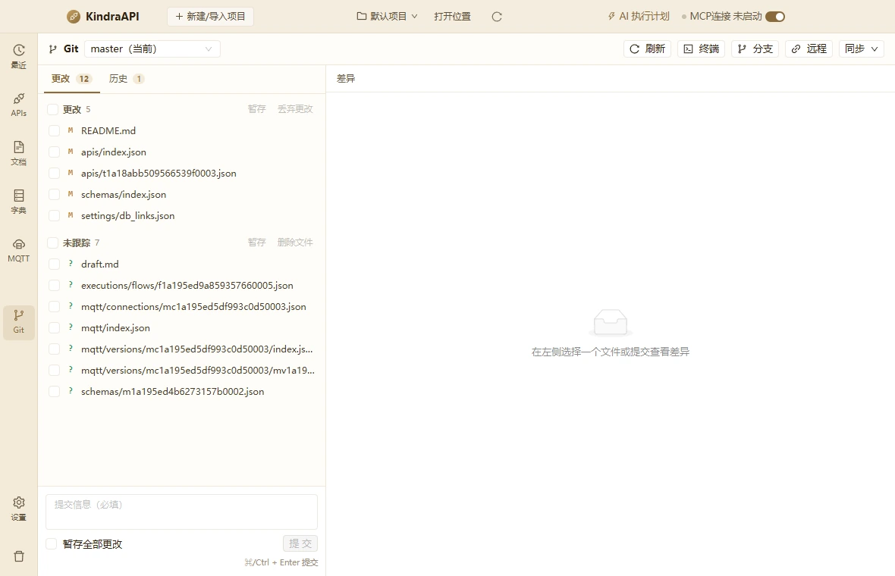
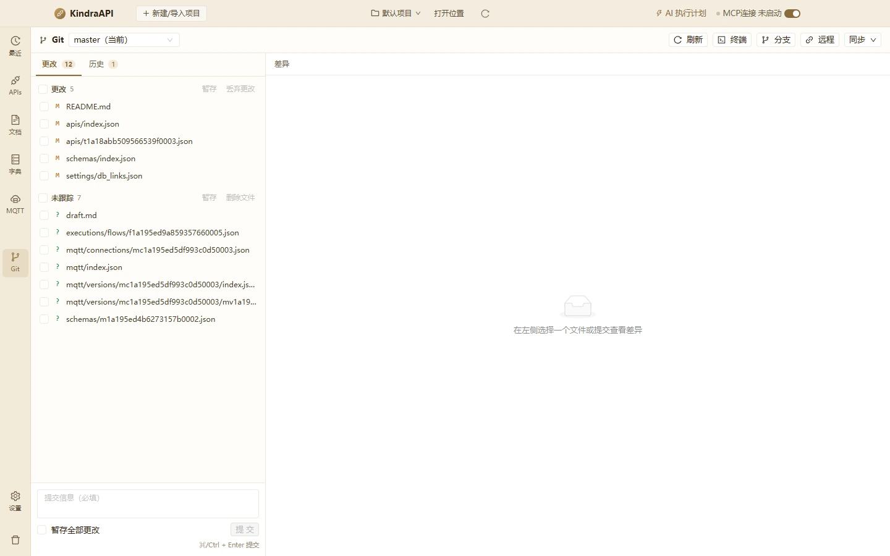

# Git 版本管理

- 路由：`/git`
- 用途：工作区变更/未跟踪、差异、提交、分支、远程与同步。
- 采集状态：4 个；DOM/AX 元素合计：115
- 主要源码：`src/renderer/src/pages/GitPage.tsx`

## 状态截图

| 状态 | 类型 | 视口 | 元素数 | 截图 |
| --- | --- | --- | --- | --- |
| `git-status-1180x760` | page | 1180×760 | 50 | [WebP](../screenshots/webp/git-status-1180x760.webp) |
| `git-status-1440x900` | page | 1440×900 | 50 | [WebP](../screenshots/webp/git-status-1440x900.webp) |
| `git-dialog-branches` | dialog | 1180×760 | 6 | [WebP](../screenshots/webp/git-dialog-branches.webp) |
| `git-dialog-remotes` | dialog | 1180×760 | 9 | [WebP](../screenshots/webp/git-dialog-remotes.webp) |

### git-status-1180x760

### git-status-1440x900

## 布局区域（1180×760 基准）

| 区域 | x | y | width | height |
| --- | --- | --- | --- | --- |
| `topbar` | 0 | 0 | 1180 | 44 |
| `rail` | 0 | 44 | 50 | 716 |
| `main` | 50 | 44 | 1130 | 716 |

## 控件全量清单

| 区块 | 控件文案 / aria / icon | 类型 | 状态 | 位置 | 来源状态 |
| --- | --- | --- | --- | --- | --- |
| 页面 | master（当前） `anticon-down` | `div` | — | 111,53 · 180×23 | `git-status-1180x760` |
| 页面 | master（当前） | `span` | — | 119,54 · 164×21 | `git-status-1180x760` |
| 页面 | 刷新 `anticon-reload` | `button` | — | 822,53 · 63×23 | `git-status-1180x760` |
| 页面 | 终端 `anticon-code` | `button` | — | 893,53 · 63×23 | `git-status-1180x760` |
| 页面 | 分支 `anticon-branches` | `button` | — | 964,53 · 63×23 | `git-status-1180x760` |
| 页面 | 远程 `anticon-link` | `button` | — | 1035,53 · 63×23 | `git-status-1180x760` |
| 页面 | 同步 `anticon-down` | `button` | — | 1106,53 · 60×23 | `git-status-1180x760` |
| 页面 | 更改 12 | `button` | active | 58,86 · 74×37 | `git-status-1180x760` |
| 页面 | 历史 1 | `button` | — | 134,86 · 67×37 | `git-status-1180x760` |
| 页面 | 暂存 | `button` | disabled | 322,132 · 33×24 | `git-status-1180x760` |
| 页面 | 丢弃更改 | `button` | disabled | 361,132 · 56×24 | `git-status-1180x760` |
| 页面 | README.md | `span` | — | 107,164 · 308×17 | `git-status-1180x760` |
| 页面 | apis/index.json | `span` | — | 107,192 · 308×17 | `git-status-1180x760` |
| 页面 | apis/t1a18abb509566539f0003.json | `span` | — | 107,220 · 308×17 | `git-status-1180x760` |
| 页面 | schemas/index.json | `span` | — | 107,248 · 308×17 | `git-status-1180x760` |
| 页面 | settings/db_links.json | `span` | — | 107,276 · 308×17 | `git-status-1180x760` |
| 页面 | 删除文件 | `button` | disabled | 361,308 · 56×24 | `git-status-1180x760` |
| 页面 | draft.md | `span` | — | 107,340 · 308×17 | `git-status-1180x760` |
| 页面 | executions/flows/f1a195ed9a859357660005.json | `span` | — | 107,368 · 308×17 | `git-status-1180x760` |
| 页面 | mqtt/connections/mc1a195ed5df993c0d50003.json | `span` | — | 107,396 · 308×17 | `git-status-1180x760` |
| 页面 | mqtt/index.json | `span` | — | 107,424 · 308×17 | `git-status-1180x760` |
| 页面 | mqtt/versions/mc1a195ed5df993c0d50003/index.json | `span` | — | 107,452 · 308×17 | `git-status-1180x760` |
| 页面 | mqtt/versions/mc1a195ed5df993c0d50003/mv1a195ed5e05da97b50004.json | `span` | — | 107,480 · 308×17 | `git-status-1180x760` |
| 页面 | schemas/m1a195ed4b6273157b0002.json | `span` | — | 107,508 · 308×17 | `git-status-1180x760` |
| 页面 | 提交信息（必填） | `textarea` | — | 60,652 · 359×47 | `git-status-1180x760` |
| 页面 | 暂存全部更改 | `label` | — | 60,707 · 109×21 | `git-status-1180x760` |
| 页面 | 提 交 | `button` | disabled | 373,706 · 46×23 | `git-status-1180x760` |
| 页面 | 在左侧选择一个文件或提交查看差异 | `div` | — | 701,453 · 208×21 | `git-status-1180x760` |
| modal:分支管理 | Close `anticon-close` | `button` | — | 808,112 · 30×30 | `git-dialog-branches` |
| modal:分支管理 | 关闭 `anticon-close` | `span` | — | 808,120 · 30×14 | `git-dialog-branches` |
| modal:分支管理 | 分支管理 | `div` | — | 354,120 · 472×22 | `git-dialog-branches` |
| modal:分支管理 | 新分支名 | `input` | — | 354,150 · 367×30 | `git-dialog-branches` |
| modal:分支管理 | 创建并切换 | `button` | — | 729,150 · 97×30 | `git-dialog-branches` |
| modal:远程仓库 | Close `anticon-close` | `button` | — | 858,112 · 30×30 | `git-dialog-remotes` |
| modal:远程仓库 | 关闭 `anticon-close` | `span` | — | 858,120 · 30×14 | `git-dialog-remotes` |
| modal:远程仓库 | 远程仓库 | `div` | — | 304,120 · 572×22 | `git-dialog-remotes` |
| modal:远程仓库 | 尚未配置远程仓库 支持 HTTPS / SSH 地址。认证由系统 git credential helper 处理，KindraAPI 不保存密码或私钥。 `anticon-info-circle` | `div/alert` | — | 304,150 · 572×115 | `git-dialog-remotes` |
| modal:远程仓库 | 名称（如 origin） | `input` | — | 304,290 · 113×30 | `git-dialog-remotes` |
| modal:远程仓库 | 仓库地址 | `input` | — | 425,290 · 381×30 | `git-dialog-remotes` |
| modal:远程仓库 | 添 加 | `button` | — | 814,290 · 62×30 | `git-dialog-remotes` |

## 提示、空态与错误

**空态**

- 在左侧选择一个文件或提交查看差异

**警告 / 提示条**

- 尚未配置远程仓库 支持 HTTPS / SSH 地址。认证由系统 git credential helper 处理，KindraAPI 不保存密码或私钥。

**title 属性（悬停提示）**

- master（当前）
- README.md
- apis/index.json
- apis/t1a18abb509566539f0003.json
- schemas/index.json
- settings/db_links.json
- draft.md
- executions/flows/f1a195ed9a859357660005.json
- mqtt/connections/mc1a195ed5df993c0d50003.json
- mqtt/index.json
- mqtt/versions/mc1a195ed5df993c0d50003/index.json
- mqtt/versions/mc1a195ed5df993c0d50003/mv1a195ed5e05da97b50004.json
- schemas/m1a195ed4b6273157b0002.json

## 源码静态清单（含 file:line）

### 源码中的按钮

| 组件 | 文案 | 关键属性 | 位置 |
| --- | --- | --- | --- |
| Button | 重新检测 |  | `src/renderer/src/pages/GitPage.tsx`:603 |
| Button | 在终端打开项目目录 | type=link | `src/renderer/src/pages/GitPage.tsx`:604 |
| Button | 初始化仓库 | type=primary loading=busy === 'init' | `src/renderer/src/pages/GitPage.tsx`:633 |
| Button | 在终端打开项目目录 | type=link | `src/renderer/src/pages/GitPage.tsx`:638 |
| Button | 重新检测 | type=link | `src/renderer/src/pages/GitPage.tsx`:641 |
| Button | 刷新 | size=small loading=loading | `src/renderer/src/pages/GitPage.tsx`:690 |
| Button | 终端 | size=small | `src/renderer/src/pages/GitPage.tsx`:698 |
| Button | 分支 | size=small | `src/renderer/src/pages/GitPage.tsx`:701 |
| Button | 远程 | size=small | `src/renderer/src/pages/GitPage.tsx`:708 |
| Button | 同步 | size=small loading=remoteBusy | `src/renderer/src/pages/GitPage.tsx`:716 |
| Button | group.key === 'conflicted' ? '标记已解决' : '暂存' selectedCount > 0 ? ` (${selectedCount})` : '' | type=link size=small disabled=selectedCount === 0 loading=busy === 'stage' | `src/renderer/src/pages/GitPage.tsx`:774 |
| Button | GROUP_DISMISS_ACTION[group.key] selectedCount > 0 ? ` (${selectedCount})` : '' | type=link size=small danger=group.key === 'unstaged' \|\| group.key === 'untracked' disabled=selectedCount === 0 loading | `src/renderer/src/pages/GitPage.tsx`:786 |
| Button | 提交 | type=primary size=small loading=busy === 'commit' disabled=!commitMessage.trim() | `src/renderer/src/pages/GitPage.tsx`:860 |
| Button | 创建并切换 | type=primary loading=busy === 'branchCreate' | `src/renderer/src/pages/GitPage.tsx`:939 |
| Button | 切换 | size=small | `src/renderer/src/pages/GitPage.tsx`:956 |
| Button | 保存 | loading=busy === `remoteSave:${remote.name}` | `src/renderer/src/pages/GitPage.tsx`:1001 |
| Button | 添加 | type=primary loading=busy === 'remoteAdd' | `src/renderer/src/pages/GitPage.tsx`:1032 |

### 源码中的提示 / 通知 / 确认框

| 类型 | 文案 | 位置 |
| --- | --- | --- |
| `message.error` | `error instanceof Error ? error.message : String(error)` | `src/renderer/src/pages/GitPage.tsx`:146 |
| `message.error` | `result.error` | `src/renderer/src/pages/GitPage.tsx`:161 |
| `message.success` | `successText(result.data)` | `src/renderer/src/pages/GitPage.tsx`:164 |
| `message.error` | `infoResult.error` | `src/renderer/src/pages/GitPage.tsx`:189 |
| `message.warning` | `请先勾选文件` | `src/renderer/src/pages/GitPage.tsx`:314 |
| `message.warning` | `请先勾选文件` | `src/renderer/src/pages/GitPage.tsx`:334 |
| `modal.confirm` | `title=deleting ? '删除未跟踪文件？' : '丢弃工作区更改？'; content=\`将影响 ${paths.length} 个文件，该操作不可撤销。\`; okText=deleting ? '删除' : '丢弃'; cancelText=取消` | `src/renderer/src/pages/GitPage.tsx`:351 |
| `message.warning` | `请填写提交信息` | `src/renderer/src/pages/GitPage.tsx`:381 |
| `message.success` | `data.message` | `src/renderer/src/pages/GitPage.tsx`:388 |
| `message.success` | `data.message` | `src/renderer/src/pages/GitPage.tsx`:404 |
| `message.success` | `已在终端打开项目目录` | `src/renderer/src/pages/GitPage.tsx`:412 |
| `message.success` | `data.message` | `src/renderer/src/pages/GitPage.tsx`:421 |
| `message.warning` | `请填写分支名` | `src/renderer/src/pages/GitPage.tsx`:431 |
| `message.success` | `data.message` | `src/renderer/src/pages/GitPage.tsx`:438 |
| `modal.confirm` | `title=\`删除分支 ${name}？\`; content=仅删除已合并的本地分支；未合并的分支会被 Git 拒绝删除。; okText=删除; cancelText=取消` | `src/renderer/src/pages/GitPage.tsx`:447 |
| `message.success` | `data.message` | `src/renderer/src/pages/GitPage.tsx`:458 |
| `message.warning` | `请填写远程名称和仓库地址` | `src/renderer/src/pages/GitPage.tsx`:470 |
| `message.success` | `data.message` | `src/renderer/src/pages/GitPage.tsx`:477 |
| `message.warning` | `仓库地址不能为空` | `src/renderer/src/pages/GitPage.tsx`:487 |
| `message.success` | `data.message` | `src/renderer/src/pages/GitPage.tsx`:494 |
| `modal.confirm` | `title=\`移除远程 ${name}？\`; content=只删除本地仓库的远程配置，不会影响远端仓库。; okText=移除; cancelText=取消` | `src/renderer/src/pages/GitPage.tsx`:506 |
| `message.success` | `data.message` | `src/renderer/src/pages/GitPage.tsx`:517 |
| `message.warning` | `请先配置远程仓库` | `src/renderer/src/pages/GitPage.tsx`:529 |
| `message.success` | `data.message` | `src/renderer/src/pages/GitPage.tsx`:551 |

### 源码中的菜单项

| label | key | disabled | 位置 |
| --- | --- | --- | --- |
| `GROUP_LABEL[key]` | `` | — | `src/renderer/src/pages/GitPage.tsx`:250 |
| `获取远端更新（fetch）` | `fetch` | — | `src/renderer/src/pages/GitPage.tsx`:558 |
| `拉取并合并（pull）` | `pull` | — | `src/renderer/src/pages/GitPage.tsx`:559 |
| `拉取并变基（pull --rebase）` | `pull-rebase` | — | `src/renderer/src/pages/GitPage.tsx`:560 |
| `推送当前分支（push）` | `push` | — | `src/renderer/src/pages/GitPage.tsx`:562 |
| `branch.current ? \`${branch.name}（当前）\` : branch.name` | `` | — | `src/renderer/src/pages/GitPage.tsx`:651 |

### 源码中的提示文案

**Placeholder**

| 文案 | 位置 |
| --- | --- |
| `提交信息（必填）` | `src/renderer/src/pages/GitPage.tsx`:844 |
| `新分支名` | `src/renderer/src/pages/GitPage.tsx`:934 |
| `https://... 或 git@...` | `src/renderer/src/pages/GitPage.tsx`:999 |
| `名称（如 origin）` | `src/renderer/src/pages/GitPage.tsx`:1018 |
| `仓库地址` | `src/renderer/src/pages/GitPage.tsx`:1026 |

**Empty**

| 文案 | 位置 |
| --- | --- |
| `尚未选择项目` | `src/renderer/src/pages/GitPage.tsx`:573 |
| `工作区干净，没有待提交的更改` | `src/renderer/src/pages/GitPage.tsx`:746 |
| `暂无提交记录` | `src/renderer/src/pages/GitPage.tsx`:876 |
| `没有差异内容` | `src/renderer/src/pages/GitPage.tsx`:913 |
| `在左侧选择一个文件或提交查看差异` | `src/renderer/src/pages/GitPage.tsx`:915 |

### 行为 / IPC 调用

| 调用 | 参数 | 位置 |
| --- | --- | --- |
| `window.api.git.availability` | `` | `src/renderer/src/pages/GitPage.tsx`:180 |
| `window.api.git.info` | `project.project_id` | `src/renderer/src/pages/GitPage.tsx`:187 |
| `window.api.git.status` | `project.project_id` | `src/renderer/src/pages/GitPage.tsx`:204 |
| `window.api.git.log` | `project.project_id, 50` | `src/renderer/src/pages/GitPage.tsx`:205 |
| `window.api.git.branches` | `project.project_id` | `src/renderer/src/pages/GitPage.tsx`:206 |
| `window.api.git.diff` | `project.project_id, request` | `src/renderer/src/pages/GitPage.tsx`:296 |
| `window.api.git.commitDiff` | `project.project_id, commit.hash` | `src/renderer/src/pages/GitPage.tsx`:305 |
| `window.api.git.stage` | `project.project_id, files.map((file) => file.path)` | `src/renderer/src/pages/GitPage.tsx`:318 |
| `window.api.git.unstage` | `project.project_id, paths` | `src/renderer/src/pages/GitPage.tsx`:340 |
| `window.api.git.discard` | `project.project_id, files.map((file) => ({ path: file.path, untracked: deleting }))` | `src/renderer/src/pages/GitPage.tsx`:359 |
| `window.api.git.commit` | `project.project_id, text, stageAll` | `src/renderer/src/pages/GitPage.tsx`:385 |
| `window.api.git.init` | `project.project_id, initBranch.trim() \|\| 'main'` | `src/renderer/src/pages/GitPage.tsx`:401 |
| `window.api.git.terminal` | `project.project_id` | `src/renderer/src/pages/GitPage.tsx`:411 |
| `window.api.git.checkoutBranch` | `project.project_id, name` | `src/renderer/src/pages/GitPage.tsx`:418 |
| `window.api.git.createBranch` | `project.project_id, name, true` | `src/renderer/src/pages/GitPage.tsx`:435 |
| `window.api.git.deleteBranch` | `project.project_id, name` | `src/renderer/src/pages/GitPage.tsx`:455 |
| `window.api.git.addRemote` | `project.project_id, name, url` | `src/renderer/src/pages/GitPage.tsx`:474 |
| `window.api.git.setRemoteUrl` | `project.project_id, name, url` | `src/renderer/src/pages/GitPage.tsx`:491 |
| `window.api.git.removeRemote` | `project.project_id, name` | `src/renderer/src/pages/GitPage.tsx`:514 |
| `window.api.git.fetch` | `project.project_id, remote` | `src/renderer/src/pages/GitPage.tsx`:536 |
| `window.api.git.push` | `project.project_id, { remote, branch, set_upstream: !info.upstream }` | `src/renderer/src/pages/GitPage.tsx`:538 |
| `window.api.git.pull` | `project.project_id, { remote, branch, rebase: kind === 'pull-rebase' }` | `src/renderer/src/pages/GitPage.tsx`:544 |

> 返回 [总索引](../README.md)
