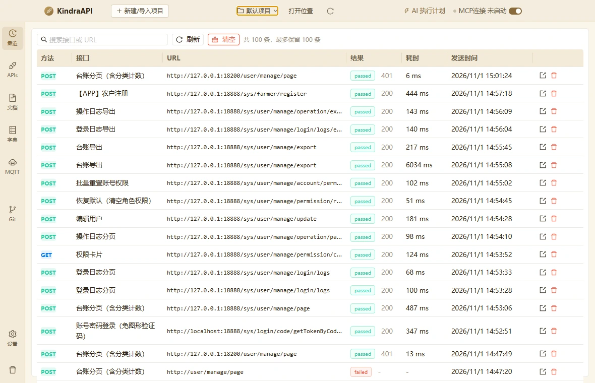
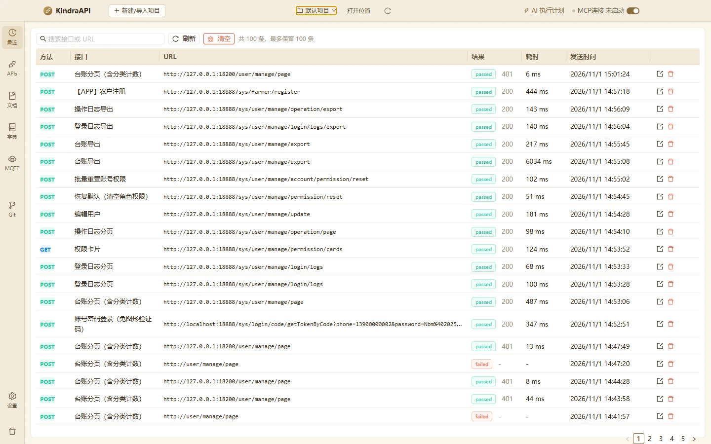

# 最近 / 发送历史

- 路由：`/history`
- 用途：最近发送记录、历史列表、响应详情抽屉与搜索/清空。
- 采集状态：11 个；DOM/AX 元素合计：270
- 主要源码：`src/renderer/src/pages/HistoryPage.tsx`、`src/renderer/src/components/ResponsePanel.tsx`

## 状态截图

| 状态 | 类型 | 视口 | 元素数 | 截图 |
| --- | --- | --- | --- | --- |
| `history-list-1180x760` | page | 1180×760 | 86 | [WebP](../screenshots/webp/history-list-1180x760.webp) |
| `history-list-1440x900` | page | 1440×900 | 86 | [WebP](../screenshots/webp/history-list-1440x900.webp) |
| `history-detail-drawer` | drawer | 1180×760 | 17 | [WebP](../screenshots/webp/history-detail-drawer.webp) |
| `history-drawer-tab-headers` | drawer-tab | 1180×760 | 10 | [WebP](../screenshots/webp/history-drawer-tab-headers.webp) |
| `history-drawer-tab-cookie` | drawer-tab | 1180×760 | 10 | [WebP](../screenshots/webp/history-drawer-tab-cookie.webp) |
| `history-drawer-tab-example` | drawer-tab | 1180×760 | 10 | [WebP](../screenshots/webp/history-drawer-tab-example.webp) |
| `history-drawer-tab-field-docs` | drawer-tab | 1180×760 | 12 | [WebP](../screenshots/webp/history-drawer-tab-field-docs.webp) |
| `history-drawer-tab-actual-request` | drawer-tab | 1180×760 | 10 | [WebP](../screenshots/webp/history-drawer-tab-actual-request.webp) |
| `history-drawer-tab-console` | drawer-tab | 1180×760 | 10 | [WebP](../screenshots/webp/history-drawer-tab-console.webp) |
| `history-empty-search` | page | 1180×760 | 16 | [WebP](../screenshots/webp/history-empty-search.webp) |
| `history-confirm-clear` | confirm | 1180×760 | 3 | [WebP](../screenshots/webp/history-confirm-clear.webp) |

### history-list-1180x760

### history-list-1440x900

## 布局区域（1180×760 基准）

| 区域 | x | y | width | height |
| --- | --- | --- | --- | --- |
| `topbar` | 0 | 0 | 1180 | 44 |
| `rail` | 0 | 44 | 50 | 716 |
| `main` | 50 | 44 | 1130 | 716 |

## 控件全量清单

| 区块 | 控件文案 / aria / icon | 类型 | 状态 | 位置 | 来源状态 |
| --- | --- | --- | --- | --- | --- |
| 页面 | 搜索接口或 URL | `input` | — | 98,68 · 213×21 | `history-list-1180x760` |
| 页面 | 刷新 `anticon-reload` | `button` | — | 341,67 · 63×23 | `history-list-1180x760` |
| 页面 | 清空 `anticon-clear` | `button` | — | 412,67 · 63×23 | `history-list-1180x760` |
| 页面 | 方法 | `th` | — | 73,98 · 70×34 | `history-list-1180x760` |
| 页面 | 接口 | `th` | — | 143,98 · 180×34 | `history-list-1180x760` |
| 页面 | URL | `th` | — | 323,98 · 364×34 | `history-list-1180x760` |
| 页面 | 结果 | `th` | — | 687,98 · 110×34 | `history-list-1180x760` |
| 页面 | 耗时 | `th` | — | 797,98 · 90×34 | `history-list-1180x760` |
| 页面 | 发送时间 | `th` | — | 887,98 · 170×34 | `history-list-1180x760` |
| 页面 | http://127.0.0.1:18200/user/manage/page | `td` | — | 323,132 · 364×36 | `history-list-1180x760` |
| 页面 | anticon-export `anticon-export` | `button` | — | 1065,138 · 23×23 | `history-list-1180x760` |
| 页面 | anticon-delete `anticon-delete` | `button` | — | 1088,138 · 23×23 | `history-list-1180x760` |
| 页面 | http://127.0.0.1:18888/sys/farmer/register | `td` | — | 323,168 · 364×36 | `history-list-1180x760` |
| 页面 | http://127.0.0.1:18888/sys/user/manage/operation/export | `td` | — | 323,203 · 364×36 | `history-list-1180x760` |
| 页面 | http://127.0.0.1:18888/sys/user/manage/login/logs/export | `td` | — | 323,239 · 364×36 | `history-list-1180x760` |
| 页面 | http://127.0.0.1:18888/sys/user/manage/export | `td` | — | 323,274 · 364×36 | `history-list-1180x760` |
| 页面 | http://127.0.0.1:18888/sys/user/manage/account/permission/reset | `td` | — | 323,345 · 364×36 | `history-list-1180x760` |
| 页面 | http://127.0.0.1:18888/sys/user/manage/permission/reset | `td` | — | 323,381 · 364×36 | `history-list-1180x760` |
| 页面 | http://127.0.0.1:18888/sys/user/manage/update | `td` | — | 323,416 · 364×36 | `history-list-1180x760` |
| 页面 | http://127.0.0.1:18888/sys/user/manage/operation/page | `td` | — | 323,452 · 364×36 | `history-list-1180x760` |
| 页面 | http://127.0.0.1:18888/sys/user/manage/permission/cards | `td` | — | 323,487 · 364×36 | `history-list-1180x760` |
| 页面 | http://127.0.0.1:18888/sys/user/manage/login/logs | `td` | — | 323,523 · 364×36 | `history-list-1180x760` |
| 页面 | http://127.0.0.1:18888/sys/user/manage/page | `td` | — | 323,594 · 364×36 | `history-list-1180x760` |
| 页面 | http://localhost:18888/sys/login/code/getTokenByCode?phone=13900000002&password=Nbm%402025 | `td` | — | 323,629 · 364×55 | `history-list-1180x760` |
| 页面 | http://user/manage/page | `td` | — | 323,720 · 364×36 | `history-list-1180x760` |
| 页面 | 上一页 `anticon-left` | `li` | disabled | 1000,878 · 23×23 | `history-list-1180x760` |
| 页面 | anticon-left `anticon-left` | `button` | disabled | 1000,878 · 23×23 | `history-list-1180x760` |
| 页面 | 1 | `li` | — | 1022,878 · 23×23 | `history-list-1180x760` |
| 页面 | 2 | `li` | — | 1045,878 · 23×23 | `history-list-1180x760` |
| 页面 | 3 | `li` | — | 1067,878 · 23×23 | `history-list-1180x760` |
| 页面 | 4 | `li` | — | 1090,878 · 23×23 | `history-list-1180x760` |
| 页面 | 5 | `li` | — | 1112,878 · 23×23 | `history-list-1180x760` |
| 页面 | 下一页 `anticon-right` | `li` | — | 1135,878 · 23×23 | `history-list-1180x760` |
| 页面 | anticon-right `anticon-right` | `button` | — | 1135,878 · 23×23 | `history-list-1180x760` |
| drawer:POST 台账分页（含分类计数） | 关闭 `anticon-close` | `button` | — | 354,16 · 22×22 | `history-detail-drawer` |
| drawer:POST 台账分页（含分类计数） | POST 台账分页（含分类计数） | `div` | — | 384,16 · 772×22 | `history-detail-drawer` |
| drawer:POST 台账分页（含分类计数） | 实时响应 | `button` | active | 371,79 · 52×39 | `history-detail-drawer` |
| drawer:POST 台账分页（含分类计数） | 响应头 | `button` | — | 449,79 · 39×39 | `history-detail-drawer` |
| drawer:POST 台账分页（含分类计数） | Cookie | `button` | — | 514,79 · 43×39 | `history-detail-drawer` |
| drawer:POST 台账分页（含分类计数） | 响应示例 | `button` | — | 584,79 · 52×39 | `history-detail-drawer` |
| drawer:POST 台账分页（含分类计数） | 字段说明 | `button` | — | 662,79 · 52×39 | `history-detail-drawer` |
| drawer:POST 台账分页（含分类计数） | 实际请求 | `button` | — | 740,79 · 52×39 | `history-detail-drawer` |
| drawer:POST 台账分页（含分类计数） | 控制台 | `button` | — | 818,79 · 39×39 | `history-detail-drawer` |
| drawer:POST 台账分页（含分类计数） | 美化 | `button` | — | 371,126 · 21×14 | `history-detail-drawer` |
| drawer:POST 台账分页（含分类计数） | 原生 | `button` | — | 404,126 · 21×14 | `history-detail-drawer` |
| drawer:POST 台账分页（含分类计数） | 预览 | `button` | — | 437,126 · 21×14 | `history-detail-drawer` |
| drawer:POST 台账分页（含分类计数） | 可视化 | `button` | — | 470,126 · 32×14 | `history-detail-drawer` |
| drawer:POST 台账分页（含分类计数） | 表格 | `button` | — | 514,126 · 21×14 | `history-detail-drawer` |
| drawer:POST 台账分页（含分类计数） | 复制 `anticon-copy` | `button` | — | 1086,122 · 54×22 | `history-detail-drawer` |
| 页面 | 仅文档字段 `anticon-plus` | `button` | — | 1027,135 · 102×23 | `history-drawer-tab-field-docs` |
| 页面 | anticon-close-circle `anticon-close-circle` | `button` | — | 315,74 · 10×10 | `history-empty-search` |
| 页面 | 暂无数据 | `div` | — | 89,216 · 1052×21 | `history-empty-search` |
| modal:清空发送历史？ | 取 消 | `button` | — | 642,204 · 62×30 | `history-confirm-clear` |
| modal:清空发送历史？ | 清 空 | `button` | — | 712,204 · 62×30 | `history-confirm-clear` |

## 提示、空态与错误

**空态**

- 暂无数据

**title 属性（悬停提示）**

- URL
- http://127.0.0.1:18200/user/manage/page
- http://127.0.0.1:18888/sys/farmer/register
- http://127.0.0.1:18888/sys/user/manage/operation/export
- http://127.0.0.1:18888/sys/user/manage/login/logs/export
- http://127.0.0.1:18888/sys/user/manage/export
- http://127.0.0.1:18888/sys/user/manage/account/permission/reset
- http://127.0.0.1:18888/sys/user/manage/permission/reset
- http://127.0.0.1:18888/sys/user/manage/update
- http://127.0.0.1:18888/sys/user/manage/operation/page
- http://127.0.0.1:18888/sys/user/manage/permission/cards
- http://127.0.0.1:18888/sys/user/manage/login/logs
- http://127.0.0.1:18888/sys/user/manage/page
- http://localhost:18888/sys/login/code/getTokenByCode?phone=13900000002&password=Nbm%402025%24&domain=%40farmer.com&sessionId=local-dev&code=0000
- http://user/manage/page
- 上一页
- 1
- 2
- 3
- 4
- 5
- 下一页
- 复制响应体

## 表格

| 状态 | 表头 | 可见行数 |
| --- | --- | --- |
| `history-list-1180x760` | 方法 / 接口 / URL / 结果 / 耗时 / 发送时间 / | 20 |

## 源码静态清单（含 file:line）

### 源码中的按钮

| 组件 | 文案 | 关键属性 | 位置 |
| --- | --- | --- | --- |
| Button | 刷新 | size=small | `src/renderer/src/pages/HistoryPage.tsx`:162 |
| Button | 清空 | size=small danger=true | `src/renderer/src/pages/HistoryPage.tsx`:165 |

### 源码中的提示 / 通知 / 确认框

| 类型 | 文案 | 位置 |
| --- | --- | --- |
| `message.success` | `响应体已复制` | `src/renderer/src/components/ResponsePanel.tsx`:115 |
| `message.success` | `响应体已复制` | `src/renderer/src/components/ResponsePanel.tsx`:119 |
| `message.error` | `复制失败` | `src/renderer/src/components/ResponsePanel.tsx`:121 |
| `message.error` | `error.message` | `src/renderer/src/components/ResponsePanel.tsx`:177 |
| `message.error` | `result.error` | `src/renderer/src/components/ResponsePanel.tsx`:181 |
| `message.warning` | `result.data.warnings[0].message` | `src/renderer/src/components/ResponsePanel.tsx`:184 |
| `modal.confirm` | `title=编辑将解除模型引用; content=解除后保留当前生成的示例 JSON，可继续手动维护。; okText=解除并编辑; cancelText=取消` | `src/renderer/src/components/ResponsePanel.tsx`:230 |
| `message.warning` | `当前仅维护成功响应` | `src/renderer/src/components/ResponsePanel.tsx`:250 |
| `message.warning` | `请先解除模型引用，再更新示例` | `src/renderer/src/components/ResponsePanel.tsx`:251 |
| `message.error` | `result.error` | `src/renderer/src/pages/HistoryPage.tsx`:25 |
| `message.error` | `result.error` | `src/renderer/src/pages/HistoryPage.tsx`:39 |
| `message.success` | `已删除` | `src/renderer/src/pages/HistoryPage.tsx`:47 |
| `message.error` | `result.error` | `src/renderer/src/pages/HistoryPage.tsx`:49 |
| `modal.confirm` | `title=清空发送历史？; content=将删除所有发送记录与最近使用列表，接口本身不受影响。; okText=清空; cancelText=取消` | `src/renderer/src/pages/HistoryPage.tsx`:55 |
| `message.success` | `已清空` | `src/renderer/src/pages/HistoryPage.tsx`:64 |
| `message.error` | `result.error` | `src/renderer/src/pages/HistoryPage.tsx`:66 |

### 源码中的菜单项

| label | key | disabled | 位置 |
| --- | --- | --- | --- |
| `(item.expect?.name ?? '成功') + ' · ' + (item.expect?.code ?? 200)` | `` | — | `src/renderer/src/components/ResponsePanel.tsx`:527 |

### 源码中的提示文案

**Tooltip**

| 文案 | 位置 |
| --- | --- |
| `解除引用后保留当前 JSON` | `src/renderer/src/components/ResponsePanel.tsx`:284 |
| `打开接口` | `src/renderer/src/pages/HistoryPage.tsx`:124 |
| `删除记录` | `src/renderer/src/pages/HistoryPage.tsx`:135 |

**Placeholder**

| 文案 | 位置 |
| --- | --- |
| `搜索接口或 URL` | `src/renderer/src/pages/HistoryPage.tsx`:157 |

### 快捷键 / 键盘处理

| 表达式 | 位置 |
| --- | --- |
| `event.key === 'Enter'` | `src/renderer/src/components/ResponsePanel.tsx`:829 |

### 行为 / IPC 调用

| 调用 | 参数 | 位置 |
| --- | --- | --- |
| `window.api.app.copyText` | `text` | `src/renderer/src/components/ResponsePanel.tsx`:113 |
| `window.api.models
      .list(projectId)
      .then((result) => {
        if (active && result.ok) setModels(result.data)
      })
      .catch` | `() => undefined` | `src/renderer/src/components/ResponsePanel.tsx`:135 |
| `window.api.models
      .list(projectId)
      .then` | `(result) => { if (active && result.ok) setModels(result.data) }` | `src/renderer/src/components/ResponsePanel.tsx`:135 |
| `window.api.models
      .list` | `projectId` | `src/renderer/src/components/ResponsePanel.tsx`:135 |
| `window.api.models.generateExample` | `projectId, model.model_id` | `src/renderer/src/components/ResponsePanel.tsx`:179 |
| `window.api.history.list` | `project.project_id` | `src/renderer/src/pages/HistoryPage.tsx`:23 |
| `window.api.history.get` | `project.project_id, recordId` | `src/renderer/src/pages/HistoryPage.tsx`:37 |
| `window.api.history.delete` | `project.project_id, recordId` | `src/renderer/src/pages/HistoryPage.tsx`:45 |
| `window.api.history.clear` | `project.project_id` | `src/renderer/src/pages/HistoryPage.tsx`:62 |

> 返回 [总索引](../README.md)
