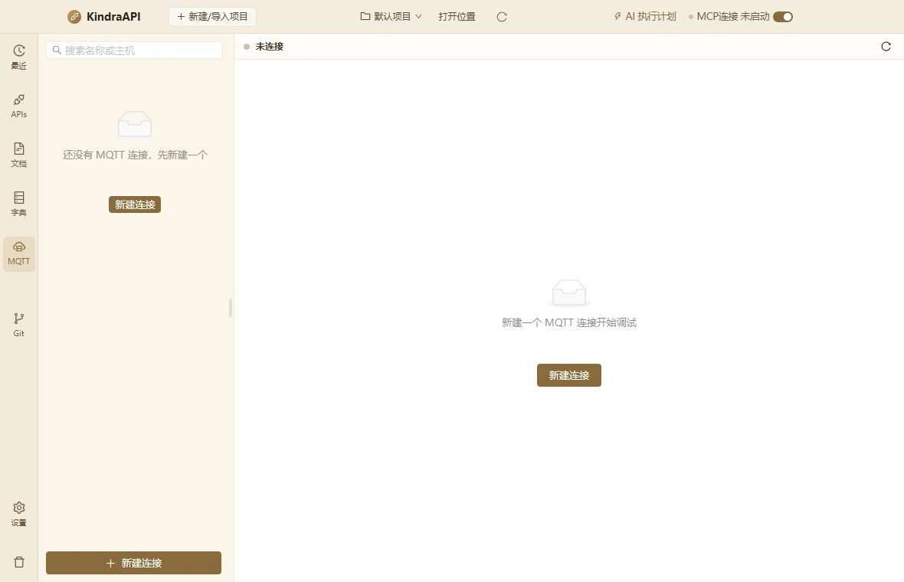
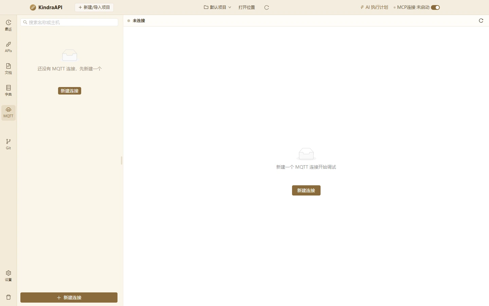

# MQTT 模块

- 路由：`/mqtt`
- 用途：连接配置、消息、发布、运行记录、版本历史、TLS/Will/MQTT5 属性。
- 采集状态：13 个；DOM/AX 元素合计：997
- 主要源码：`src/renderer/src/pages/MqttPage.tsx`、`src/renderer/src/components/mqtt/ProfileEditor.tsx`、`src/renderer/src/components/mqtt/ProfileList.tsx`、`src/renderer/src/components/mqtt/MessagesPanel.tsx`、`src/renderer/src/components/mqtt/PublishPanel.tsx`、`src/renderer/src/components/mqtt/AttemptsPanel.tsx`、`src/renderer/src/components/mqtt/UserPropertiesEditor.tsx`、`src/renderer/src/components/mqtt/VersionDrawer.tsx`

## 状态截图

| 状态 | 类型 | 视口 | 元素数 | 截图 |
| --- | --- | --- | --- | --- |
| `mqtt-empty-1180x760` | page | 1180×760 | 10 | [WebP](../screenshots/webp/mqtt-empty-1180x760.webp) |
| `mqtt-empty-1440x900` | page | 1440×900 | 10 | [WebP](../screenshots/webp/mqtt-empty-1440x900.webp) |
| `mqtt-profile-editor-1180x760` | page | 1180×760 | 101 | [WebP](../screenshots/webp/mqtt-profile-editor-1180x760.webp) |
| `mqtt-profile-editor-1440x900` | page | 1440×900 | 101 | [WebP](../screenshots/webp/mqtt-profile-editor-1440x900.webp) |
| `mqtt-tab-messages` | page | 1180×760 | 101 | [WebP](../screenshots/webp/mqtt-tab-messages.webp) |
| `mqtt-tab-publish` | page | 1180×760 | 119 | [WebP](../screenshots/webp/mqtt-tab-publish.webp) |
| `mqtt-tab-attempts` | page | 1180×760 | 103 | [WebP](../screenshots/webp/mqtt-tab-attempts.webp) |
| `mqtt-more-menu` | menu | 1180×760 | 8 | [WebP](../screenshots/webp/mqtt-more-menu.webp) |
| `mqtt-drawer-versions` | drawer | 1180×760 | 8 | [WebP](../screenshots/webp/mqtt-drawer-versions.webp) |
| `mqtt-subscription-row` | page | 1180×760 | 111 | [WebP](../screenshots/webp/mqtt-subscription-row.webp) |
| `mqtt-advanced-tls` | page | 1180×760 | 101 | [WebP](../screenshots/webp/mqtt-advanced-tls.webp) |
| `mqtt-advanced-will` | page | 1180×760 | 102 | [WebP](../screenshots/webp/mqtt-advanced-will.webp) |
| `mqtt-advanced-props` | page | 1180×760 | 122 | [WebP](../screenshots/webp/mqtt-advanced-props.webp) |

### mqtt-empty-1180x760

### mqtt-empty-1440x900

## 布局区域（1180×760 基准）

| 区域 | x | y | width | height |
| --- | --- | --- | --- | --- |
| `topbar` | 0 | 0 | 1180 | 44 |
| `rail` | 0 | 44 | 50 | 716 |
| `main` | 50 | 44 | 1130 | 716 |

## 控件全量清单

| 区块 | 控件文案 / aria / icon | 类型 | 状态 | 位置 | 来源状态 |
| --- | --- | --- | --- | --- | --- |
| 页面 | 搜索名称或主机 | `input` | — | 85,55 · 184×21 | `mqtt-empty-1180x760` |
| 页面 | 还没有 MQTT 连接，先新建一个 | `div` | — | 82,191 · 189×21 | `mqtt-empty-1180x760` |
| 页面 | 新建连接 | `button` | — | 142,256 · 68×23 | `mqtt-empty-1180x760` |
| 页面 | 新建连接 `anticon-plus` | `button` | — | 60,720 · 229×30 | `mqtt-empty-1180x760` |
| 页面 | anticon-reload `anticon-reload` | `button` | — | 1146,49 · 23×23 | `mqtt-empty-1180x760` |
| 页面 | 新建一个 MQTT 连接开始调试 | `div` | — | 655,410 · 176×21 | `mqtt-empty-1180x760` |
| 页面 | 未分组 1 `anticon-down` | `button` | — | 60,85 · 233×26 | `mqtt-profile-editor-1180x760` |
| 页面 | 新连接 localhost:1883 MQTT 5.0 `anticon-more` | `div/button` | active | 60,111 · 233×53 | `mqtt-profile-editor-1180x760` |
| 页面 | 未连接 | `span` | — | 71,124 · 8×8 | `mqtt-profile-editor-1180x760` |
| 页面 | 新连接 | `span` | — | 87,120 · 173×18 | `mqtt-profile-editor-1180x760` |
| 页面 | 更多操作 `anticon-more` | `button` | — | 264,119 · 20×20 | `mqtt-profile-editor-1180x760` |
| 页面 | localhost:1883 MQTT 5.0 | `div` | — | 87,141 · 197×15 | `mqtt-profile-editor-1180x760` |
| 页面 | 保存 `anticon-save` | `button` | — | 588,90 · 79×30 | `mqtt-profile-editor-1180x760` |
| 页面 | 测试连接 `anticon-thunderbolt` | `button` | — | 675,90 · 105×30 | `mqtt-profile-editor-1180x760` |
| 页面 | 往返验证 | `label` | — | 784,95 · 83×21 | `mqtt-profile-editor-1180x760` |
| 页面 | 连接 `anticon-play-circle` | `button` | — | 875,90 · 79×30 | `mqtt-profile-editor-1180x760` |
| 页面 | 复制 `anticon-copy` | `button` | — | 962,90 · 79×30 | `mqtt-profile-editor-1180x760` |
| 页面 | 版本历史 `anticon-history` | `button` | — | 1049,90 · 105×30 | `mqtt-profile-editor-1180x760` |
| 页面 | (未命名单选/控件) | `input` | — | 324,185 · 267×30 | `mqtt-profile-editor-1180x760` |
| 页面 | 未分组 | `input` | — | 605,185 · 267×30 | `mqtt-profile-editor-1180x760` |
| 页面 | localhost | `input` | — | 887,185 · 267×30 | `mqtt-profile-editor-1180x760` |
| 页面 | anticon-up `anticon-up` | `div` | — | 324,245 · 267×30 | `mqtt-profile-editor-1180x760` |
| 页面 | Increase Value `anticon-up` | `span/button` | — | 590,246 · 1×14 | `mqtt-profile-editor-1180x760` |
| 页面 | Decrease Value `anticon-down` | `span/button` | — | 590,260 · 1×14 | `mqtt-profile-editor-1180x760` |
| 页面 | TCP (mqtt) `anticon-down` | `div` | — | 605,245 · 267×30 | `mqtt-profile-editor-1180x760` |
| 页面 | TCP (mqtt) | `span` | — | 617,246 · 243×28 | `mqtt-profile-editor-1180x760` |
| 页面 | MQTT 5.0 (v5) `anticon-down` | `div` | — | 887,245 · 267×30 | `mqtt-profile-editor-1180x760` |
| 页面 | MQTT 5.0 (v5) | `span` | — | 899,246 · 243×28 | `mqtt-profile-editor-1180x760` |
| 页面 | Clean Session / Start | `span` | — | 887,362 · 113×16 | `mqtt-profile-editor-1180x760` |
| 页面 | TLS 校验证书 `anticon-right` | `div/button` | — | 325,410 · 828×37 | `mqtt-profile-editor-1180x760` |
| 页面 | /path/to/ca.pem | `input` | — | 337,498 · 259×30 | `mqtt-profile-editor-1180x760` |
| 页面 | /path/to/client.crt | `input` | — | 610,498 · 259×30 | `mqtt-profile-editor-1180x760` |
| 页面 | /path/to/client.key | `input` | — | 882,498 · 259×30 | `mqtt-profile-editor-1180x760` |
| 页面 | broker.example.com | `input` | — | 610,561 · 259×30 | `mqtt-profile-editor-1180x760` |
| 页面 | 默认 `anticon-down` | `div` | — | 882,561 · 259×30 | `mqtt-profile-editor-1180x760` |
| 页面 | mqtt, h2 | `input` | — | 337,623 · 804×30 | `mqtt-profile-editor-1180x760` |
| 页面 | 遗嘱 Will `anticon-right` | `div/button` | — | 325,707 · 828×37 | `mqtt-profile-editor-1180x760` |
| 页面 | MQTT 5 属性 `anticon-right` | `div/button` | — | 325,745 · 828×37 | `mqtt-profile-editor-1180x760` |
| 页面 | 订阅 0 `anticon-right` | `div/button` | — | 325,783 · 828×37 | `mqtt-profile-editor-1180x760` |
| 页面 | 添加订阅 `anticon-plus` | `button` | — | 337,849 · 89×23 | `mqtt-profile-editor-1180x760` |
| 页面 | 保留策略 本地 `anticon-right` | `div/button` | — | 325,886 · 828×37 | `mqtt-profile-editor-1180x760` |
| 页面 | 刷新 | `button` | — | 413,932 · 42×23 | `mqtt-profile-editor-1180x760` |
| 页面 | 消息 | `div` | active | 316,457 · 26×45 | `mqtt-profile-editor-1180x760` |
| 页面 | 发布 | `div` | — | 374,457 · 26×45 | `mqtt-profile-editor-1180x760` |
| 页面 | 运行记录 | `div` | — | 432,457 · 52×45 | `mqtt-profile-editor-1180x760` |
| 页面 | 过滤 topic | `input` | — | 341,511 · 113×21 | `mqtt-profile-editor-1180x760` |
| 页面 | 搜索 topic / 内容 | `input` | — | 492,511 · 150×21 | `mqtt-profile-editor-1180x760` |
| 页面 | Plain `anticon-down` | `div` | — | 672,510 · 96×23 | `mqtt-profile-editor-1180x760` |
| 页面 | Plain | `span` | — | 680,511 · 80×21 | `mqtt-profile-editor-1180x760` |
| 页面 | 暂停自动滚动 | `label` | — | 776,511 · 109×21 | `mqtt-profile-editor-1180x760` |
| 页面 | 导出 `anticon-download` | `button` | — | 1107,510 · 63×23 | `mqtt-profile-editor-1180x760` |
| 页面 | 清空 `anticon-clear` | `button` | disabled | 316,541 · 63×23 | `mqtt-profile-editor-1180x760` |
| 页面 | 未连接，连接后将接收已订阅主题的消息 | `div` | — | 626,700 · 234×21 | `mqtt-profile-editor-1180x760` |
| 页面 | 当前连接未建立，连接后才能发布消息。 `anticon-info-circle` | `div/alert` | — | 316,508 · 521×39 | `mqtt-tab-publish` |
| 页面 | devices/client/command | `input` | — | 316,579 · 521×30 | `mqtt-tab-publish` |
| 页面 | JSON `anticon-down` | `div` | — | 316,664 · 254×30 | `mqtt-tab-publish` |
| 页面 | JSON | `span` | — | 328,665 · 230×28 | `mqtt-tab-publish` |
| 页面 | QoS 0 `anticon-down` | `div` | — | 583,664 · 254×30 | `mqtt-tab-publish` |
| 页面 | QoS 0 | `span` | — | 595,665 · 230×28 | `mqtt-tab-publish` |
| 页面 | { "command": "ping" } | `textarea` | — | 316,755 · 521×145 | `mqtt-tab-publish` |
| 页面 | 发送 `anticon-send` | `button` | disabled | 758,908 · 79×30 | `mqtt-tab-publish` |
| 页面 | 添加属性 `anticon-plus` | `button` | — | 316,1033 · 89×23 | `mqtt-tab-publish` |
| 页面 | 按次数 | `label` | active | 475,1108 · 55×23 | `mqtt-tab-publish` |
| 页面 | 按时长 | `label` | — | 529,1108 · 55×23 | `mqtt-tab-publish` |
| 页面 | 启动循环 `anticon-play-circle` | `button` | — | 710,1105 · 105×30 | `mqtt-tab-publish` |
| 页面 | 刷新 `anticon-loading anticon-spin` | `button` | — | 928,516 · 42×23 | `mqtt-tab-publish` |
| 页面 | 全部配置 `anticon-down` | `div` | — | 316,510 · 220×23 | `mqtt-tab-attempts` |
| 页面 | 全部配置 | `span` | — | 324,511 · 204×21 | `mqtt-tab-attempts` |
| 页面 | 开始时间 | `th` | — | 316,540 · 160×34 | `mqtt-tab-attempts` |
| 页面 | 配置 | `th` | — | 476,540 · 180×34 | `mqtt-tab-attempts` |
| 页面 | 类型 | `th` | — | 656,540 · 80×34 | `mqtt-tab-attempts` |
| 页面 | 结果 | `th` | — | 736,540 · 80×34 | `mqtt-tab-attempts` |
| 页面 | 耗时 | `th` | — | 816,540 · 90×34 | `mqtt-tab-attempts` |
| 页面 | 详情 | `th` | — | 906,540 · 264×34 | `mqtt-tab-attempts` |
| 页面 | 暂无数据 | `div` | — | 340,668 · 806×21 | `mqtt-tab-attempts` |
| 页面 | 编辑 `anticon-edit` | `li/menuitem` | — | 267,147 · 71×30 | `mqtt-more-menu` |
| 页面 | 复制 `anticon-copy` | `li/menuitem` | — | 267,177 · 71×30 | `mqtt-more-menu` |
| 页面 | 导出 `anticon-export` | `li/menuitem` | — | 267,207 · 71×30 | `mqtt-more-menu` |
| 页面 | 删除 `anticon-delete` | `li/menuitem` | — | 267,246 · 71×30 | `mqtt-more-menu` |
| drawer:版本历史 | 关闭 `anticon-close` | `button` | — | 644,16 · 22×22 | `mqtt-drawer-versions` |
| drawer:版本历史 | 版本历史 `anticon-history` | `div` | — | 674,16 · 436×22 | `mqtt-drawer-versions` |
| drawer:版本历史 | 刷 新 | `button` | — | 1110,16 · 46×23 | `mqtt-drawer-versions` |
| 页面 | 查看 | `button` | — | 1027,100 · 42×23 | `mqtt-drawer-versions` |
| 页面 | 恢复 `anticon-undo` | `button` | — | 1085,100 · 63×23 | `mqtt-drawer-versions` |
| 页面 | 请先修正以下字段 非法 Topic Filter：（空） `anticon-exclamation-circle` | `div/alert` | — | 324,-534 · 830×94 | `mqtt-subscription-row` |
| 页面 | 订阅 1 `anticon-right` | `div/button` | — | 325,214 · 828×37 | `mqtt-subscription-row` |
| 页面 | sensors/+/temperature 或 $share/group/topic | `input` | — | 337,262 · 670×30 | `mqtt-subscription-row` |
| 页面 | anticon-delete `anticon-delete` | `button` | — | 1111,262 · 30×30 | `mqtt-subscription-row` |
| 页面 | 默认 | `input/spinbutton` | — | 338,477 · 257×28 | `mqtt-advanced-props` |

## 菜单 / 下拉项（运行态）

| 所在区域 | 菜单文案 | 类型 | 状态 | 选择器 |
| --- | --- | --- | --- | --- |
| 菜单 | 编辑 | `li` | — | `div:nth-of-type(5) > div.ant-dropdown.css-dzyqf7 > ul.ant-dropdown-menu.ant-dropdown-menu-root > li.ant-dropdown-menu-item:nth-of-type(1)` |
| 菜单 | edit | `span` | — | `div:nth-of-type(5) > div.ant-dropdown.css-dzyqf7 > ul.ant-dropdown-menu.ant-dropdown-menu-root > li.ant-dropdown-menu-item:nth-of-type(1) > span.anticon.anticon-edit:nth-of-type(1)` |
| 菜单 | 复制 | `li` | — | `div:nth-of-type(5) > div.ant-dropdown.css-dzyqf7 > ul.ant-dropdown-menu.ant-dropdown-menu-root > li.ant-dropdown-menu-item:nth-of-type(2)` |
| 菜单 | copy | `span` | — | `div:nth-of-type(5) > div.ant-dropdown.css-dzyqf7 > ul.ant-dropdown-menu.ant-dropdown-menu-root > li.ant-dropdown-menu-item:nth-of-type(2) > span.anticon.anticon-copy:nth-of-type(1)` |
| 菜单 | 导出 | `li` | — | `div:nth-of-type(5) > div.ant-dropdown.css-dzyqf7 > ul.ant-dropdown-menu.ant-dropdown-menu-root > li.ant-dropdown-menu-item:nth-of-type(3)` |
| 菜单 | export | `span` | — | `div:nth-of-type(5) > div.ant-dropdown.css-dzyqf7 > ul.ant-dropdown-menu.ant-dropdown-menu-root > li.ant-dropdown-menu-item:nth-of-type(3) > span.anticon.anticon-export:nth-of-type(1)` |
| 菜单 | 删除 | `li` | — | `div:nth-of-type(5) > div.ant-dropdown.css-dzyqf7 > ul.ant-dropdown-menu.ant-dropdown-menu-root > li.ant-dropdown-menu-item.ant-dropdown-menu-item-danger:nth-of-type(5)` |
| 菜单 | delete | `span` | — | `div:nth-of-type(5) > div.ant-dropdown.css-dzyqf7 > ul.ant-dropdown-menu.ant-dropdown-menu-root > li.ant-dropdown-menu-item.ant-dropdown-menu-item-danger:nth-of-type(5) > span.anticon.anticon-delete:nth-of-type(1)` |

## 提示、空态与错误

**空态**

- 还没有 MQTT 连接，先新建一个
- 新建一个 MQTT 连接开始调试
- 未连接，连接后将接收已订阅主题的消息
- 暂无数据

**警告 / 提示条**

- 当前连接未建立，连接后才能发布消息。
- 请先修正以下字段 非法 Topic Filter：（空）

**title 属性（悬停提示）**

- 未连接
- 新连接
- 更多操作
- localhost:1883
- TCP (mqtt)
- MQTT 5.0 (v5)
- MQTT 5 中对应 Clean Start
- Plain
- JSON
- QoS 0
- 全部配置
- 配置

## 表格

| 状态 | 表头 | 可见行数 |
| --- | --- | --- |
| `mqtt-tab-attempts` | 开始时间 / 配置 / 类型 / 结果 / 耗时 / 详情 | 0 |

## 源码静态清单（含 file:line）

### 源码中的按钮

| 组件 | 文案 | 关键属性 | 位置 |
| --- | --- | --- | --- |
| Button | 导出 | size=small disabled=attempts.length === 0 | `src/renderer/src/components/mqtt/AttemptsPanel.tsx`:209 |
| Button | 清空 | size=small danger=true disabled=attempts.length === 0 | `src/renderer/src/components/mqtt/AttemptsPanel.tsx`:217 |
| Button | 导出 | size=small | `src/renderer/src/components/mqtt/MessagesPanel.tsx`:319 |
| Button | 清空 | size=small danger=true disabled=messages.length === 0 | `src/renderer/src/components/mqtt/MessagesPanel.tsx`:323 |
| Button | 重发 | size=small type=link | `src/renderer/src/components/mqtt/MessagesPanel.tsx`:393 |
| Button | 复制完整 payload | disabled=!detail | `src/renderer/src/components/mqtt/MessagesPanel.tsx`:423 |
| Button | 重发 | disabled=!detail | `src/renderer/src/components/mqtt/MessagesPanel.tsx`:430 |
| Button | 关闭 | type=primary | `src/renderer/src/components/mqtt/MessagesPanel.tsx`:447 |
| Button | 添加订阅 | size=small type=dashed | `src/renderer/src/components/mqtt/ProfileEditor.tsx`:578 |
| Button | 保存 | type=primary loading=saving | `src/renderer/src/components/mqtt/ProfileEditor.tsx`:665 |
| Button | 测试连接 | loading=testing | `src/renderer/src/components/mqtt/ProfileEditor.tsx`:674 |
| Button | 断开 | danger=true loading=connecting | `src/renderer/src/components/mqtt/ProfileEditor.tsx`:689 |
| Button | 连接 | loading=connecting | `src/renderer/src/components/mqtt/ProfileEditor.tsx`:698 |
| Button | 复制 |  | `src/renderer/src/components/mqtt/ProfileEditor.tsx`:706 |
| Button | 版本历史 |  | `src/renderer/src/components/mqtt/ProfileEditor.tsx`:709 |
| Button | 刷新 | size=small type=link | `src/renderer/src/components/mqtt/ProfileEditor.tsx`:939 |
| Button | 新建连接 | type=primary size=small | `src/renderer/src/components/mqtt/ProfileList.tsx`:164 |
| Button | 新建连接 | type=primary loading=busy | `src/renderer/src/components/mqtt/ProfileList.tsx`:245 |
| Button | 发送 | type=primary loading=sending disabled=!canSend | `src/renderer/src/components/mqtt/PublishPanel.tsx`:383 |
| Radio.Button | 按次数 | value=count | `src/renderer/src/components/mqtt/PublishPanel.tsx`:448 |
| Radio.Button | 按时长 | value=duration | `src/renderer/src/components/mqtt/PublishPanel.tsx`:449 |
| Button | 停止 | danger=true | `src/renderer/src/components/mqtt/PublishPanel.tsx`:469 |
| Button | 启动循环 | loading=starting | `src/renderer/src/components/mqtt/PublishPanel.tsx`:477 |
| Button | 刷新 | size=small type=link loading=historyLoading | `src/renderer/src/components/mqtt/PublishPanel.tsx`:501 |
| Button | 添加属性 | size=small type=dashed disabled=disabled | `src/renderer/src/components/mqtt/UserPropertiesEditor.tsx`:64 |
| Button | 刷新 | size=small loading=loading | `src/renderer/src/components/mqtt/VersionDrawer.tsx`:127 |
| Button | 查看 | size=small type=link | `src/renderer/src/components/mqtt/VersionDrawer.tsx`:149 |
| Button | 恢复 | size=small type=link loading=restoring === version.version_id | `src/renderer/src/components/mqtt/VersionDrawer.tsx`:157 |
| Button | 关闭 |  | `src/renderer/src/components/mqtt/VersionDrawer.tsx`:194 |
| Button | 新建连接 | type=primary | `src/renderer/src/pages/MqttPage.tsx`:379 |

### 源码中的提示 / 通知 / 确认框

| 类型 | 文案 | 位置 |
| --- | --- | --- |
| `message.error` | `errorMessage(error)` | `src/renderer/src/components/mqtt/AttemptsPanel.tsx`:52 |
| `modal.confirm` | `title=清空运行记录？; content=filterId === 'all' ? '将清空当前项目全部连接测试与连接记录，此操作不可撤销。' : \`将清空「${names.get(filterId) ?? filterId}」的运行记录，此操作不可撤销。\`; okText=清空; cancelText=取消` | `src/renderer/src/components/mqtt/AttemptsPanel.tsx`:78 |
| `message.success` | `已清空` | `src/renderer/src/components/mqtt/AttemptsPanel.tsx`:96 |
| `message.error` | `errorMessage(error)` | `src/renderer/src/components/mqtt/AttemptsPanel.tsx`:98 |
| `message.info` | `已取消导出` | `src/renderer/src/components/mqtt/AttemptsPanel.tsx`:113 |
| `message.success` | `\`已导出 ${result.count ?? 0} 条记录${result.path ? \` → ${result.path}\` : ''}\`` | `src/renderer/src/components/mqtt/AttemptsPanel.tsx`:116 |
| `message.error` | `errorMessage(error)` | `src/renderer/src/components/mqtt/AttemptsPanel.tsx`:120 |
| `message.warning` | `text \|\| 'payload 超过 1MB，已拒收'` | `src/renderer/src/components/mqtt/MessagesPanel.tsx`:93 |
| `message.error` | `errorMessage(error)` | `src/renderer/src/components/mqtt/MessagesPanel.tsx`:117 |
| `message.warning` | `消息已不在本地缓存中` | `src/renderer/src/components/mqtt/MessagesPanel.tsx`:166 |
| `message.error` | `errorMessage(error)` | `src/renderer/src/components/mqtt/MessagesPanel.tsx`:172 |
| `message.warning` | `消息已不在本地缓存中` | `src/renderer/src/components/mqtt/MessagesPanel.tsx`:185 |
| `message.info` | `已填入发布面板，确认后再发送` | `src/renderer/src/components/mqtt/MessagesPanel.tsx`:195 |
| `message.error` | `errorMessage(error)` | `src/renderer/src/components/mqtt/MessagesPanel.tsx`:197 |
| `message.success` | `已复制完整 payload` | `src/renderer/src/components/mqtt/MessagesPanel.tsx`:204 |
| `message.error` | `errorMessage(error)` | `src/renderer/src/components/mqtt/MessagesPanel.tsx`:206 |
| `modal.confirm` | `title=清空当前连接的消息记录？; content=会删除该连接在本地保存的全部消息，此操作不可撤销。; okText=清空; cancelText=取消` | `src/renderer/src/components/mqtt/MessagesPanel.tsx`:211 |
| `message.success` | `已清空` | `src/renderer/src/components/mqtt/MessagesPanel.tsx`:223 |
| `message.error` | `errorMessage(error)` | `src/renderer/src/components/mqtt/MessagesPanel.tsx`:225 |
| `message.info` | `已取消导出` | `src/renderer/src/components/mqtt/MessagesPanel.tsx`:240 |
| `message.success` | `\`已导出 ${result.count ?? 0} 条消息${result.path ? \` → ${result.path}\` : ''}\`` | `src/renderer/src/components/mqtt/MessagesPanel.tsx`:243 |
| `message.error` | `errorMessage(error)` | `src/renderer/src/components/mqtt/MessagesPanel.tsx`:247 |
| `message.error` | `errorMessage(error)` | `src/renderer/src/components/mqtt/MessagesPanel.tsx`:311 |
| `message.info` | `已填入发布面板，确认后再发送` | `src/renderer/src/components/mqtt/MessagesPanel.tsx`:441 |
| `message.error` | `issues.map((issue) => issue.message).join('；')` | `src/renderer/src/components/mqtt/ProfileEditor.tsx`:211 |
| `message.error` | `issues.map((issue) => issue.message).join('；')` | `src/renderer/src/components/mqtt/ProfileEditor.tsx`:219 |
| `message.success` | `连接测试成功` | `src/renderer/src/components/mqtt/ProfileEditor.tsx`:232 |
| `message.error` | `attempt.error?.message ?? '连接测试失败'` | `src/renderer/src/components/mqtt/ProfileEditor.tsx`:233 |
| `message.error` | `errorMessage(error)` | `src/renderer/src/components/mqtt/ProfileEditor.tsx`:235 |
| `message.error` | `errorMessage(error)` | `src/renderer/src/components/mqtt/ProfileList.tsx`:94 |
| `modal.confirm` | `title=\`删除连接「${profile.name}」？\`; content=连接配置、版本历史与本地消息记录都会被删除，此操作不可撤销。; okText=删除; cancelText=取消` | `src/renderer/src/components/mqtt/ProfileList.tsx`:101 |
| `modal.confirm` | `title=导出连接配置？; content=该文件包含明文凭据（用户名、密码、TLS 私钥口令等），请妥善保管。; okText=继续导出; cancelText=取消` | `src/renderer/src/components/mqtt/ProfileList.tsx`:112 |
| `message.success` | `\`发布成功：${publishResult.reason_text ?? '已发送'}\`` | `src/renderer/src/components/mqtt/PublishPanel.tsx`:221 |
| `message.error` | `\`发布失败：${publishResult.reason_text ?? publishResult.error ?? '未知错误'}\`` | `src/renderer/src/components/mqtt/PublishPanel.tsx`:224 |
| `message.error` | `errorMessage(error)` | `src/renderer/src/components/mqtt/PublishPanel.tsx`:227 |
| `message.error` | `请先连接 MQTT` | `src/renderer/src/components/mqtt/PublishPanel.tsx`:235 |
| `message.error` | `encoded.error` | `src/renderer/src/components/mqtt/PublishPanel.tsx`:239 |
| `message.error` | `topicError` | `src/renderer/src/components/mqtt/PublishPanel.tsx`:243 |
| `message.error` | `payload 超过 1MB 限制，无法发送` | `src/renderer/src/components/mqtt/PublishPanel.tsx`:247 |
| `message.error` | `发送次数必须大于 0` | `src/renderer/src/components/mqtt/PublishPanel.tsx`:252 |
| `message.error` | `持续时间必须大于 0 秒` | `src/renderer/src/components/mqtt/PublishPanel.tsx`:256 |
| `modal.confirm` | `title=启动循环发布？; content=\`按 ${interval} ms 间隔发送，预计 ${estimated} 条。运行中可随时停止。\`; okText=启动; cancelText=取消` | `src/renderer/src/components/mqtt/PublishPanel.tsx`:262 |
| `message.success` | `循环发布已启动` | `src/renderer/src/components/mqtt/PublishPanel.tsx`:284 |
| `message.error` | `errorMessage(error)` | `src/renderer/src/components/mqtt/PublishPanel.tsx`:286 |
| `message.success` | `已停止循环发布` | `src/renderer/src/components/mqtt/PublishPanel.tsx`:299 |
| `message.error` | `errorMessage(error)` | `src/renderer/src/components/mqtt/PublishPanel.tsx`:301 |
| `message.info` | `已回填发布历史` | `src/renderer/src/components/mqtt/PublishPanel.tsx`:313 |
| `message.error` | `errorMessage(error)` | `src/renderer/src/components/mqtt/VersionDrawer.tsx`:53 |
| `message.warning` | `版本不存在` | `src/renderer/src/components/mqtt/VersionDrawer.tsx`:72 |
| `message.error` | `errorMessage(error)` | `src/renderer/src/components/mqtt/VersionDrawer.tsx`:77 |
| `modal.confirm` | `title=恢复该版本？; content=\`将使用「${version.name \|\| '未命名'}」${ version.created_at ? \`（${formatDateTime(version.created_at)}）\` : '' } 的内容覆盖当前配置，恢复后会生成一个新的版本快照。\`; okTex` | `src/renderer/src/components/mqtt/VersionDrawer.tsx`:84 |
| `message.success` | `已恢复版本` | `src/renderer/src/components/mqtt/VersionDrawer.tsx`:103 |
| `message.error` | `errorMessage(error)` | `src/renderer/src/components/mqtt/VersionDrawer.tsx`:105 |
| `message.success` | `已新建连接` | `src/renderer/src/pages/MqttPage.tsx`:196 |
| `message.success` | `已复制连接配置` | `src/renderer/src/pages/MqttPage.tsx`:205 |
| `message.success` | `已删除连接` | `src/renderer/src/pages/MqttPage.tsx`:227 |
| `message.info` | `已取消导出` | `src/renderer/src/pages/MqttPage.tsx`:236 |
| `message.success` | `\`已导出连接配置${result.path ? \` → ${result.path}\` : ''}\`` | `src/renderer/src/pages/MqttPage.tsx`:239 |
| `message.error` | `issues.map((issue) => issue.message).join('；')` | `src/renderer/src/pages/MqttPage.tsx`:248 |
| `message.success` | `已保存` | `src/renderer/src/pages/MqttPage.tsx`:257 |
| `message.error` | `errorMessage(error)` | `src/renderer/src/pages/MqttPage.tsx`:260 |
| `message.success` | `state.state === 'connected' ? '已连接' : '正在连接…'` | `src/renderer/src/pages/MqttPage.tsx`:276 |
| `message.error` | `text` | `src/renderer/src/pages/MqttPage.tsx`:280 |
| `message.success` | `已断开` | `src/renderer/src/pages/MqttPage.tsx`:298 |
| `message.error` | `errorMessage(error)` | `src/renderer/src/pages/MqttPage.tsx`:300 |

### 源码中的菜单项

| label | key | disabled | 位置 |
| --- | --- | --- | --- |
| `详情` | `detail` | — | `src/renderer/src/components/mqtt/AttemptsPanel.tsx`:162 |
| `全部配置` | `` | — | `src/renderer/src/components/mqtt/AttemptsPanel.tsx`:197 |
| `profile.name` | `` | — | `src/renderer/src/components/mqtt/AttemptsPanel.tsx`:198 |
| `导出 JSONL` | `jsonl` | — | `src/renderer/src/components/mqtt/MessagesPanel.tsx`:253 |
| `导出 CSV` | `csv` | — | `src/renderer/src/components/mqtt/MessagesPanel.tsx`:254 |
| `QoS 0` | `` | — | `src/renderer/src/components/mqtt/ProfileEditor.tsx`:74 |
| `QoS 1` | `` | — | `src/renderer/src/components/mqtt/ProfileEditor.tsx`:75 |
| `QoS 2` | `` | — | `src/renderer/src/components/mqtt/ProfileEditor.tsx`:76 |
| `TCP (mqtt)` | `` | — | `src/renderer/src/components/mqtt/ProfileEditor.tsx`:80 |
| `TLS (mqtts)` | `` | — | `src/renderer/src/components/mqtt/ProfileEditor.tsx`:81 |
| `WebSocket (ws)` | `` | — | `src/renderer/src/components/mqtt/ProfileEditor.tsx`:82 |
| `WebSocket TLS (wss)` | `` | — | `src/renderer/src/components/mqtt/ProfileEditor.tsx`:83 |
| `(  TLS <Tag color={tls.reject_unauthorized` | `tls` | — | `src/renderer/src/components/mqtt/ProfileEditor.tsx`:252 |
| `TLSv1.2` | `` | — | `src/renderer/src/components/mqtt/ProfileEditor.tsx`:314 |
| `TLSv1.3` | `` | — | `src/renderer/src/components/mqtt/ProfileEditor.tsx`:315 |
| `(  遗嘱 Will {will ? <Tag color="blue">已启用</` | `will` | — | `src/renderer/src/components/mqtt/ProfileEditor.tsx`:353 |
| `(  MQTT 5 属性 {protocolVersion === 4 ? <Tag` | `mqtt5` | — | `src/renderer/src/components/mqtt/ProfileEditor.tsx`:446 |
| `(  订阅 <Tag color="blue">{profile.subscript` | `subscriptions` | — | `src/renderer/src/components/mqtt/ProfileEditor.tsx`:525 |
| `(  保留策略 <Tag color="default">本地</Tag> </sp` | `retention` | — | `src/renderer/src/components/mqtt/ProfileEditor.tsx`:589 |
| `MQTT 3.1.1 (v4)` | `` | — | `src/renderer/src/components/mqtt/ProfileEditor.tsx`:797 |
| `MQTT 5.0 (v5)` | `` | — | `src/renderer/src/components/mqtt/ProfileEditor.tsx`:798 |
| `编辑` | `edit` | — | `src/renderer/src/components/mqtt/ProfileList.tsx`:123 |
| `复制` | `clone` | — | `src/renderer/src/components/mqtt/ProfileList.tsx`:124 |
| `导出` | `export` | — | `src/renderer/src/components/mqtt/ProfileList.tsx`:125 |
| `删除` | `delete` | — | `src/renderer/src/components/mqtt/ProfileList.tsx`:127 |
| `QoS 0` | `` | — | `src/renderer/src/components/mqtt/PublishPanel.tsx`:53 |
| `QoS 1` | `` | — | `src/renderer/src/components/mqtt/PublishPanel.tsx`:54 |
| `QoS 2` | `` | — | `src/renderer/src/components/mqtt/PublishPanel.tsx`:55 |
| `禁用` | `` | — | `src/renderer/src/components/mqtt/UserPropertiesEditor.tsx`:48 |
| `消息` | `messages` | — | `src/renderer/src/pages/MqttPage.tsx`:331 |
| `发布` | `publish` | — | `src/renderer/src/pages/MqttPage.tsx`:344 |
| `运行记录` | `attempts` | — | `src/renderer/src/pages/MqttPage.tsx`:359 |

### 源码中的提示文案

**Tooltip**

| 文案 | 位置 |
| --- | --- |
| `attempt.error.hint` | `src/renderer/src/components/mqtt/AttemptsPanel.tsx`:168 |
| `刷新` | `src/renderer/src/components/mqtt/AttemptsPanel.tsx`:206 |
| `重新加载当前连接消息` | `src/renderer/src/components/mqtt/MessagesPanel.tsx`:297 |
| `删除订阅` | `src/renderer/src/components/mqtt/ProfileEditor.tsx`:565 |
| `新建 MQTT 连接` | `src/renderer/src/components/mqtt/ProfileList.tsx`:244 |
| `删除` | `src/renderer/src/components/mqtt/UserPropertiesEditor.tsx`:52 |
| `lastError` | `src/renderer/src/pages/MqttPage.tsx`:472 |
| `刷新项目连接与会话` | `src/renderer/src/pages/MqttPage.tsx`:482 |

**Placeholder**

| 文案 | 位置 |
| --- | --- |
| `过滤 topic` | `src/renderer/src/components/mqtt/MessagesPanel.tsx`:270 |
| `搜索 topic / 内容` | `src/renderer/src/components/mqtt/MessagesPanel.tsx`:278 |
| `/path/to/ca.pem` | `src/renderer/src/components/mqtt/ProfileEditor.tsx`:272 |
| `/path/to/client.crt` | `src/renderer/src/components/mqtt/ProfileEditor.tsx`:280 |
| `/path/to/client.key` | `src/renderer/src/components/mqtt/ProfileEditor.tsx`:288 |
| `broker.example.com` | `src/renderer/src/components/mqtt/ProfileEditor.tsx`:303 |
| `默认` | `src/renderer/src/components/mqtt/ProfileEditor.tsx`:312 |
| `mqtt, h2` | `src/renderer/src/components/mqtt/ProfileEditor.tsx`:324 |
| `devices/client/status` | `src/renderer/src/components/mqtt/ProfileEditor.tsx`:383 |
| `0` | `src/renderer/src/components/mqtt/ProfileEditor.tsx`:417 |
| `默认` | `src/renderer/src/components/mqtt/ProfileEditor.tsx`:472 |
| `默认` | `src/renderer/src/components/mqtt/ProfileEditor.tsx`:488 |
| `默认` | `src/renderer/src/components/mqtt/ProfileEditor.tsx`:504 |
| `sensors/+/temperature 或 $share/group/topic` | `src/renderer/src/components/mqtt/ProfileEditor.tsx`:548 |
| `10000` | `src/renderer/src/components/mqtt/ProfileEditor.tsx`:607 |
| `52428800` | `src/renderer/src/components/mqtt/ProfileEditor.tsx`:623 |
| `7` | `src/renderer/src/components/mqtt/ProfileEditor.tsx`:637 |
| `未分组` | `src/renderer/src/components/mqtt/ProfileEditor.tsx`:741 |
| `localhost` | `src/renderer/src/components/mqtt/ProfileEditor.tsx`:750 |
| `/mqtt` | `src/renderer/src/components/mqtt/ProfileEditor.tsx`:787 |
| `搜索名称或主机` | `src/renderer/src/components/mqtt/ProfileList.tsx`:145 |
| `devices/client/command` | `src/renderer/src/components/mqtt/PublishPanel.tsx`:337 |
| `view === 'json' ? '{\n "command": "ping"\n}' : 'payload'` | `src/renderer/src/components/mqtt/PublishPanel.tsx`:370 |
| `key` | `src/renderer/src/components/mqtt/UserPropertiesEditor.tsx`:31 |
| `value` | `src/renderer/src/components/mqtt/UserPropertiesEditor.tsx`:38 |

**Empty**

| 文案 | 位置 |
| --- | --- |
| `emptyText` | `src/renderer/src/components/mqtt/MessagesPanel.tsx`:361 |
| `还没有 MQTT 连接，先新建一个` | `src/renderer/src/components/mqtt/ProfileList.tsx`:158 |
| `每次保存连接配置后会自动生成版本快照` | `src/renderer/src/components/mqtt/VersionDrawer.tsx`:137 |
| `请先在顶部选择一个项目` | `src/renderer/src/pages/MqttPage.tsx`:321 |
| `profiles.length === 0 ? '新建一个 MQTT 连接开始调试' : '请从左侧选择一个连接'` | `src/renderer/src/pages/MqttPage.tsx`:370 |

### 快捷键 / 键盘处理

| 表达式 | 位置 |
| --- | --- |
| `event.key === 'Enter'` | `src/renderer/src/components/mqtt/MessagesPanel.tsx`:372 |
| `event.key === 'Enter'` | `src/renderer/src/components/mqtt/ProfileList.tsx`:202 |

### 行为 / IPC 调用

| 调用 | 参数 | 位置 |
| --- | --- | --- |
| `window.api.mqtt.attempts.list` | `projectId, filterId === 'all' ? undefined : filterId, 200` | `src/renderer/src/components/mqtt/AttemptsPanel.tsx`:44 |
| `window.api.mqtt.attempts.clear` | `projectId, filterId === 'all' ? undefined : filterId` | `src/renderer/src/components/mqtt/AttemptsPanel.tsx`:90 |
| `window.api.mqtt.attempts.export` | `projectId, filterId === 'all' ? undefined : filterId` | `src/renderer/src/components/mqtt/AttemptsPanel.tsx`:107 |
| `window.api.mqtt.messages.list` | `projectId, connectionId, { limit: 300 }` | `src/renderer/src/components/mqtt/MessagesPanel.tsx`:112 |
| `window.api.mqtt.replay` | `connectionId, 0` | `src/renderer/src/components/mqtt/MessagesPanel.tsx`:122 |
| `window.api.mqtt.messages.get` | `projectId, connectionId, summary.seq` | `src/renderer/src/components/mqtt/MessagesPanel.tsx`:163 |
| `window.api.mqtt.messages.get` | `projectId, connectionId, summary.seq` | `src/renderer/src/components/mqtt/MessagesPanel.tsx`:182 |
| `window.api.mqtt.messages.clear` | `projectId, connectionId` | `src/renderer/src/components/mqtt/MessagesPanel.tsx`:219 |
| `window.api.mqtt.messages.export` | `projectId, { connection_ids: [connectionId], format }` | `src/renderer/src/components/mqtt/MessagesPanel.tsx`:234 |
| `window.api.mqtt.messages.list` | `projectId, connectionId, { limit: 300 }` | `src/renderer/src/components/mqtt/MessagesPanel.tsx`:305 |
| `window.api.mqtt.attempts.list` | `projectId, profile.connection_id, 20` | `src/renderer/src/components/mqtt/ProfileEditor.tsx`:137 |
| `window.api.mqtt.test` | `projectId, profile, { round_trip: roundTrip }` | `src/renderer/src/components/mqtt/ProfileEditor.tsx`:229 |
| `window.api.mqtt.publish
            .loopState(projectId, connectionId)
            .then((state) => {
              if (state.ok) setLoop(state.data)
            })
            .catch` | `() => undefined` | `src/renderer/src/components/mqtt/PublishPanel.tsx`:114 |
| `window.api.mqtt.publish
            .loopState(projectId, connectionId)
            .then` | `(state) => { if (state.ok) setLoop(state.data) }` | `src/renderer/src/components/mqtt/PublishPanel.tsx`:114 |
| `window.api.mqtt.publish
            .loopState` | `projectId, connectionId` | `src/renderer/src/components/mqtt/PublishPanel.tsx`:114 |
| `window.api.mqtt.publish.history` | `projectId` | `src/renderer/src/components/mqtt/PublishPanel.tsx`:129 |
| `window.api.mqtt.publish
      .loopState(projectId, connectionId)
      .then((state) => {
        if (alive && state.ok) setLoop(state.data.running ? state.data : null)
      })
      .catch` | `() => undefined` | `src/renderer/src/components/mqtt/PublishPanel.tsx`:145 |
| `window.api.mqtt.publish
      .loopState(projectId, connectionId)
      .then` | `(state) => { if (alive && state.ok) setLoop(state.data.running ? state.data : null) }` | `src/renderer/src/components/mqtt/PublishPanel.tsx`:145 |
| `window.api.mqtt.publish
      .loopState` | `projectId, connectionId` | `src/renderer/src/components/mqtt/PublishPanel.tsx`:145 |
| `window.api.mqtt.publish
          .stopLoop(projectId, connectionId)
          .catch` | `() => undefined` | `src/renderer/src/components/mqtt/PublishPanel.tsx`:155 |
| `window.api.mqtt.publish
          .stopLoop` | `projectId, connectionId` | `src/renderer/src/components/mqtt/PublishPanel.tsx`:155 |
| `window.api.mqtt.publish
        .loopState(projectId, connectionId)
        .then((state) => {
          if (!alive) return
          if (state.ok) setLoop(state.data.running ? state.data : null)
        })
        .catch` | `() => undefined` | `src/renderer/src/components/mqtt/PublishPanel.tsx`:166 |
| `window.api.mqtt.publish
        .loopState(projectId, connectionId)
        .then` | `(state) => { if (!alive) return if (state.ok) setLoop(state.data.running ? state.data : null)` | `src/renderer/src/components/mqtt/PublishPanel.tsx`:166 |
| `window.api.mqtt.publish
        .loopState` | `projectId, connectionId` | `src/renderer/src/components/mqtt/PublishPanel.tsx`:166 |
| `window.api.mqtt.publish
        .stopLoop(projectId, connectionId)
        .then((state) => {
          if (state.ok) setLoop(null)
        })
        .catch` | `() => undefined` | `src/renderer/src/components/mqtt/PublishPanel.tsx`:182 |
| `window.api.mqtt.publish
        .stopLoop(projectId, connectionId)
        .then` | `(state) => { if (state.ok) setLoop(null) }` | `src/renderer/src/components/mqtt/PublishPanel.tsx`:182 |
| `window.api.mqtt.publish
        .stopLoop` | `projectId, connectionId` | `src/renderer/src/components/mqtt/PublishPanel.tsx`:182 |
| `window.api.mqtt.publish.send` | `projectId, connectionId, buildInput()` | `src/renderer/src/components/mqtt/PublishPanel.tsx`:217 |
| `window.api.mqtt.publish.startLoop` | `projectId, connectionId, buildInput(), options` | `src/renderer/src/components/mqtt/PublishPanel.tsx`:275 |
| `window.api.mqtt.publish.stopLoop` | `projectId, connectionId` | `src/renderer/src/components/mqtt/PublishPanel.tsx`:296 |
| `window.api.mqtt.profiles.versions.list` | `projectId, connectionId` | `src/renderer/src/components/mqtt/VersionDrawer.tsx`:51 |
| `window.api.mqtt.profiles.versions.get` | `projectId, connectionId, versionId` | `src/renderer/src/components/mqtt/VersionDrawer.tsx`:69 |
| `window.api.mqtt.profiles.versions.restore` | `projectId, connectionId, version.version_id` | `src/renderer/src/components/mqtt/VersionDrawer.tsx`:95 |
| `window.api.mqtt.profiles.list` | `pid` | `src/renderer/src/pages/MqttPage.tsx`:68 |
| `window.api.mqtt.sessions.list` | `pid` | `src/renderer/src/pages/MqttPage.tsx`:89 |
| `window.api.mqtt.profiles
      .get(projectId, selectedId)
      .then((result) => {
        if (!alive || projectRef.current !== projectId) return
        if (!result.ok) {
          messageRef.current.error(result.error)
          return
        }
        if (!result.data) {
          messageRef.current.warning('连接配置不存在或已被删除')
          return
        }
        setProfile(result.data)
      })
      .catch((error) => {
        if (alive) messageRef.current.error(errorMessage(error))
      })
      .finally` | `() => { if (alive) setProfileLoading(false) }` | `src/renderer/src/pages/MqttPage.tsx`:125 |
| `window.api.mqtt.profiles
      .get(projectId, selectedId)
      .then((result) => {
        if (!alive || projectRef.current !== projectId) return
        if (!result.ok) {
          messageRef.current.error(result.error)
          return
        }
        if (!result.data) {
          messageRef.current.warning('连接配置不存在或已被删除')
          return
        }
        setProfile(result.data)
      })
      .catch` | `(error) => { if (alive) messageRef.current.error(errorMessage(error)) }` | `src/renderer/src/pages/MqttPage.tsx`:125 |
| `window.api.mqtt.profiles
      .get(projectId, selectedId)
      .then` | `(result) => { if (!alive \|\| projectRef.current !== projectId) return if (!result.ok) { mess` | `src/renderer/src/pages/MqttPage.tsx`:125 |
| `window.api.mqtt.profiles
      .get` | `projectId, selectedId` | `src/renderer/src/pages/MqttPage.tsx`:125 |
| `window.api.mqtt.profiles.create` | `projectId` | `src/renderer/src/pages/MqttPage.tsx`:192 |
| `window.api.mqtt.profiles.clone` | `projectId, connectionId` | `src/renderer/src/pages/MqttPage.tsx`:201 |
| `window.api.mqtt.publish
        .stopLoop(projectId, connectionId)
        .catch` | `() => undefined` | `src/renderer/src/pages/MqttPage.tsx`:211 |
| `window.api.mqtt.publish
        .stopLoop` | `projectId, connectionId` | `src/renderer/src/pages/MqttPage.tsx`:211 |
| `window.api.mqtt.disconnect(projectId, connectionId).catch` | `() => undefined` | `src/renderer/src/pages/MqttPage.tsx`:214 |
| `window.api.mqtt.disconnect` | `projectId, connectionId` | `src/renderer/src/pages/MqttPage.tsx`:214 |
| `window.api.mqtt.profiles.remove` | `projectId, connectionId` | `src/renderer/src/pages/MqttPage.tsx`:216 |
| `window.api.mqtt.profiles.export` | `projectId, { connection_ids: [connectionId] }` | `src/renderer/src/pages/MqttPage.tsx`:233 |
| `window.api.mqtt.profiles.save` | `projectId, profile` | `src/renderer/src/pages/MqttPage.tsx`:253 |
| `window.api.mqtt.profiles.list` | `projectId` | `src/renderer/src/pages/MqttPage.tsx`:255 |
| `window.api.mqtt.profiles.save` | `projectId, profile` | `src/renderer/src/pages/MqttPage.tsx`:271 |
| `window.api.mqtt.connect` | `projectId, saved.connection_id` | `src/renderer/src/pages/MqttPage.tsx`:273 |
| `window.api.mqtt.publish.stopLoop(projectId, selectedId).catch` | `() => undefined` | `src/renderer/src/pages/MqttPage.tsx`:290 |
| `window.api.mqtt.publish.stopLoop` | `projectId, selectedId` | `src/renderer/src/pages/MqttPage.tsx`:290 |
| `window.api.mqtt.disconnect` | `projectId, selectedId` | `src/renderer/src/pages/MqttPage.tsx`:291 |

> 返回 [总索引](../README.md)
