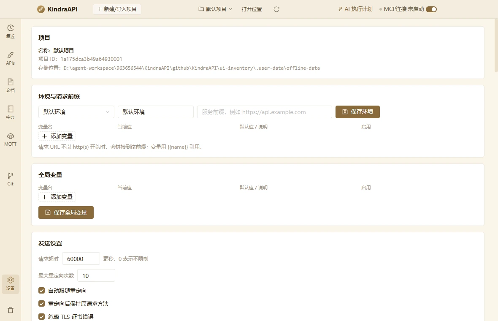
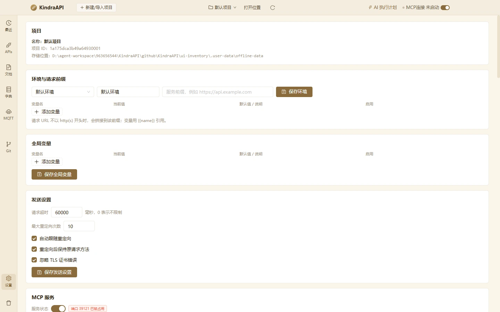

# 设置

- 路由：`/settings`
- 用途：环境与请求前缀、全局变量、发送设置、MCP 服务、调试设置。
- 采集状态：8 个；DOM/AX 元素合计：446
- 主要源码：`src/renderer/src/pages/SettingsPage.tsx`

## 状态截图

| 状态 | 类型 | 视口 | 元素数 | 截图 |
| --- | --- | --- | --- | --- |
| `settings-top-1180x760` | page | 1180×760 | 55 | [WebP](../screenshots/webp/settings-top-1180x760.webp) |
| `settings-top-1440x900` | page | 1440×900 | 55 | [WebP](../screenshots/webp/settings-top-1440x900.webp) |
| `settings-section-env` | page | 1180×760 | 55 | [WebP](../screenshots/webp/settings-section-env.webp) |
| `settings-section-global-vars` | page | 1180×760 | 55 | [WebP](../screenshots/webp/settings-section-global-vars.webp) |
| `settings-section-send` | page | 1180×760 | 55 | [WebP](../screenshots/webp/settings-section-send.webp) |
| `settings-section-mcp` | page | 1180×760 | 55 | [WebP](../screenshots/webp/settings-section-mcp.webp) |
| `settings-section-debug` | page | 1180×760 | 55 | [WebP](../screenshots/webp/settings-section-debug.webp) |
| `settings-variable-row-added` | page | 1180×760 | 61 | [WebP](../screenshots/webp/settings-variable-row-added.webp) |

### settings-top-1180x760

### settings-top-1440x900

## 布局区域（1180×760 基准）

| 区域 | x | y | width | height |
| --- | --- | --- | --- | --- |
| `topbar` | 0 | 0 | 1180 | 44 |
| `rail` | 0 | 44 | 50 | 716 |
| `main` | 50 | 44 | 1130 | 716 |

## 控件全量清单

| 区块 | 控件文案 / aria / icon | 类型 | 状态 | 位置 | 来源状态 |
| --- | --- | --- | --- | --- | --- |
| 页面 | 默认环境 `anticon-down` | `div` | — | 91,250 · 180×30 | `settings-top-1180x760` |
| 页面 | 默认环境 | `span` | — | 103,251 · 156×28 | `settings-top-1180x760` |
| 页面 | 环境名称 | `input` | — | 279,250 · 180×30 | `settings-top-1180x760` |
| 页面 | 服务前缀，例如 https://api.example.com | `input` | — | 467,250 · 320×30 | `settings-top-1180x760` |
| 页面 | 保存环境 `anticon-save` | `button` | — | 795,250 · 105×30 | `settings-top-1180x760` |
| 页面 | 添加变量 `anticon-plus` | `button` | — | 91,311 · 89×23 | `settings-top-1180x760` |
| 页面 | 保存全局变量 `anticon-save` | `button` | — | 91,488 · 131×30 | `settings-top-1180x760` |
| 页面 | anticon-up `anticon-up` | `div` | — | 147,597 · 90×30 | `settings-top-1180x760` |
| 页面 | Increase Value `anticon-up` | `span/button` | — | 236,598 · 1×14 | `settings-top-1180x760` |
| 页面 | Decrease Value `anticon-down` | `span/button` | — | 236,612 · 1×14 | `settings-top-1180x760` |
| 页面 | (未命名单选/控件) | `input/spinbutton` | — | 148,598 · 88×28 | `settings-top-1180x760` |
| 页面 | 自动跟随重定向 | `label` | — | 91,677 · 122×21 | `settings-top-1180x760` |
| 页面 | 重定向后保持原请求方法 | `label` | — | 91,708 · 174×21 | `settings-top-1180x760` |
| 页面 | 忽略 TLS 证书错误 | `label` | — | 91,739 · 138×21 | `settings-top-1180x760` |
| 页面 | 保存发送设置 `anticon-save` | `button` | — | 91,770 · 131×30 | `settings-top-1180x760` |
| 页面 | anticon-copy `anticon-copy` | `button` | — | 527,951 · 30×30 | `settings-top-1180x760` |
| 页面 | 重新生成 `anticon-reload` | `button` | — | 565,951 · 105×30 | `settings-top-1180x760` |
| 页面 | 默认项目 | `label` | — | 91,1074 · 83×21 | `settings-top-1180x760` |
| 页面 | 保存 MCP 配置 `anticon-save` | `button` | — | 91,1105 · 142×30 | `settings-top-1180x760` |
| 页面 | 复制 Claude Desktop 配置 `anticon-copy` | `button` | — | 241,1105 · 211×30 | `settings-top-1180x760` |
| 页面 | CDP 没有鉴权 启用后，本机任意程序都能通过 DevTools 协议控制本应用（读写项目、发送请求、修改设置）。仅在需要调试时开启，用完请关闭；正式分发时保持关闭。 `anticon-exclamation-circle` | `div/alert` | — | 91,3710 · 1040×94 | `settings-top-1180x760` |
| 页面 | 保存调试设置 `anticon-save` | `button` | — | 91,3813 · 131×30 | `settings-top-1180x760` |
| 页面 | 变量名 | `input` | — | 91,311 · 182×23 | `settings-variable-row-added` |
| 页面 | 当前值 | `input` | — | 279,311 · 283×23 | `settings-variable-row-added` |
| 页面 | 说明 | `input` | — | 568,311 · 283×23 | `settings-variable-row-added` |
| 页面 | anticon-delete `anticon-delete` | `button` | — | 1105,311 · 23×23 | `settings-variable-row-added` |

## 提示、空态与错误

**警告 / 提示条**

- CDP 没有鉴权 启用后，本机任意程序都能通过 DevTools 协议控制本应用（读写项目、发送请求、修改设置）。仅在需要调试时开启，用完请关闭；正式分发时保持关闭。

**title 属性（悬停提示）**

- 默认环境

## 源码静态清单（含 file:line）

### 源码中的按钮

| 组件 | 文案 | 关键属性 | 位置 |
| --- | --- | --- | --- |
| Button | 保存环境 | type=primary | `src/renderer/src/pages/SettingsPage.tsx`:302 |
| Button | 保存全局变量 | type=primary | `src/renderer/src/pages/SettingsPage.tsx`:315 |
| Button | 保存发送设置 | type=primary | `src/renderer/src/pages/SettingsPage.tsx`:373 |
| Button | 重新生成 |  | `src/renderer/src/pages/SettingsPage.tsx`:430 |
| Button | 保存 MCP 配置 | type=primary | `src/renderer/src/pages/SettingsPage.tsx`:484 |
| Button | 复制 Claude Desktop 配置 |  | `src/renderer/src/pages/SettingsPage.tsx`:487 |
| Button | 复制 | size=small type=link | `src/renderer/src/pages/SettingsPage.tsx`:615 |
| Button | 保存调试设置 | type=primary | `src/renderer/src/pages/SettingsPage.tsx`:628 |
| Button | 添加变量 | size=small type=dashed | `src/renderer/src/pages/SettingsPage.tsx`:707 |

### 源码中的提示 / 通知 / 确认框

| 类型 | 文案 | 位置 |
| --- | --- | --- |
| `message.success` | `环境已保存` | `src/renderer/src/pages/SettingsPage.tsx`:151 |
| `message.error` | `result.error` | `src/renderer/src/pages/SettingsPage.tsx`:153 |
| `message.success` | `全局变量已保存` | `src/renderer/src/pages/SettingsPage.tsx`:172 |
| `message.error` | `result.error` | `src/renderer/src/pages/SettingsPage.tsx`:173 |
| `message.success` | `设置已保存` | `src/renderer/src/pages/SettingsPage.tsx`:180 |
| `message.error` | `(e as Error).message` | `src/renderer/src/pages/SettingsPage.tsx`:182 |
| `message.success` | `MCP 配置已保存，服务已重启` | `src/renderer/src/pages/SettingsPage.tsx`:190 |
| `message.error` | `(e as Error).message` | `src/renderer/src/pages/SettingsPage.tsx`:192 |
| `message.error` | `result.error` | `src/renderer/src/pages/SettingsPage.tsx`:199 |
| `message.success` | `调试设置已保存` | `src/renderer/src/pages/SettingsPage.tsx`:206 |
| `modal.confirm` | `title=需要重启应用; content=CDP 调试开关在应用启动时生效，是否立即重启？; okText=立即重启; cancelText=稍后` | `src/renderer/src/pages/SettingsPage.tsx`:211 |
| `modal.confirm` | `title=启用远程调试？; content=CDP 没有鉴权。启用后，本机任意程序都能通过 DevTools 协议控制本应用（读写项目、发送请求）。请在调试结束后关闭。; okText=启用; cancelText=取消` | `src/renderer/src/pages/SettingsPage.tsx`:226 |
| `message.success` | `已复制` | `src/renderer/src/pages/SettingsPage.tsx`:243 |
| `message.error` | `复制失败，请手动选择文本` | `src/renderer/src/pages/SettingsPage.tsx`:245 |
| `message.success` | `token 已重新生成，服务已重启` | `src/renderer/src/pages/SettingsPage.tsx`:434 |
| `message.error` | `error.message` | `src/renderer/src/pages/SettingsPage.tsx`:435 |

### 源码中的菜单项

| label | key | disabled | 位置 |
| --- | --- | --- | --- |
| `item.name` | `` | — | `src/renderer/src/pages/SettingsPage.tsx`:287 |
| `item.name` | `` | — | `src/renderer/src/pages/SettingsPage.tsx`:469 |

### 源码中的提示文案

**Tooltip**

| 文案 | 位置 |
| --- | --- |
| `开发调试常用；生产环境建议关闭` | `src/renderer/src/pages/SettingsPage.tsx`:365 |
| `复制 token` | `src/renderer/src/pages/SettingsPage.tsx`:427 |

**Placeholder**

| 文案 | 位置 |
| --- | --- |
| `选择环境` | `src/renderer/src/pages/SettingsPage.tsx`:288 |
| `环境名称` | `src/renderer/src/pages/SettingsPage.tsx`:294 |
| `服务前缀，例如 https://api.example.com` | `src/renderer/src/pages/SettingsPage.tsx`:300 |
| `变量名` | `src/renderer/src/pages/SettingsPage.tsx`:681 |
| `当前值` | `src/renderer/src/pages/SettingsPage.tsx`:687 |
| `说明` | `src/renderer/src/pages/SettingsPage.tsx`:693 |

### 行为 / IPC 调用

| 调用 | 参数 | 位置 |
| --- | --- | --- |
| `window.api.globals.get(project.project_id).then` | `(result) => { if (result.ok) setGlobalRows(globalsToRows(result.data)) }` | `src/renderer/src/pages/SettingsPage.tsx`:101 |
| `window.api.globals.get` | `project.project_id` | `src/renderer/src/pages/SettingsPage.tsx`:101 |
| `window.api.debug.get().then` | `(result) => { if (!result.ok) return setDebugActive(result.data) setDebugForm({ enabled: result.dat` | `src/renderer/src/pages/SettingsPage.tsx`:115 |
| `window.api.debug.get` | `` | `src/renderer/src/pages/SettingsPage.tsx`:115 |
| `window.api.mcp.infoPath().then` | `(result) => { if (result.ok) setMcpInfo(result.data) }` | `src/renderer/src/pages/SettingsPage.tsx`:123 |
| `window.api.mcp.infoPath` | `` | `src/renderer/src/pages/SettingsPage.tsx`:123 |
| `window.api.mcp.stdioPath().then` | `(result) => { if (result.ok) setMcpStdio(result.data) }` | `src/renderer/src/pages/SettingsPage.tsx`:126 |
| `window.api.mcp.stdioPath` | `` | `src/renderer/src/pages/SettingsPage.tsx`:126 |
| `window.api.envs.save` | `project.project_id, next` | `src/renderer/src/pages/SettingsPage.tsx`:149 |
| `window.api.globals.save` | `project.project_id, { project_id: project.project_id, vars, updated_at: new Date().toISOString() }` | `src/renderer/src/pages/SettingsPage.tsx`:167 |
| `window.api.debug.save` | `debugForm` | `src/renderer/src/pages/SettingsPage.tsx`:197 |
| `window.api.debug.get` | `` | `src/renderer/src/pages/SettingsPage.tsx`:202 |
| `window.api.app.relaunch` | `` | `src/renderer/src/pages/SettingsPage.tsx`:217 |

> 返回 [总索引](../README.md)
